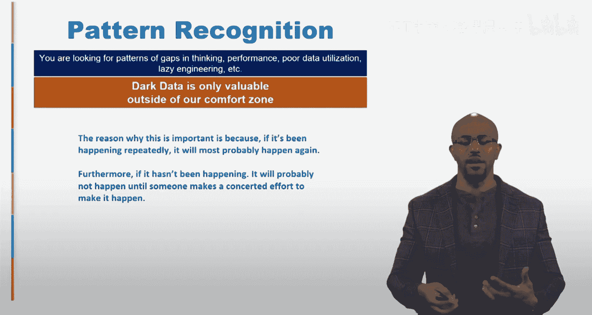
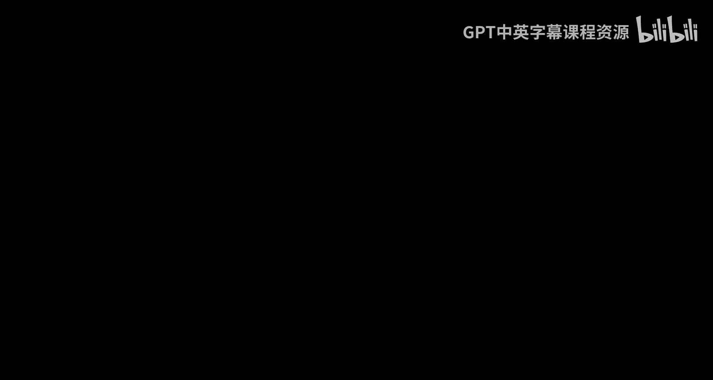

# 16：已知数据的SWOT深度分析方法 📊

在本节课中，我们将深入探讨一个关于已知数据的SWOT分析，并以之前模块中讨论过的“客户投诉”案例为例进行讲解。

这个案例涉及企业体验副总裁提供的投诉总量数据，而首席财务官则要求了解投诉情况与业务增长之间的关系。通过SWOT分析，我们可以系统地审视已知数据的优势、劣势、机会与威胁。

---

## 概述

我们将对一个已知数据集——即“客户投诉”案例——进行标准的SWOT分析。SWOT分析框架分为四个象限：**优势**（内部积极因素）、**劣势**（内部消极因素）、**机会**（外部积极因素）和**威胁**（外部消极因素）。通过这个分析，我们可以更清晰地理解组织当前数据利用的状况以及未来的改进方向。

---

## 内部因素分析

首先，我们分析内部因素，即组织自身的优势与劣势。

### 优势 (Strengths)

以下是该组织在数据利用方面表现出的积极内部因素。

*   **组织能够生成洞察**：这是有益的。他们主要关注那些更明确、更容易获取、已经“在阳光下”的数据。
*   **分析团队知晓并沟通了数据缺口**：这一点至关重要。一个组织只有透明地承认问题所在，才能开始解决问题。
*   **能够进行高层级的投诉分析**：他们至少有一个投诉渠道的数据是完全可访问的，并且可以信赖该分析的质量。
*   **数据分析领域发展迅速**：对于这个团队而言，他们几乎可以从零开始构建，因为公司当前的数据分析环境非常初级，数据流动是自下而上的，他们主要在电子表格中进行数据清洗。

### 劣势 (Weaknesses)

接下来，我们看看内部存在的消极因素，即需要改进的方面。

*   **对“情报”存在误解**：不理解情报的构成以及如何真正获取它。
*   **数据驱动决策的价值未被优先考虑**：在团队的现状下，数据驱动的决策显然没有被放在优先位置。
*   **缺乏清晰的数据战略**：没有关于如何利用数据改进产品、改善客户互动或推动内部持续改进的全局视图。
*   **系统未针对数据产品化进行优化**：参考数据科学的需求层次三角形，数据必须被产品化、转换并与已知事实数据建模，才能真正从分析中获取价值。
*   **潜在暗数据捕获点不理想**：例如电话渠道或线下门店互动，我们能否以及如何从这些与客户、消费者的互动中捕获信息？

---

## 外部因素分析

上一节我们审视了内部状况，本节中我们来看看外部环境带来的机会与威胁。

### 机会 (Opportunities)

外部环境中存在着诸多可以利用的积极因素。

*   **机会非常丰富**：组织远未达到峰值，在利用AI挖掘暗数据、采用先进数据捕获工具方面存在大量机会。
*   **市场人才充足**：市场上有大量人才可以帮助决策、完善思路并构建智能管道。
*   **竞争差距存在**：许多公司的数据战略尚未发展到能够充分利用暗数据的程度，因此存在追赶甚至超越竞争对手的机会。

### 威胁 (Threats)

同时，外部环境也带来了一些需要警惕的挑战。

*   **主要竞争对手已优化其数据产品化系统**：如果其他公司已经实现了数据产品化，他们就能做出更好的决策，产品表现更优，一线员工也能更高效地工作。
*   **全渠道数字体验成为常态**：跨数字触点提供统一的体验已成为标准，这是所有公司都需要思考的问题。
*   **客户普遍期待现代数字体验**：这是必须满足的期望。
*   **加密货币赋能数据中心化公司**：尤其是在金融交易领域，许多金融科技公司和初创企业正在探索加密货币和新型支付平台，这可能加速竞争对手的增长。

---

## 超越SWOT：企业行为模式识别

在完成SWOT分析后，我想强调一个关键点：**模式识别**。这更多是关于企业行为模式，因为这些行为将影响你如何推进工作以及暗数据能产生多大影响。

一个基本前提是：**数据只有在我们的舒适区之外才有价值**。容易获取的暗数据通常已被查看过，且被认为价值不大。真正有价值的暗数据往往来自内部未被使用或未被丰富的数据，以及从外部来源获取、用于改善客户触点并收集更多信息的数据——这些数据极难获取，完全在我们的舒适区之外。

因此，当我们思考“数据只有在舒适区外才有价值”时，你需要观察企业并理解其行为模式。原因如下：

以下是识别企业行为模式时需要关注的几个关键点。

1.  **如果某事反复发生，它将继续发生**：如果报告一直被评价为“不错，能清楚看到产品表现”，那么这种“还可以”的思维定式就会持续。但实际上，需要有人开始提问：这真的能全面反映产品表现吗？我们能看到所有相关数据触点吗？
2.  **过去有效的方法未必最优**：如果缺乏所有数据触点，过去的方法可能只是部分有效，我们不知道是否有更好的方法。你需要观察是否存在一种满足于平均水平、而非寻求持续改进的思维模式。
3.  **如果某事从未发生，除非有人推动，否则它不会发生**：这与第一点相反。当你看到只有汇总数据、表现平平的情况时，必须有人率先提出问题、推动变革、打开人们的思路，然后付诸行动，思考如何改进、如何产生影响、如何通过暗数据、数据转换和丰富来交付并获取价值，最终将其反馈到分析和产品中，更好地服务客户。

请记住，模式识别至关重要。虽然我们寻找数据中的模式，但**你首先需要寻找的是与你共事的人的行为模式**，以便更好地与他们合作，提升整体绩效。

---

## 总结

本节课中，我们一起学习了如何对已知数据进行SWOT深度分析。我们以客户投诉案例为例，逐步剖析了其内部的**优势**与**劣势**，以及外部的**机会**与**威胁**。更重要的是，我们认识到在数据分析之外，识别和理解**企业行为模式**是推动暗数据价值实现的关键。数据真正的价值常存在于舒适区之外，而改变始于对现有思维和行动模式的洞察与挑战。