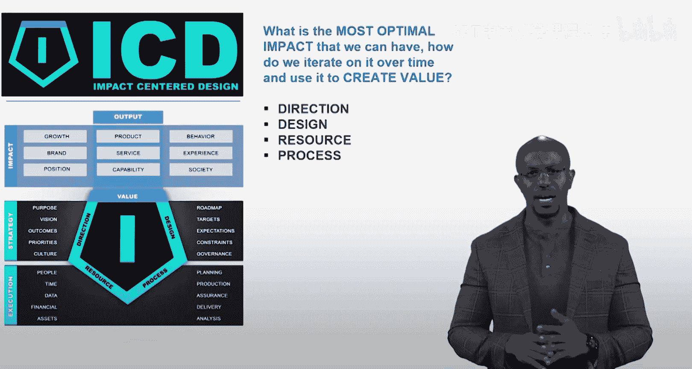

# 黑暗数据迁移与架构：第18章：组织定位评估方法 🧭

在本节课中，我们将继续深入探讨黑暗数据，并学习一种基于SWOT分析和差距分析的组织定位评估方法。我们将从数据需求层次结构出发，审视公司的资源与流程，最终将战术层面的评估与战略目标对齐，以确定最优的改进路径。

## 资源定位：人员与系统

上一节我们介绍了数据需求层次结构。本节中，我们来看看如何评估组织在资源层面的定位，特别是人员角色与系统配置。

核心在于理解公司需要混合的技能组合。你不能只雇佣数据科学家和分析师，就期望获得强大的智能输出。必须拥有完整的“技术栈”。

以下是关键角色及其在数据层次中的定位：

*   **数据基础设施工程师/软件工程师/系统工程师**：他们位于“收集、移动、存储”以及“实验与转换”层面。他们负责构建系统，以产品化的方式交付数据。
*   **数据工程师**：同样处于关键层面，负责数据的管道建设与处理。
*   **数据分析师与数据科学家**：需要他们的视角来分析数据、获取洞见，推动公司进步。
*   **机器学习工程师**：位于顶层，专注于算法、人工智能和深度学习等工作。

理解这一点至关重要。你需要确保将合适的人员、正确的系统类别配置在正确的位置上，从而为组织的成功奠定基础。

## 流程定位：效率与架构

在讨论了以人员和系统为主的资源后，我们现在将焦点转向流程。流程定位是关键，因为繁琐的流程会扼杀公司的效率。

例如，如果你的发布流程需要无数个签字批准，工程师很容易感到倦怠。他们希望构建产品，却忙于应付签字和发布工程。因此，你需要审视项目管理流程。

以下是需要评估的流程领域：

*   **项目管理流程**：我们使用的是敏捷、SAFe、精益、瀑布还是其他方法？
*   **企业架构流程**：包括业务架构、系统架构、技术架构、治理架构、变更管理架构以及迁移规划。例如，在进行数据迁移和并行运行系统时，流程是怎样的？
*   **流程优化**：我们如何在流程中优化人员效率？哪些流程是不必要的？一些签字流程是否真的无关紧要？

有些公司依赖手动流程以减少错误，但手动流程本身就会引入人为错误。你应该思考如何实现自动化，并通过数据质量视图来确保流程正确运行、数据正确流转、清洗和转换机制正常运作。

你需要仔细思考所有这些检查点，并确保流程得到精简。无论是使用敏捷还是瀑布模型，都需要深入思考，并确保流程与公司及各个系统、组织和团队的架构相契合。

## 从战术评估到战略对齐

现在，我们进入定位评估的核心部分。我们首先讨论了战术层面（资源与流程），因为我们在评估阶段花了大量时间在“理解与学习”以及战略空间上。现在，我们基于对战术层面的理解，审视我们如何进行差距分析和SWOT分析，并重新评估结果如何与目标（OKRs）、倡议和数据战略保持一致。

我们需要评估：
*   我们的资源定位是否良好？
*   我们的流程定位是否良好？
*   我们是否清楚自身的优势、劣势、机会与威胁？

进而决定：
*   哪些机会最值得投入？
*   哪些劣势最需要改进？
*   哪些优势需要加强或无需调整？
*   哪些威胁需要认真思考并制定管理策略？

这将把我们带回以影响为中心的设计。总结来说，我们梳理了资源和流程。

在资源方面，我们讨论了：
*   **人员**：他们学习、成长、构建系统所需的时间。
*   **数据**：流经系统的显性、隐性数据，已知和未知数据，收集点。当从财务角度讨论人员时，其影响是什么？许多公司将技术团队视为成本中心，我们需要改变这种范式，从数据和系统中驱动价值，将技术团队转变为创收团队。
*   **资产**：公司资产、材料供应、我们使用的实际工具和软件等。

在流程方面，我们讨论了：
*   **规划流程**：它们是否 streamlined？是否合理？我们是否花了时间进行规划，又能否减少规划时间？
*   **生产与交付**：我们是否有正确的生产流程、质量保证、交付物和分析机制？围绕分析的流程是数据产品化的上层建筑，这正是数据科学家和分析师发挥作用的地方。

## 总结与聚焦

当我们进入战略空间时，将重新引导我们讨论的大部分能量和内容，思考如何产生最大影响，进入评估阶段，并缩小范围。

在结束本次评估时，我们需要确保思考：
*   我们能产生的最优影响是什么？
*   如何随时间迭代并利用它来创造价值？

**总结公式：最优影响 = 战略方向 × (资源效率 + 流程效率)**

本节课中，我们一起学习了如何通过评估组织的资源（人员与系统）和流程来进行定位。我们从数据需求层次出发，审视了关键角色与流程效率，最终将战术评估与战略目标（OKRs、数据战略）对齐，以SWOT和差距分析为工具，聚焦于能创造最大价值的改进点，为后续制定具体的行动方案奠定基础。核心在于确保人员、流程和系统都为实现数据价值而优化配置。