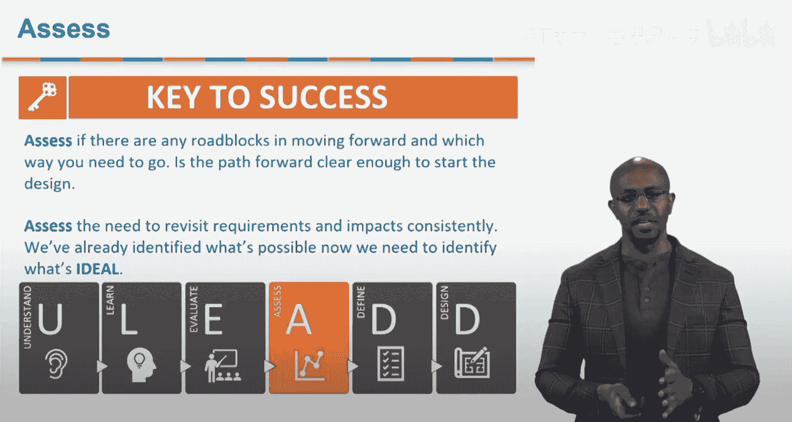
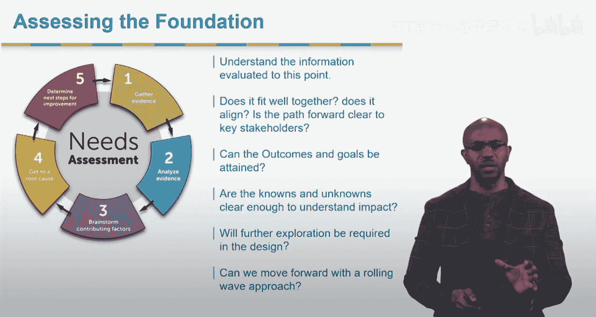
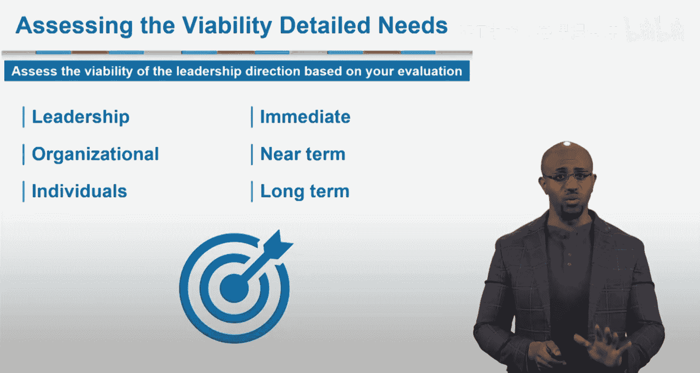

# 黑暗数据迁移与架构：19：组织需求评估框架：紧急-近期-长期 🎯

在本节课中，我们将学习如何为黑暗数据项目进行需求评估，并专注于评估阶段的启动。我们将从“评估可能性”阶段，过渡到“确定理想方案”阶段，最终为解决方案的设计奠定基础。

上一节我们介绍了评估阶段的目标，本节中我们来看看如何进行具体的需求评估。

## 需求评估概述

需求评估是理解、学习、评估、定义和设计流程中的一环。我们目前正处于“评估”环节。此阶段的核心是从探索“可能性”转向确定“理想方案”。我们将整合在评估阶段发现的所有可能性，寻找最佳的前进路径，并围绕战略设计解决方案，最终产出将由公司领导层的目标、使命和方向来定义。

## 需求评估的标准流程

以下是进行需求评估的标准步骤，这是一个迭代循环的过程：

1.  **收集证据**：获取当前状态的相关信息和数据。
2.  **分析证据**：对收集到的信息进行深入分析。
3.  **头脑风暴影响因素**：集思广益，找出可能影响目标达成的各种因素。
4.  **进行根本原因分析**：追溯问题或机会的根源。
5.  **确定改进的后续步骤**：规划如何帮助团队、公司和产品实现更好的绩效。

## 评估的关键问题

在进行评估时，我们需要思考以下几个核心问题：

*   当前评估的信息是否清晰？
*   各个部分是否能很好地协同工作？
*   哪些成果和目标是可实现的？
*   哪些**目标与关键成果（OKRs）**是可实现的？
*   在审视关键性时，我们是否需要调整某些关键成果的目标？是应该提高、降低、限制，还是优先考虑其他更关键的目标？

## 为下一阶段做准备

接下来，我们需要明确进入“定义”和“设计”阶段所需的条件。最后，我们探讨如何采用“滚动波”方法（类似于迭代方法），并尝试利用该方法预见更远的未来。这涉及到对资源、流程以及战略方向的考量。

## 评估可行性：紧急-近期-长期框架

现在，让我们更深入地探讨可行性评估。我们必须真正理解领导层的方向，并仔细思考实现这些方向的战术。

我们将从领导层、组织和个人层面，按照**紧急、近期和长期**的时间框架来开展工作。这意味着，在审视OKRs时，我们需要评估哪些是可更快交付的成果，哪些属于中长期的交付目标，并据此进行规划。这是在可行性阶段需要重点考虑的事项。

让我们再次回顾影响中心设计（ICD）模型。我们的目标是变得**更大、更好、更快**（根据我们为最终目标和成果所定义的具体含义）。同时，我们必须关注未知因素，这些因素可能会阻碍我们，这就是围绕我们工作核心的“黑暗数据”。我们将利用方向、设计、资源和流程来实施解决方案。

## 整合工具与战术

最终，我们的评估将包含所需的工具和战术。我们必须确保选择正确的战术和工具，以执行我们的定义和设计方案。

本节课中我们一起学习了为黑暗数据实施进行需求评估的框架，特别是如何通过“紧急-近期-长期”的视角来组织评估工作，为后续的定义和设计阶段做好准备。