# 黑暗数据迁移与架构：第20章：隐性需求评估：紧急-近期-长期 🎯

在本节课中，我们将深入探讨详细的需求评估过程。我们将从评估“可能性”转向分析“可行性”与“理想状态”，并学习如何为计划外的情况制定应对策略。

## 回顾数据视图

上一节我们介绍了迭代、评估和审视的流程。现在，我们来看看之前模块中提到的数据视图。该视图包含我们已在使用的**交易数据**和**分析数据**，这些数据存在于我们现有的**内部数据系统**中，并已为我们的数据产品和消费者创造价值。

本节中，我们将重点关注**衍生数据**层。部分衍生数据可能已存在于内部系统中，但另一部分则需要我们通过逻辑、算法、附加数据集，甚至组织外部的**黑暗数据**来创建和理解。当前视图涵盖了我们**组织内部**所有可访问的数据，暂不需要考虑外部数据或新建数据采集点。

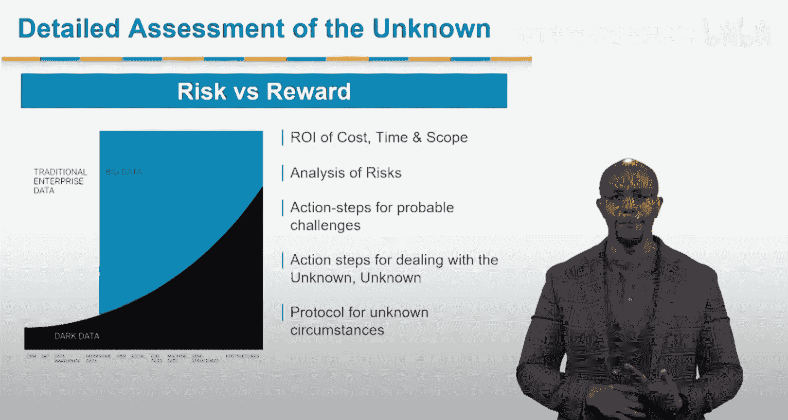

然而，当我们评估风险与回报、审视可行性时，必须清楚现有数据是什么，以及需要添加什么。引入外部数据的第一步，是**先识别和理解内部数据**，明确我们将引入哪些黑暗数据片段。

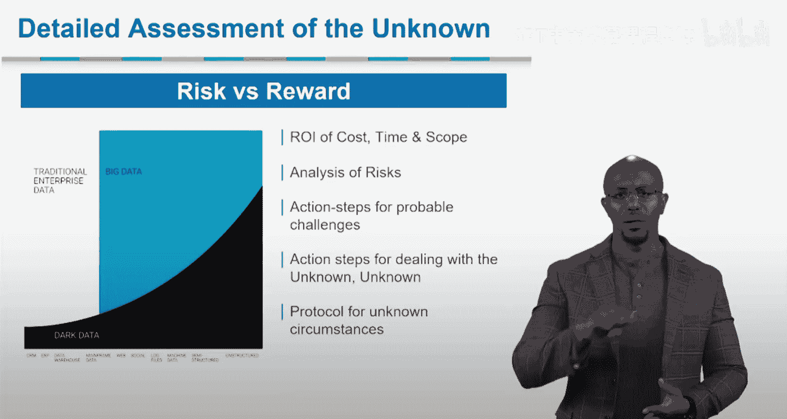

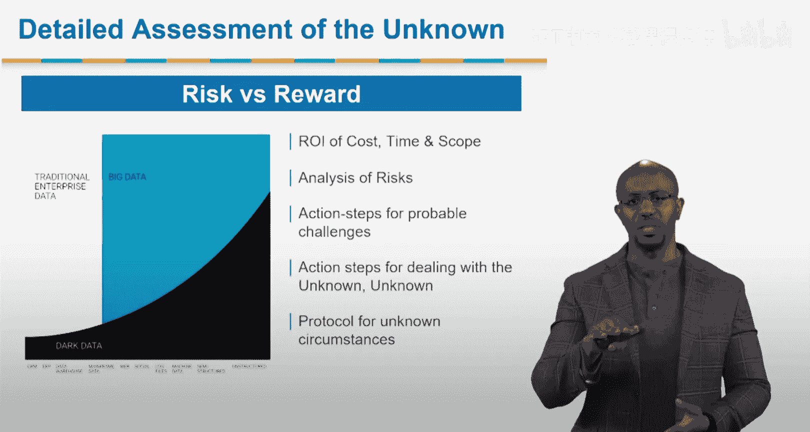

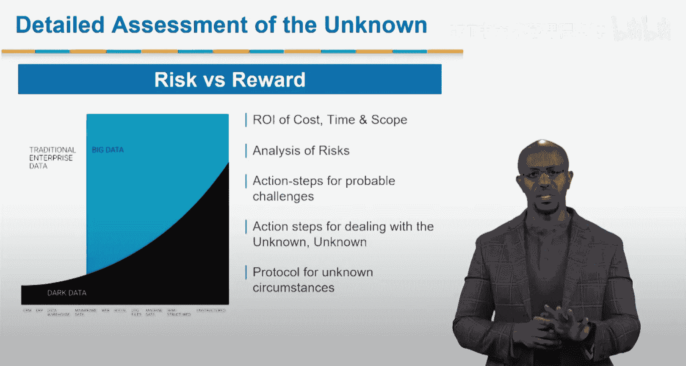

## 详细评估：风险与回报

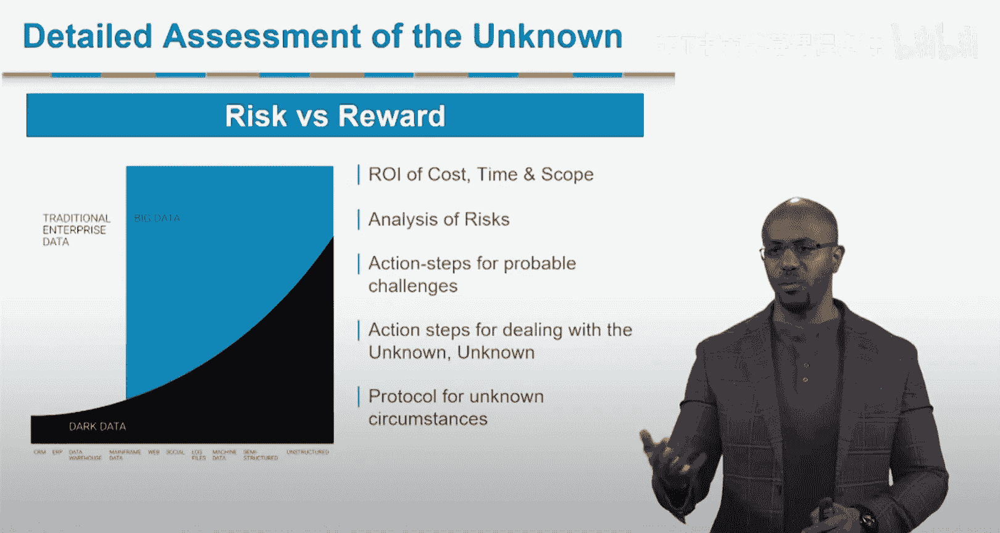

接下来，我们进行更详细的评估。在考虑风险与回报时，首先要思考的是传统的项目投资回报率，即**时间、成本、范围**这三重约束，同时也需考虑风险、质量、回报、资源等因素。

以下是评估过程中的关键行动步骤：

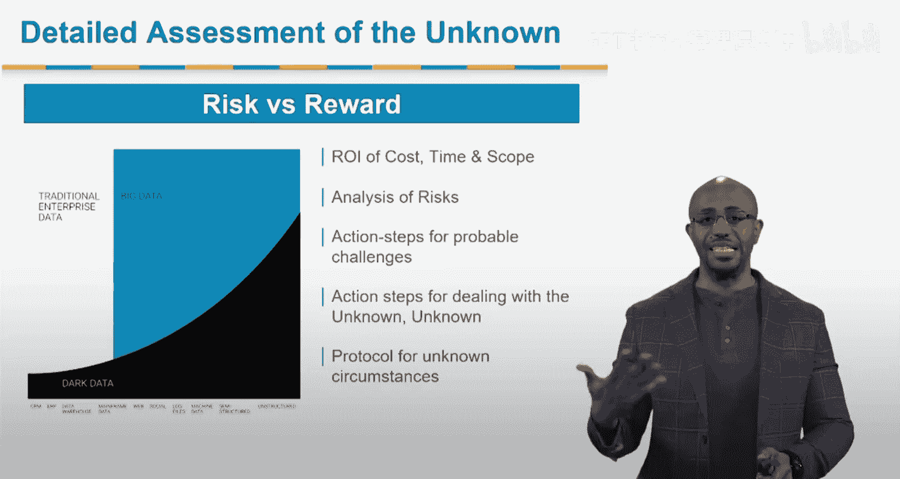

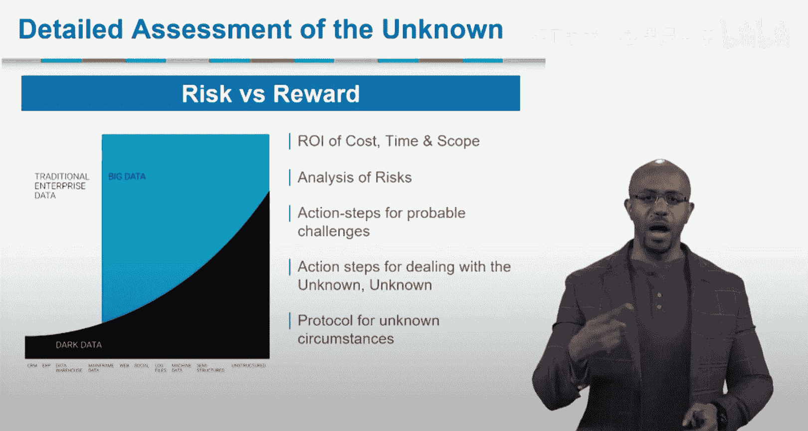

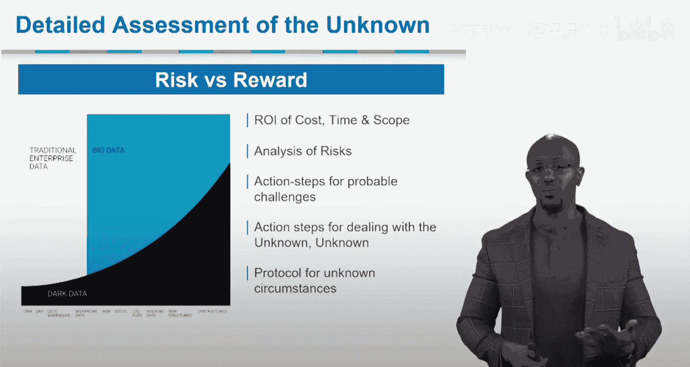

*   **应对已知挑战的行动步骤**：处理项目中可预见的困难。
*   **应对未知因素的行动步骤**：处理那些已知但细节不明的问题。
*   **应对未知情况的预案**：为完全无法预料的情况制定行动方案。最后一点的核心是：**如何为不可计划之事做计划**。

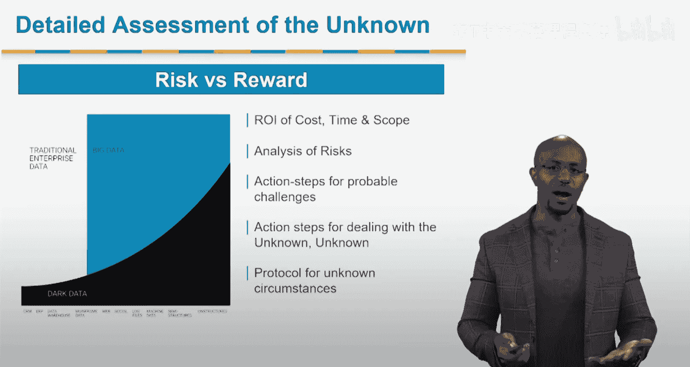

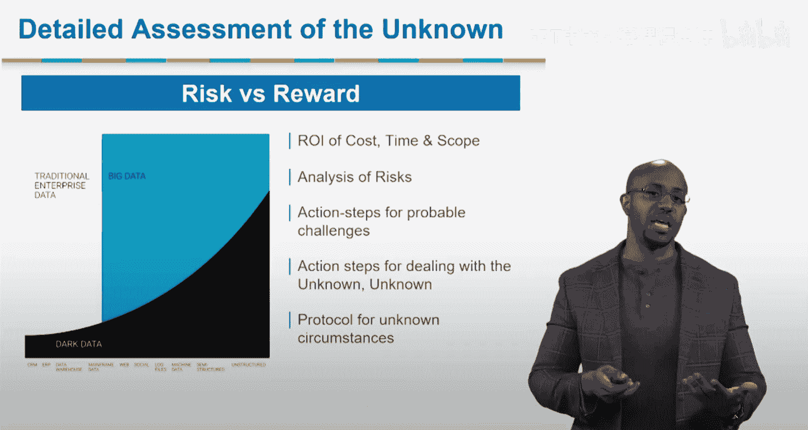

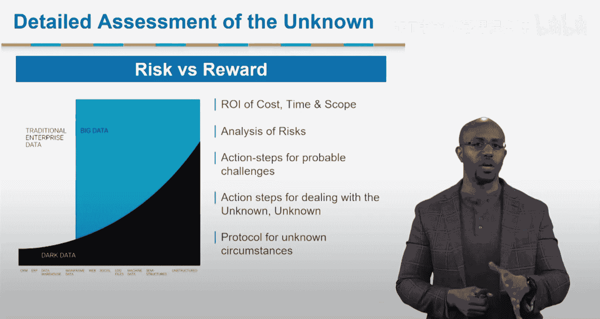

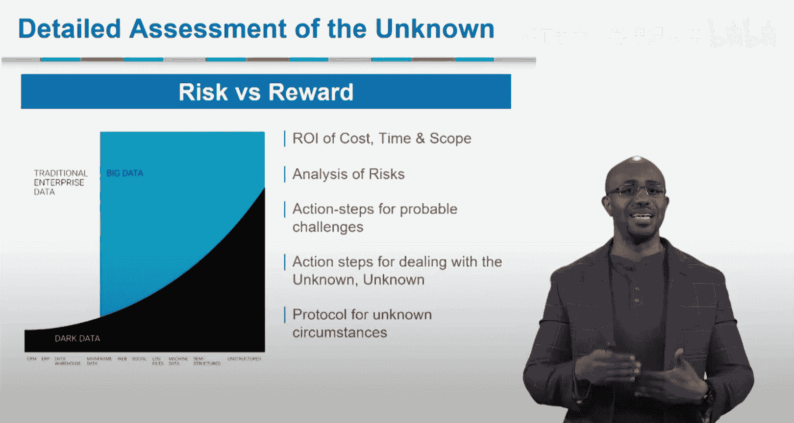

## 案例分析：应对数据流程中的未知

为了说明如何为未知情况制定预案，这里有一个例子。假设你是一个分析团队，需要从通常合作的数据组请求数据。数据需要经过另一个负责**ETL**过程的团队进行提取、转换和加载，然后才能进入数据市场或已建立参考表的地方，供你使用。

但如何为这个场景中的不确定未知情况做计划？例如：
*   ETL团队的服务水平协议是24小时，但如果耗时更长怎么办？
*   如果他们加载的数据不正确，导致你基于有缺陷的、未正确转换的数据工作怎么办？
*   你能否快速发现数据问题？

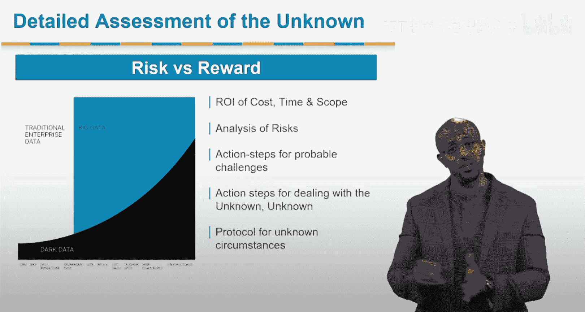

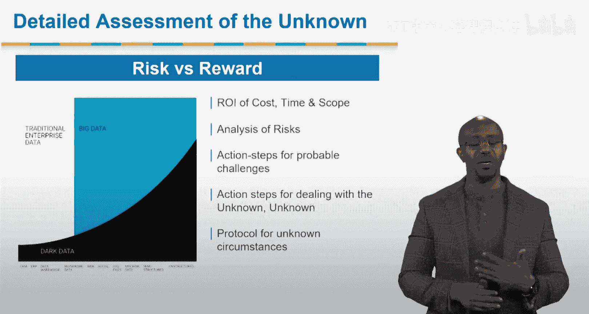

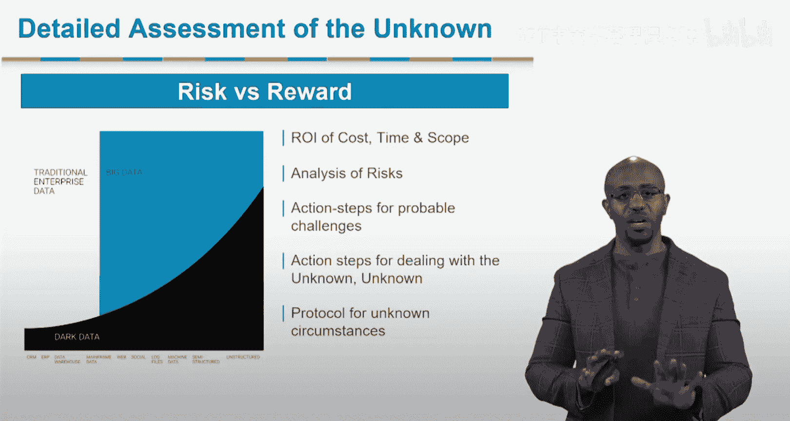

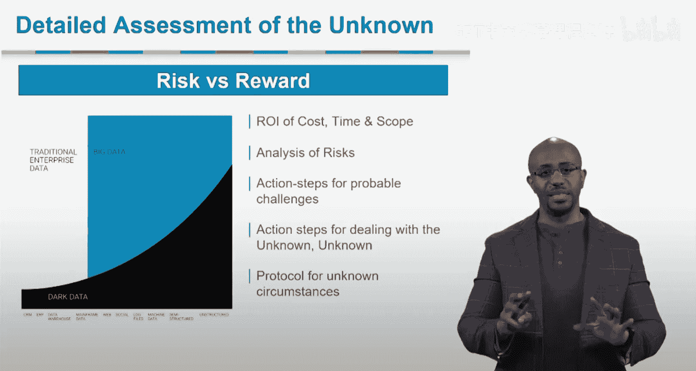

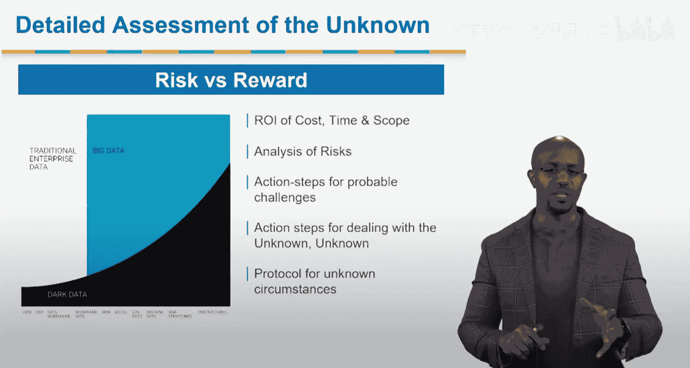

你需要准备好评估这种情况下的风险与回报，并建立防护措施。例如：
*   能否设置仪表盘来审查数据质量？
*   能否运行一些**算法**或转换流程来检查新接收的数据，确保其符合标准的数据质量指标？
*   能否与原始数据所属的团队协作，让他们也能验证数据转换是否正确？

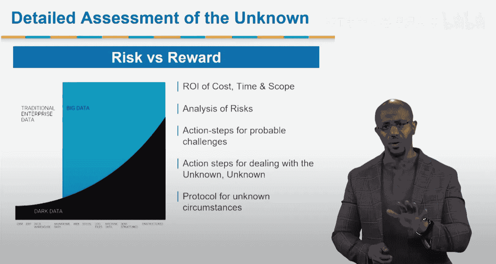

这些都是思考如何处理突发未知情况时需要考虑的。

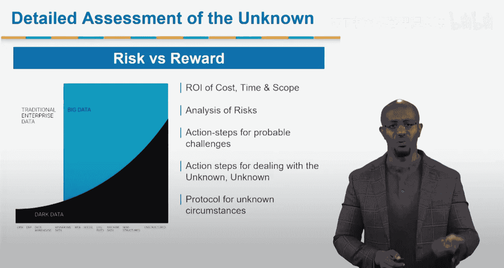

## 评估外部需求：未捕获、难获取与模糊数据

现在，我们转向评估外部需求，即那些你完全不了解的黑暗数据，包括**未捕获的**、**难获取的**和**模糊的**数据。

之前我们关注的是公司内部的**内部数据**和**衍生数据**。而**未捕获数据**，是我们可以通过建立新的数据采集点（如客户交互监测器、更完善的网页表单等）轻松获取的数据。

**难获取数据**是目前我们无法触及的数据，可能因为技术或知识限制。**模糊数据**则是那些我们根本不知道其存在的数据。

评估外部数据时，我们首先进行**差距分析**，找出缺口。我们识别出哪些是**未捕获数据**，并计划建立数据采集点。然后，为当前**难获取的数据**制定远期计划。最后，对于**模糊数据**，我们需要一个更具创造性的过程来规划，但这通常需要在我们将部分未捕获和难获取数据纳入系统并开始从中获取知识后，才能更好地进行。

## 为不可计划之事做计划：海豹突击队的启示

回到“如何为不可计划之事做计划”这个话题，可以借鉴**美国海军海豹突击队**的做法。他们在执行任务时经常面对未知。他们会为已知的未知和未知的未知做计划。

他们拥有标准的行动程序和沟通方式。这帮助每个队员都知道在特定情况下，个人和团队的默认反应应该是什么，从而能够更好地应对突发障碍，甚至将阻碍转化为达成目标的助力。

将这种思维应用到我们的数据工作中：面对有缺陷的数据、被证明错误的假设、项目中途需要调整方向、优先级突然变化等情况，我们是否准备好了？

关键在于，**行动不等于进展**。我们需要确保行动始终朝着目标推进。我们必须确保，无论是内部还是外部的数据，包括黑暗数据和内部数据，都能整合起来，为我们提供一个持续的视图，使我们能够不断调整、重新确定优先级，并作为一个整体向前推进——只要我们建立了那些**标准操作程序**。

## 总结

本节课中，我们一起学习了如何进行详细的需求评估。我们从内部数据评估开始，探讨了如何为数据流程中的未知风险建立预案。接着，我们学习了如何评估外部黑暗数据需求，将其分类为未捕获、难获取和模糊数据，并制定相应的获取策略。最后，我们借鉴了海豹突击队的理念，理解了为“不可计划之事”制定标准操作程序的重要性，以确保团队在变化中始终保持向目标的真正进展。

完成这些评估，并建立起标准操作程序，明确了我们将要使用的数据范围和使用方式后，我们才算赢得了**开始正式定义问题、定义最终目标**的权利，从而为后续的设计阶段做好准备。