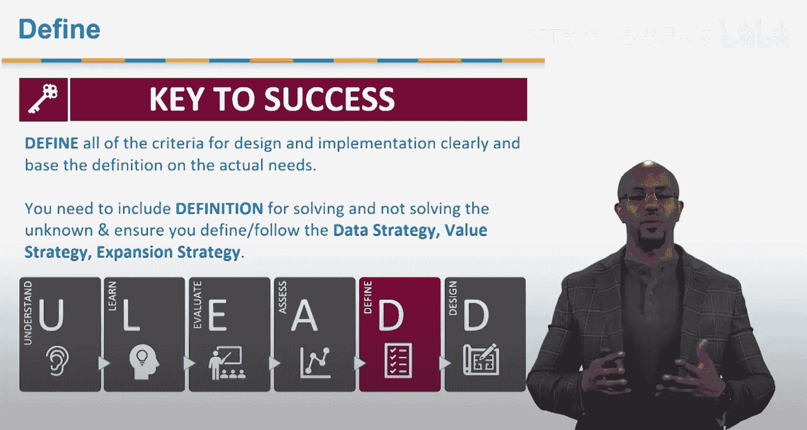
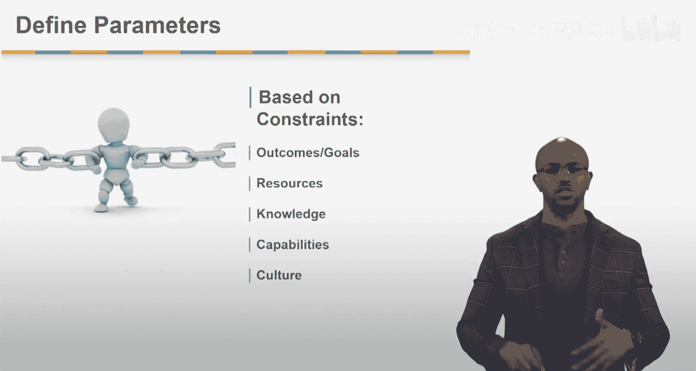
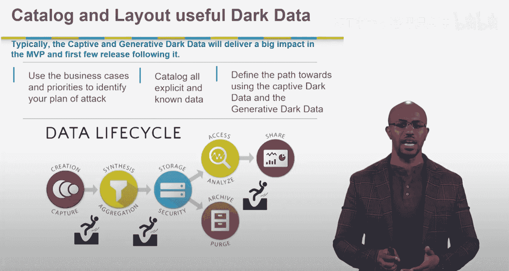

# 黑暗数据迁移与架构：第22章：定义与设计阶段总览 🗺️

在本节课中，我们将学习黑暗数据项目中的“定义”与“设计”阶段。我们将了解如何设定项目范围、明确目标，并为后续的架构设计奠定基础。

上一节我们探讨了黑暗数据的整体概念，本节中我们来看看如何正式启动一个项目，即定义与设计阶段。

## 定义阶段：设定边界与目标

定义阶段的核心工作是明确项目的范围。这包括确定我们要解决什么问题，以及同样重要的是，明确哪些问题我们暂不解决。我们必须确保项目的定义遵循当前的数据战略、价值战略和扩展战略。

我们需要将这些战略视为整体业务战略的一部分进行通盘考虑。其中，数据战略尤为关键，因为它是贯穿整个生态系统、存在于我们的数字应用和用户应用中的生命线。

而价值战略和扩展战略的考量则更为宏观和理论化。

## 确定参数与约束

我们首先从参数开始。什么是我们定义阶段的参数？哪些约束条件在界定这些参数？通过明确这些，我们可以定义：
*   我们要做什么。
*   我们不做什么。
*   哪些应该是已知的。
*   哪些应该是未知的。
*   哪些数据被有意保留为“黑暗”状态。
*   哪些未知数据被留作“黑暗”状态。

以下是定义参数时需要考虑的关键要素：
*   **成果与目标**：项目最终要达成的业务成果。
*   **资源**：可用的人力、物力和财力。
*   **知识与能力**：团队现有的技能与专业知识。
*   **文化**：组织的协作与数据文化。

这些概念在我们整个课程中都有讨论，大家应该很熟悉。在定义阶段，所有这些概念都将作为“插件”和约束条件，帮助我们识别和确立用于定义设计与最终目标的参数。

## 梳理现有架构

有时，当你加入一家公司，可能会看到类似上图的技术生态系统架构图。这本身可能就是一个问题。我想展示这一点，是因为现实中，架构可能混乱不清，图中的某个方框对一半的组织来说可能是个“黑箱”，只有少数人理解，导致各种困惑。

我们的第一步是“清理”架构，理清“现状架构”。当我们谈论企业架构时，它应该看起来更清晰，类似于上图右侧的样式。我们需要思考：
*   正在开发什么？
*   最终用户接触什么？
*   我们的系统运行（SoOs）和服务请求（SRs）是什么？
*   我们的云战略是什么？（混合云、本地部署？）
*   我们的API战略和服务导向架构（SOA）如何？
*   我们的微服务如何实施及定位？
*   它们如何提供近实时信息和数据，并同时集成到交易系统与分析系统的整体生态中？

这些都是我们需要通盘考虑的问题，目标是获得一个更清晰、类似右侧的视图。

## 规划数据路径与生命周期

当我们开始为组织编目和规划有用的黑暗数据时，需要思考以下方面。我们定义什么是黑暗数据、什么是有意保留的黑暗数据，以及什么是非黑暗数据、我们将去发掘并带入“光明”的数据。

我们希望以业务用例为优先，来确定我们的行动计划。我们将编目明确已知的数据，然后定义前进的路径。

以下是规划数据路径时需要考虑的环节：
*   **创建与合成**
*   **存储**
*   **访问**
*   **共享**

此外，在底层，我们还需要考虑数据的**完整生命周期**，包括数据的**归档与清除**。围绕这一点，我们的治理和定位策略是什么？

## 阶段重点总结

总而言之，在定义与设计阶段，我们将从高层视角审视以上所有方面。我们将在后续的设计阶段深入探讨架构，但目前，我们专注于确定参数、约束等，以明确我们在设计中要推进的内容，即定义问题、解决方案和机遇，并推进到设计阶段。

本节课中我们一起学习了黑暗数据项目定义与设计阶段的核心任务。我们明确了如何通过设定参数和约束来划定项目范围，梳理了清理现有架构的重要性，并规划了数据从创建到消亡的完整路径，为后续的具体设计工作做好了准备。

感谢你的时间。

