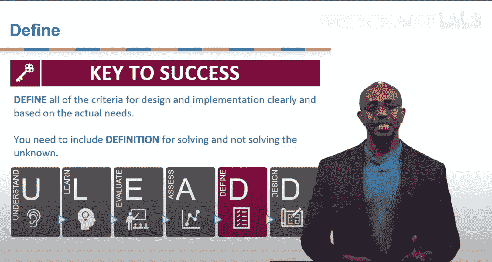
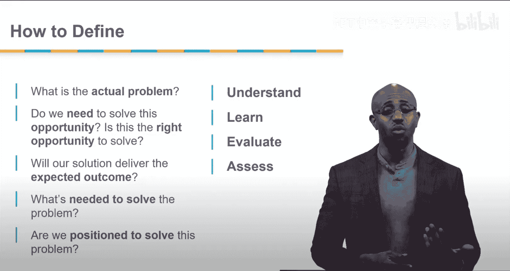
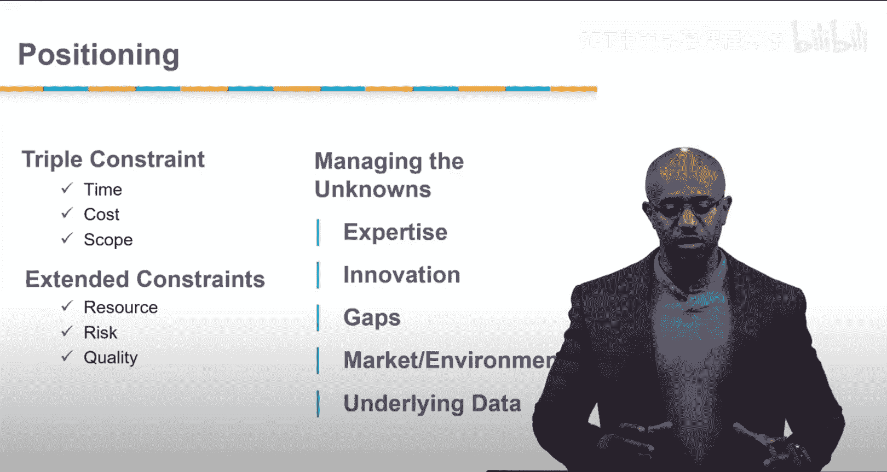

# 黑暗数据迁移与架构：24：机会界定标准 📋

在本节课中，我们将学习如何界定一个机会。这是整个“理解、学习、评估、界定、设计”流程中的关键阶段。在此阶段，我们将基于前期收集的信息，明确需要解决的问题和把握的机会。

上一节我们完成了对问题的评估与评估。本节中，我们来看看如何具体地界定机会。

首先，我们需要提出几个核心问题。以下是界定机会时需要思考的关键点：

*   **实际问题是什么？** 利用我们收集的数据，包括流程初期未掌握的“黑暗数据”，来准确定义实际问题。
*   **是否需要解决此机会？** 有时，呈现出来的机会未必是正确或值得解决的。可能需要调整方向，或在多个方案间权衡，这通常不是非黑即白的。
*   **我们的解决方案能否达成预期成果？** 思考我们正在推进的解决方案，是否真的能解决问题并交付所需的结果。
*   **我们是否具备解决问题的条件？** 这一点至关重要，涉及专业能力等多方面因素。可以参考项目管理中的“三重约束”（现已扩展），即**时间、成本、范围、资源、风险、质量**。我们需要审视自身定位：资源是否具备相应的技能和才智？

接下来，我们还需要管理那些未知因素，例如专业水平、市场创新程度、我们的创新水平与速率、竞争力等。竞争力不一定仅指技术层面，市场营销等其他软性领域的优势也能带来领先地位，甚至包括具体的实施方式。此外，我们存在的差距、底层数据与市场环境、以及影响我们执行定位的外部因素，都是在交付过程中需要思考的环节。

那么，我们如何具体定义这个机会呢？我们可以将其视为项目的“宪法”。机会界定书就像宪法一样，是向前推进的基础文件。它像宪法一样可以修订（`amenable`），我们可以调整和改变它。但其目标是成为一个基础文件，使我们能够快速推进并将失败风险降至最低，因为我们在探索阶段已经经历了一些“失败”。

因此，我们需要清晰地列出机会界定书的构成要素。以下是需要包含的内容：

*   **机会陈述**：按现状描述机会。
*   **业务预期**：包括目标、OKR（目标与关键成果）、KPI（关键绩效指标）、日期、路线图（此时为高级别路线图）等。
*   **风险、差距与约束**。
*   **任何数据挑战**：数据挑战至关重要，未知领域往往是我们可能失败的地方。

界定机会是项目成功的关键步骤，执行上述要点能帮助我们有效地完成这一任务。

本节课中，我们一起学习了机会界定的核心流程。我们从提出关键问题开始，审视了解决方案的可行性与自身定位，最后明确了如何构建一份像“宪法”一样坚实的机会界定书，为后续的设计与执行奠定清晰、可靠的基础。