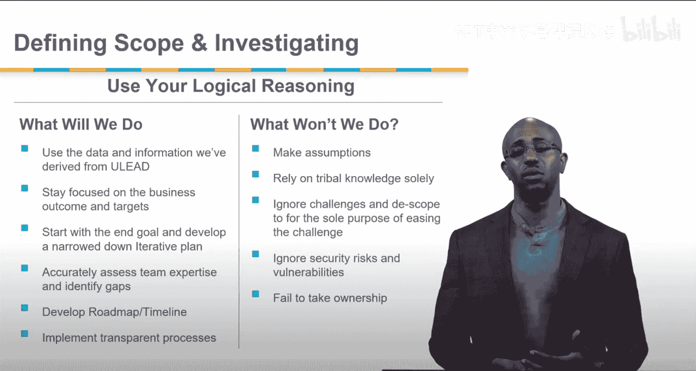
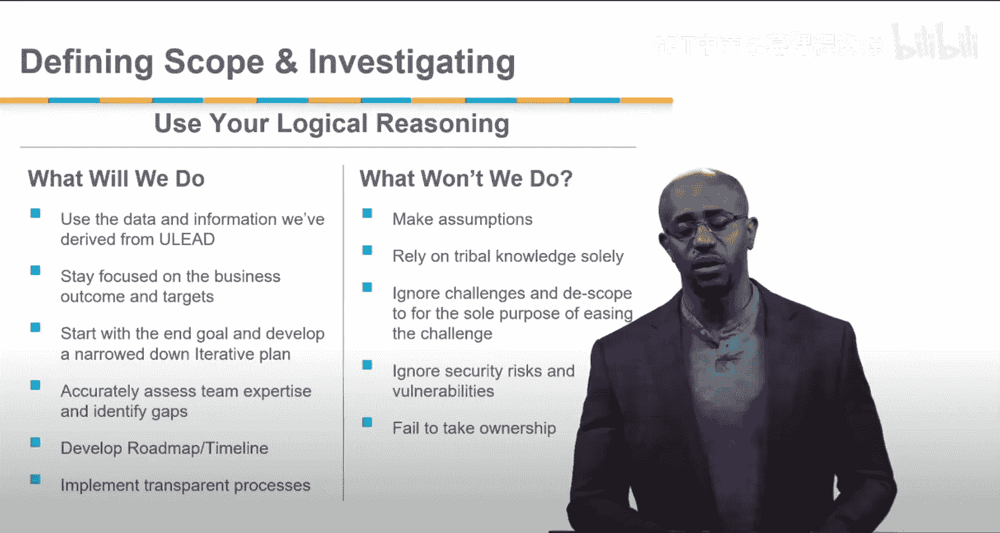
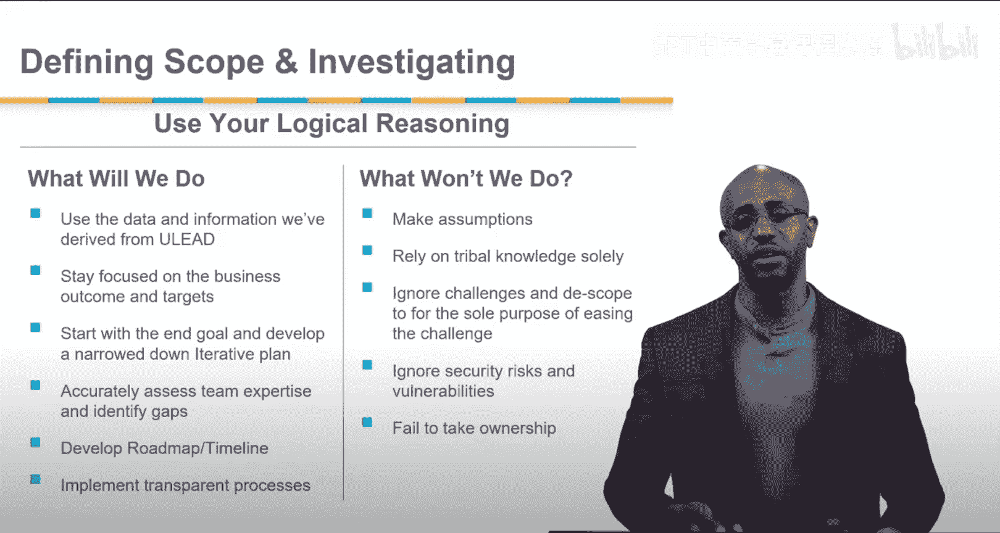
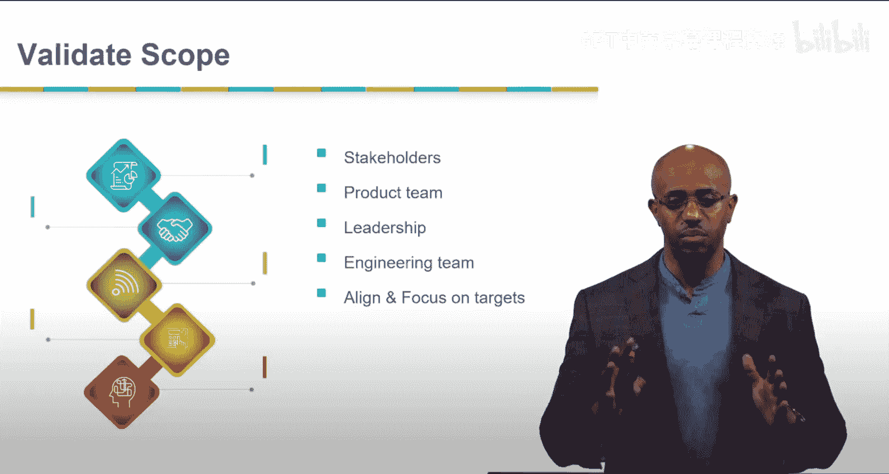
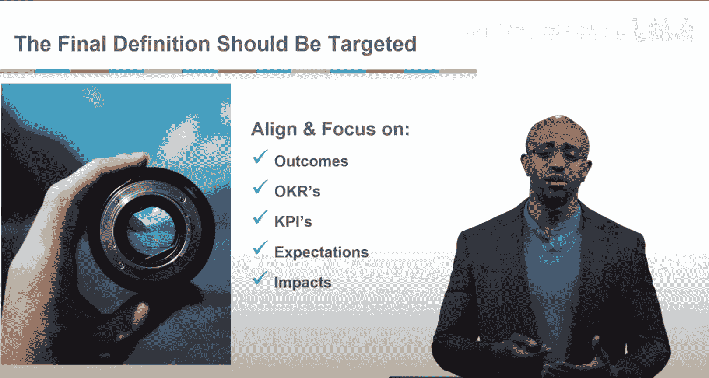

# 25：机会定义验证流程 🔍

在本节课中，我们将简要介绍如何验证我们定义的机会。验证是确保项目方向正确、团队目标一致的关键步骤，它能帮助我们在投入大量资源前，识别并修正潜在的理解偏差或计划缺陷。

上一节我们完成了机会定义，明确了范围、关键绩效指标和目标。本节中，我们来看看如何系统地验证这个定义，确保其坚实可靠，为后续行动奠定基础。

## 验证的核心：明确“做”与“不做”

验证过程的核心是运用逻辑推理，清晰地界定项目将执行和将避免的事项。这基于我们在“引导、理解、学习、评估、分析”阶段收集的所有数据和信息。

以下是我们在验证时需要审视和明确的关键事项列表：

*   **我们将要做的事情：**
    *   **审视数据与信息**：回顾从“引导”阶段获得的所有原始数据和洞见。
    *   **审视机会声明**：仔细检查定义好的机会陈述是否准确、完整。
    *   **审视差距分析**：确认我们为缩小现状与目标差距所制定的计划方向。
    *   **制定高层路线图**：规划一个包含时间线的高层路线图（非详细执行计划）。
    *   **实施透明流程**：确保项目推进过程的每一步都公开、透明。

*   **我们将不做的事情：**
    *   **不做假设**：当我们开始认为某事“可能”发生时，必须明确划清界限。公式表示为：`是否会发生？是 / 否 / 未知`。对于未知项，需标注为待观察事项。
    *   **不依赖部落知识**：所有决策都需用数据和事实进行验证与核对。依赖口口相传的非正式知识是导致失败的常见原因。
    *   **不忽视挑战并随意缩减范围**：为了推进项目，适当调整范围是允许的，但必须有明确目的，不能仅仅为了让事情“变简单”而回避核心挑战。
    *   **不忽视安全风险**：必须确保所有环节都考虑到安全性和潜在漏洞，并采取相应措施。
    *   **不推卸责任**：对项目各环节主动承担责任，计划性失败往往源于责任缺失。

## 验证范围：确保团队对齐

明确了“做”与“不做”之后，下一步是验证项目范围本身。团队对齐至关重要。

我们需要与所有利益相关者——包括产品团队、领导层和工程团队——反复确认，确保大家对同一目标保持聚焦。有时，会议或讨论结束后，不同团队的理解可能大相径庭。我们必须成为一个整体，确保每个人都对未来的行动方向有统一、清晰的认识。

## 最终定义：聚焦目标与成果

经过上述验证后，最终确定的定义必须是目标明确的。

我们需要清晰地就以下成果达成一致：**目标与关键成果、关键绩效指标、预期影响**。这些是我们的“北极星”，是指引我们前进并最终取得成功的核心原则。确保你的机会声明与这些成果指标都经过充分验证，这样项目才能清晰、稳健地向前推进，从而最大限度地减少重大失败的风险。

本节课中，我们一起学习了机会定义的验证流程。我们明确了验证的核心在于区分“做”与“不做”，强调了通过审视数据、制定路线图来落实行动，同时必须避免假设、部落知识等陷阱。此外，我们认识到确保所有团队对齐并聚焦于以成果为导向的清晰目标，是项目成功的基础。完成这些验证步骤，将使你的项目计划更加坚实可靠。