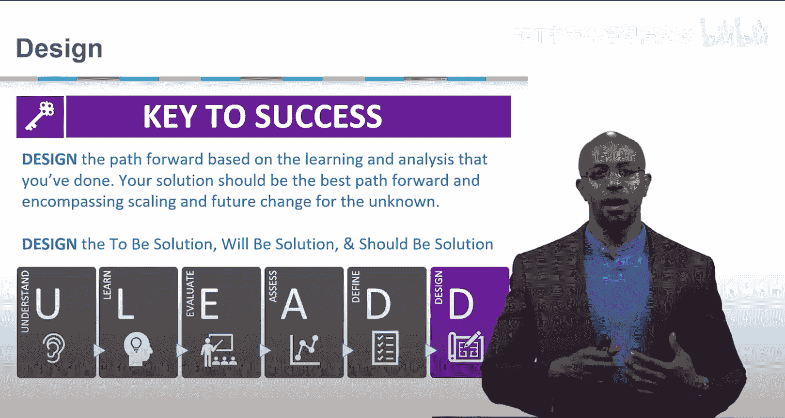
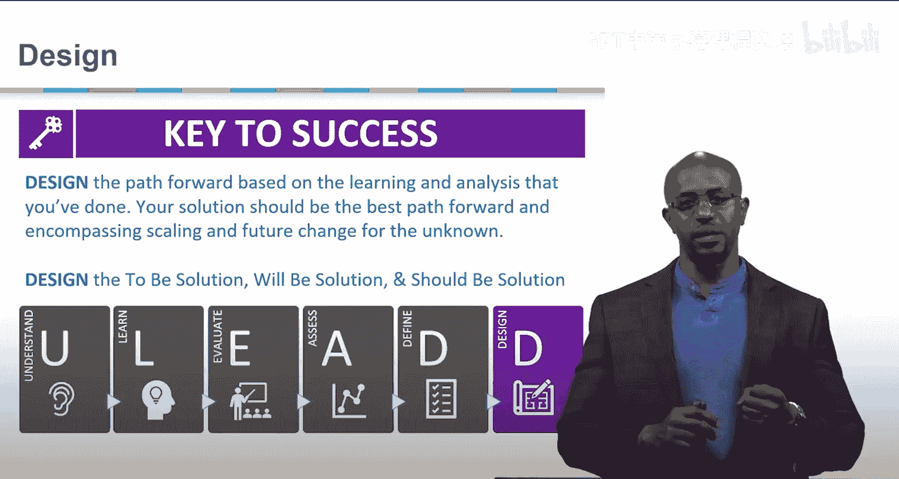
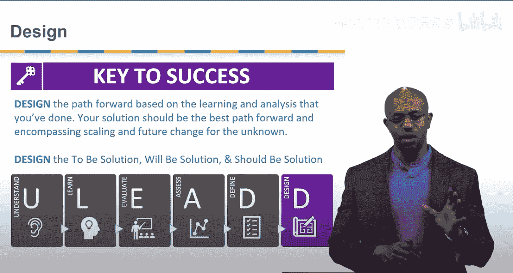
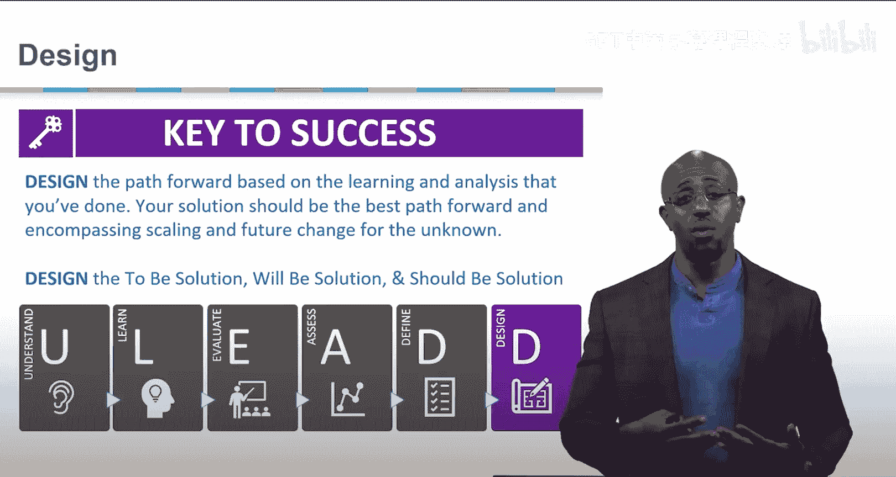
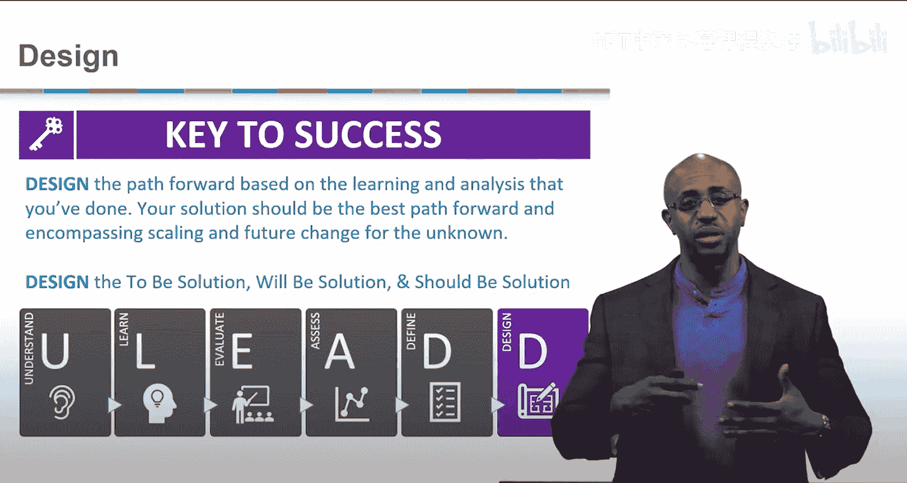
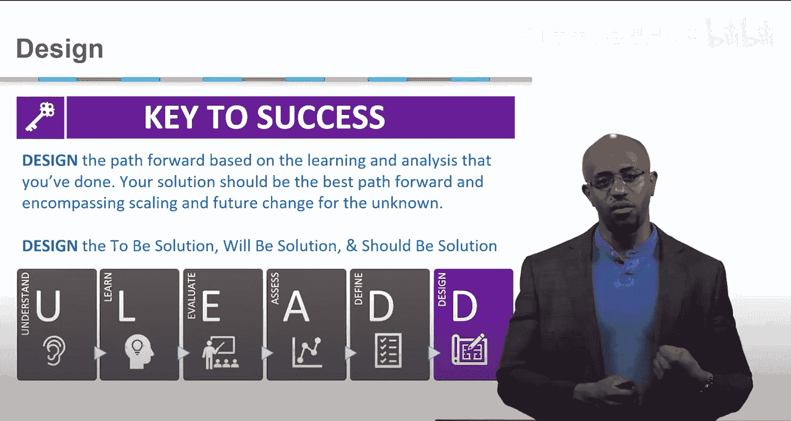

# 黑暗数据迁移与架构：26：发展路径设计 🗺️

在本节课中，我们将学习如何设计项目的前进路径。设计阶段将为我们提供可视化的蓝图，帮助我们具体理解后续的工作流程。

在之前的“定义”阶段，我们建立了项目基线，制定了行动章程。现在，我们将进入“设计”阶段，把想法落实到纸面上，以便我们能够看到、理解并可视化未来的流程。这将帮助我们开始迭代地分解工作，整合所有未知因素，并将其轻松地安排到时间线上。

---

上一节我们完成了项目的定义，现在来看看如何设计前进路径。这是评估阶段（评估、定义、设计）后的关键一步。目前，我们已经完成了定义，对机会进行了逻辑和功能分解。现在，我们将着眼于创建前进路径的逻辑和功能设计，即具体的实施方案。我们将开始审视预期的成果和目标。

以下是设计前进路径时需要考虑的几个核心方面：

*   **概念设计**
*   **解决方案设计**
*   **架构设计**
*   **路线图**
*   **价值流**
*   **旅程图**

许多人看到后三项——路线图、价值流和旅程图——会认为它们不是技术设计。这没错，它们确实不是纯粹的技术设计。但它们对于指导技术设计至关重要，能帮助我们、架构师和工程师理解前进方向、需要做什么以及如何构建系统。这些方面是协同工作的。

当我们思考**价值流映射**时，实际上是在设计价值如何流入和流出系统。当我们思考**旅程图**（包括客户旅程、数据旅程，以及与价值流图高度相似的价值旅程）时，是在描绘客户与我们互动的流程、数据流转的路径，以及价值如何随时间在我们的系统中复杂变化的流程。

---

现在，让我们回到上方的概念设计、解决方案设计和架构设计。每一项都包含许多不同的层面。

**概念设计**，就像你在左侧看到的通用概念设计图，能帮助我们初步理解企业的整体格局，以及如何管理其中的各个层面，包括伴随而来的数据和数据缺口。

**解决方案设计**着眼于不同的细分领域，我们如何为创新提供解决方案？如何为新系统上线或现有系统的升级提供解决方案？同时也要考虑集成设计，这些设计最终会汇总到我们的概念设计中。

最后，还有一系列不同的**架构设计**。请注意，这里没有列出物理设计，它同样重要。我们可以添加许多不同类型的架构，这里仅列出了最重要的三种。业务架构也很重要，尽管它更偏向于TOGAF和企业架构的范畴。所有这些设计都是相互映射、紧密结合的。

数据架构、系统信息架构等都会汇总到企业架构中。我们需要将其视为高度集成的整体。当我们思考TOGAF时，需要考虑如何将所有部分整合在一起，并基于定义阶段的成果，运用路线图、价值流、旅程图、概念设计和解决方案设计等综合层面，来推进我们的设计工作。

---

本节课中，我们一起学习了发展路径设计的重要性及其核心组成部分。设计阶段将定义阶段的抽象章程转化为具体的可视化蓝图，涵盖了从高层次的概念设计、解决方案设计、架构设计，到指导性的路线图、价值流和旅程图。这些元素协同工作，共同为项目的成功实施铺平道路。