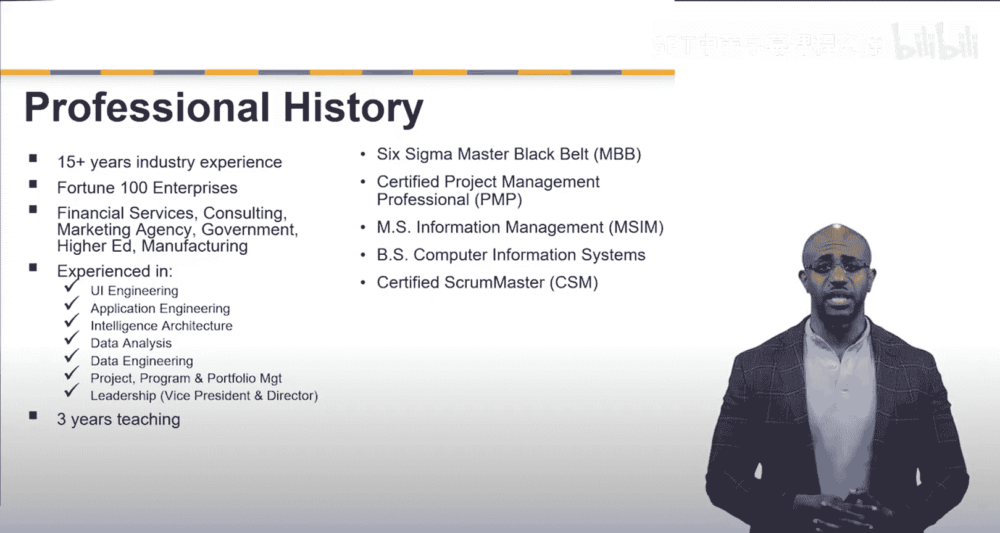
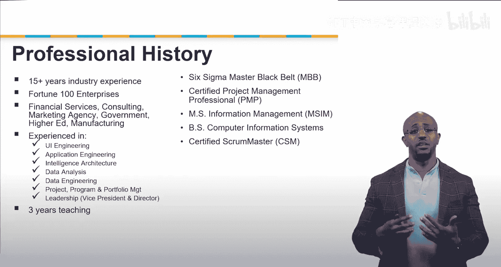
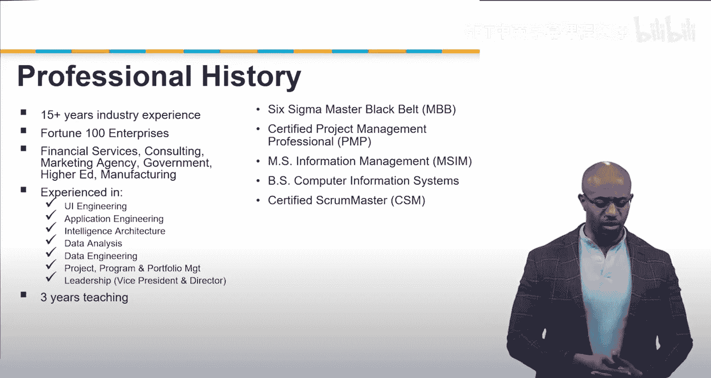
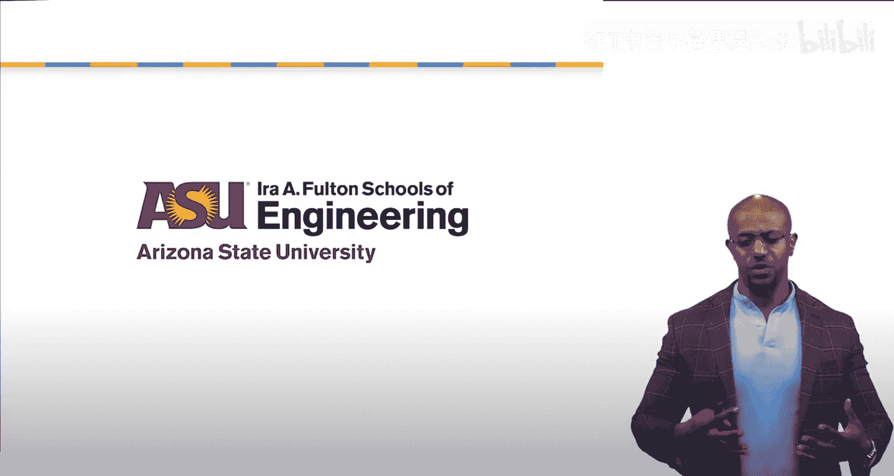
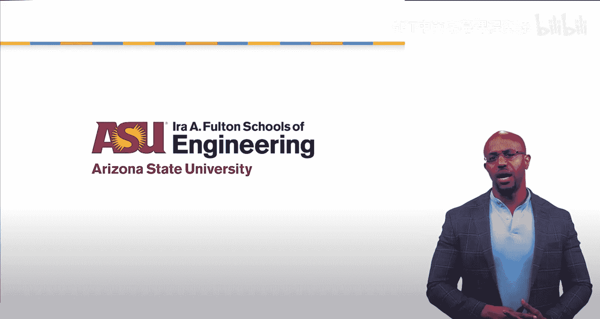
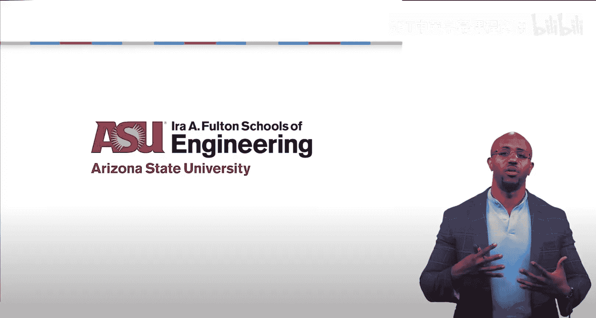
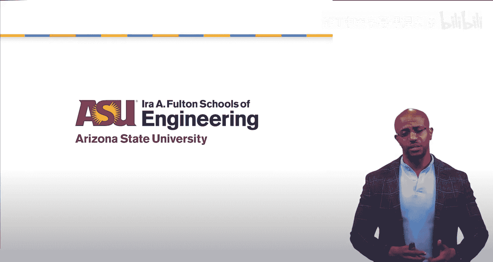

# 0：讲师介绍 🧑‍🏫

在本节课中，我们将了解本课程讲师的背景，包括他的专业经历、个人兴趣，以及这些因素如何塑造了他对“黑暗数据”领域的探索和理解。

## 专业背景

上一节我们介绍了课程主题，本节中我们来看看讲师的职业发展路径。他拥有超过15年的行业经验，涉足领域广泛。

以下是其职业经历的关键点：

*   **行业领域**：曾任职于美国企业界，并涉及咨询、市场营销、政府、高等教育以及创业领域。
*   **公司规模**：主要服务于《财富》500强及100强公司。
*   **职能角色**：职业生涯涵盖多个职位和学科，包括：
    *   UI工程
    *   应用工程
    *   智能架构
*   数据分析
*   数据工程
*   项目/项目集/项目组合管理
*   **领导职务**：目前担任副总裁，此前曾在一些美国和全球大型公司担任总监职务。

## 教育与持续成长

讲师认为，持续学习和多方向发展是职业生涯的关键。在交付项目的过程中，总会发现需要改进或解决问题的新领域。

他的正式教育背景同样多元：

*   **本科**：阿拉巴马州立大学，计算机信息系统与信息管理专业。
*   **硕士**：亚利桑那州立大学。
*   **专业认证**：持有GR Master、PMP以及六西格玛黑带大师认证，这些认证均在亚利桑那州立大学完成。

其核心理念是：**只要专注于发现问题、解决问题并帮助他人成长，就能在不断积累经验的同时，在原本不熟悉的领域变得更有能力。**

## 个人兴趣

从职业经历转向个人生活，讲师的兴趣广泛，这些兴趣也丰富了他的视角。

以下是其个人兴趣的几个方面：

*   **运动经历**：曾是大学田径运动员，在阿拉巴马州立大学时期是一名短跑运动员，主攻100米、200米和400米项目。
*   **旅行**：享受全球旅行，到访过许多地方，例如葡萄牙里斯本、法国巴黎、西班牙马德里、阿利坎特、梅里达，以及南美洲的巴西、秘鲁、巴拿马和墨西哥等地的城市，还有亚洲的巴厘岛等地。对他而言，旅行的核心在于**接触不同的人、理解多样的文化，并尝试当地美食**，这有助于打破思维定式。
*   **数字资产**：近年来对NFT和加密货币产生了浓厚兴趣。目前创作了一些更侧重于艺术性的NFT，并计划在未来涉足更多实用型NFT。在加密货币投资方面，他投资了包括Solana、Avalanche、以太坊和比特币在内的多种项目。
*   **健康倡导**：始终倡导健康与 wellness，信奉古罗马哲学家马克·安东尼的理念：**身体越健康，思维就越敏锐，头脑也越清晰。**

幻灯片顶部的图片是讲师在旅行中拍摄的风景，包括哥伦比亚的瓜塔佩、西班牙阿利坎特圣巴巴拉城堡俯瞰的海港、巴西里约热内卢糖面包山间的日落，以及葡萄牙里斯本一个著名公园里的大型商场。

## 核心驱动力

当我们深入本课程时，会发现探索精神对讲师至关重要。他极度热衷于**探索、创新和创造力**。

他认为，这三者是推动世界发展、解决问题的关键，也是提升自我、职业生涯、所在企业及周围人群的核心与支柱，正是它们构建了我们所生活的世界。

本节课中，我们一起学习了讲师的职业轨迹、教育背景、丰富的个人兴趣及其核心驱动力。这些多元的经历共同奠定了他教授“黑暗数据”这一主题的独特视角。感谢你的时间，预祝在本课程中学习顺利。