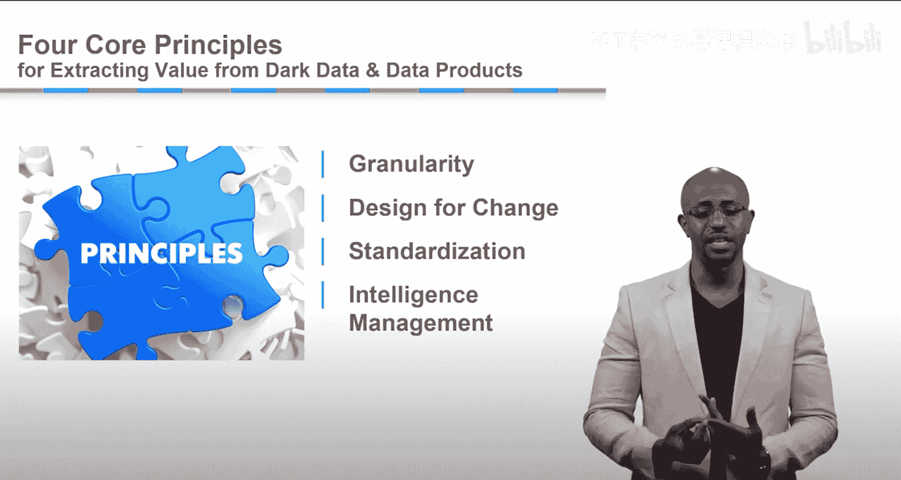
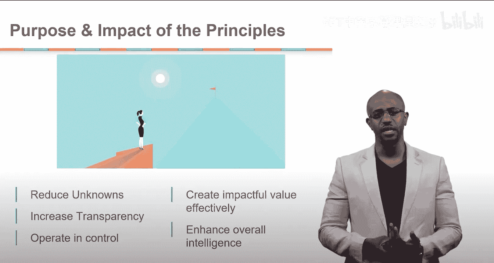
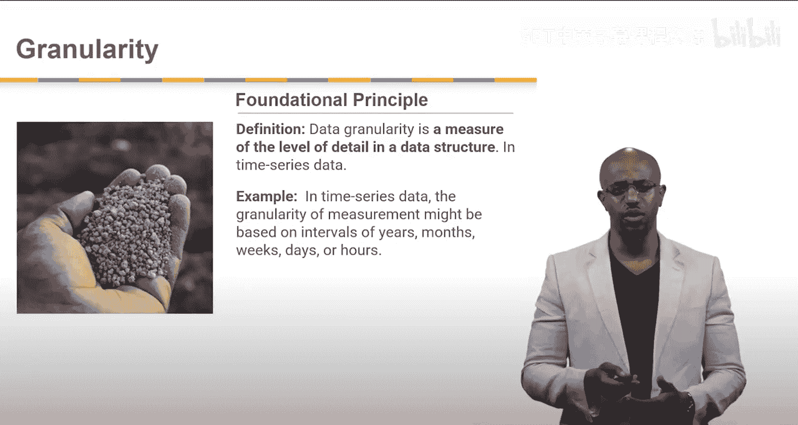
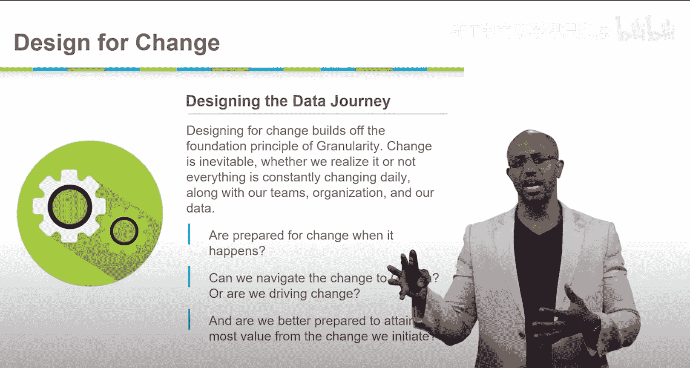
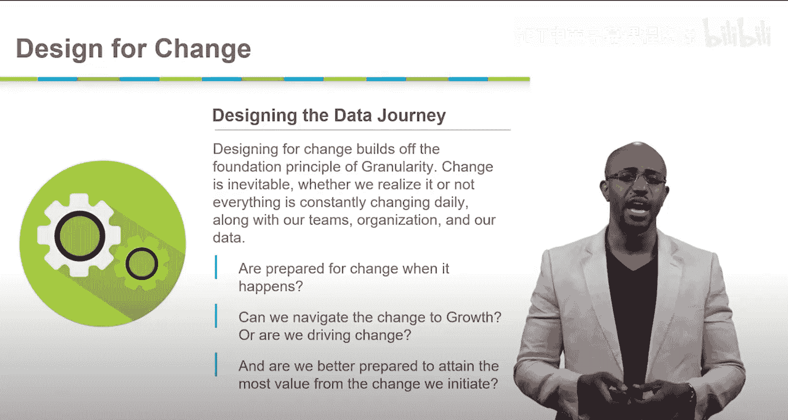
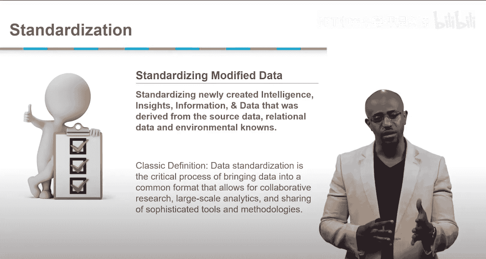
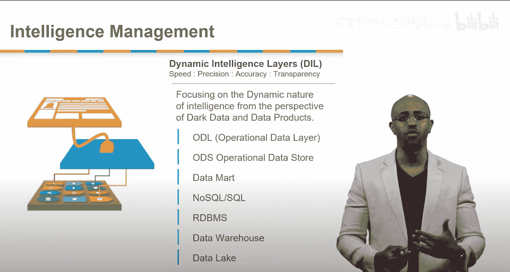

# 暗数据处理与架构：3：暗数据处理四原则 🧭

在本节课中，我们将学习从暗数据（Dark Data）和数据产品（Data Products）中提取价值的四个核心原则。这些原则是构建有效数据处理架构的基石。

## 概述



从暗数据中提取价值并构建数据产品，需要遵循四个关键原则：**粒度化**、**为变化而设计**、**标准化**和**智能管理**。这些原则共同作用，旨在减少未知、增加透明度、实现可控操作、有效创造价值并提升整体智能水平。

---

## 粒度化：数据的基石

上一节我们介绍了课程目标，本节中我们来看看第一个原则：粒度化。这是处理暗数据的基础性原则。

粒度化并不意味着系统中的所有数据都必须是最细粒度的，而是指**关键数据**必须具备足够的粒度。它为后续的“为变化而设计”和“标准化”提供了基础。

例如，在处理时间序列数据时，你可能需要按周、月、日甚至小时进行数据切割和展示。为了在仪表板或可视化工具中实现这种灵活性，你的数据必须能够被切片到最细的时间粒度。

**核心公式**：`数据价值 ∝ 数据粒度`（在关键数据上）





---

## 为变化而设计：构建可扩展的架构

建立在粒度化的基础上，我们来看第二个原则：为变化而设计。没有良好的数据粒度，就难以设计出适应变化的系统。

许多公司在构建报告系统或新基础设施时，只针对特定用例，没有考虑长期的可扩展性。这会导致技术债务，或使系统无法服务于“创造价值”这个更大的目标，最终引发更多问题。

在设计系统时，请思考以下几个问题：
*   当变化发生时，我们是否已做好准备？
*   我们能否驾驭变化，使其转化为增长，而非问题？
*   是我们在驱动变化，还是变化在驱动我们？
*   当我们主动发起变化时，我们是否做好了充分准备以从中获取最大价值？



---

## 标准化：管理已知与未知



接下来是第三个原则：标准化。在数据治理中，标准化是常见概念。但对于暗数据，它更具挑战性，因为暗数据本身是未知的。

我们这里的标准化，重点在于**规范那些从源数据、关系数据、环境知识或团队经验中新衍生出的情报、见解和信息**。

关键问题是：我们如何以标准化的流程方式，对这些已知为真的信息进行分类和捕获？并且要以**粒度化**的方式构建，以实现可扩展性。

**核心概念**：标准化对象 = 新创建的（情报 + 见解 + 信息）

---



## 智能管理：保持情报的新鲜与可操作

最后，我们探讨第四个原则：智能管理。这是一个动态且有趣的概念。

从暗数据和数据产品的角度看，情报本身会过时、会失效。因此，智能管理要求情报必须保持**新鲜、可操作且有用**。

我们通常有数据湖、数据仓库、关系数据库等系统。而在使用数据做决策的层面，则有数据集市、操作数据存储等。这些系统很好，但有时可能被锁定，缺乏可扩展性。

一种思路是构建**动态智能层**。这些层专为**速度、精确性、准确性和透明度**而设计。它们在物理层面可能与普通数据库无异，但概念上完全不同：
*   它们被设计为可以快速部署和撤销，用于快速测试实验。
*   它们服务于Tableau、Power BI等可视化工具，并能基于这些智能层扩展更多元数据见解。
*   其核心优势在于避免数据重复，同时能够快速创建、使用，并在不再需要时迅速撤销。

**代码示例（概念性）**：
```python
# 动态智能层的生命周期管理
intelligence_layer = create_intelligence_layer(source_data, experiment_params)
insights = analyze_and_visualize(intelligence_layer, bi_tool)
if not is_actively_used(insights):
    decommission_layer(intelligence_layer) # 快速撤销
```

---

## 总结

本节课中，我们一起学习了从暗数据提取价值的四大原则：
1.  **粒度化**：为关键数据建立精细的基石。
2.  **为变化而设计**：确保架构能够适应和驱动增长。
3.  **标准化**：以流程化方式规范新衍生的知识与情报。
4.  **智能管理**：通过动态层保持情报的新鲜、可操作与高效利用。



将这四项原则结合起来，并以减少未知、提升透明度、创造价值为目标进行应用，就能有效地将暗数据转化为驱动业务增长和提升整体智能的宝贵资产。