# 黑暗数据迁移与架构：4：数据粒度对暗数据的影响 📊

在本节课中，我们将聚焦于探讨数据粒度在数据旅程的哪个环节最具影响力，以及其原因。

## 概述

数据粒度是处理暗数据的基石。它决定了我们如何从暗数据中提取价值，并将其交付给数据产品。本节课我们将探讨数据探索、数据结构、算法和数据工程等如何从粒度中衍生，并开始为业务增长和组织发展提取价值。

## 数据粒度的核心作用

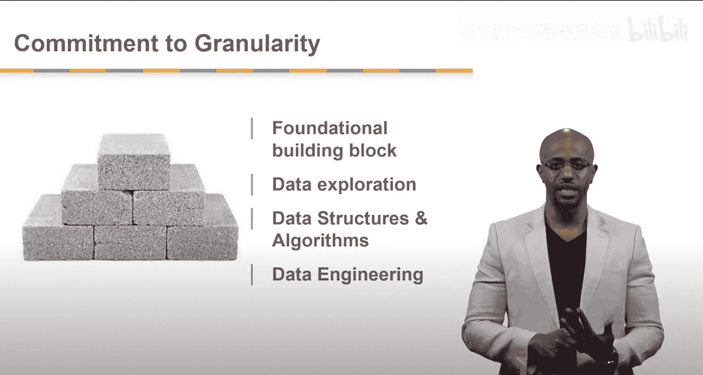

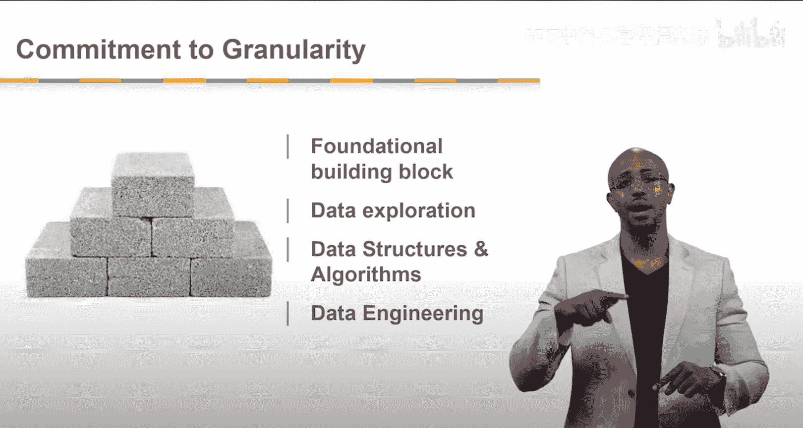

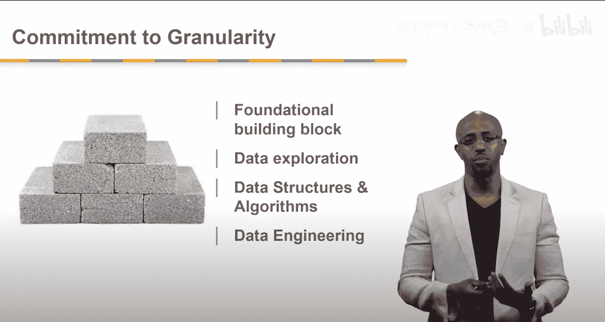

上一节我们介绍了数据粒度的基本概念，本节中我们来看看它在具体实践中的关键作用。

对数据粒度的承诺必须坚定不移。正如我们在上一个视频中所说，粒度是我们从暗数据中提取价值并交付给数据产品的**基础**。

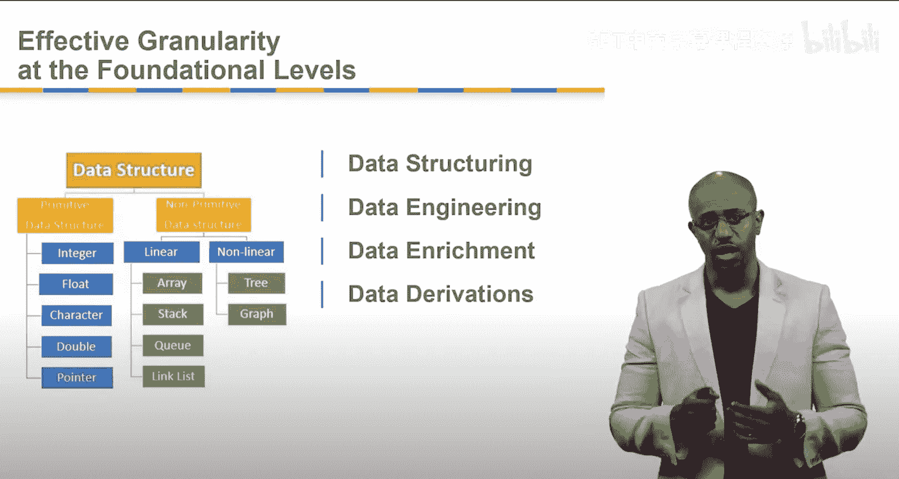

为了实现粒度的有效性，我们必须关注以下几个方面：

*   **数据结构**
*   **数据工程**
*   **数据丰富**
*   **数据衍生**

这些方面将成为我们持续增长价值所依赖的层级。下图展示了一个基本的数据结构层次，从原始数据类型到复合结构：

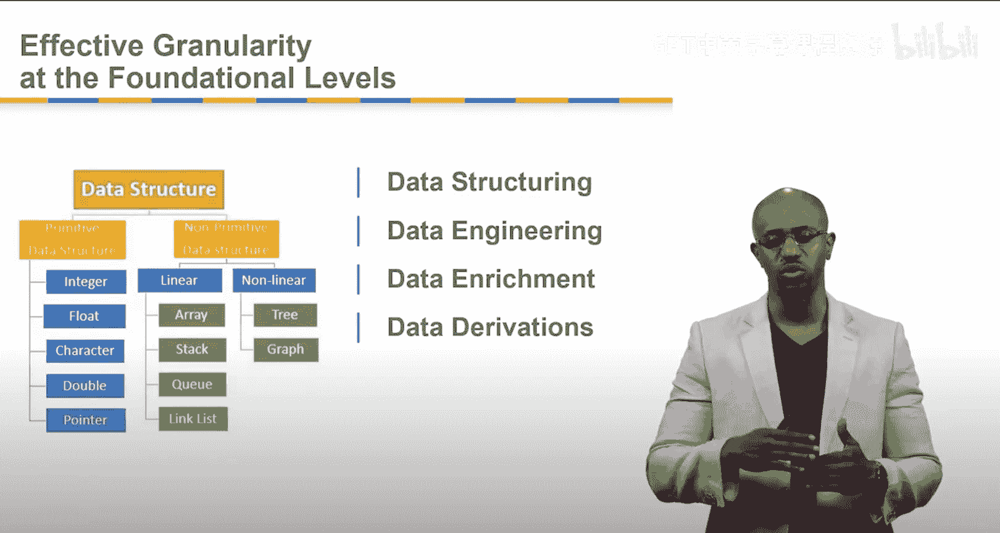

当我们谈论整数、浮点数、字符、双精度数等时，这些元素被组织到数组等结构中，目的是让我们能够对数据和情报的视图进行**切片和切块**，并创造出我们之前未知的新内容，从数据本身进行学习。

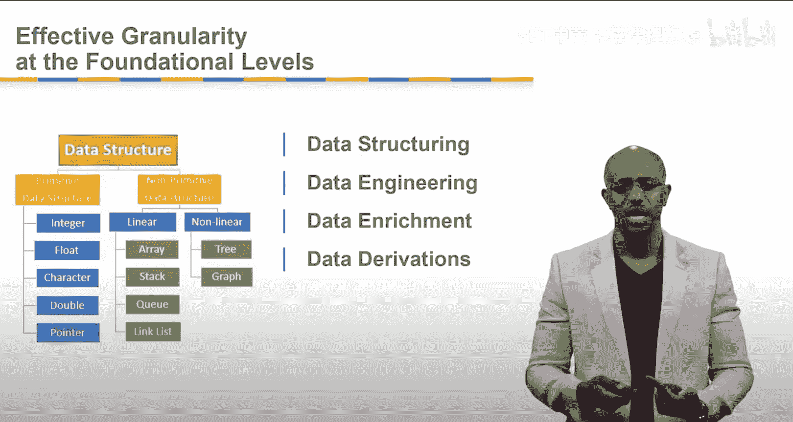

这种学习部分通过机器学习实现，但也部分取决于你如何设置和构建数据结构。

## 粒度影响最大的环节

那么，数据粒度在哪个环节最具机会？答案是在**生成层**。

我们已有的数据是被捕获的，已经在使用，并通过不同系统在企业内流转。当我们基于这些数据生成衍生数据、进行丰富、创建新视图和获得新理解时，我们需要尽可能保持其**高粒度**，直到数据进入操作数据层和快速动态情报层。

最后，观察我们的架构图，我们截取了OLAP（联机分析处理）部分。在底部，你可以看到层次化数据和关系数据库管理系统（RDBMS）。

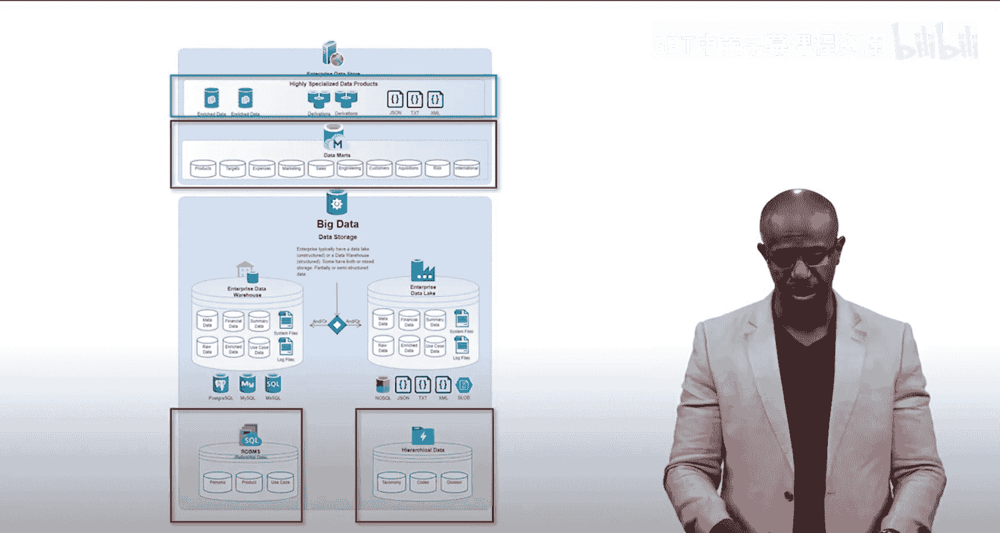

这些通常不被视为核心数据集，因为它们本质上是外围的。但在大多数公司中，这里存在许多机会。正因它们不被视为核心数据源，这类数据源有时会被忽视，可能引发问题，或者其组件和部分未被充分考虑。我在此特别指出它们，是因为这是你需要认真思考的一点，因为它们在创造新的丰富价值和新的衍生数据方面是**关键环节**。

## 架构中的粒度实践

随着我们向上看架构图，在水平红色方框标记的“数据市场”层，这是我们从数据存储、数据湖或数据仓库中提取数据的**第一层**。

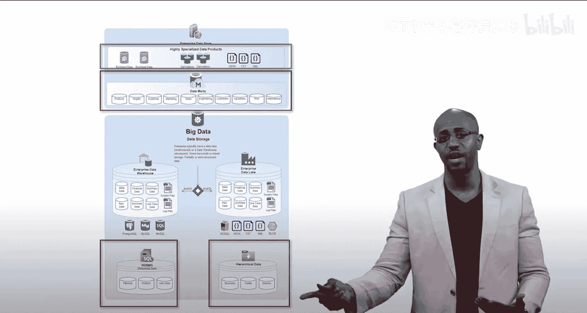

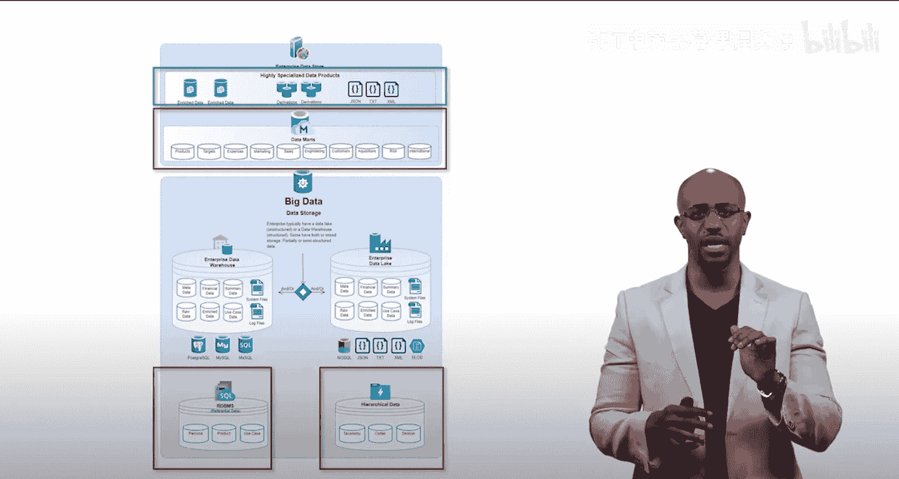

在这里，我们将数据存储在例如产品表、目标表或营销表中。我们会提供API，允许人们访问和提取这些信息，但会以良好的**粒度化方式**进行，这一点至关重要。

当我们继续向上到顶部的绿色方框时，这里就是我们获取**价值**的地方。

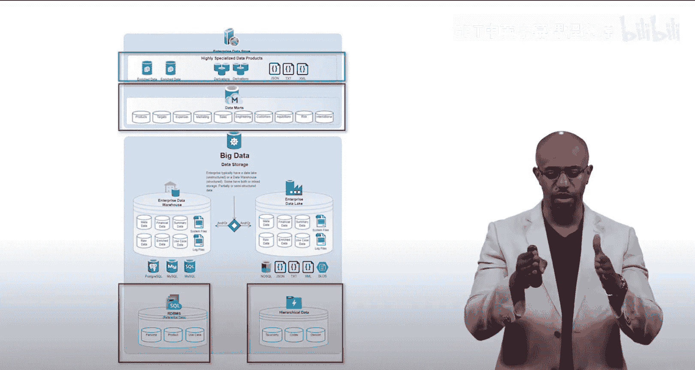

我们可能能够即时创建那些衍生数据，或者使用数据市场，或者使用操作数据层（ODL）。它们可能是丰富后的数据，可能是衍生数据，也可能是JSON对象等许多不同的形式。但它们将附带大量不同的元数据，这些元数据基于我们获得的所有不同学习和理解，以及我们能够对已生成的数组和其他值进行的所有不同计算。

这些计算源于我们构建的数据市场和算法。因此，这些区域是**粒度发挥其最大影响力的最有利环节**。

## 总结

本节课中，我们一起学习了数据粒度在暗数据处理架构中的关键作用。我们明确了粒度是价值提取的基础，探讨了其在数据结构、工程、丰富和衍生等环节的影响，并重点分析了在数据生成层、数据市场层以及最终价值交付层保持高粒度的重要性。理解并实践数据粒度，是成功从暗数据中挖掘价值的关键一步。

感谢你的时间。

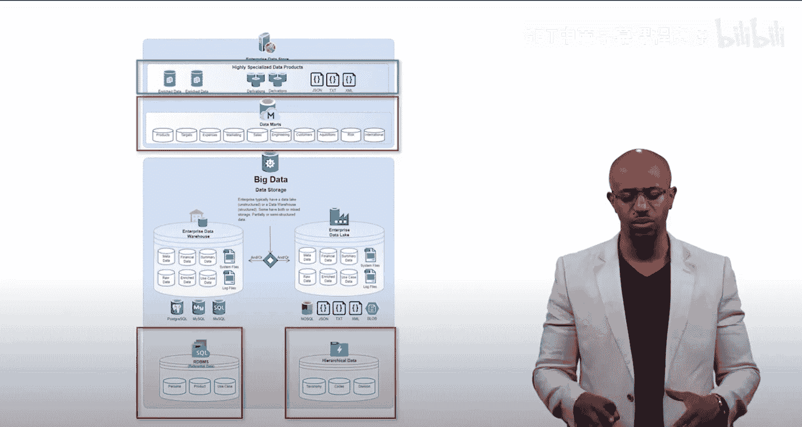

