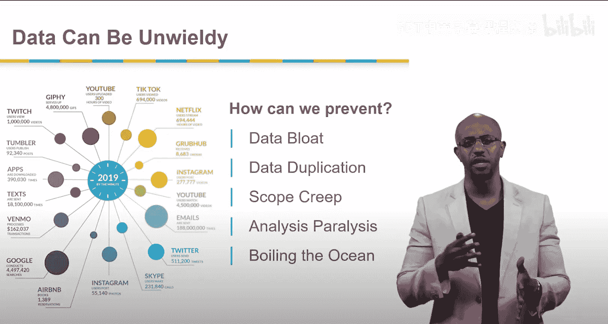
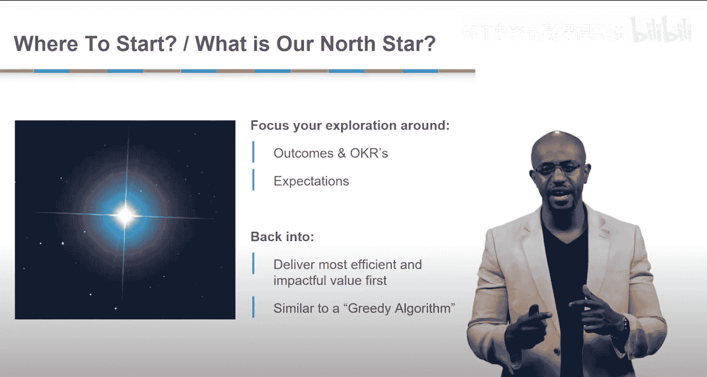
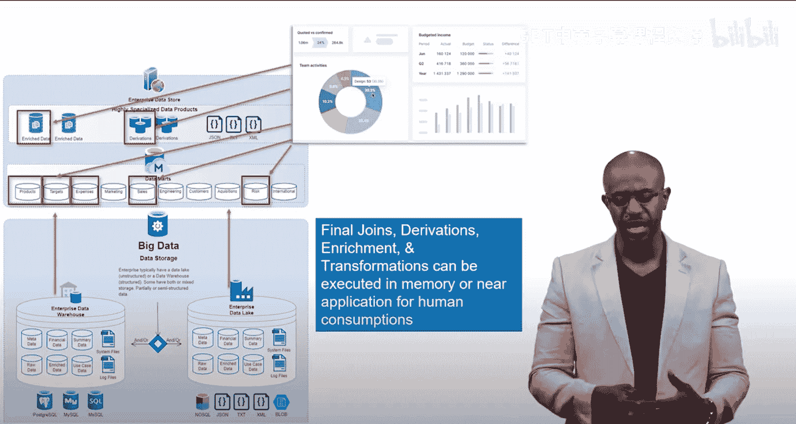

# 5：粒度思维与范围控制策略 🎯

在本节课中，我们将聚焦于如何保持数据处理的**粒度化**，并有效避免**范围蔓延**。我们将探讨在数据工程中，如何通过精细化的策略来管理数据，从而高效地获取所需情报，而不至于陷入“分析瘫痪”或“煮沸海洋”的困境。

---

## 概述

数据，尤其是黑暗数据，通常难以驾驭。无论你是数据科学家、分析师、数据工程师还是程序员，都可能遇到过数据膨胀、重复或范围失控的问题。本节课程的核心在于，并非一味避免这些挑战，而是学习如何在正确的时机、以正确的层级运用所需资源，从而实现目标效能。我们将介绍一种**粒度化**的方法，通过迭代和模块化的方式逐步获取信息，避免一次性处理过多数据。

---

## 从目标出发：确定北极星

我们总是从**预期成果**开始。无论是目标与关键成果，还是具体的业务期望，明确我们想从数据中获得什么是第一步。接着，我们采用类似**贪心算法**的思路逆向工作：优先交付最高效、最具影响力的价值，然后通过迭代过程不断向数据集添加内容。

**公式示例**： 贪心算法选择策略可抽象为：
```
在每一步选择中，选取当前状态下局部最优的解，以期达到全局最优。
```

---

## 实践案例：OAP数据架构中的粒度控制

现在，让我们看一个具体例子。我们回到OAP架构的数据流转场景：数据经历了数据湖和数据仓库，现在的问题是如何避免数据膨胀并保持其粒度。

大多数数据的粒度体现在**数据集市**层级。然而，如果直接从多个数据集市表拉取数据，用户界面会变得非常缓慢，因为你需要联接大量数据和表格。

**代码示例**： 一个低效的跨表查询可能如下所示（伪代码）：
```sql
-- 这可能很慢，尤其是在没有优化的情况下联接多个大表
SELECT *
FROM data_mart_table_1
JOIN data_mart_table_2 ON ...
JOIN data_mart_table_3 ON ...
WHERE ...;
```

因此，我们引入了**DIL层**。这一层包含高度专业化和专门化的产品，是产生**智能**的地方。

---



## 关键策略：管理数据膨胀与提升性能



以下是控制范围和保持粒度的核心策略。

### 复制关键标识符

你通常需要复制的数据是**关键值**，比如ID。将这些标识符配对使用，是数据膨胀常发生的地方。核心策略是：将数据集和衍生数据保留在DIL层，同时仍向下调用数据集市以获取可能需要的核心数据。

### 优化仪表板与用户界面性能

当发现仪表板或用户界面性能缓慢时，需要考虑哪些**超出关键值**的部分确实需要复制。例如，在查看“已报价”与“已确认”数据的UI时，你需要理解可以使用哪些衍生数据，以及如何在UI源解构这些衍生数据，以加速性能并提升智能，同时避免数据膨胀。

**列表前的介绍**： 以下是实现这一优化的几个关键考虑点：
*   **识别高频使用数据**：确定UI中最常访问和计算的数据点。
*   **预计算衍生指标**：在DIL层预先计算复杂的衍生指标，避免UI实时计算。
*   **按需加载**：只将当前视图或分析必需的数据加载到应用内存中。

---

## 架构回顾：数据流转与智能分层

我们来总结一下这个架构的数据旅程。

你的最终联接、衍生和数据丰富转换，所有这些操作都可以在**内存中执行**。这减少了数据膨胀量，并且可以为了便于人工消费而在接近应用源的地方完成。

观察整个架构：底部的数据仓库或数据湖是起点。数据以粒度化的方式结构在**数据集市**中。然后，用户界面会向这些数据集市请求核心信息。而所有的衍生数据，你都从**DIL层**获取。DIL层是那些为特定视图创建的、高度智能和专门化的层级，可以随时被填充或清空。

**图示说明**：
```
[数据湖/数据仓库] 
    ↓ (结构化)
[数据集市] → 存储核心、粒度化数据
    ↓ (请求核心数据)
[用户界面/仪表板] 
    ↑ (获取衍生智能)
[DIL层] → 处理衍生、转换和丰富化逻辑
```

你可以在阅读材料和文本中了解更多细节，但这就是你尝试实现的方法的基础和前提。

---

## 总结



本节课中，我们一起学习了如何运用**粒度思维**来管理数据项目，并控制**范围蔓延**。关键要点包括：从明确的业务成果逆向工作；在数据处理中优先考虑效率和影响力；利用**数据集市**保持数据粒度；通过专门的**DIL层**处理衍生逻辑以提升性能并避免不必要的复制。记住，目标不是避免处理大量数据，而是学会在正确的层面、以正确的方式使用你需要的数据。