# 黑暗数据迁移与架构：6：成长型架构设计 🚀

在本节课中，我们将聚焦于以成长型思维进行设计。我们将探讨如何为变化和粒度化进行设计，确保产品能够适应未来的增长与需求。

上一节我们讨论了数据产品的基础，本节中我们来看看如何构建一个能够持续演进和深入分析的架构。

## 概述：为变化与增长做好准备

构建一个有用的产品至关重要。如果产品有用，用户会要求更多功能；如果无用，用户将停止使用。因此，必须为产品的成功和随之而来的增长需求做好准备。设计时需要避免一些常见陷阱，并确保架构能够支持深入的数据洞察。

## 设计时需要关注的要点

以下是设计成长型架构时需要重点关注的几个方面：

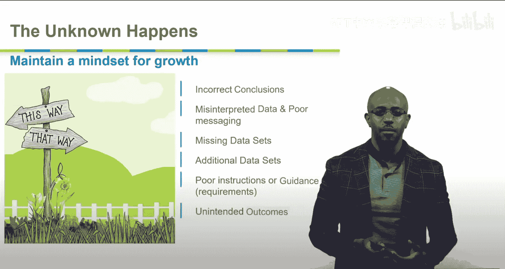

*   **避免错误结论**：必须熟悉数据本身。虽然可以使用算法和机器学习来揭示未知信息，但设计者自身必须理解数据，以避免数据被误解或从数据结论中得出错误的行动指引。
*   **处理缺失数据集**：考虑是否需要额外的外部数据集来丰富现有数据。需要规划获取和整合这些数据的流程，并确保该流程能提供所需的智能。
*   **明确需求与指导**：如同上一课程所讨论的，需要在需求收集阶段就排除模糊的指示和引导，确保目标明确。
*   **确保预期结果**：必须保证最终产出的是预期的结果，并且整个推进过程是经过深思熟虑的。

## 案例分析：标准仪表板的局限性

让我们通过一个例子来具体说明。这是一个标准的销售仪表板，展示了常规的销售指标。

此类仪表板影响力有限，因为它仅提供总计数据。它既无法支持深入钻取分析，也无法提供诸如“哪些渠道表现更好及原因”、“哪些渠道表现不佳”等关键情报。

例如，领导者看到销售额同比增长了 **43%**，但会立刻产生疑问：增长趋势线是怎样的？我们的增长与市场整体增长相比影响如何？如果市场本身扩大了，我们相对于竞争对手的实际增长情况又是怎样的？

观察“实际销售额 vs 目标”图表时，可以看到有些月份高于目标，有些则低于目标。

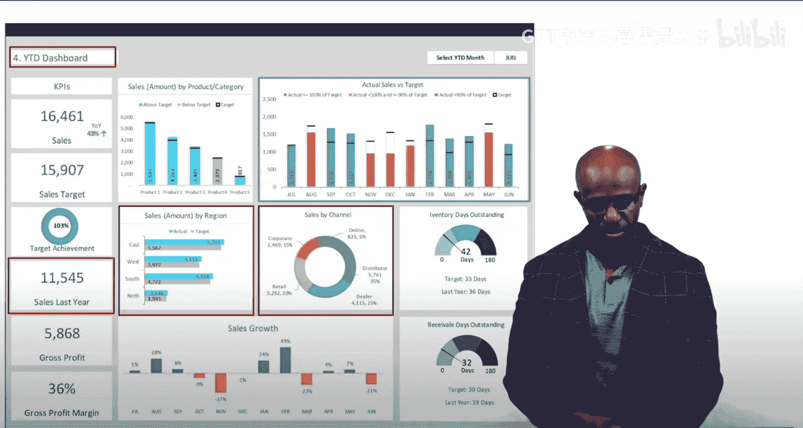

特别需要关注红色标记的月份（如11月、12月），它们远低于目标，而绿色标记的月份（如9月、10月、2月、3月）则远高于目标。

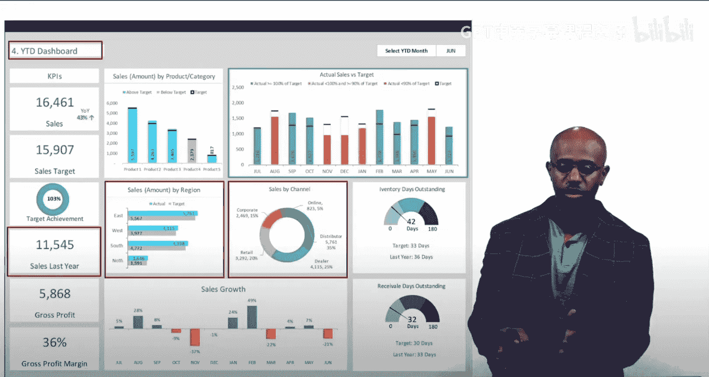

此时，领导者会提出两个核心问题：
1.  我们如何确认所看到的数据符合我们的运营实际？
2.  对于11月和12月，具体出了什么问题？我们该如何解决？

理想情况下，领导者能立即向下钻取，在五分钟内定位问题并找到负责人。但若依赖人工对宽泛的数据集进行分析，往往难以得出正确结论。人们通常寻找单一答案，但实际问题可能由多个因素共同导致。

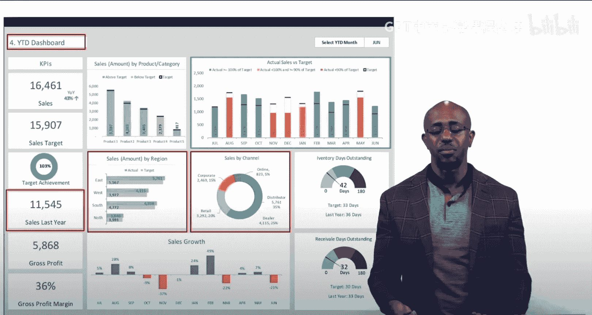

因此，我们需要对表现异常（如11月、12月）和表现优异（如2月、3月）的月份进行深入分析。成功是因为产品在2、3月本身就畅销，还是因为市场刺激计划、市场反弹等外部因素？

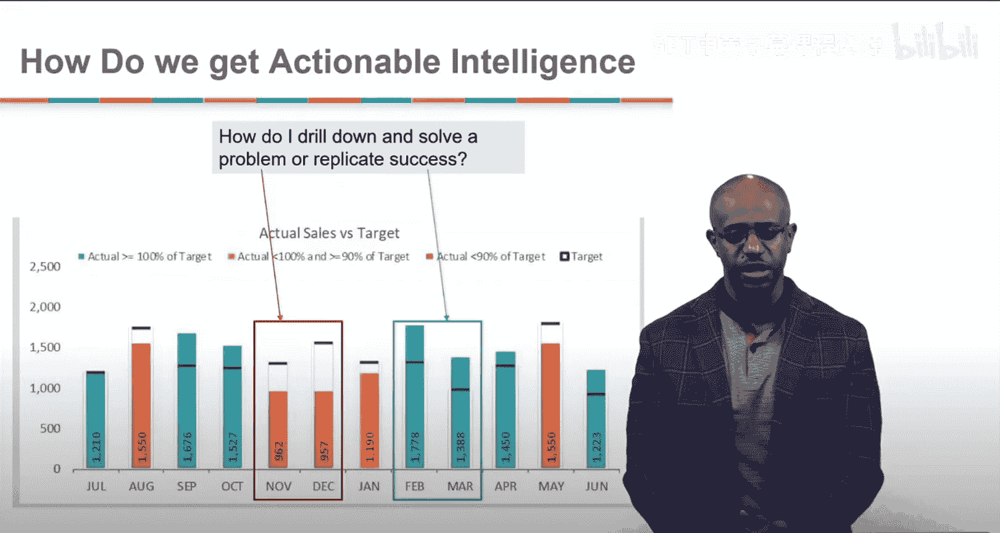
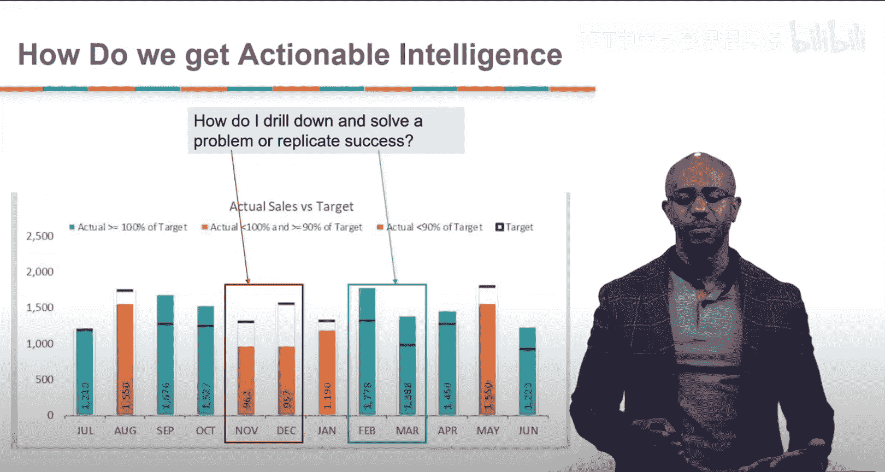

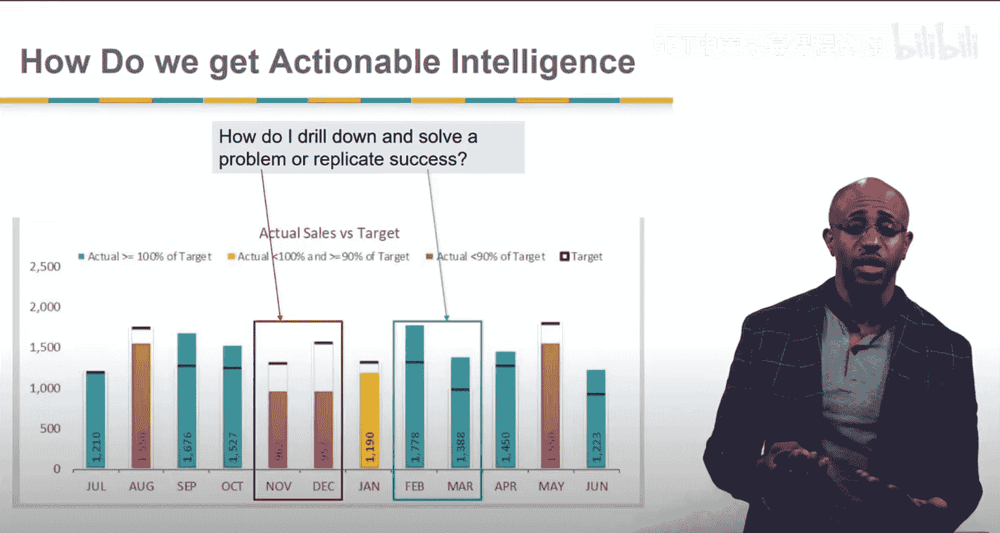
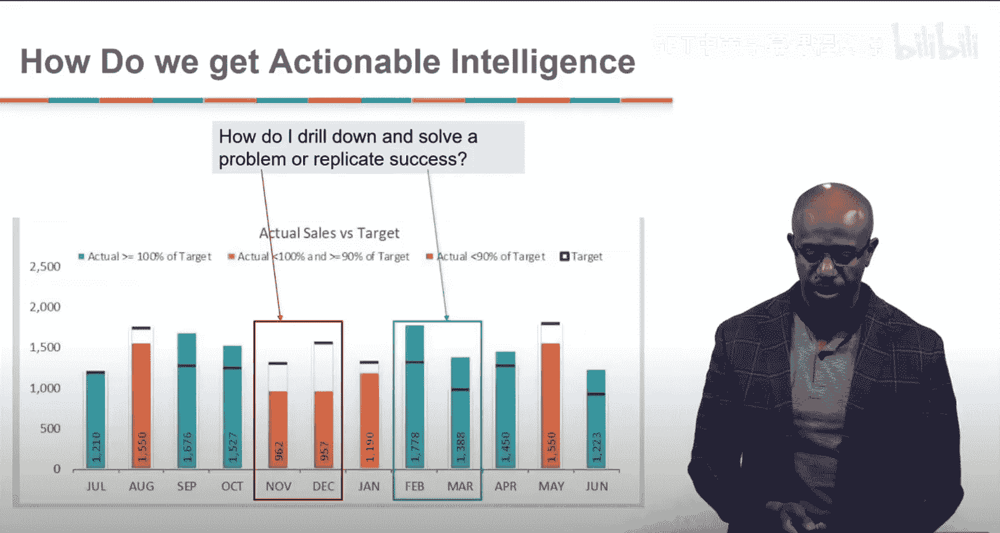

## 数据架构对比：汇总表与明细表

问题的根源往往在于底层数据架构。许多仪表板使用的数据是高度汇总的。

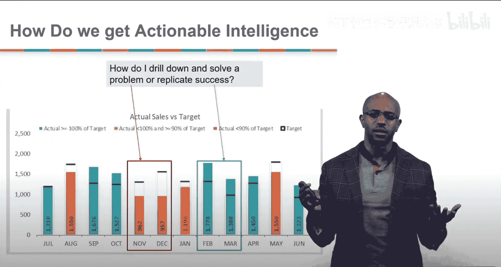

例如，一个按渠道、月份、州汇总的销售数据表：

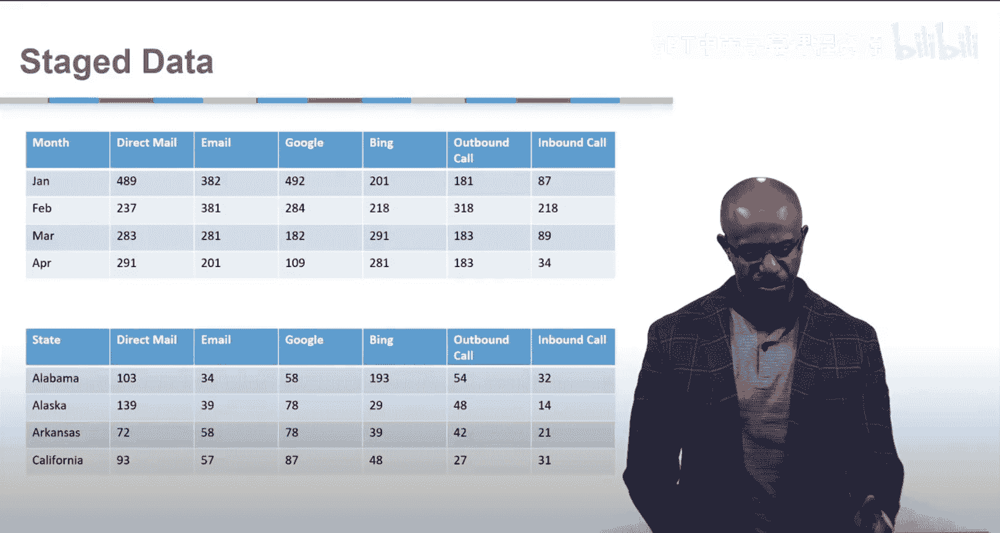

这种汇总数据阻止了更深入的钻取分析。仪表板所呈现的只是聚合后的结果，无法查看构成这些总数的具体交易记录。

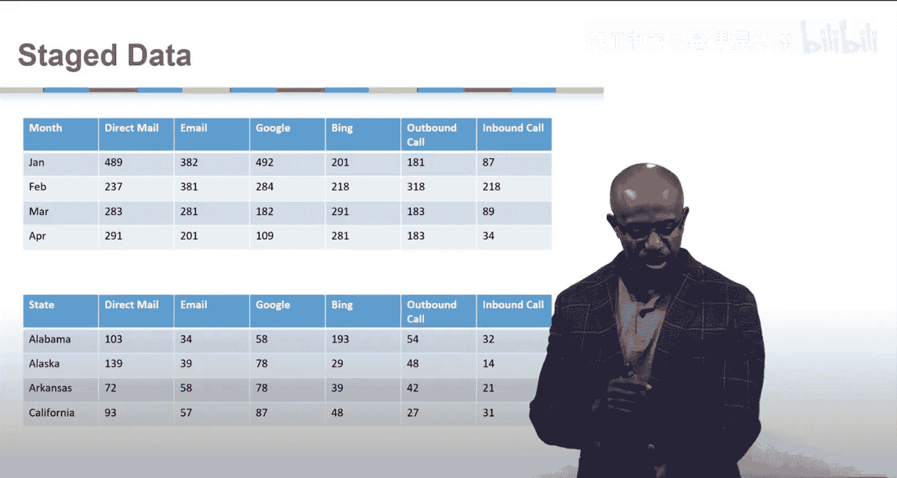

为了支持深度分析，理想的数据结构应该包含明细数据。如下图所示，我们应保有每笔销售交易的详细记录。

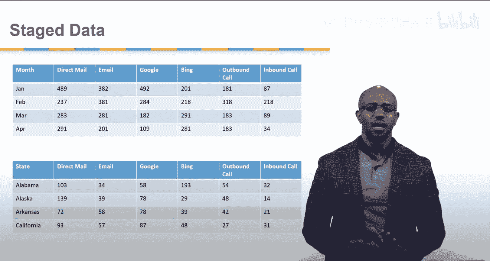

在这种架构下，我们仍然可以使用汇总表来呈现高层级分析，但明细表允许我们进行深度钻取。在仪表板中，用户可以选定特定的月份、产品或区域，然后查看所有相关的详细销售记录。

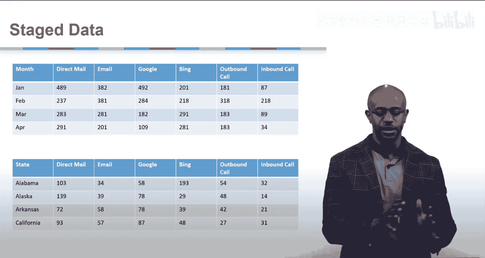

系统可以运用智能来高亮显示问题区域或异常成功的记录，并通过数据推导展示其原因。这样，领导者可以在短时间内完成所需的分析并得出结论。

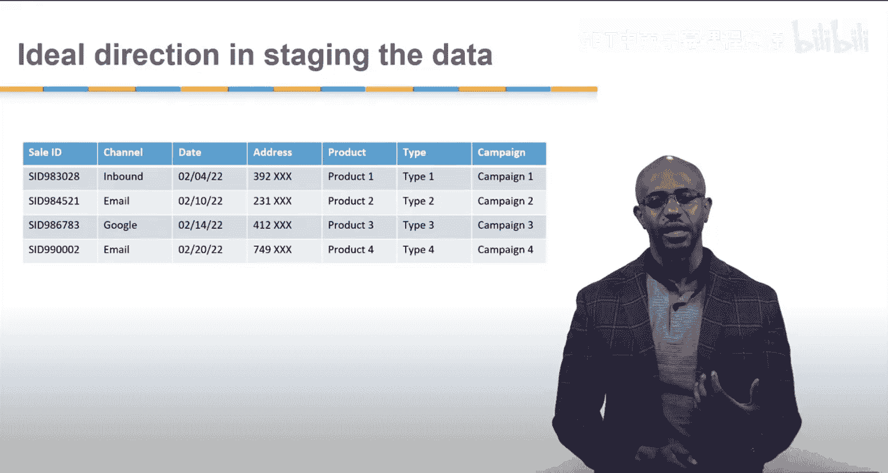

## 总结

本节课中，我们一起学习了成长型架构设计的核心思想。关键在于构建有用的、能产生影响力的产品，并为必然到来的变化和增长做好准备。通过采用支持深度钻取的明细数据架构，而非仅仅依赖汇总数据，我们可以使产品更具洞察力，让用户能够快速发现问题根源、分析成功因素，从而做出更明智的决策。这就是为变化而设计、为增长而设计的实践方法。