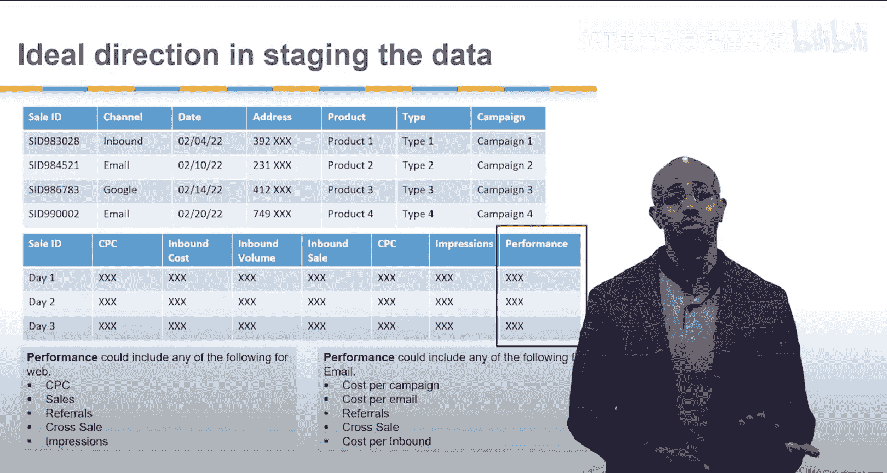
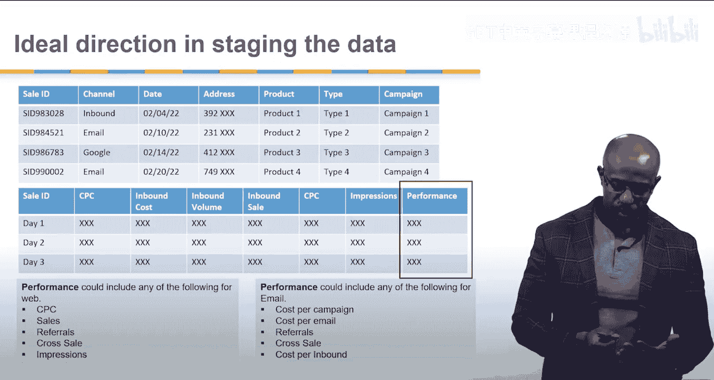
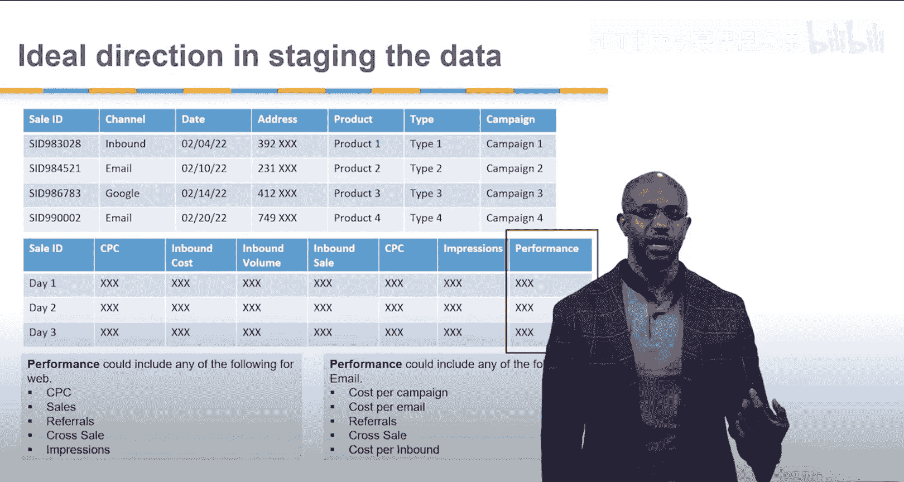
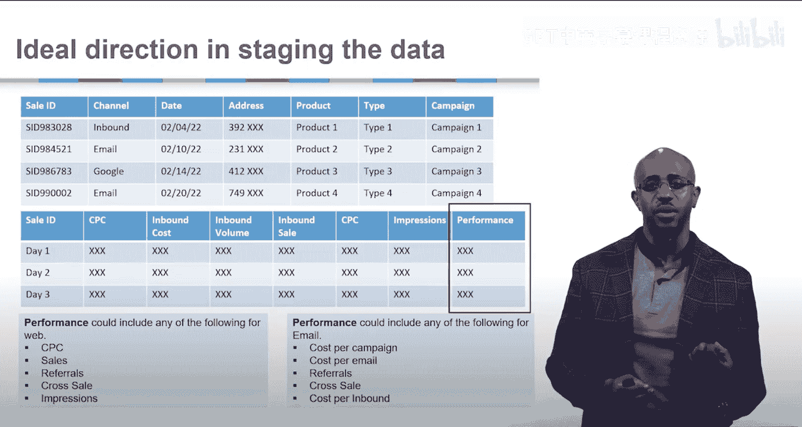
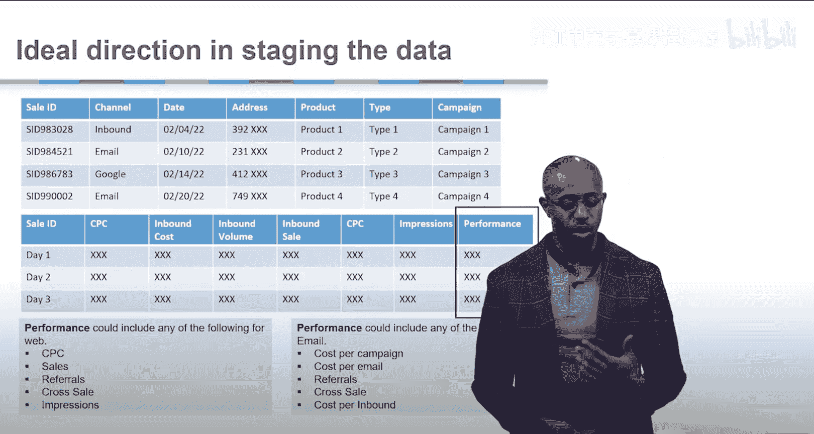
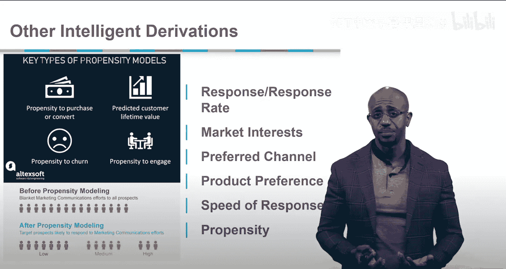

# 7：偏差预防机制 🛡️

在本节课中，我们将聚焦于如何在为变化而设计的过程中，避免衍生数据过度增长。

为变化而设计可以是一个非常稳健的过程，在这个过程中，你可以创建大量的衍生数据。你可以丰富数据，真正地扩展数据集以获得更多洞察。然而，你需要小心，不要过度加重系统负担或让数据过度增长，因为这有时会导致性能问题、造成混淆，或者导致对数据的误导性结果或错误表征。

在探索过程中，当你试图从数据中学习、寻找模式时，总会存在一定程度的探索和创建相对宽泛数据集的情况。但你需要能够找到方法，在最终产品阶段控制这种增长并将其最小化。有时我们可能会创建超出必要的数据，因此我们必须真正弄清楚如何控制输出，因为学习本身就是这个过程的一部分。

## 从基础数据到衍生数据

上一节我们讨论了数据设计的基础，本节中我们来看看如何从基础数据中创建衍生数据。

请看最上面的表格，我们以销售数据为例。你会看到一些标准的列，如销售ID、时间或日期、客户地址等。从地址信息中，你可以衍生出城市、县、州、地区等一系列信息。

接下来，我想展示的是下方的表格。你会使用相同的数据集，但稍微调整一下视角。不是按销售ID排列，而是按天排列，并利用日期创建一个衍生列。例如，在上方的表格中，你使用日期创建了一个名为“日期ID”的衍生列。在下方的表格中，它简单地显示为“第一天”、“第二天”、“第三天”，你可以将其视为你的日期ID。

从这里，你可以看到全天的总点击成本、全天的总入站成本等不同的指标。这些指标开始用于识别“性能”，而性能至关重要。因为当公司想知道应该开展哪些活动、如何进行营销，或者哪些产品正在创造更多利润、促进业务增长时，他们需要了解这些事物的性能。

## 理解“性能”这一衍生概念

有趣的是，“性能”本身并不是一个数据点。数据集中没有任何地方会直接写着“今天这个产品的性能是XX水平”。因此，你必须从许多其他变量和值中创建出“性能”本身，这是一个非常广泛的衍生过程。

而这个衍生出的值本身，就构成了你的数据产品。当你审视这一点时，会涉及诸如点击成本、销售额、推荐量、交叉销售、展示次数等指标。

传统上，对产品或市场活动性能的看法是它卖出了多少，无论是销售数量还是总金额，或是两者的结合。然而，考虑到现代环境中的所有影响因素，你需要关注更多方面。

因为你可能卖出了更多的一种产品，但如果你的每次点击成本更高，那么你也必须考虑投资回报率与建议销售额。即使你看投资回报率，除了点击成本之外，这些销售还有其他成本，比如你的总前期投资。构建产品、允许我们使用搜索引擎优化进入市场所投入的工程努力，也是总前期投资的一部分。

此外，你还需要考虑推荐量，因为推荐有助于长期建立品牌形象和产品增长。所以你不仅仅想要销售额，还希望人们谈论你的产品，这也是你性能的一部分。交叉销售也是如此：将这个产品与其他产品一起销售的难易程度如何？你是否能够基于一个不同产品的营销活动获得销售？这很有价值，因为你不需要额外花钱来获得那笔收入。

所有这些因素都构成了“性能”这一指标。展示次数也是如此，它是长期建立品牌形象的一部分。

因此，你需要整合所有这些指标，创建一个算法，并随着时间的推移发展和完善这个算法，以识别性能。它可以包含许多不同的方面，例如电子邮件性能、网站性能，甚至搜索引擎优化性能。

## 其他智能衍生数据考量

除了性能，还有其他智能衍生数据需要考虑。

以下是几个关键方向：
*   **倾向性建模**：这是一个行业标准。哪些客户有倾向去做某事？我们的市场沟通如何针对那些最有可能接受我们产品的客户？我们如何为他们建模、创建用户画像？
*   **响应率**：市场对活动的响应速度如何。
*   **偏好渠道**：客户倾向于通过哪个渠道与我们互动或购买。
*   **产品性能**：更细粒度的产品表现。
*   **响应速度**：从触达到产生行动的周期。
*   **市场兴趣**：市场对我们的产品有多感兴趣，以及我们如何衡量这种兴趣。

当我们思考“偏好渠道”时，我们不能简单地说哪个渠道销售额最高。因为有时交叉销售会帮助我们，推荐也会帮助我们。因此，需要多次讨论和深入思考，才能确定如何开始识别这些类型的数据产品，以及如何利用外部黑暗数据来提供帮助，因为整个方案的一部分就是实际存在消费我们产品和服务的客户群体规模。

## 总结

本节课中，我们一起学习了在为变化设计数据架构时，如何预防衍生数据过度增长带来的偏差。我们了解到，从基础数据（如地址、日期）可以衍生出多层次的信息（如地理信息、时间维度聚合指标）。核心挑战在于定义像“性能”这样的复杂衍生指标，它并非原始数据点，而是需要综合点击成本、销售额、推荐量、交叉销售、展示次数等多个变量，通过算法模型计算得出。此外，我们还探讨了其他智能衍生方向，如倾向性建模、响应率、偏好渠道等。关键在于，在探索阶段允许适度的数据衍生以获取洞察，但在最终产品阶段，必须有意识地控制、精简并明确定义这些衍生逻辑，避免系统过载和指标混淆，确保数据产品清晰、可管理且能准确反映业务现实。