# 黑暗数据迁移与架构：8：数据产品标准化策略 📊

在本节课中，我们将学习如何为标准化的数据产品处理黑暗数据。我们将重点关注如何将不同类型和来源的数据置于同一尺度上进行比较和分析，并探讨网站性能等因素如何影响整体业务表现。

上一节我们介绍了销售ID和日期ID的运作方式。本节中，我们将更深入地探讨“性能”这一概念，因为评估和标准化性能数据有多种不同的方法。

## 性能数据的标准化挑战

当思考性能时，我们需要考虑的一个核心问题是：如何将**不相似的数据类型**和**非结构化数据值**统一到相同的尺度上。

例如，我们可能同时拥有：
*   **每次点击成本**（Cost Per Click）
*   **呼入成本**（Inbound Costs）
*   **呼入量**（Inbound Volume）

其中，呼入成本和呼入量专门针对电话渠道。而每次点击成本则专门针对网络渠道。虽然我们不会为不同的产品将它们整合到同一个性能变量中，但从报告输出的角度来看，它们需要处于相同的尺度上。

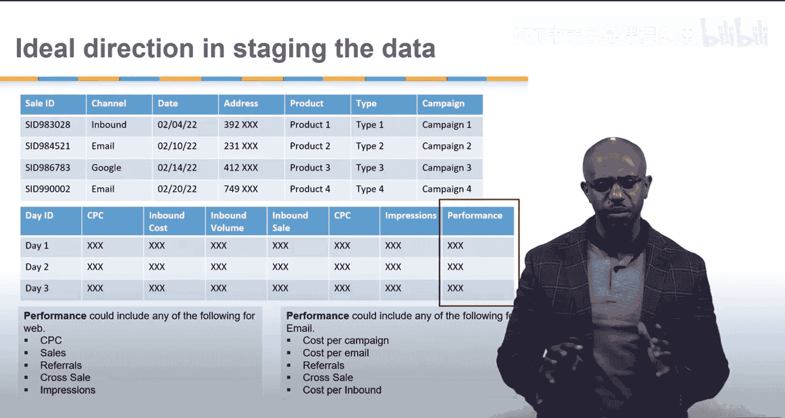

关键在于如何将所有指标都置于一个**100%的尺度**上，因为任何事物的努力或资源最多只能达到100%。思考每次点击成本、展示次数等指标的标准化过程可能会非常复杂。

## 分离渠道与网站性能

性能本身不是一个单一的数据点。它通常与销售额相关，但如何量化性能呢？我们的平台如何影响搜索引擎优化本身？

如果我们考虑呼入电话、SEO性能以及我们的平台（例如公司网站），实际情况是：用户即使通过SEO渠道进入，最终也需要在我们的网站上完成购买。因此，如果网站性能不佳，你将无法完成这笔交易。

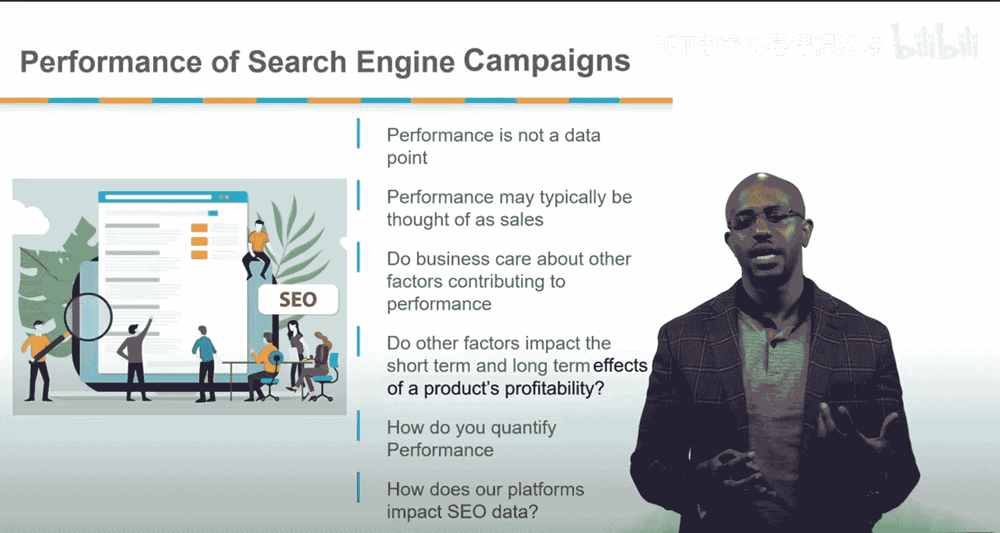

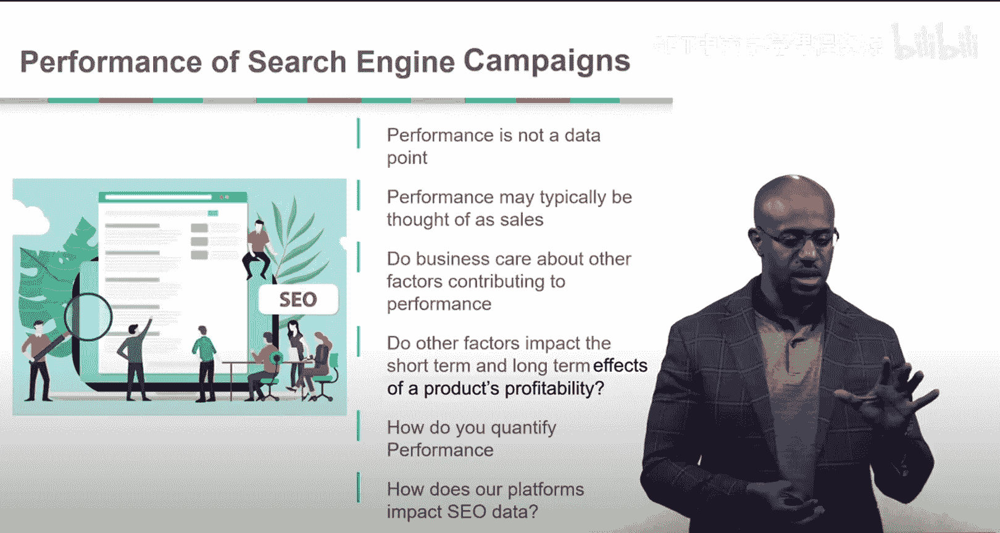

但如果你不将两者（渠道获取和网站转化）分开，并将它们置于同一尺度上衡量，那么网站转化差的结果将会影响对整个SEO渠道表现的评估。

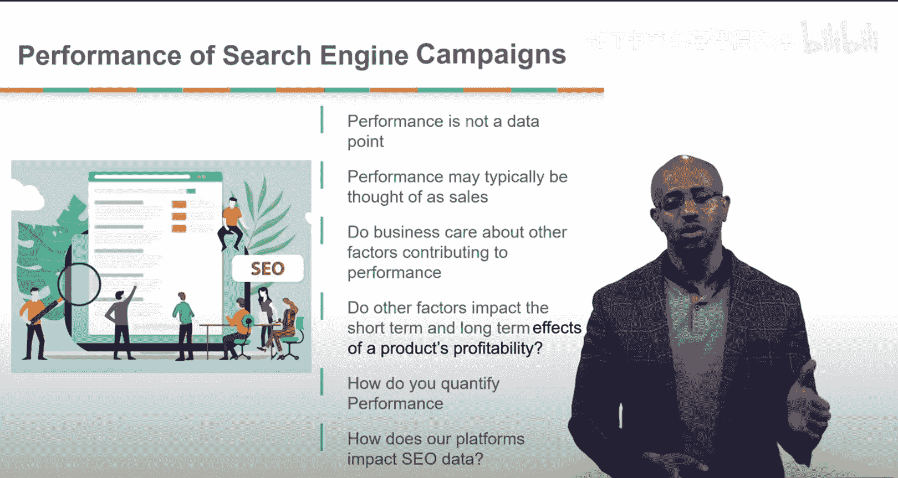

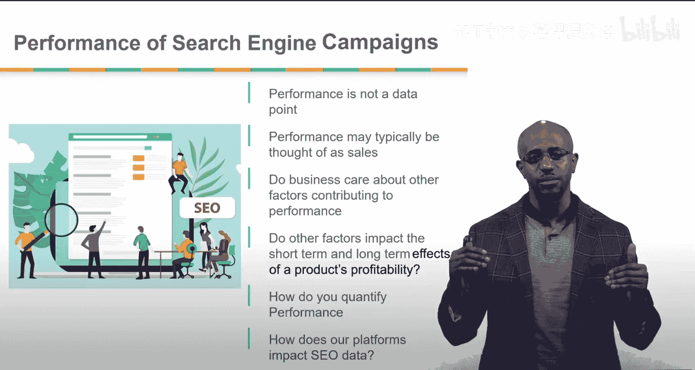

你需要能够分辨：究竟是**网站性能差**，还是**搜索引擎优化性能差**？

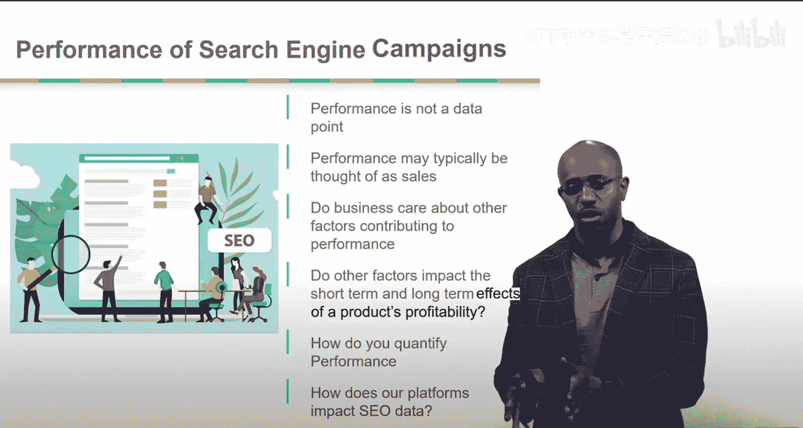

## 关键考量因素

因此，一个关键问题是：业务是否关心以下**贡献因素**？
*   **网站**作为贡献因素
*   **用户体验**作为贡献因素
*   **客户旅程**作为贡献因素

在进行数据标准化处理时，你需要认真思考并重点关注这些方面。

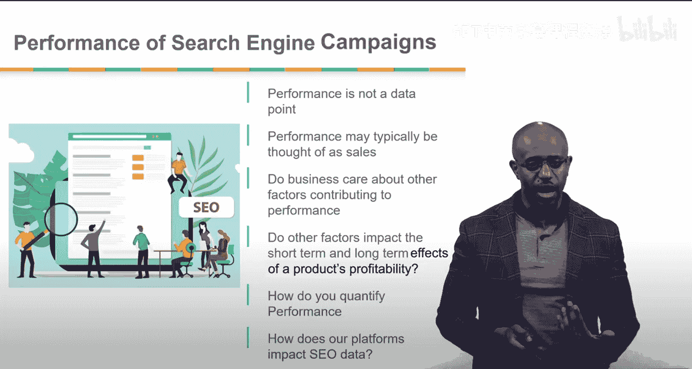

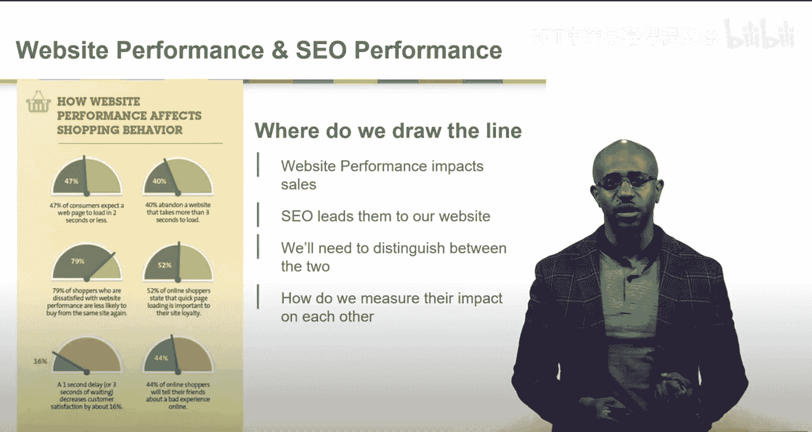

## 网站性能对购物行为的影响

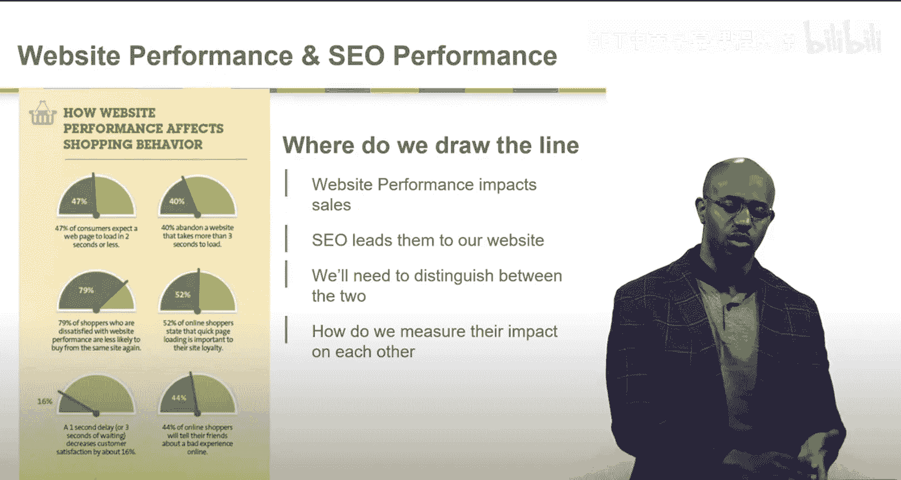

接下来，我们通过一个信息图来分析网站性能如何影响购物行为。当我们思考SEO以及用户通过Google、Bing等搜索引擎访问时，这一点至关重要。

该信息图清晰地揭示了一些事实：

以下是网站性能与用户行为的关键数据点：
*   **47%的消费者**期望网页加载时间在2秒或以内。
*   **40%的放弃率**发生在加载时间超过3秒的网站上。可以想象，如果加载时间达到5秒、8秒或9秒，用户将会放弃并转向竞争对手购买产品。

你需要思考这些问题：你的搜索广告活动可能运行良好，但当人们点击进入并准备购买时，如果你的网站存在性能或可用性问题，你在转化这些潜在客户时就会遇到挑战。

同样地，**79%对网站性能不满意的购物者**不太可能再次从该网站购买。

你必须确保当用户访问你的网站时，能够获得轻松易用的体验。用户体验设置得当，客户旅程顺畅，并且能用更少的点击完成购买。这些都是你需要考虑的因素。

## 识别黑暗数据并量化影响

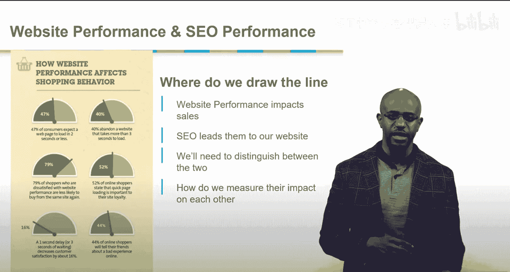

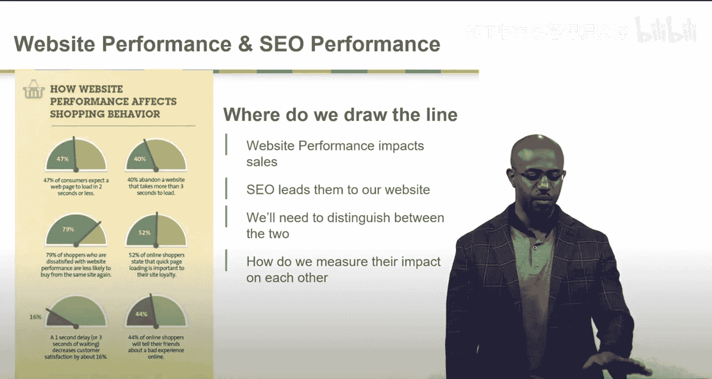

退一步思考，识别黑暗数据的位置。传统上，我们只关注每次点击成本、展示次数和销售额。

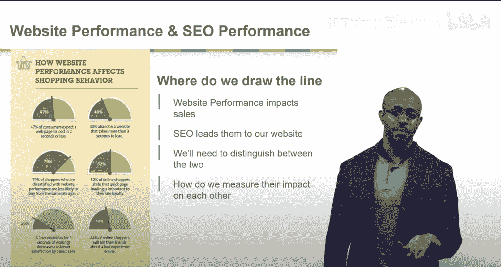

我们并没有思考**放弃率如何影响性能算法**。我们需要理解这一点，并判断是否需要将其纳入考量。

然后，我们需要理解其中是否存在**指数级影响因素**，以及如何找到一个直接的答案。例如，某个水平的放弃率会导致50%的失败，而在此之后，如何说明它有可能指数级地导致60%或70%的失败率。

思考这些问题的目的是为了提供精确的数字，并展示不同的放弃率、不同的可用性和性能水平如何影响SEO。尽管它们应该被分开评估，但你同时也需要能够展示它们如何相互关联，以及问题究竟出在哪个环节。

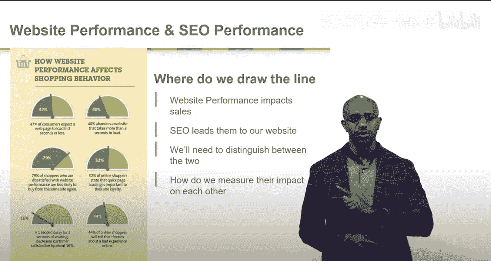

## 总结

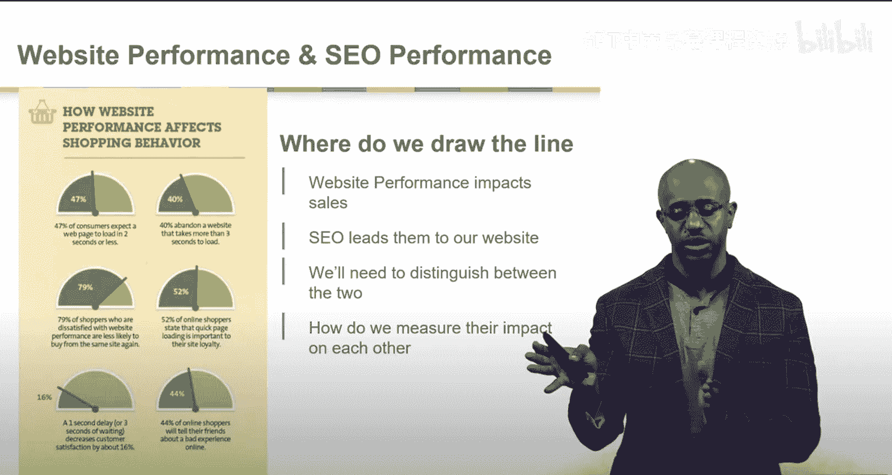

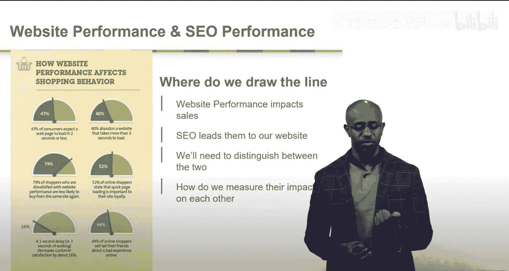

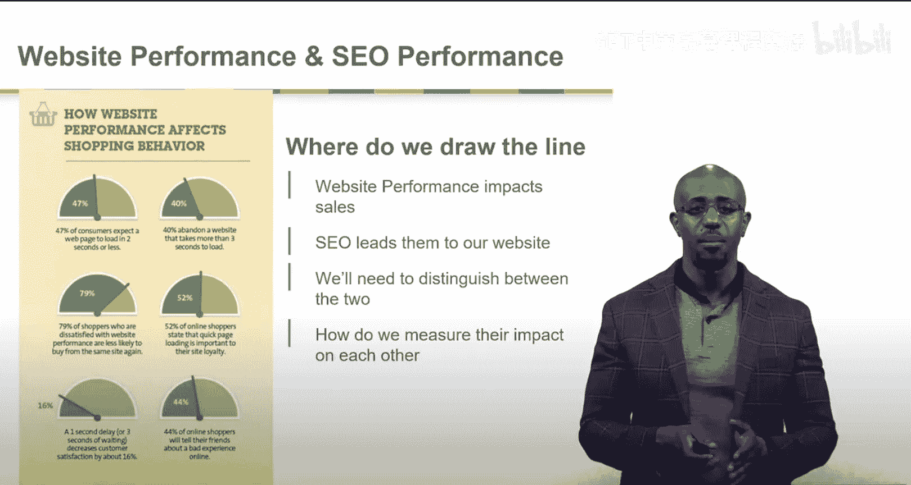

本节课中，我们一起学习了为数据产品标准化黑暗数据的策略。核心在于将不同来源和类型的性能数据（如成本与量）置于统一的尺度（如100%基准）上进行评估。我们重点探讨了必须将**用户获取渠道**（如SEO）的表现与**网站转化**性能分离开来单独分析，才能准确诊断问题。同时，我们认识到网站性能（如加载速度）是关键的黑暗数据，会通过影响用户放弃率，进而指数级地影响整体业务成果。标准化过程需要量化这些影响，以提供清晰的业务洞察。