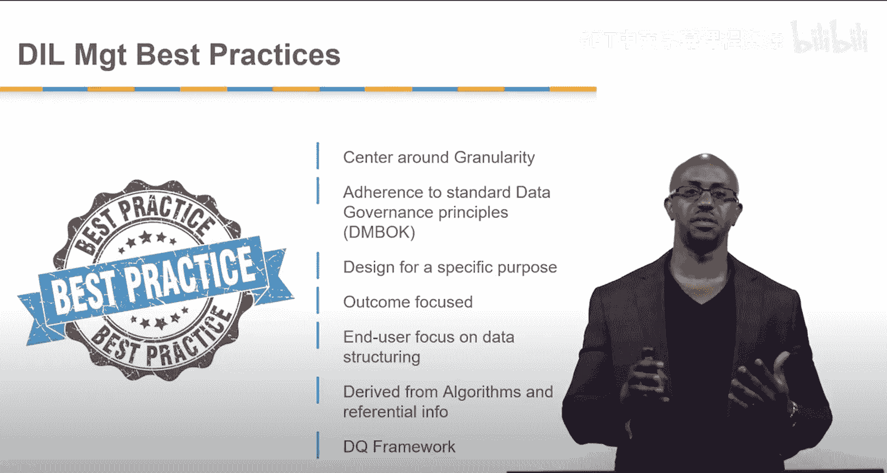
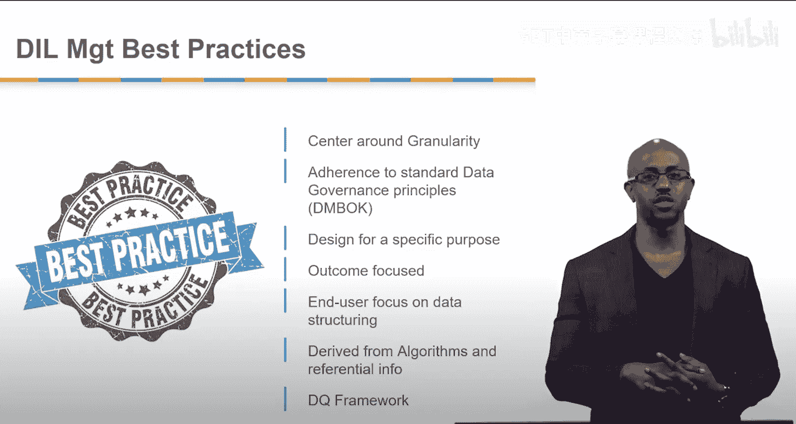
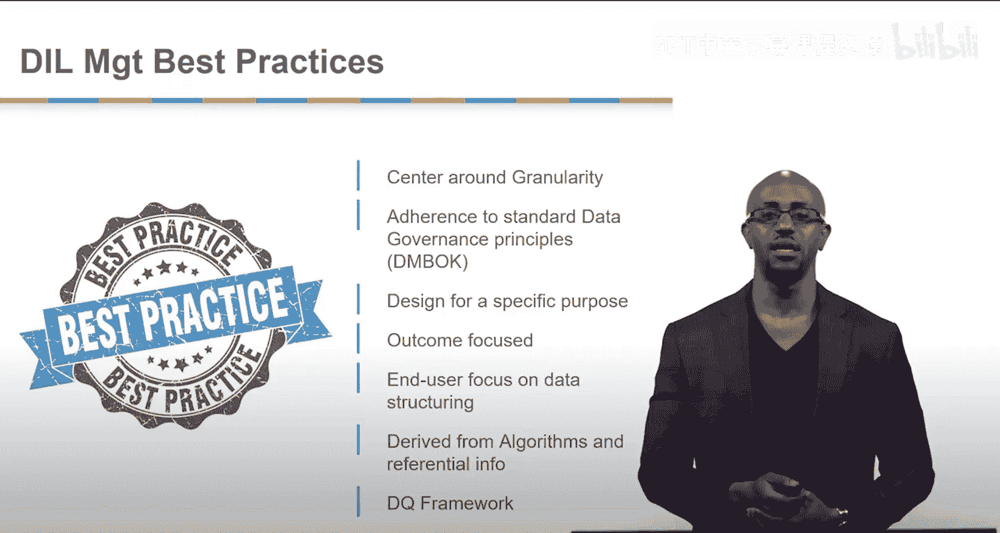
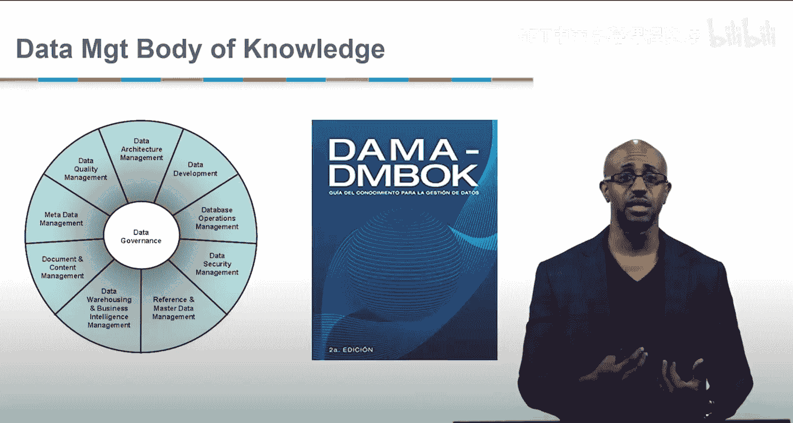
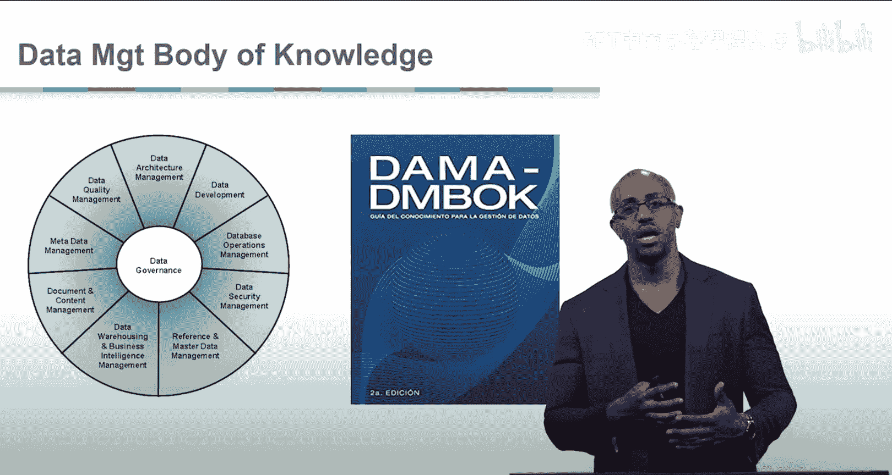
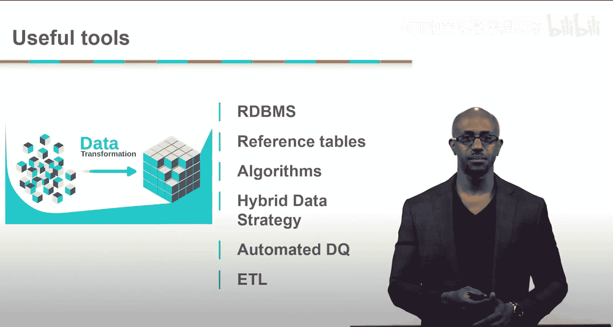
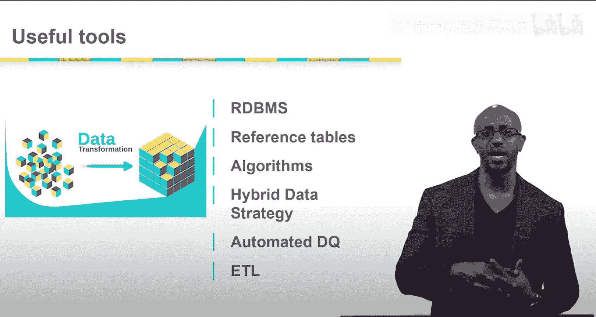
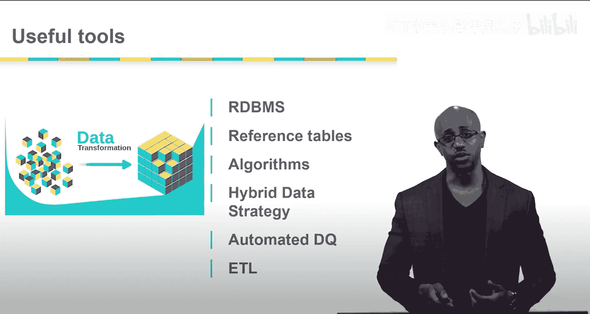

# 11：动态智能层管理最佳实践 🏗️

在本节课中，我们将聚焦于管理动态智能层的最佳实践。我们将探讨构建和维护该层时需要关注的核心原则与实用工具，以确保其能有效服务于特定目标。

## 概述

动态智能层是数据架构中的关键组成部分，旨在从原始数据中提炼出可操作的洞察。为了高效管理此层，我们需要遵循一系列最佳实践，这些实践围绕**粒度**、**治理**、**用户中心设计**和**工具选择**展开。

## 核心最佳实践

上一节我们介绍了课程概述，本节中我们来看看具体的核心实践原则。

以下是管理动态智能层时应遵循的四项核心最佳实践：

1.  **围绕粒度与单一目标进行设计**
    动态智能层的设计应**以粒度为核心**，并确保该层专注于为**一个特定目标**服务。该目标可能会产生衍生结果，这些衍生结果也应包含在该目标的范畴内。关键在于保持高度的专注与细化。

2.  **遵循标准数据治理原则**
    应严格遵循由数据管理权威组织DAMA发布的**DMBOK**中概述的标准治理原则。该框架提供了丰富的数据治理指导，强烈建议将其作为通用数据治理的基础。

3.  **以特定目的和用户为中心进行设计**
    正如之前所述，设计必须聚焦于特定的目的和结果。同时，需要**以用户为中心来构建数据**。动态智能层中的数据组织结构，应围绕为最终用户提供的**价值**来设计。

4.  **确保数据质量与流程自动化**
    在构建过程中，需设置恰当的**引用表**和正确的**算法**，以计算并激活从底层表中提取出的“黑暗数据”。**自动化数据质量**检查至关重要，因为它能确保在数据输入、转换及形成新数据产品后，其质量可靠、结果合理且不会误导用户。

## 关键工具与技术

在理解了核心原则后，我们来看看实现这些实践所需的具体工具。

以下是构建和管理动态智能层时的一些有用工具：

*   **关系型数据库管理系统**
    RDBMS（如PostgreSQL, MySQL）是基础，用于建立引用数据和相关的引用表。

*   **混合数据策略**
    动态智能层的数据可能源自多种存储类型。部分可能来自如PostgreSQL这类结构化SQL数据库，部分则可能来自如MongoDB、Cassandra等存储JSON对象的非结构化或文档型数据库。因此，需要采用**混合数据策略**进行开发。

*   **自动化数据质量工具**
    由于动态智能层会创造用户尚未完全理解的新数据值，因此必须在数据输入前和所有转换完成后，对数据质量进行评估，确保最终的数据产品清晰、合理。

*   **提取、转换、加载流程**
    标准的**ETL**工具有助于实现数据质量检查的自动化，并处理算法、引用表集成等其他环节。

请记住，这些工具将帮助你有效地构建和管理动态智能层，尤其是保障**数据质量**。

## 总结

本节课中，我们一起学习了管理动态智能层的最佳实践。我们强调了以**粒度**和**单一目标**为中心的设计思想，遵守**DMBOK**治理框架，以及**以用户价值为导向**的结构化方法。同时，我们介绍了实现这些实践的关键工具，包括RDBMS、混合数据策略、自动化数据质量检查和ETL流程。掌握这些原则和工具，是成功构建并提供可靠数据洞察的基础。