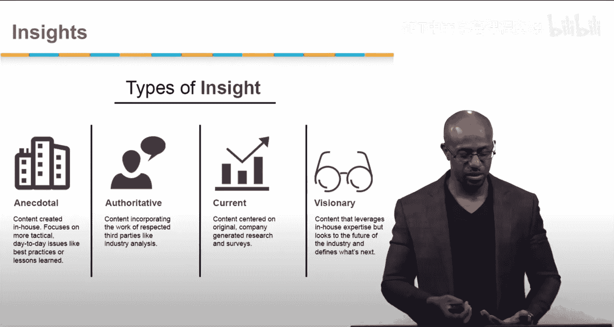
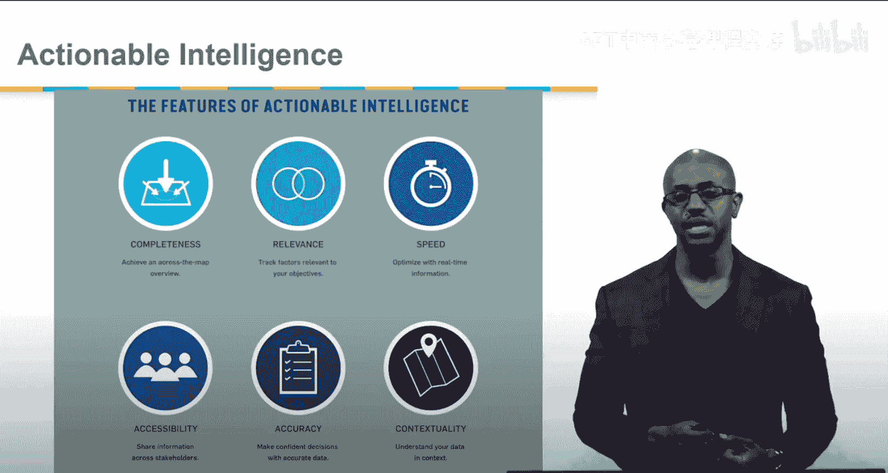

# 黑暗数据迁移与架构：13：洞察与行动型智能区分 🔍

在本节课中，我们将简要区分“洞察”与“行动型智能”这两个概念。理解它们的区别对于有效利用数据、尤其是处理“黑暗数据”至关重要。

上一节我们介绍了数据产品与智能的核心概念，本节中我们来看看“洞察”与“行动型智能”有何不同。

## 洞察的定义与特点

洞察是指对人或事物获得准确、深刻、直观理解的能力。它帮助你理解事物，并对正在发生的事情有更深入的见解。完成一项分析或评估后，你通常就会获得洞察。洞察是有用的，也是有益的。

以下是几种不同类型的洞察：

*   **轶事型洞察**：关注战术性和日常问题。
*   **权威型洞察**：更具权威性，是促成事情发生的一种方式。
*   **现状型洞察**：帮助你理解当前的结果。
*   **愿景型洞察**：帮助你展望未来。

## 行动型智能的定义与核心

行动型智能在本质上有所不同。它专注于那些一旦采取行动，就能为公司、个人或任何实体带来相对于竞争对手的战略优势的信息。

行动型智能的核心在于“可行动”。它必须是你可以据此采取行动的智能。军事领域是大量使用行动型智能的典型场景，他们要求情报必须是“可行动的”，因为如果不能据此采取行动，就可能危及生命。因此，许多人可能对这个术语比较熟悉。

## 行动型智能的关键数据质量维度

行动型智能的核心功能是采取行动。其质量高度依赖于底层数据的质量。以下是构建行动型智能时需要考虑的关键数据质量维度：

*   **完整性**：数据是否完整无缺。
*   **准确性**：数据是否正确无误。
*   **相关性**：数据是否与当前问题相关。
*   **及时性**：涉及速度的时间成分，智能的速度至关重要。基于过时信息采取行动可能代价高昂。
*   **可访问性**：数据是否易于获取和使用。

只要这些数据质量维度得到满足，其价值就会渗透并提升行动型智能的质量。

## 总结

本节课中我们一起学习了“洞察”与“行动型智能”的关键区别。**洞察**侧重于获得深刻理解，而**行动型智能**则强调基于高质量数据（具备**完整性、准确性、相关性、及时性、可访问性**）采取行动以获取战略优势。在处理数据产品和黑暗数据时，牢记这一区别对于构建动态智能至关重要。