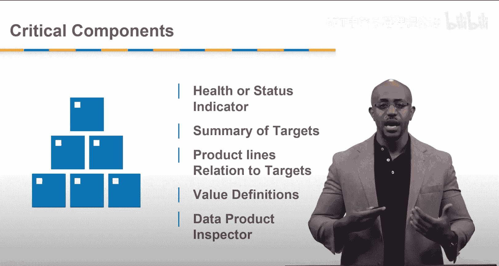
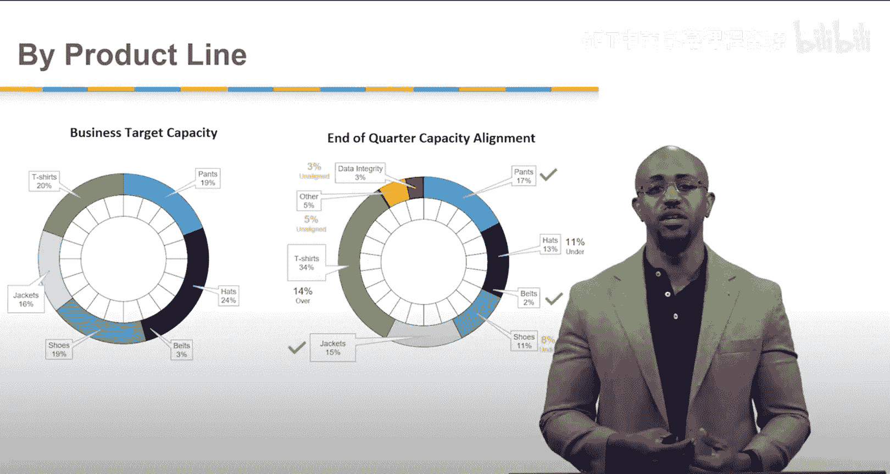
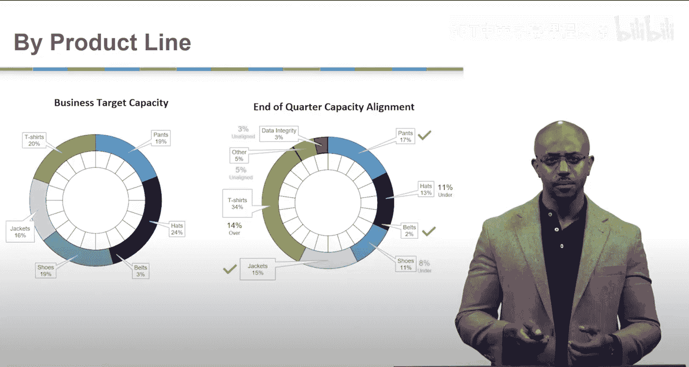
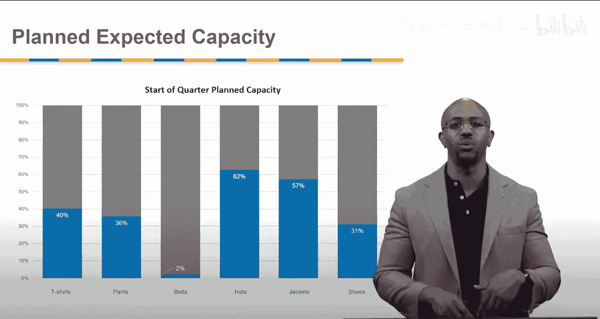

# 黑暗数据迁移与架构：15：智能界面集成方案 🧠

在本节课中，我们将深入探讨如何将智能集成到用户界面中。我们将以T恤工厂为例，并基于供需和工程能力的示例进行构建。

上一节我们介绍了数据集成的基础，本节中我们来看看如何将这些数据转化为直观、可操作的界面信息。

## 界面设计核心原则

当思考用户界面以及人类查看仪表板、报告和智能信息时的交互时，需要考虑一个核心原则：用户需要快速理解当前状态，并迅速掌握信息流向和问题解决方法。

因此，设计用户界面时，应从顶部开始，展示标准状态：我们是否正常？是否按预期执行？如果未达预期，哪些地方表现不佳，哪些地方表现超常。

对于表现不佳的情况，我们需要审视每一个细分的项目，找出问题所在。将这些信息集成到界面中，意味着必须集成你的目标、关键绩效指标或目标与关键成果，这些是衡量业务预期表现的指标，并能快速突出和呈现它们。因为你无法逐一检查海量数据。

以下是构建集成智能的用户界面时至关重要的几个方面：

*   **健康或状态指示器**
*   **目标摘要**
*   **产品线及其与目标的关系**
*   **价值定义**
*   **产品检查员**

## 目标与实际结果对比分析

我们使用类似下图的示例，左侧是业务目标，右侧是季度末的实际结果。

观察这个对比，可以清晰地看到业务如何期望将工程能力分配到预期销量最高的产品和需要软件支持的产品上。

观察右侧结果：
*   **裤子**：基本符合目标，仅有2%的偏差。对于此类指标，通常期望偏差在±5%以内。
*   **帽子**：低于目标11%，严重偏离目标。需要重新调整团队的工作或人员配置。通过检查每个细分任务的优先级，可以找到解决方案。
*   **腰带**：正好符合目标，说明在腰带产品上投入不多。
*   **鞋子**：低于目标8%，虽不如帽子严重，但仍需改进。
*   **夹克**：基本符合目标。
*   **T恤**：大幅超出目标。

通过这个对比，很容易看出我们需要将T恤项目上的一些工作重新分配到帽子项目上。接下来，应查看负责T恤的团队，了解部分工作是否应调整优先级，或者是否需要将一两个团队转移到帽子项目以承担更多工作。

因此，下一步是单独查看各个任务项，观察在软件交付过程中，哪些高优先级任务的进展更快或更慢。

## 数据质量与完整性检查

最后，必须确保在发现数据问题时能够明确指出，这是数据质量检查的一部分。

如图所示，有5%的部分被标记为“其他”，而“其他”并不在目标范围内。这可能意味着部分团队过多地支持了跨企业的其他工作，这是在审视工程能力时需要指出的问题之一。

**数据完整性**是另一个关键点。团队通常会持续更新他们的敏捷管理工具。根据经验，组织需要自行定义可接受的误差范围。通常，如果能将误差控制在2%以下，尤其是达到1%或更低，则表现良好。在定义能力时，总会存在1-2%的误差，但如果能保持在1.x%的水平，通常就很不错。

一些成熟度不高的公司可能从5-6%开始，并逐步降低。如果具备良好的数据质量实践和沟通渠道，配合数据质量检查，应该能够将这个数字降至2%以下，并维持在1.x%的水平。

## 季度初计划能力视图

接下来，这是审视能力的另一种方式，展示的是季度初的计划能力。

与之前季度末的视图不同，这是季度初的视图。每个垂直条代表基于以往表现和季度末预期目标，该产品线自身的计划完成度对比。

当一个季度开始时，不可能所有工作都已确定、评估并准备就绪。理想情况是完成度达到65%到70%。观察图表：
*   **帽子**：团队计划最完善，接近理想区间。
*   **腰带**：完成度很低。但由于其工作量本身很小，这可能不是主要担忧。
*   **鞋子、裤子和T恤**：更需要关注。尤其是我们之前看到T恤在上个季度大幅超支，裤子和鞋子也存在问题。需要确保它们按照标准执行。

这类图表使处于领导岗位或一线的人员能够直观看到问题，并意识到需要调整人员或工作。很多时候，调整工作分配比调动人员更容易，这样人员可以保持原有职责，减少变动带来的影响。

## 总结

本节课中，我们一起学习了如何将智能集成到用户界面。我们探讨了从展示整体状态和目标对比，到深入分析具体偏差和数据质量问题的完整流程。通过具体的T恤工厂示例和图表，我们了解了如何设计直观的仪表板，使复杂的数据变得清晰可操作，从而暴露“黑暗数据”，支持快速决策和问题解决。在实际应用中，此类图表会集成在包含多个图表的仪表板中，底部通常设有专门的问题解决区域。