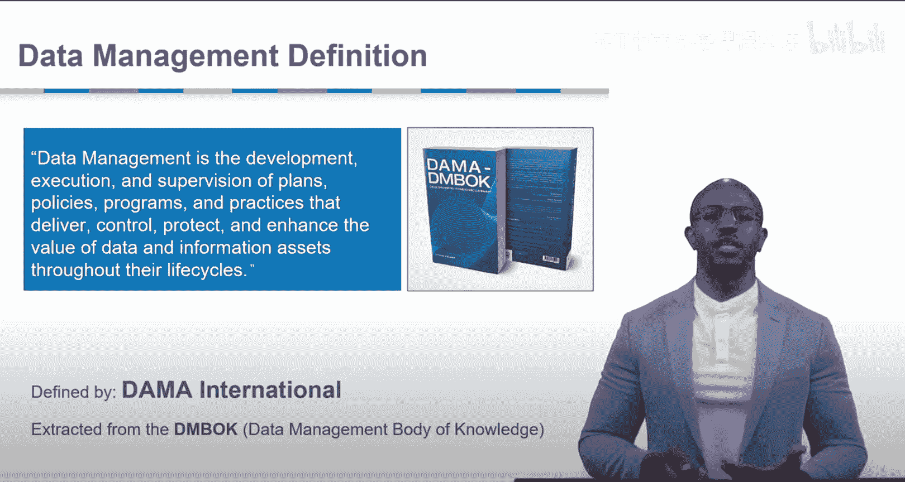
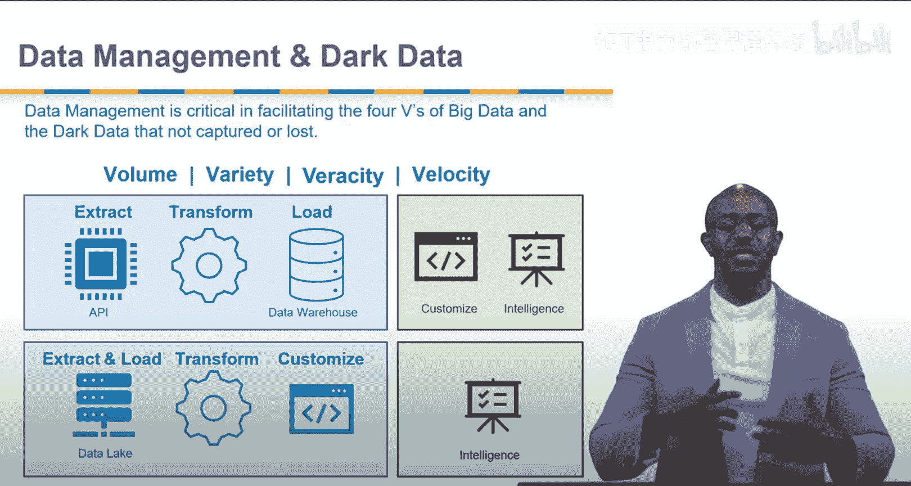
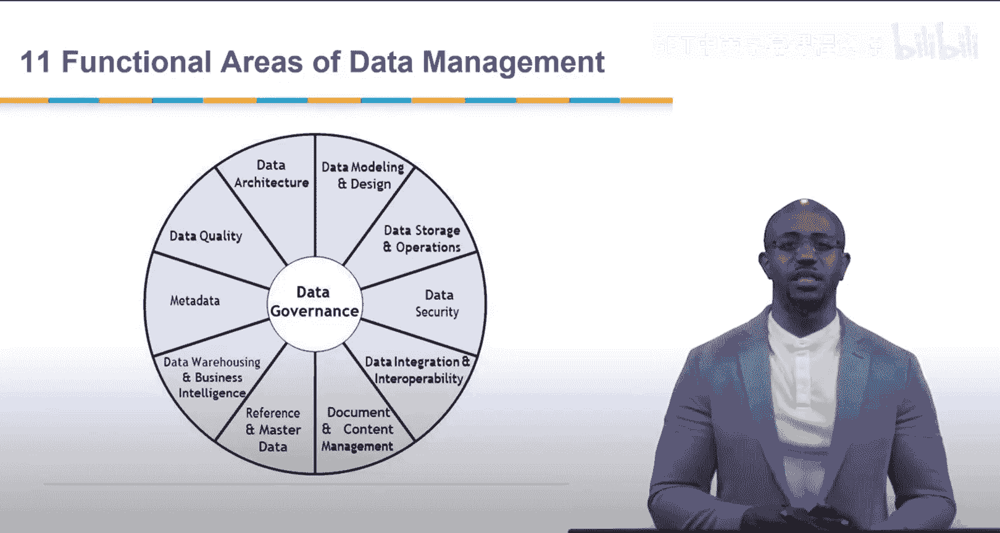
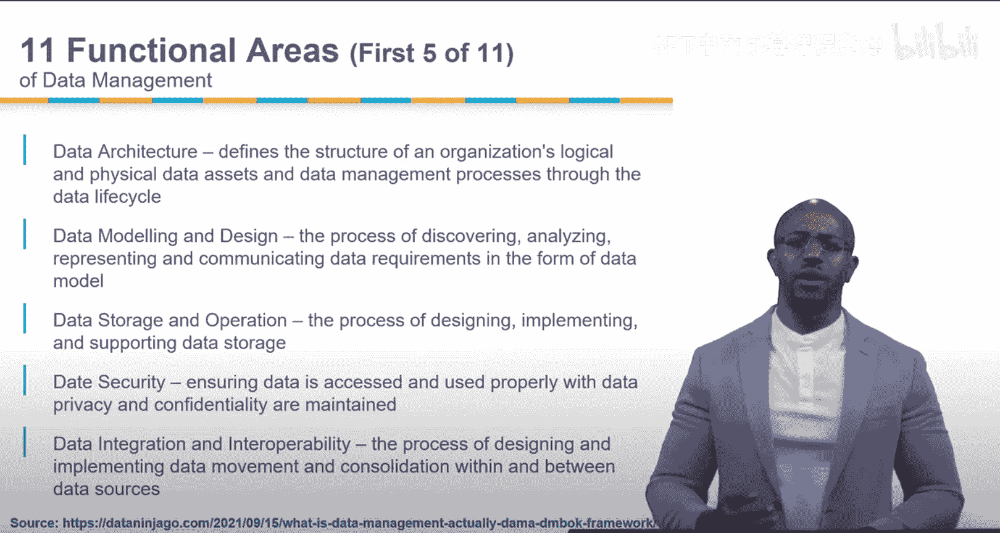
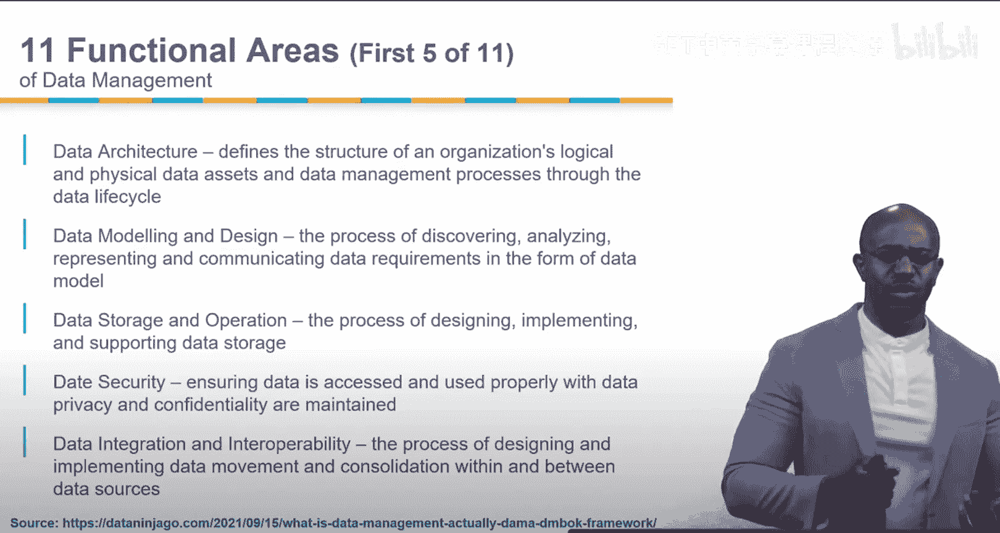
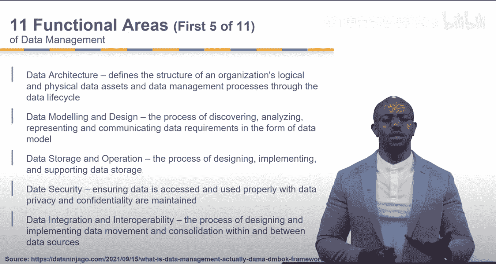
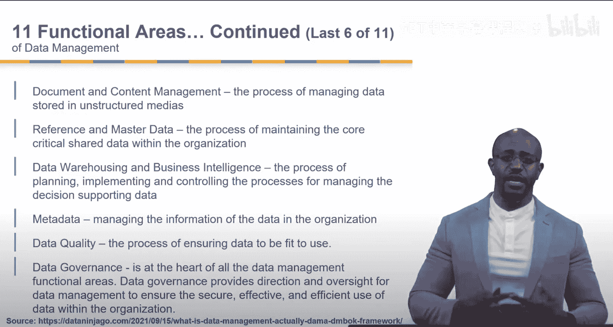

# 黑暗数据迁移与架构：16：数据管理总览 📊

在本节课中，我们将对数据管理进行概述，并重点关注其对黑暗数据的影响，以及我们从黑暗数据中创建的相应数据产品。

## 数据管理定义

上一节我们引入了数据管理的概念。本节中，我们来看看其具体定义。我们参考了DAMA国际组织在《数据管理知识体系指南》中的定义。数据管理的核心在于**提升信息资产在其整个生命周期中的价值**。

简而言之，数据管理是**计划、政策、方案和实践的开发、执行与监督**，旨在**控制、保护并提升数据和信息资产在其整个生命周期中的价值**。

## 数据管理与黑暗数据的关系

理解了数据管理的定义后，我们来看看它如何与黑暗数据相关联。当我们思考数据管理时，可以将其视为一个从数据源到价值产出的支持性框架。

下图展示了两种典型的数据处理流程：
*   **传统数据仓库模型**：遵循 **ETL（提取、转换、加载）** 流程，即 `数据源 -> 提取 -> 转换 -> 加载 -> 定制化 -> 商业智能`。
*   **数据湖模型**：遵循 **ELT（提取、加载、转换）** 流程，即 `数据源 -> 提取 -> 加载 -> 转换（数据科学家/工程师协作）-> 商业智能`。

两种流程都有效，选择取决于数据量、速度、服务水平协议以及对信息更新速度的需求。

数据管理正是我们**从数据中提取价值的支持机制**，它让我们能够以高效且有效的方式处理数据，包括黑暗数据。

## 数据管理的功能领域

现在，让我们深入了解数据管理的具体构成。根据DAMA国际的框架，数据管理包含11个功能领域，它们都围绕**数据治理**展开。

数据治理是理论层面的支持机制和指导原则，引导我们以原则性方法实施数据管理的各项战术。下面我们将简要浏览这11个领域，为你建立一个高层面的理解。

### 核心架构与操作领域

以下是11个领域中的前5个，主要涉及数据的结构、存储和流动：

1.  **数据架构**：指导我们如何访问和利用数据，帮助更好地分析数据、优化系统内数据流动，从而提升整个企业的运营效率。
2.  **数据建模与设计**：与架构紧密相关，共同构建数据的使用蓝图。
3.  **数据存储与操作**：关键在于理解如何设计和实施存储，以有效利用数据获取洞察和价值。数据可能变得陈旧过时，这正是产生**冗余、非及时性数据（腐烂数据）** 的根源。
4.  **数据安全**：确保数据在整个生命周期中的保密性、完整性和可用性。
5.  **数据集成与互操作性**：至关重要，因为数据在系统间流动，需要确保数据以允许客户和消费者最有效使用的方式进行组织和整合。

### 数据价值提升领域

上一部分我们介绍了架构与操作领域，接下来看看专注于提升数据价值的后6个领域：

6.  **文档与内容管理**：对于管理存储在非结构化媒介（如文档、图像、视频）中的数据至关重要。
7.  **参考数据与主数据管理**：
    *   **主数据**：定义了在整个企业或生态系统中统一使用的核心业务实体（如客户、产品）及其属性和值。
    *   **参考数据**：允许对数据进行定制化、扩展、衍生和丰富，并以更统一的方式进行。
8.  **数据仓库与商业智能**：涉及数据的存储、组织以及最终通过报表、仪表盘等形式转化为商业洞察的过程。
9.  **元数据管理**：元数据是“关于数据的数据”，它使我们能更充分地利用数据，并以更多方式连接数据。
10. **数据质量管理**：确保数据的准确性、完整性、一致性、时效性和可靠性。
11. **数据治理**：作为所有领域的支撑，提供战略指导、政策、标准和组织结构，确保数据管理活动与企业目标一致。

所有这11个功能领域对于**通过数据管理从黑暗数据中衍生价值**都至关重要。

## 总结

本节课中，我们一起学习了数据管理的核心概念。我们首先明确了数据管理的定义是提升信息资产价值的系统性工作。接着，探讨了数据管理作为支持框架，如何帮助我们高效处理包括黑暗数据在内的各类数据。最后，我们概述了DAMA框架下的11个关键功能领域，从数据架构、安全到质量、治理，理解了它们共同构成了一个完整的数据价值管理体系。掌握这些是有效管理和利用黑暗数据的基础。