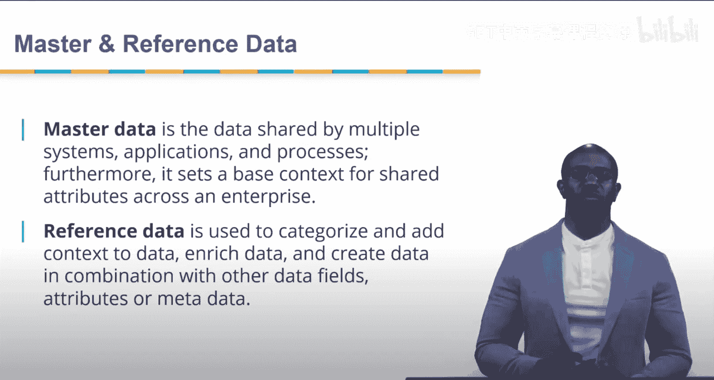
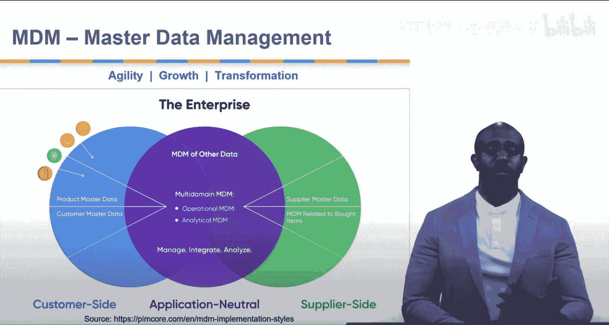
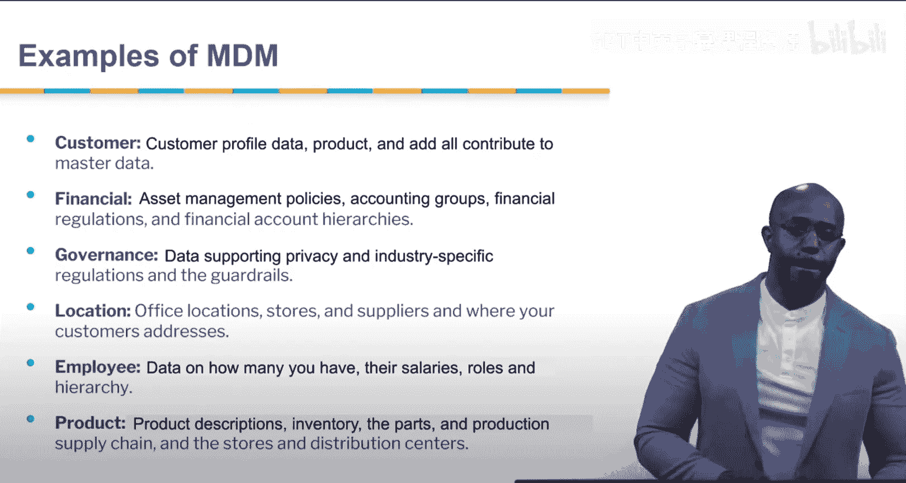
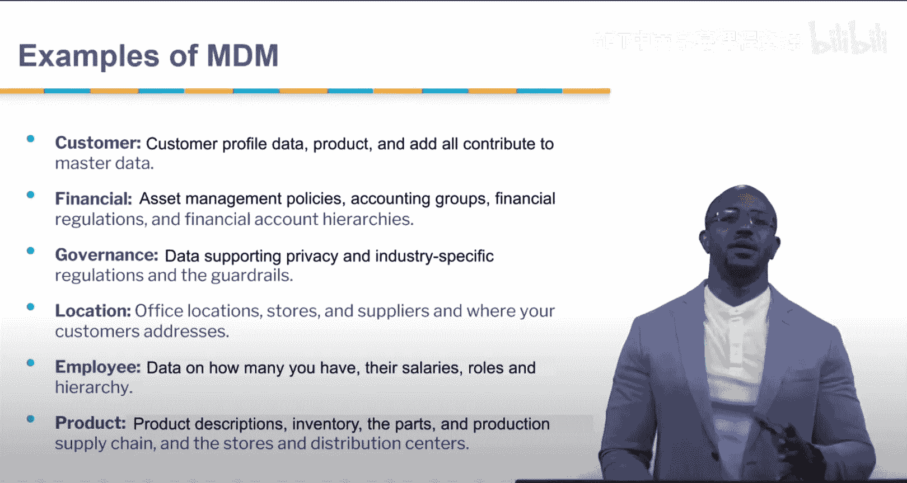
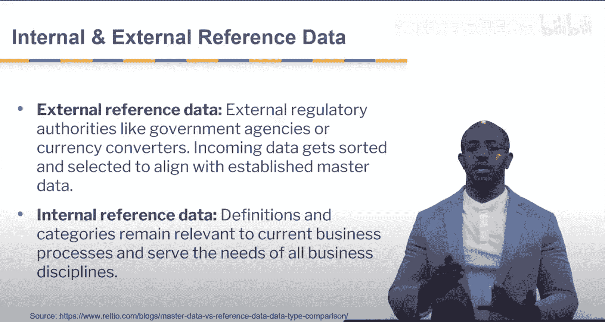
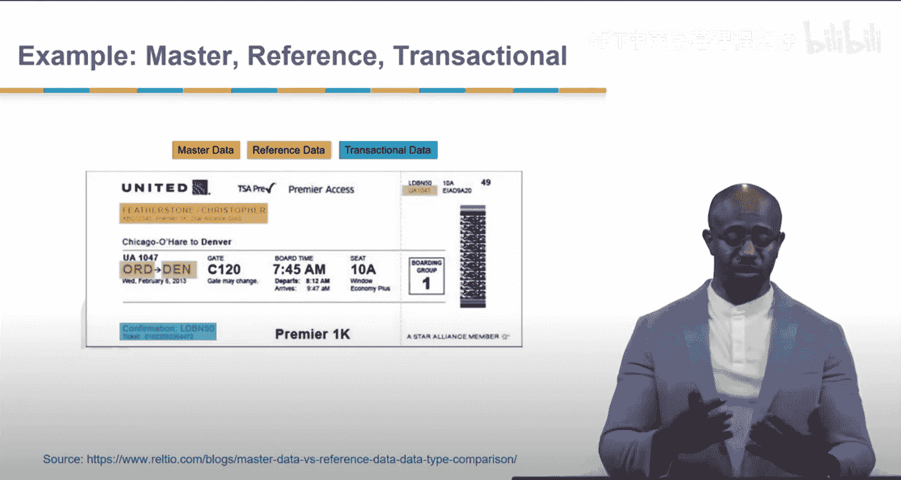
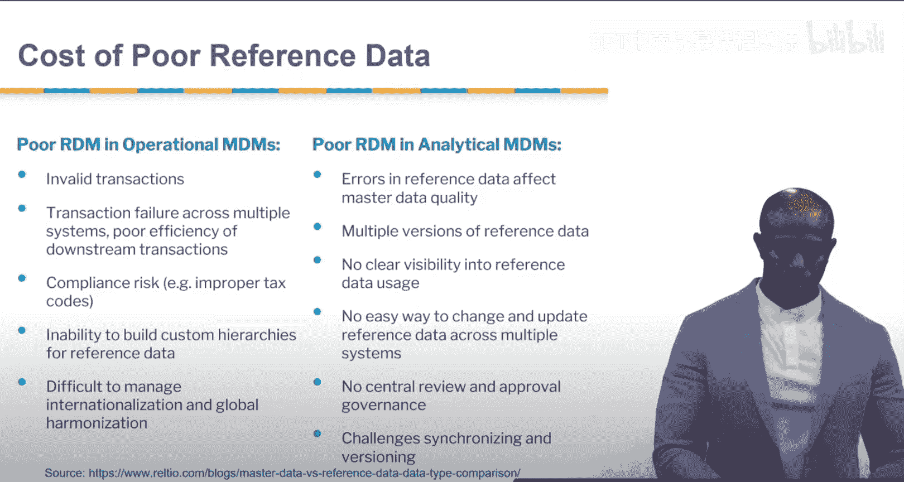
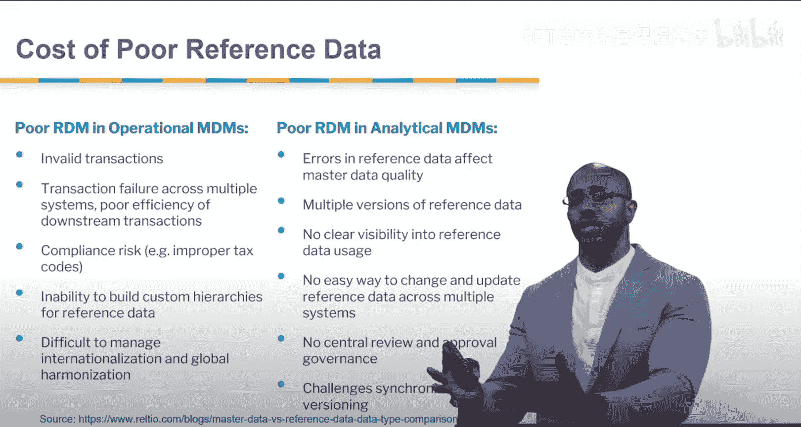
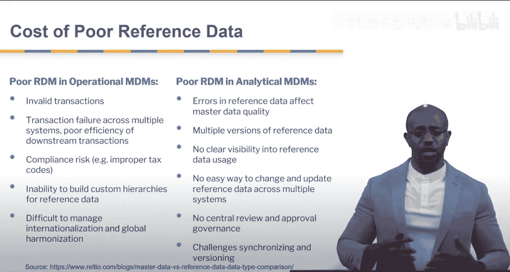

# 17：参考与主数据管理 📚

在本节课中，我们将深入探讨主数据与参考数据，并讨论这两者之间的关系，以及它们与黑暗数据之间的联系。

## 概述

我们将首先定义主数据和参考数据，解释它们在数据管理架构中的角色。接着，我们会通过实例说明它们如何在实际业务场景中应用，并分析参考数据管理不善可能带来的成本。最后，我们会总结这些概念如何帮助我们更好地利用黑暗数据创造价值。

---

## 主数据与参考数据定义

上一节我们介绍了课程的整体框架，本节中我们来看看核心概念的定义。

**主数据**是在多个系统之间共享的、集中管理的数据。它通常是企业整体数据管理架构中**主数据管理系统**的一部分。主数据作为基础上下文，用于在整个企业内共享属性。

**参考数据**通常是主数据的一个子集。它更普遍地用作一种分类方式，用于定义属性或新的数据元素，并在不同对象之间建立关联。因此，参考数据对于丰富数据及其可获取的价值至关重要。

---

## 主数据管理架构

理解了基本定义后，我们通过一个架构图来直观了解主数据管理。

上图是一个简化的示意图。中间部分是**MDM（主数据管理）**系统，它是一个多域类型的系统，大多数公司将其作为集中定义相似数据元素的核心方式。它具有运营和分析双重目的。

*   **运营侧**：包含公司的系统、运营和交易等。
*   **分析侧**：包含大数据、数据湖、数据仓库，并由此衍生出智能和决策。

在图的绿色部分，您可以看到**供应商主数据管理**，它与采购项目数据相关联，帮助我们更好地从供应商端理解数据。在客户侧，则有**产品主数据**和**客户主数据**。这只是我们如何对输入数据进行分类、分组并加以组织存储和使用的两个例子。

---

## 主数据管理实例

以下是MDM的一些常见实例：

*   **客户**
*   **财务**
*   **治理**
*   **位置**
*   **员工**
*   **产品**

以**产品**为例，考虑产品描述、库存部件。您可能在商店见过带有**SKU**（库存单位）代码的商品。这个SKU代码在任何企业内对于相似产品都是一致的。这使得企业能够以统一的方式识别产品，并在出现问题时进行跟踪。

**员工数据**也非常重要。当您考虑薪资、公司层级时，例如经理的薪资在一定范围内，或者考虑角色、层级、权限，以及工程师、副总裁或总监的职责范围，员工数据的作用巨大。

关于**治理**，我们之前已有所讨论，它与财务和客户数据密切相关。通过查看客户数据档案及其与产品的映射关系，您可以开始结合使用主数据管理和参考数据，来分析哪些类型的客户被哪些类型的产品所吸引，反之亦然。稍后讨论参考数据时，您将看到我们如何提取部分参考数据并将其用于此类目的。

---

## 参考数据的类型

现在，让我们进一步探讨参考数据。参考数据通常分为两类：内部和外部。

*   **外部参考数据**：来自监管机构、政府机构、货币转换器等。您将其引入公司，与主数据对齐，并从中创造新的衍生价值和数据。
*   **内部参考数据**：包含许多定义和类别，可能特定于市场营销客户细分、市场细分等领域。它们使我们能够以更有纪律、更高效、更统一的方式开展业务。

当消费者通过不同渠道与企业互动时，这有助于传递更统一的信息。因此，内部和外部参考数据对于成功以及从黑暗数据中获取价值都至关重要，因为您将开始围绕客户细分、市场细分、产品及其内部关系创造新的衍生数据和关联。

---

## 综合示例：机票信息

为了将概念具体化，我们来看一个结合了主数据、参考数据和交易数据的例子。

这是一张**飞机票**。在您的登机牌上，通常会看到此类信息。

*   **主数据**：以橙色标出的乘客姓名，以及可能的客户ID、金卡或白金卡会员状态等信息。这些都来自主数据管理（MDM）表。
*   **参考数据**：以“Orlando to Denver”以及三字代码“MCO”和“DEN”的形式出现。这些可能来自外部供应商或数据源，在我们识别某人从奥兰多前往丹佛时，会显示在登机牌上。
*   **交易数据**：确认日期以及票号。这些让他们了解关于此次交易及其特定迭代的详细信息。

从客户的角度看，您不一定会对看到的信息进行分类，您只是登机出发。但如果您在企业内部工作，您就知道这类信息来自这些类型的源，并且其中的部分信息可以通过黑暗数据产品进行衍生和创建。

---

## 参考数据管理不善的代价

如果参考数据管理不当，会在运营和分析两侧造成成本。

以下是可能产生的问题：

**在运营侧：**
*   无效交易和交易失败。
*   跨系统的多重交易，可能导致风险与合规问题。
*   无法构建自定义层级结构（例如区分金卡会员与白金卡会员），这在客户管理中至关重要。
*   难以实现数据的内部全局协调与统一，如果无法正确匹配，会导致更多问题。

**在分析侧（关于参考数据管理RDM）：**
*   参考数据相关的错误会影响主数据质量，这是公司间常见的主要问题之一。
*   当公司内部存在数据孤岛且未有效沟通时，会出现参考表的多个版本，即重复造轮子。
*   参考数据使用情况不透明，缺乏集中的治理审查与批准。
*   如果参考数据未为分析用途正确设置，同步会面临大量挑战。
*   试图从分析侧创建的黑暗数据中获取洞察，可能会陷入泥潭，而不是以可用的形式从数据仓库或数据湖中产出数据。

这些都是需要考虑的问题。如果您想了解更多关于参考数据管理的细节，请查阅相关资料进行更深入的研究，这里只是一个简要概述。

---

## 总结

本节课中，我们一起学习了：
1.  **主数据**是企业内跨系统共享的核心业务实体数据。
2.  **参考数据**是用于分类和定义的主数据子集，对数据丰富化至关重要。
3.  主数据管理架构连接运营与分析系统，是数据治理的核心。
4.  参考数据分为**内部**（如客户细分）和**外部**（如货币代码）两类。
5.  通过机票示例，我们看到了主数据、参考数据和交易数据如何协同工作。
6.  低质量的参考数据管理会在运营（如交易失败）和分析（如数据质量下降、洞察困难）两侧带来显著代价。

有效管理主数据和参考数据，是释放黑暗数据价值、驱动企业智能决策的重要基础。