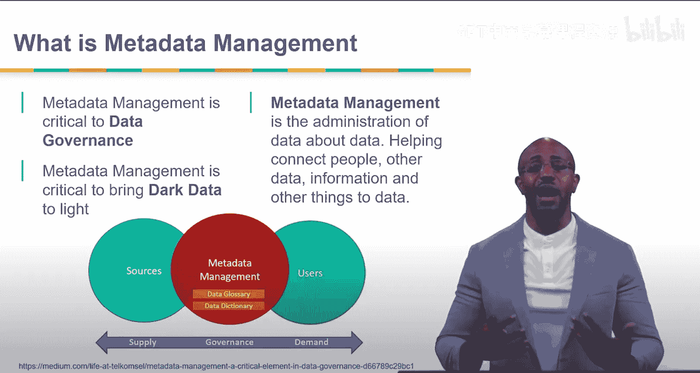
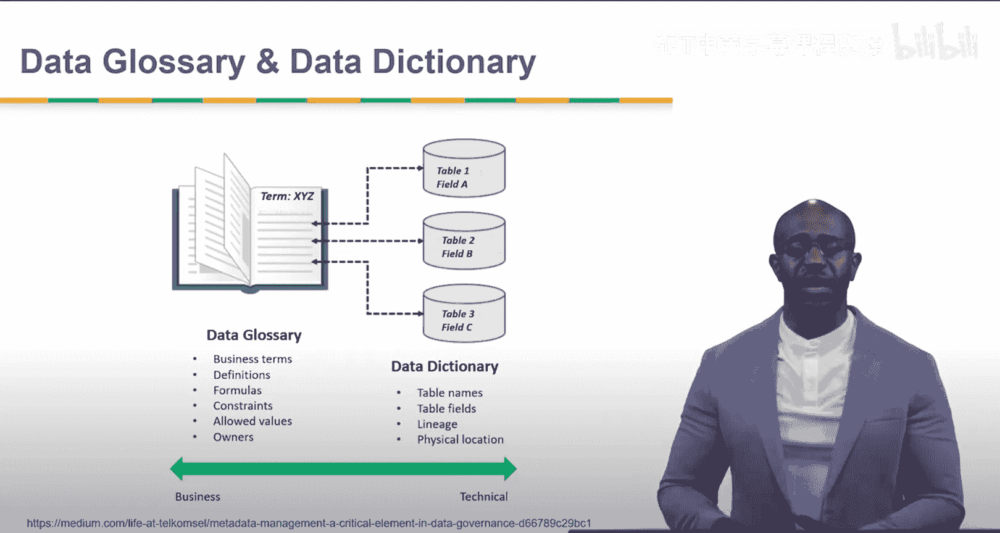
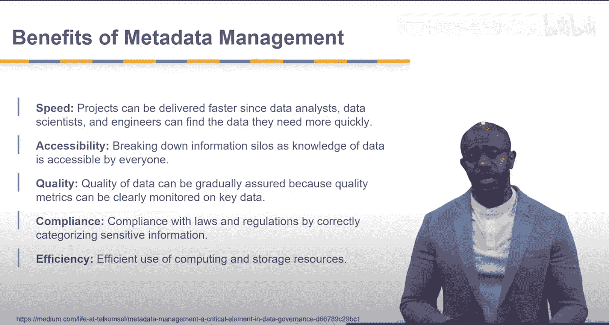

# 18：元数据管理体系概述 🗂️

在本节课中，我们将对元数据及其管理体系进行概述。元数据管理是数据治理和数据管理的关键组成部分，它帮助我们更好地理解、组织和利用数据。

---

### 什么是元数据？

元数据，简而言之，就是“关于数据的数据”或“描述数据的数据”。它允许用户和数据源更好地理解其所指代的数据对象。元数据本身携带其属性，并使得数据的需求方和供给方都能在数据治理的框架下，以最佳方式利用数据。

如果没有元数据，数据的结构和分类将变得非常困难。

---

### 数据术语表与数据字典 📖

上一节我们介绍了元数据的基本概念，本节中我们来看看两个重要的元数据工具：数据术语表和数据字典。当您查看数据表或非结构化数据（如数据湖中的JSON对象）时，能够参考这两者至关重要。

以下是两者的核心区别：

*   **数据术语表**：侧重于数据的**业务层面**。它包含数据元素的业务细节。
    *   定义
    *   计算公式
    *   使用场景
    *   约束条件
    *   使用规范

*   **数据字典**：侧重于数据的**技术层面**。它更关注数据元素或对象本身的属性。
    *   表名
    *   字段名
    *   数据血缘
    *   数据类型
    *   字段限制

简而言之，术语表回答“这个数据在业务上是什么意思、怎么用”，而字典回答“这个数据在技术上叫什么、是什么类型、从哪里来”。

---

### 元数据管理的益处 🚀

理解了元数据的构成后，我们来看看有效的元数据管理能带来哪些具体好处。如果元数据缺失或质量不佳，以下所有方面都会受到影响，进而损害企业的数据能力。

以下是元数据管理的五大核心益处：

1.  **速度**：能够更快地交付项目，分析工作更精准高效。
2.  **可访问性**：用户能够找到、理解并使用数据，从而从中获得洞察。
3.  **质量**：保持元数据的新鲜、清晰和结构化，有助于维持数据质量，防止其随时间推移而下降。
4.  **合规性**：有助于遵守所在行业及企业必须遵循的法律法规。
5.  **效率**：提升计算、存储等资源的利用效率。

关于这些益处，在更深入的课程中会有更多细节，但以上是一个简要的概述。

---

### 总结

本节课中，我们一起学习了元数据的基础知识。我们明确了元数据是“关于数据的数据”，并区分了面向业务的**数据术语表**和面向技术的**数据字典**。最后，我们探讨了良好的元数据管理在提升**速度、可访问性、质量、合规性和效率**方面的重要价值。掌握元数据是有效进行数据治理和发挥数据价值的第一步。