# 19：数据质量管理机制 📊

在本节课中，我们将深入探讨数据质量管理。数据质量管理对于确保数据及其分析结果的准确性、有效性和可用性至关重要。

数据质量管理为提升数据适用性提供了框架，旨在支持分析与决策。随着数据量增长和系统内数据流动速度加快，这一挑战变得日益严峻。下图展示了数据如何从源头最终服务于决策者，而数据质量正是支撑这一完整流程的基石。

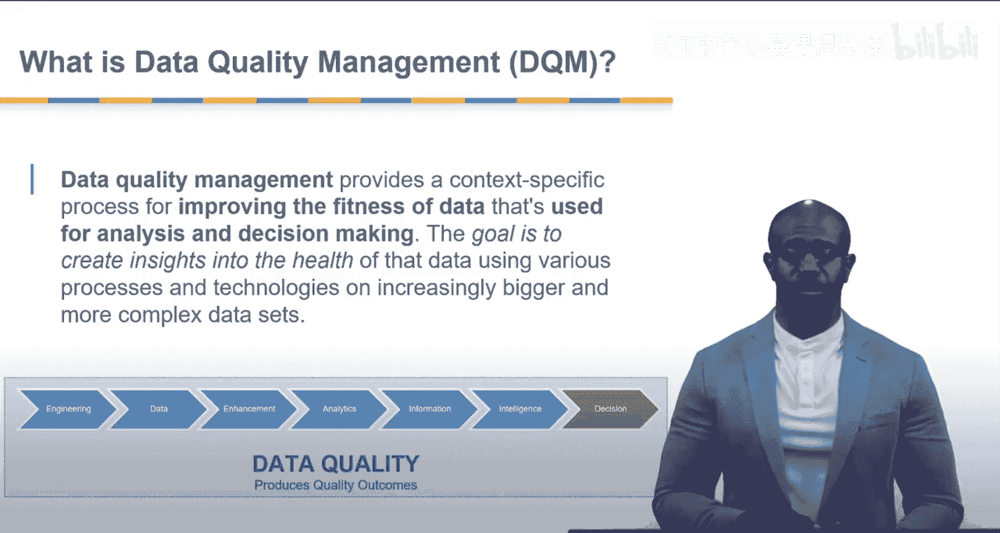

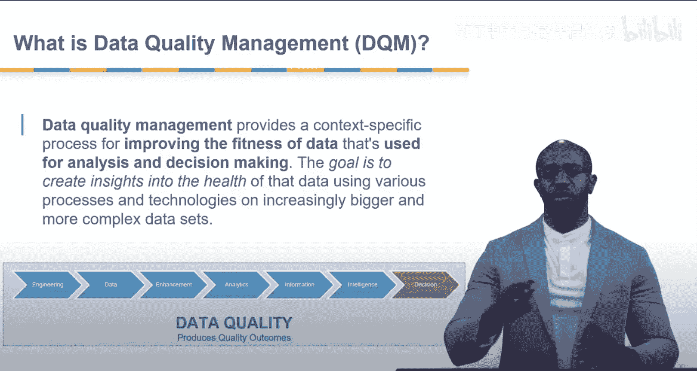

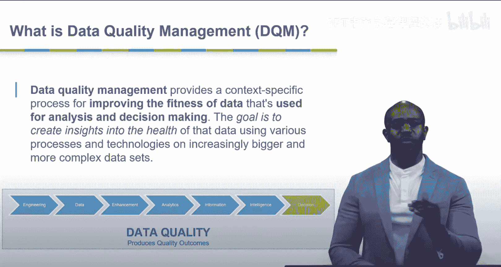

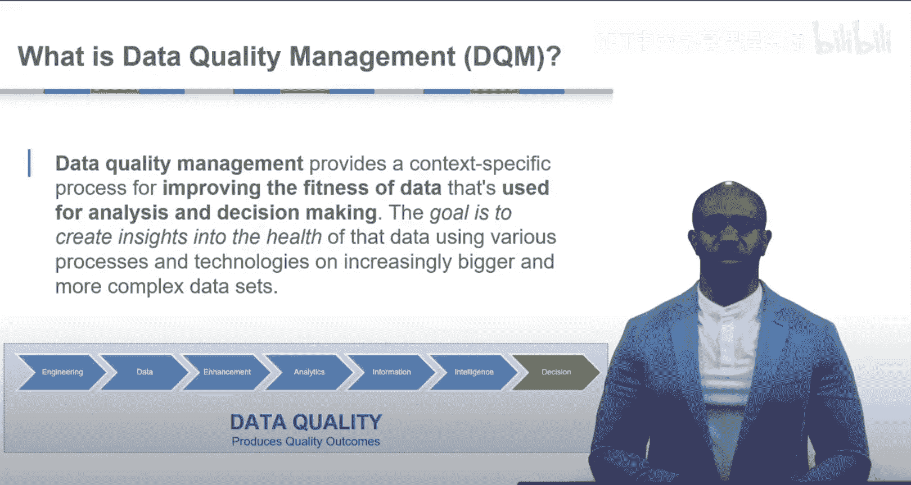

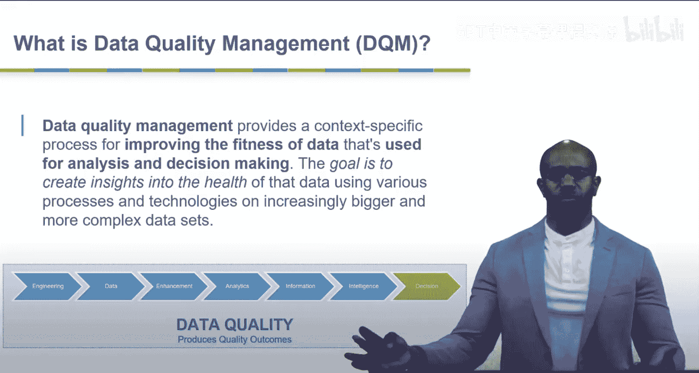

这个过程涉及**工程、数据、增强、分析、信息、情报和决策**。在初始的工程阶段需要大量工作，但随着流程推进，数据被不断提炼和优化，信息变得更丰富，情报变得更精准，最终才能用于做出最优决策。

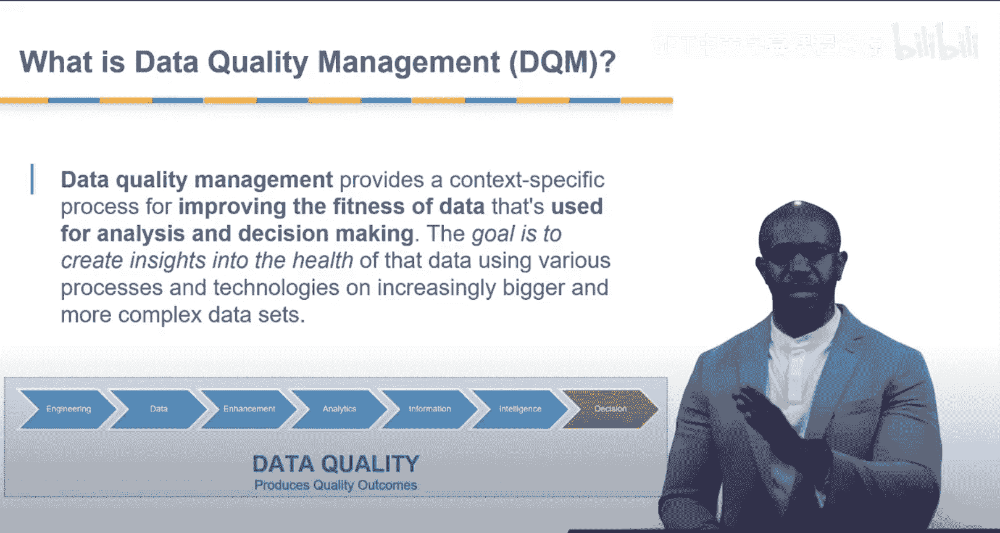

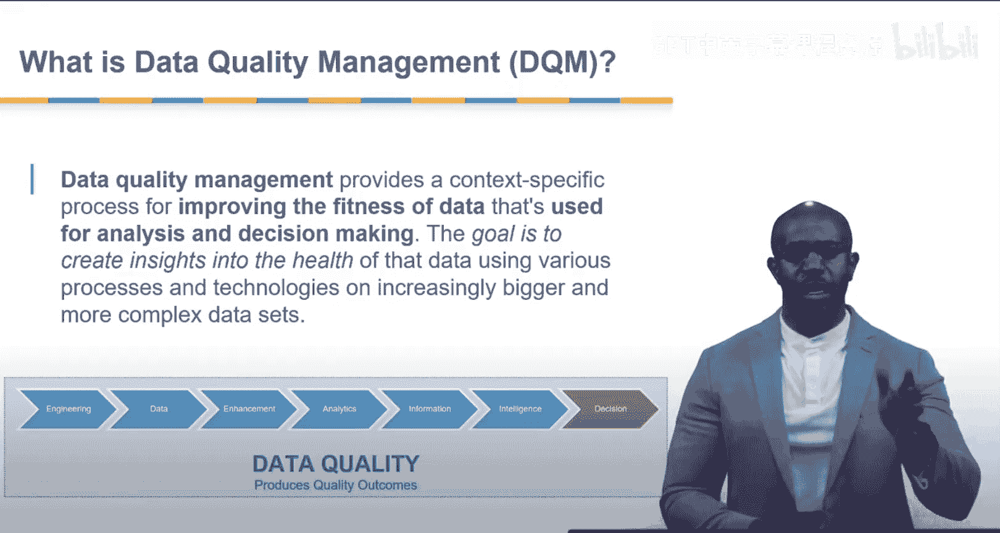

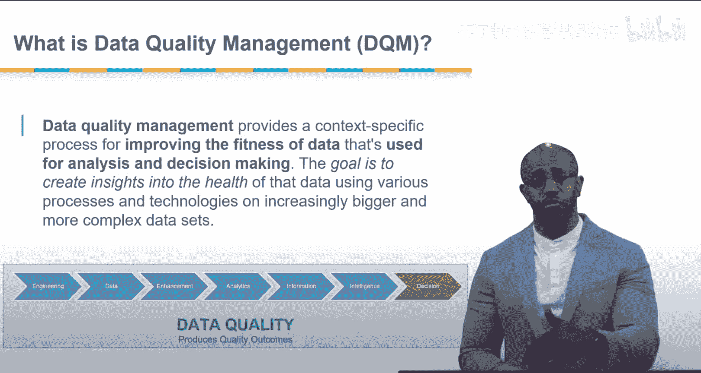

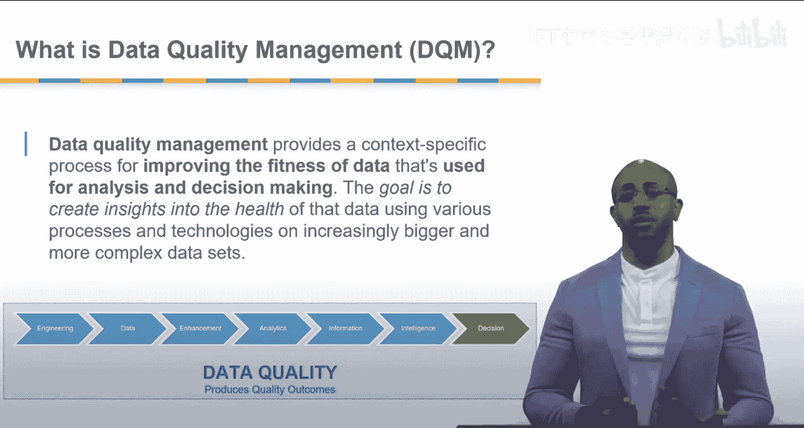

上一节我们了解了数据质量管理的整体流程，本节中我们来看看衡量数据质量的具体维度。数据质量包含六个核心维度。

以下是这六个维度的具体说明：
*   **完整性**：数据是否完整无缺失。例如，数据库中必填字段是否有值。
*   **及时性**：数据是否在需要时可用，反映了数据的时效性。
*   **一致性**：数据在不同系统或不同时间点是否保持一致。
*   **唯一性**：数据记录是否存在不必要的重复。
*   **有效性**：数据是否符合预定义的格式、类型或业务规则。
*   **准确性**：数据是否真实、正确地反映了现实世界中的实体或事件。

这六个维度都极为关键。其中一些（如完整性）相对容易识别，而其他维度（如有效性、唯一性、一致性）在开始进行数据衍生和汇总时尤为重要。请务必深入理解这些维度。

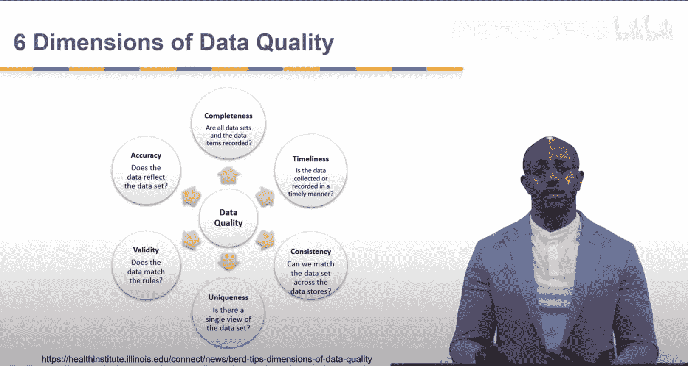

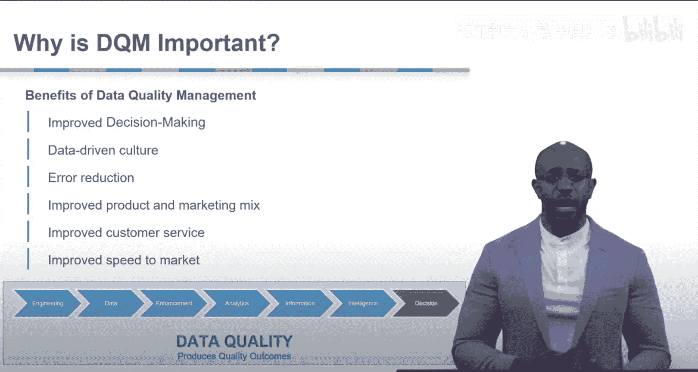

理解了数据质量的维度后，我们来看看实施数据质量管理能带来哪些实际益处。数据质量管理能带来显著的效益。

以下是其主要价值：
*   **改进决策**：基于高质量数据做出更可靠的决策。
*   **建立数据驱动文化**：促进组织内基于事实和数据的运营方式。
*   **减少错误**：降低因数据问题导致的业务失误和成本。
*   **优化产品与营销组合**：更精准地理解市场和客户需求。
*   **提升客户服务**：基于准确的客户信息提供更好的服务。
*   **加快市场响应速度**：依赖及时可靠的数据快速应对市场变化。

这些只是数据质量管理所能带来的众多增值部分中的一部分。因此，花时间深入理解数据质量管理至关重要。必须认识到，如果你无法确保所衍生、创建、摄取、捕获或使用的数据的质量，那么黑暗数据本身将毫无意义。

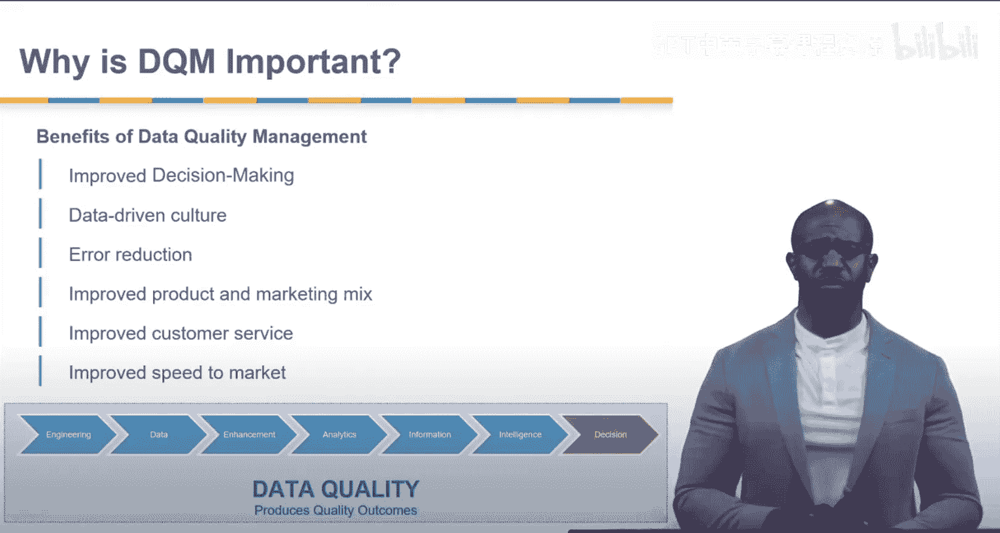

本节课中我们一起学习了数据质量管理的重要性、支撑数据流转至决策的完整流程、衡量数据质量的六个核心维度（完整性、及时性、一致性、唯一性、有效性、准确性），以及实施数据质量管理所带来的多方面业务价值。确保数据质量是释放数据潜力、避免黑暗数据陷阱的根本前提。