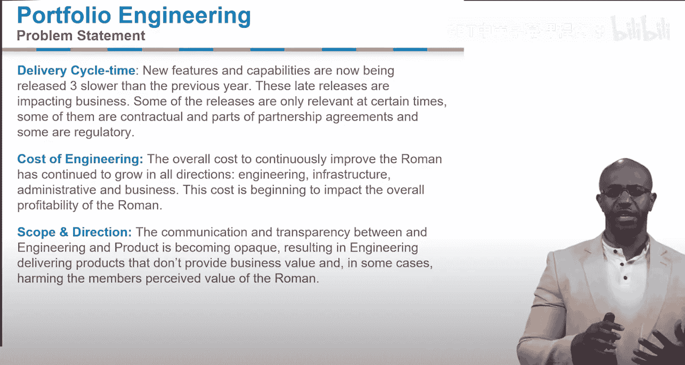
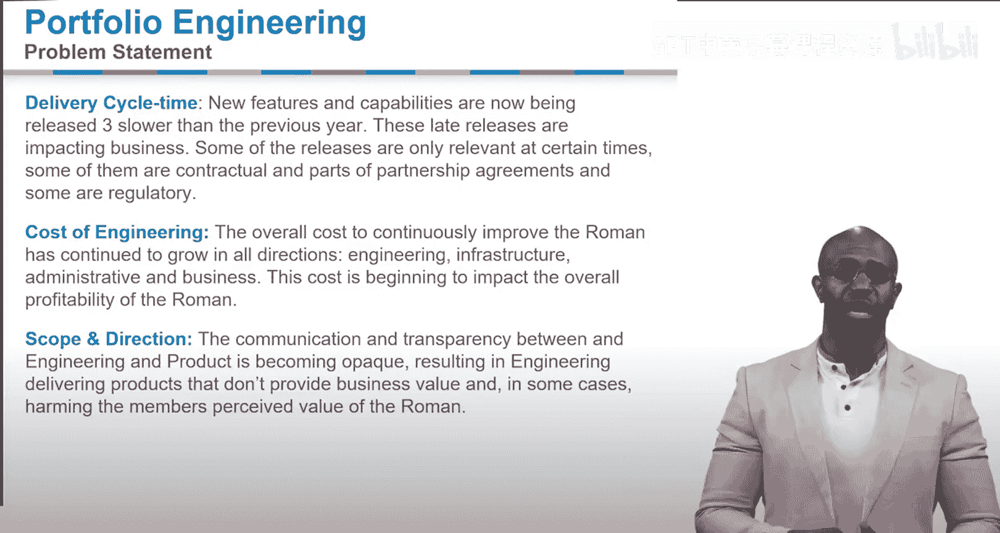
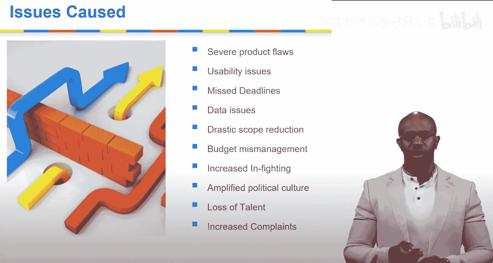

# 20：案例研究背景 🏦

在本节课中，我们将深入探讨一个虚构的金融科技公司案例，了解其在快速成功后面临的挑战。这个案例将帮助我们理解如何运用黑暗数据和数据产品来解决现实世界中的复杂问题。

## 案例公司介绍

欢迎来到本系列三门课程的最后阶段。现在，我们将深入分析一个案例研究。这个案例关于一家在过去几年新成立的数字公司。

这是一家虚构的公司，它已经声势浩大地闯入了《财富》500强。它是一家金融科技公司，名为 **Legion Digital**。

Legion Digital 提供一系列多样化的创新产品和传统金融产品，例如银行账户、信用卡、贷款、房屋净值信贷额度等传统业务。他们还新增了针对比特币和以太坊等数字资产的贷款服务，允许客户在现实世界中释放其数字加密货币的价值，并将其用于投资目的，以尝试扩大自己的投资组合。

因此，Legion Digital 在短时间内实现了非常快速和深远的发展。

## 新产品“Roman”的推出与成功

最近，Legion Digital 开发了一款全新的产品。他们希望捕捉移动设备上的销售点系统市场。正如我们所知，信用卡、移动设备等正日益紧密地交织在一起。

因此，Legion Digital 设计了名为 **Roman** 的全新移动设备。他们称其为进入这个数字优先的新世界所需的未来设备。

随着 Roman 这款新产品上市，它在一年内占据了移动设备市场的巨大份额，捕获了 **30%** 的市场份额，并且份额仍在持续增长。

## 新产品带来的机遇与挑战

这款设备允许 Legion Digital 的合格客户快速获得资金。同时，它也为与 Legion Digital 有银行业务往来并使用其公司卡的企业，**完全免费** 提供移动设备，从而降低了企业成本。此外，企业还能以最低成本将这些设备分发给员工，员工可以从中获得诸多福利和激励。

然而，在这个新市场中，巨大的成功总会伴随着相应的挣扎。成功越大，挣扎也越大。

Roman 设备开始经历一系列问题。他们曾出现过一段时间的服务中断。大量用户使用该设备进行多媒体等活动，给 Legion Digital 的**多租户云基础设施**设置带来了问题。他们尚未为这种规模级别和成功程度做好准备。这款新设备的增长远远超出了他们的预期。

正如我们所说，公司持续成长，实际上已跻身全球前100名公司之列，位列《财富》500强之内。

## 高层面的核心问题

这种成功与挣扎，在高层面上导致了以下三个核心问题。这些问题又会衍生出许多其他问题，但高层面的问题如下：

1.  **交付周期时间变慢**：新功能和能力的发布速度曾经按冲刺、按月、按季度进行。现在速度慢了**三倍**，并且持续变慢。
2.  **产品、数据、营销活动以及公司试图快速自动化的优惠和激励方案的复杂性**持续增长。
3.  **这些延迟发布正在影响业务增长**，因为当个人和公司试图注册使用产品时，由于负载问题，我们无法像以前那样快速分发，这进一步拖慢了交付周期。

此外，政府也开始关注并提出了监管挑战。能够追踪销售情况和客户会员生命周期也是另一个问题。

## 成本、沟通与价值实现问题

现在来看工程成本。总体成本持续上升。通常从方向性上思考，只要收入持续流入，就可以支撑成本。但这些成本正在膨胀，甚至超过了利润率。因此，Legion Digital 正在努力寻找方法，如何利用现有资源更精益、更高效地运营，并在无需花费大量资金聘请顾问或进行其他类型合作来解决问题的情况下，继续保持增长。

接下来是范围、方向和沟通透明度问题。在处理产品发布和上市等事务时，沟通和透明度至关重要。

目前，在工程部门和产品部门之间，沟通变得非常不透明。存在大量信息不畅通的情况，办公室政治正在上演，人们试图争夺事务的领导权和所有权。在某些情况下，他们争夺的可能是不应该由他们负责、甚至可能没有能力处理的事务。当沟通变得不透明，而人们又试图相对快速地解决问题时，就会发生这类事情。

另一个问题是，由于沟通不透明，工程部门有时按照既定的范围交付产品，但范围本身并不清晰。因此，这些交付成果并未实现其**业务价值**。这是一个非常严重的问题。因为当你发布一个新功能或能力时，如果业务价值没有实现，你将会面临来自客户的巨大问题，也会面临来自领导层的巨大压力，他们会质问：“我们并没有提供会员期望从我们产品中看到的价值。”

## 深入问题细节

以上是 Legion Digital 凭借席卷市场的新 Roman 设备所面临的三个核心问题。

现在，让我们提供更多背景信息，并更深入地探讨其中一些问题。

以下是 Legion Digital 在 Roman 产品上面临的一些具体问题：

*   **严重的产品缺陷和可用性问题**：产品存在影响用户体验的根本性问题。
*   **错过最后期限和数据问题**：项目无法按时交付，并且存在数据质量或管理方面的问题。
*   **范围大幅缩减**：这是一个巨大的问题。因为如果我们对外宣传某项新功能以吸引客户，但最终交付的东西与客户的期望不符，范围被缩小，你将会收到大量投诉，在线评分和评级也会从五星降至三星、两星，投诉也会增多。
*   **内部斗争加剧和政治文化放大**：正如我们之前讨论的，这导致了沟通障碍和决策低效。
*   **人才流失**：这对公司来说是巨大的损失，尤其是当你正在创造市场前所未有的独特产品时。关键角色的流失可能是致命的，因为如果某人是开发某项功能的骨干，你必须留住这位人才，至少直到你能将该个人掌握的知识传播开来。
*   **投诉增加**：上述所有问题最终导致客户满意度下降和投诉增多。

这些都是 Legion Digital 在 Roman 产品上面临的问题，但他们必须继续前进。我们将在后续课程中探讨如何利用黑暗数据和数据产品来解决这些问题。

感谢您的时间。

---

本节课中，我们一起学习了案例公司 Legion Digital 的背景。我们了解到这家快速成功的金融科技公司，在推出革命性产品 Roman 后，面临着交付周期变慢、系统复杂性激增、沟通不透明以及成本失控等一系列严峻挑战。这些挑战为后续探讨如何应用黑暗数据与数据产品解决方案奠定了现实基础。