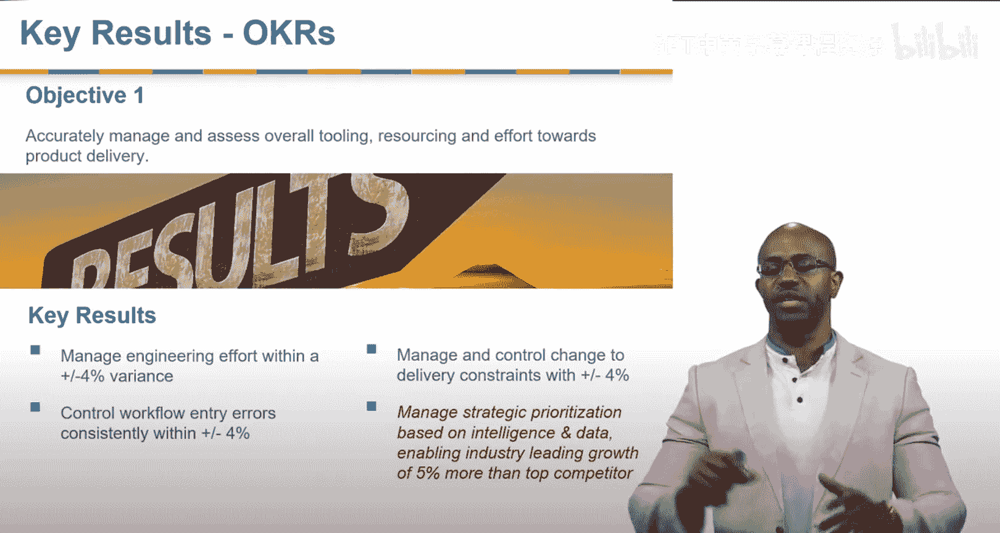
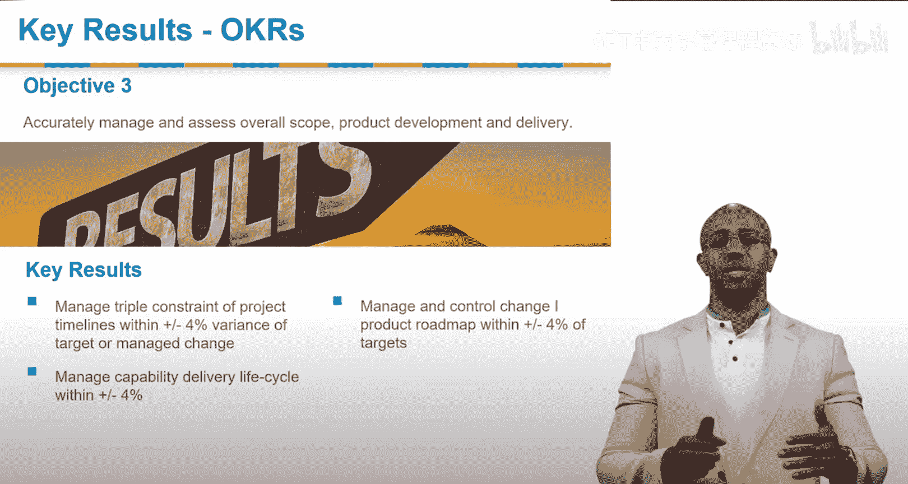
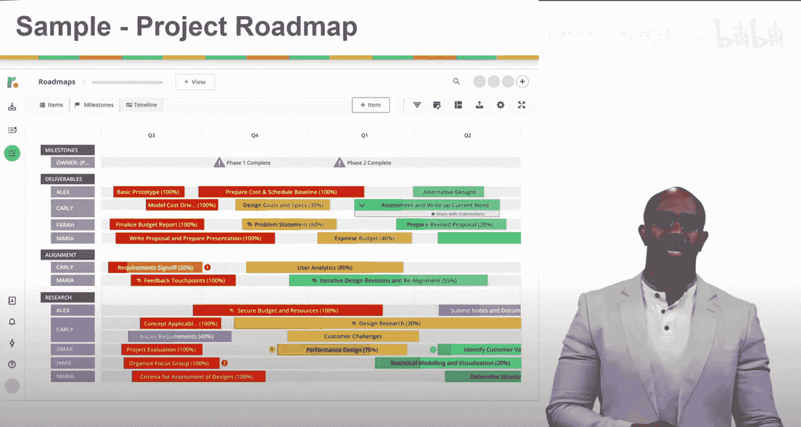

# 21：目标与关键成果体系 🎯

在本节课中，我们将深入探讨Legion Digital案例研究中的目标与关键成果体系，特别是针对新的Roman移动设备项目。我们将学习如何设定清晰的目标，并定义衡量这些目标是否达成的关键成果。

上一节我们介绍了案例背景，本节中我们来看看具体的OKR设定。

## 概述

OKR体系包含三个核心目标，它们与传统项目管理中的“三重约束”相呼应。这些目标旨在通过利用黑暗数据和数据产品，更精准地管理资源、财务和产品交付。

## 目标一：精准管理与评估整体工具资源与工程投入

第一个目标是准确管理和评估用于产品交付的整体工具资源、人员配置和工程投入。这至关重要，因为它使我们能够审视整体价值流和项目组合，从而更快速、高效、精准地调配资源和工程力量。

以下是该目标对应的关键成果：

*   **管理工程投入**：将工程投入的偏差控制在**±4%** 以内。
*   **控制工作流录入错误**：持续管理工作流中的录入错误。
*   **管理控制变更与交付约束**：这需要我们调整流程管理。
*   **基于情报与数据管理战略优先级**：实现比顶级竞争对手高出**5%** 的行业领先增长。此项为延伸目标，旨在激励团队超越基准，但并非当前练习的强制要求。

## 目标二：精准管理与预测整体财务状况及年度预算

第二个目标是准确管理和预测整体财务状况及年度预算。与传统会计方法不同，我们将不再简单地按月平均分摊预算，而是通过精确测量人员流失率、招聘计划、技能组合、关键岗位配置以及承包商使用策略，来优化每一分预算的效用。

以下是该目标对应的关键成果：

*   **管理预算**：将每个组织和项目的预算偏差控制在**±4%** 以内，并确保组织预算与项目预算对齐。
*   **管理财务预测**：将每个组织和项目的财务预测偏差控制在**±4%** 以内。这需要结合招聘计划、流失率等因素进行动态预测。
*   **管理产品成本**：将产品的整体成本偏差控制在**±4%** 以内。
*   **管理投资回报率**：将包含工程成本在内的每款产品投资回报率偏差控制在**±4%** 以内。这里的ROI不仅指金钱回报，还包括对市场的影响力、用户互动方式的改变以及社会效益等更广泛的回报。

## 目标三：精准管理与评估整体范围、产品开发与交付

第三个目标是准确管理和评估整体项目范围、产品开发与交付。这涉及确保我们交付的产品符合预期，并能产生所需的价值，而这些价值将从黑暗数据和数据产品中提取。

以下是该目标对应的关键成果：

*   **管理三重约束**：管理项目的时间、成本和范围约束。变更并不意味着失控，而是需要明确变更带来的权衡。
*   **管理能力交付生命周期**：将能力交付生命周期的偏差控制在**±4%** 以内。能力交付是战略与战术执行之间的关键衔接点。
*   **管理控制产品路线图**：将产品路线图的变更控制偏差控制在**±4%** 以内。这可以与三重约束管理相结合。

为了更直观地理解，下图展示了一个示例性的项目路线图。它按季度划分，展示了里程碑、交付物和各阶段工作。虽然这是一个项目级视图，但我们可以借鉴其思路来构建产品组合路线图，并基于提供的数据开发自动化管理工具。

## 总结

本节课中我们一起学习了如何为Legion Digital的Roman设备项目设定OKR。我们明确了三个核心目标：管理资源与投入、管理财务与预算、管理范围与交付。每个目标都配备了具体、可衡量的关键成果，并且我们了解到，有些成果是基础要求，而有些则是激励性的延伸目标。最后，我们通过一个项目路线图示例，了解了如何将OKR落实到具体的执行计划中。