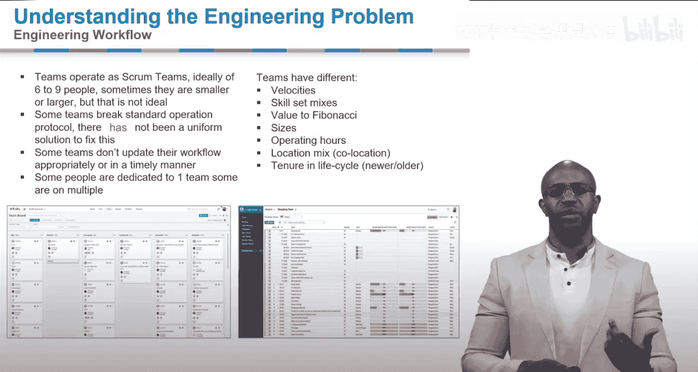
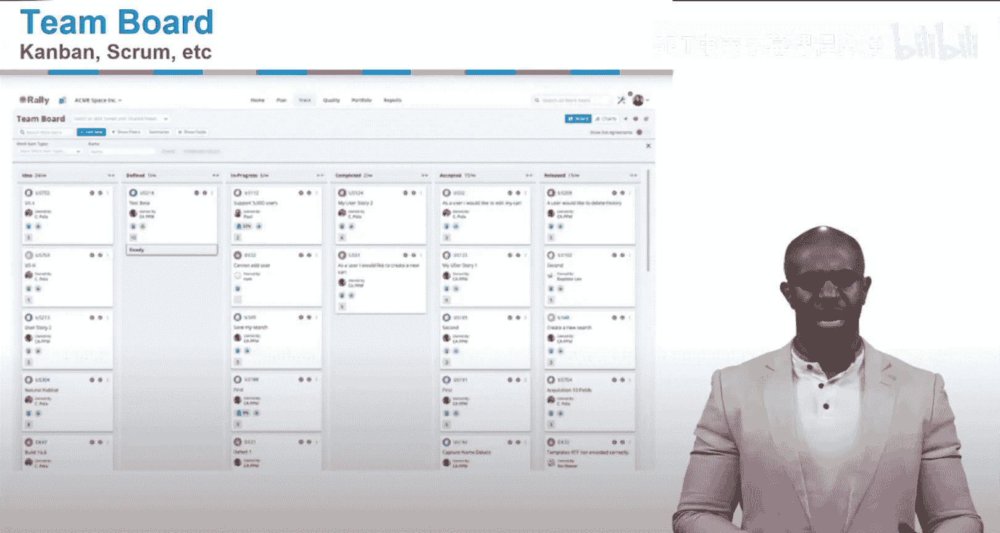
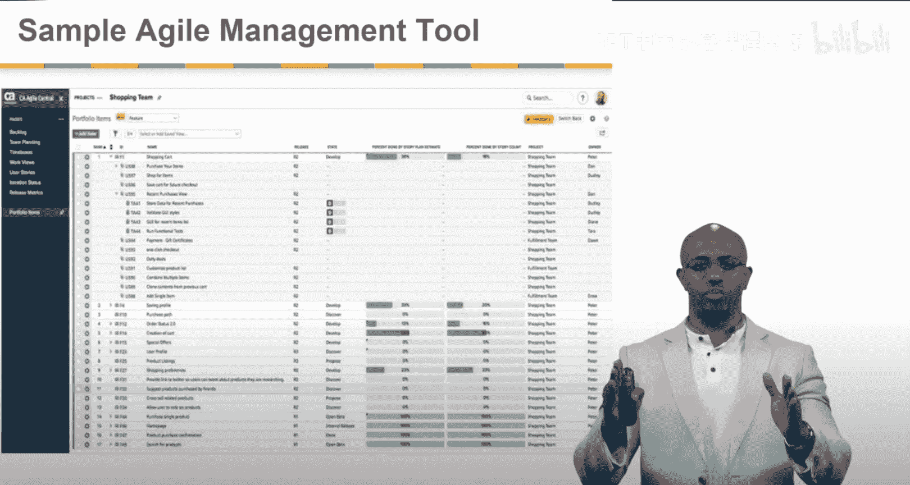
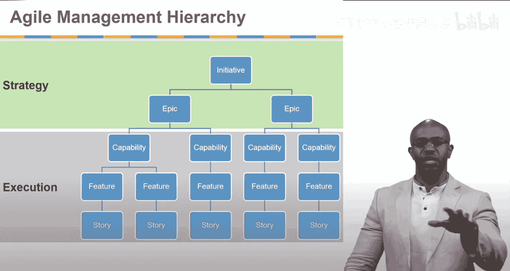
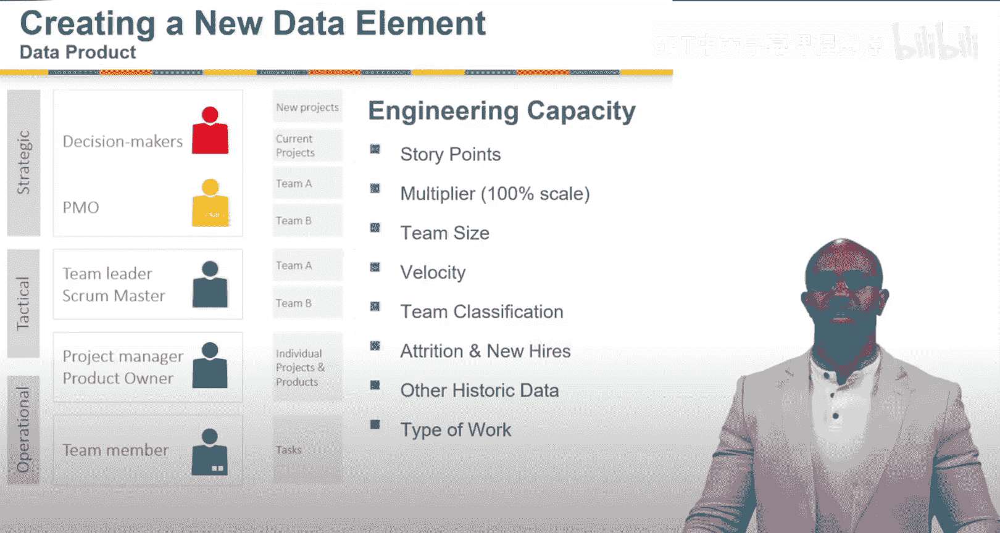
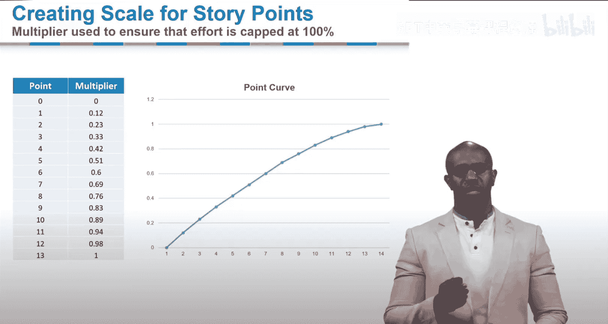

# 黑暗数据迁移与架构：22：工程问题解析 🛠️

在本节课中，我们将深入探讨工程能力问题。我们将从团队的工作流程开始，分析标准敏捷管理工具的局限性，并最终提出一个基于历史数据（即“黑暗数据”）来创建工程能力数据产品的解决方案。

## 团队工作流程概述

大多数团队以Scrum团队的形式运作。这些团队在规模上高度相似，通常是6到9人。虽然有时团队规模会更大或更小，但这并非理想状态。让50人作为一个Scrum团队运作是不可取的。在某些情况下，由于任务和项目高度相关，两个团队可能会作为一个联合团队运作，例如一个17-18人的团队，但他们内部仍可能保留各自独立的站会。

## 非标准工作流程的挑战

并非所有团队都遵循标准的Scrum流程。例如，基础设施团队或支持团队可能采用持续交付模式，直接处理工单。此外，许多公司的工程师不填写工时表，因此了解他们工作的唯一途径是通过用户故事或工单。这带来了一个挑战：用户故事可能分配给某个人，但实际工作可能由多人协作完成，导致难以精确追踪谁在何时做什么。因此，在集中管理时，最好将故事与团队而非个人关联。

以下是团队管理中的几个常见变量：
*   **团队构成**：人员可能同时服务于多个团队，这在高级工程师和架构师中尤为常见。
*   **地理位置**：在全球性公司中，团队成员可能分布在世界各地。
*   **团队差异**：不同团队在速度、技能组合、估算方式（如斐波那契数列）、规模、工作时间、人员构成和资历上存在差异。通常，新团队的工作模式更不稳定。

## 标准敏捷工具的局限性

上一节我们介绍了团队运作的基本模式，本节中我们来看看用于管理这些团队的标准工具及其局限性。

下图展示了一个标准的团队看板，故事从构思到完成，会经历待办、进行中、已完成、已验收、需修订等状态。

标准敏捷工作流与团队看板。

下图展示了敏捷管理工具的另一个视图——项目组合视图。你可以看到特性如何分解为用户故事，用户故事又如何分解为任务。

敏捷管理工具的项目组合视图。

这些视图为团队和相关方提供了概览，但内置的“完成百分比”等功能可能无法反映全貌。原因在于，新的用户故事可能在季度中或冲刺中途被创建并加入，这会导致完成百分比下降，但这并不意味着工作倒退了，只是总工作量增加了。因此，我们需要关注**工作量的传统负载或速度**。

## 从黑暗数据中提取洞察

正是由于标准工具的局限性，我们需要提取和分析历史数据，即“黑暗数据”。通过分析历史模式，我们可以提取特征属性，并在一定误差范围内（如±4%）估算某个特性或能力所需的工程能力。我们不应仅基于故事数量，而应结合多个变量来确定其实际工程价值。

作为项目经理，我个人从不依赖“完成百分比”，因为它只有在项目100%完成时才准确，而那时它已失去意义。我们需要的是创建一个**数据产品**，它能描述工程能力，并允许我们根据一系列变量对特性和能力进行分类和估算。

## 敏捷管理层次结构

接下来，我们了解一下标准的敏捷管理层次结构，这有助于我们定位不同角色的关注点。

下图展示了一个典型的敏捷管理层次，常见于SAFe框架。自上而下分别是：史诗、能力、特性、用户故事。

标准敏捷管理层次结构。

*   **战略层**：决策者主要关注史诗和举措。他们依赖执行层的意见。
*   **执行/战术层**：工程师主要工作在特性和用户故事层面。项目经理和产品经理则横跨能力和特性层面，他们管理故事，并为战略决策提供上下文和价值。
*   **管理层**：总监和初级副总裁主要关注能力层面，并了解支撑能力的特性和故事。

## 工程能力数据产品的构建

现在，我们进入核心部分：如何构建工程能力这一关键数据产品。这个产品将贯穿项目的每个重大环节，涉及时间、财务、能力、产品影响和市场管理。

构建工程能力模型，我们主要从两个核心要素入手：**故事点**和**团队规模**。

### 故事点与标准化

故事点通常基于斐波那契数列（1, 2, 3, 5, 8, 13），并在敏捷中封顶于13。但实践中会遇到变体，我们需要有解决方案。

关于故事点的两个关键假设是：
1.  如果故事点是13或更高（应重新规范为13），意味着团队需要投入100%的精力。
2.  如果故事点是1，意味着应该由一个人快速（例如一小时内）完成。

核心原则是：**任何个人或任务的努力上限都是100%**。因此，任何超过13的故事点都应被视为13（即100%）。

### 速度与团队分类

**速度**是帮助我们确定工作量的关键。它受团队规模、技能组合、人员构成（资深与初级比例）和工作类型的影响。

我们需要对团队进行分类（如A、B、C类），但分类不宜过细。分类后，我们可以结合速度来标准化不同团队对同一交付物的贡献。

此外，**人员流动和新员工入职**会直接影响团队规模和能力，我们需要确定一个合适的节奏（如按冲刺或按月）来跟踪这些变化。

### 工作类型与范围界定

工作类型也影响能力评估。团队可能是后端工程、数据工程、UI设计、数据分析或数据科学团队。例如，设计团队通常比工程团队小。

关于“工程能力”的范围界定，需要做出决策：是否将Scrum Master、项目经理甚至产品人员计入工程能力？这取决于组织的视角。

## 工程能力计算示例

最后，我们通过一个示例来看如何将故事点标准化并计算工程能力。

下图展示了故事点到“乘数”（即努力百分比）的映射曲线。故事点0-13对应0%到100%的努力。

故事点标准化与乘数曲线示例。

关键点：
*   故事点13对应100%努力（乘数为1.0）。
*   故事点超过13的一律视为13。
*   故事点为1时，乘数很低（例如0.08），代表很小的努力。
*   这条曲线的形状可以根据组织对努力程度的理解进行调整。

**工程能力**的计算可以初步表示为：
`初步工程努力 = 故事点标准化后的乘数`
但更完整的模型需要纳入**团队速度**进行修正：
`标准化工程能力 = 初步工程努力 × 团队速度系数`
通过这个公式，我们就能得到随时间变化的、标准化的工程能力视图。这个由历史“黑暗数据”衍生出的数据集，就是我们的核心数据产品，可用于容量规划、财务管理和整个生态系统的分析。

本节课的练习材料将基于Microsoft Excel和CSV格式提供，你可以在此基础上扩展，将其导入数据库进行更大规模的分析。

## 总结

本节课我们一起学习了工程能力问题的解析。我们从Scrum团队的工作流程出发，指出了标准敏捷工具在反映真实进度方面的不足。为了解决这个问题，我们提出了利用历史“黑暗数据”构建工程能力数据产品的方案。该方案的核心在于将故事点标准化为努力百分比，并结合团队速度、规模、分类和工作类型等多个变量，形成一个可 pervasive 使用的标准化能力度量。这为后续进行准确的容量预测和项目管理奠定了数据基础。接下来，我们将探讨财务相关问题。