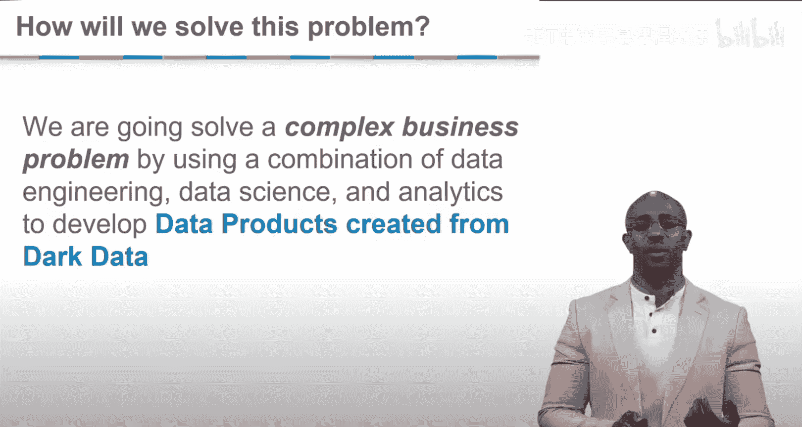
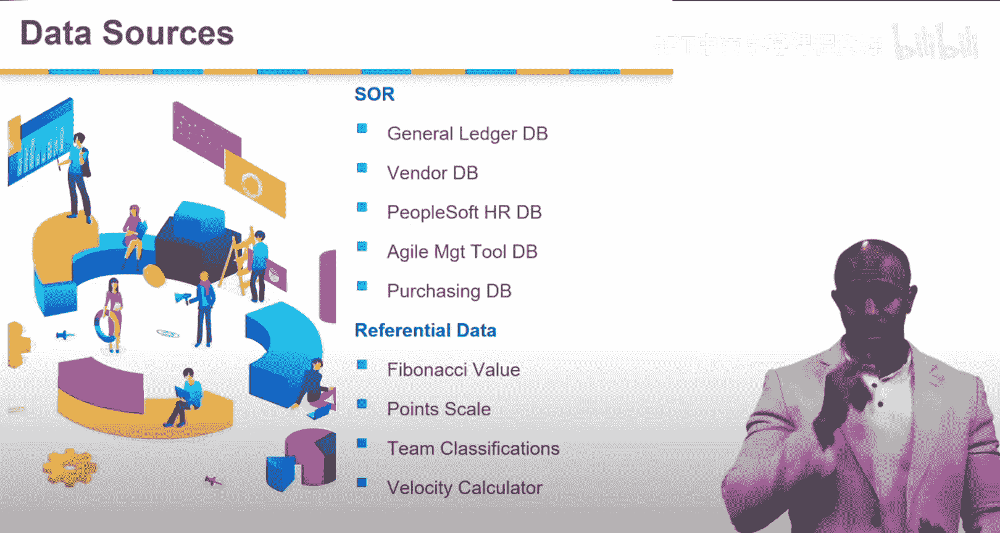
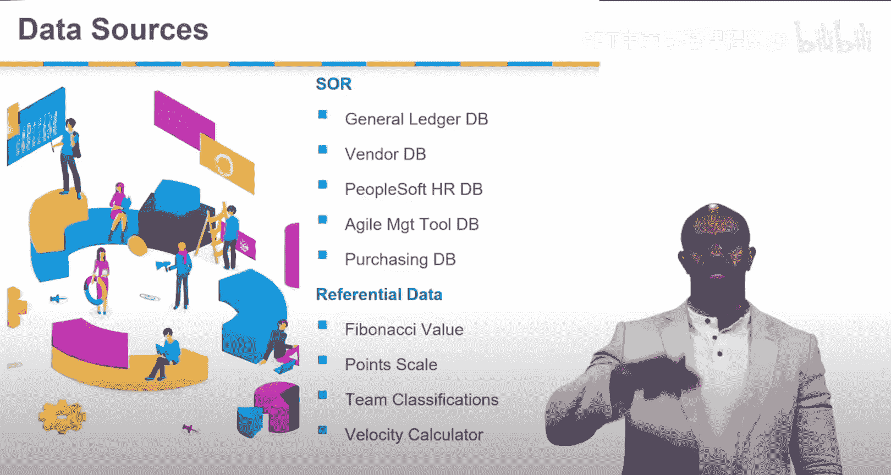
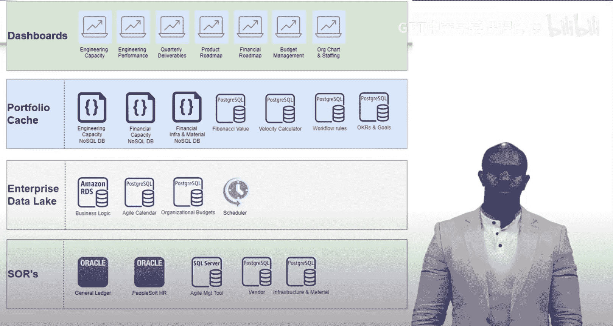

# 23：解决方案路径 🧩

在本节课中，我们将深入探讨如何解决一个复杂的业务问题。我们将学习如何结合数据工程、数据科学和分析学，将黑暗数据转化为有价值的数据产品。虽然本课程主要使用Excel进行演示，但其中的核心概念同样适用于大型企业环境。

## 解决方案概述

我们将通过结合数据工程、数据科学和分析学来解决复杂的业务问题，目标是开发出由黑暗数据创建的数据产品。请注意，由于我们是在小规模数据集上操作，本教程将使用Excel电子表格，因此不涉及软件工程部分。然而，如果在财富100强企业中实施，软件工程也将是重要的一环。

上一节我们概述了目标，本节中我们来看看具体的实现路径。

## 核心组成部分解析

解决方案建立在三个核心支柱之上：数据工程、数据科学和分析学。它们共同作用，将未被充分利用的黑暗数据转化为驱动决策的洞察力。

以下是这三个组成部分的详细解析：

*   **数据工程**：我们将**构建数据架构**并**创建数据**。这包括设计数据结构、确保数据质量，并为分析准备可用的数据集。
*   **数据科学**：我们将应用**数据算法和数据结构**，从初始的黑暗数据中创造新的数据。这涉及发现隐藏的数据关系、推导新的数据元素，并增强现有数据的价值。
*   **分析学与产品化**：最终目标是**创建一个全新的产品套件**。这个产品将帮助我们获取所需信息，其核心围绕工程效益展开，旨在更好地理解工作方式、优化流程、辅助关键决策者，并让工程师能打造更好的产品。

这个解决方案旨在消除管理层与产品层之间的信息隔阂，使我们能够更高效、更快速、更早地推进工作。整个方案的基石是黑暗数据，因为这些数据元素未被广泛认知和使用，容易导致“部落知识”和依赖直觉决策，而我们知道这并不总是正确的。

## 数据源与架构

要构建上述解决方案，我们需要整合来自多个系统的数据。理解这些数据源是工程工作的基础。

以下是关键的数据来源：

*   **财务系统**：例如总账。
*   **供应商数据库**：存储供应商信息、新供应商、供应商费率、工时表等。
*   **人力资源系统**：例如PeopleSoft，存储员工信息、混合费率等。这部分数据将用于与敏捷管理工具的数据进行核对，确保团队信息的准确性。
*   **敏捷管理工具**：这是工程工作的核心基地，使工作变得更加透明。虽然这些工具自带仪表板，但无法整合外部数据。因此，我们需要将财务、供应商和HR数据导入，以补充和增强敏捷工具中的数据，然后再导出供我们使用。
*   **采购数据库**：记录所有采购的软件等资产。

在本课程中，所有这些数据库都将以电子表格中的表格形式呈现。我们将以参照引用的方式使用这些表格，并在其中应用公式。

## 参照数据与业务规则

除了原始数据源，我们还需要一系列参照数据和业务规则来支撑分析。这些是使数据产生意义的逻辑和标准。

以下是我们将重点关注的参照数据：

*   **斐波那契值/故事点量表**：用于估算工作量的标准尺度。
*   **团队分类**：我们将提供一些示例性的团队分类，但也会留出空间让你思考如何根据技能组合等因素进一步细化分类。这一点很重要，因为在进行工程人力与容量规划时，工作不能随意在不同技能的团队间转移（例如，软件工程工作不能转移给数据科学团队）。
*   **速率计算器**：定义“速率”的含义及计算方法，用于展示速率如何使工作负载趋于平稳。
*   **工作流规则**：定义流程和规范。
*   **目标与关键成果**：用于跟踪绩效是否符合目标。

在理想的企业级技术栈中，这些参照数据、业务逻辑和规则会存储在数据湖中的一个“组合缓存”层。ETL过程会通过调度器定期运行，也可能有触发刷新的软件接口。数据可能存储在NoSQL数据库中（以键值对形式），以避免在传统SQL数据库中造成表结构过于臃肿。

然而，由于我们使用电子表格，我们将以非理想但实用的方式模拟这些概念，例如使用多个工作表而非JSON对象来管理这些参照数据。

## 仪表板与数据科学应用

在完成底层数据工程工作后，数据科学的价值将在仪表板层得到充分体现。

以下是仪表板层可能包含的内容：

*   **工程容量仪表板**
*   **工程绩效仪表板**
*   **季度交付物仪表板**
*   **产品自动化路线图**
*   **财务路线图与预算管理**
*   **人员编制规划**

所有这些仪表板都依赖于从底层系统（SoR）和敏捷管理工具中输入的数据。此外，考虑建立一个**数据质量检查仪表板**也很有价值，用于监控数据的正确性、完整性和合理性，并在发现异常时发出警报。

## 回归核心目标

让我们将最后这部分课程收尾，回到最初的出发点。

我们所做的一切都是为了解决课程开始时提出的问题陈述（或解决方案陈述）。我们的努力需要导向三个明确的业务目标。

以下是我们的三大核心目标：

1.  **管理工具、资源和交付努力**：我们需要确保能够一致、普遍且尽可能准确地管理、评估项目交付所涉及的工具、资源和努力。
2.  **掌握财务状况与年度预算**：确保能够管理财务状况和年度预算，并尽可能一致地进行未来预测。这不仅仅是基于历史模式的简单平均分配，而是需要更精准的洞察。
3.  **管控范围、产品开发与交付**：这是三重约束的最后一块。确保项目范围正确，并且我们开发和交付的产品是正确的。

我们所做的一切——提取数据、创建数据产品、从黑暗数据中创造价值——最终目的都是为了**交付价值**。在开展这类项目时，我们有时会沉迷于创造新变量或酷炫的功能，但我们始终需要聚焦于这三个核心目标，并在此基础上打造出色的产品。

## 总结

本节课中，我们一起学习了解决复杂业务问题的完整路径。我们从结合数据工程、数据科学和分析学的整体方案出发，探讨了所需整合的各类数据源，理解了参照数据和业务规则的关键作用，并展望了数据科学在仪表板层的最终应用。最后，我们再次明确了所有技术工作都必须服务于管理资源、控制财务和确保交付这三大核心业务目标。感谢你学习本课程，祝你一切顺利，我们下次再见。