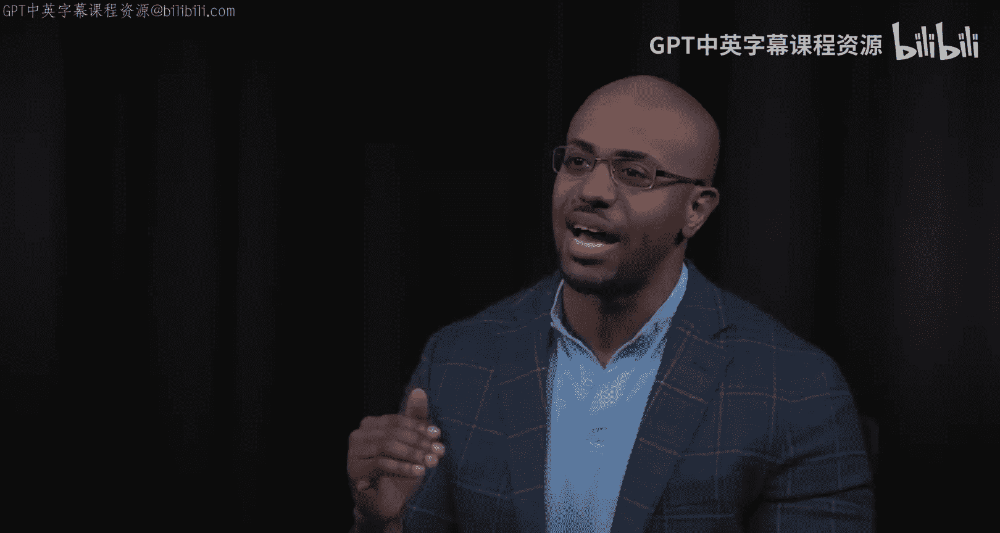
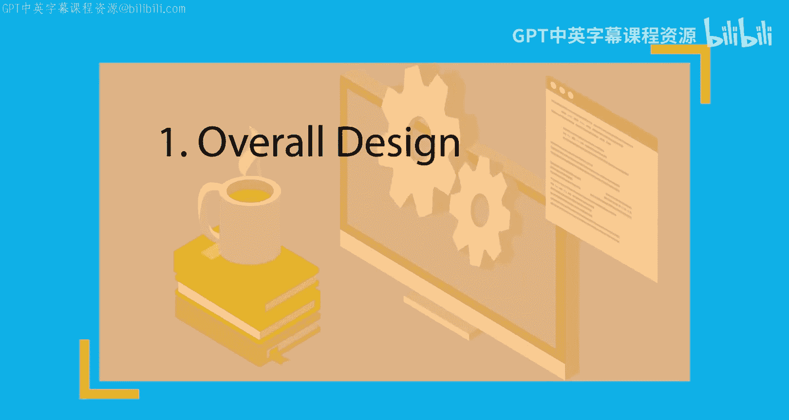
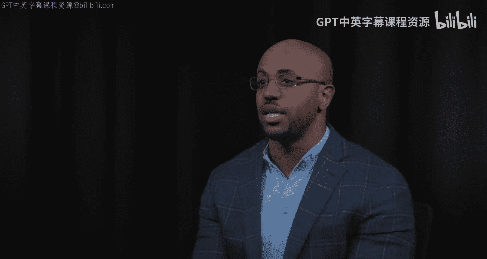

# 亚利桑那州立大学《黑暗数据迁移与架构｜Dark Data Migration and Architecture》中英字幕 p01 0_暗数据.zh_en [BV1TkurzMEmm_p1]

Understanding the unknowns， the unknown， unknown and just not used well， that's dark data。

Dark data is a specialization that should generate a lot of excitement it inherently is the foundation of providing amplified value to the data products that we consume daily in that businesses produced there's data in systems that are looked at it as rot data。

 redundant， obsolete or trivial and in most cases when you're looking at business a lot of times the data that they need at the core is in their systems but the people either lack the expertise the understanding the understanding of where to go to get it and how to use it so when you think about these things and you're thinking about dark data these are things that are uncaptured that should be used or could be used for value and to be able to prevent disaster。

This course is set up for many different types of careers you can be a data analyst。

 a data scientist， you can be a project manager， a product manager anything dealing with creating and problem solving this course is for you the course is structured in three parts the first one is about understanding。

 defining and really getting a grasp of what this is second course is focused around how you engage in a project where you're delivering value or you're trying to prevent failure the last course is focused around anybody who wants to use star data specifically for growth for value。

For the student that comes here within five years， if you understand this topic and you are focused on growing your career and providing value。

 I would expect you to grow your career a lot faster than normal。

 the reason why is because the thinking involved in this course allows you to recognize patterns faster and almost inherently。

 it also allows you to adjust faster when you think about business。

 the innovation that is necessary if you want to be competitive。

 this course allows you to begin the thought process of how to do things bigger， better。

 faster and without as much failure。

