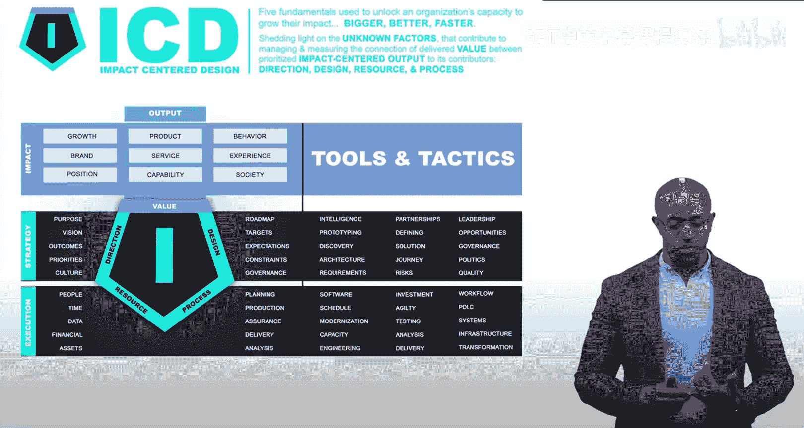
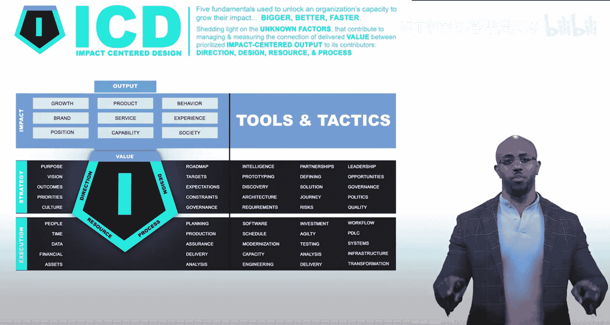
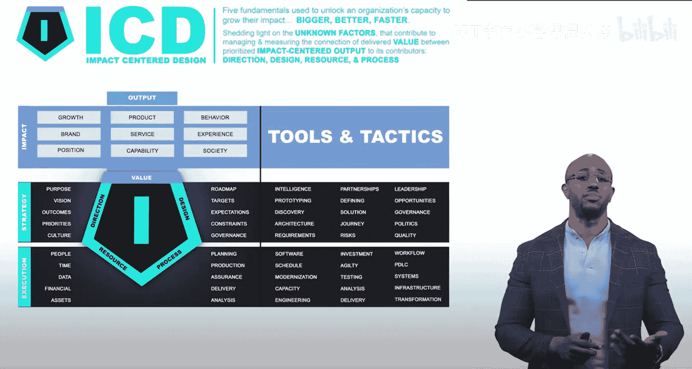
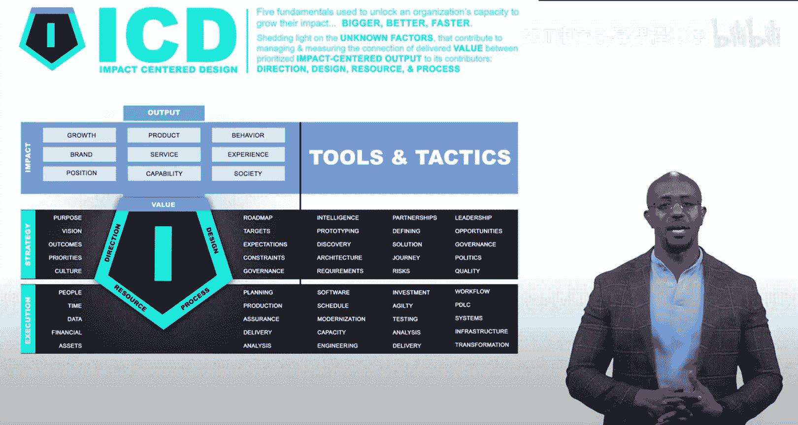
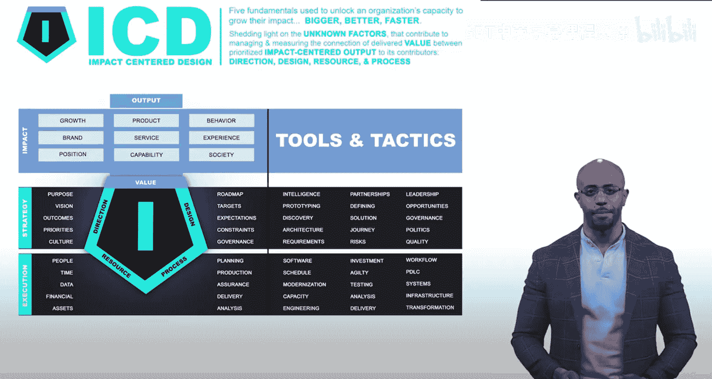

# 亚利桑那州立大学《黑暗数据迁移与架构｜Dark Data Migration and Architecture》中英字幕 p03 2_暗数据基础.zh_en [BV1TkurzMEmm_p3]

Welcome， in this first course， we're going to focus on defining dark data and data products。

We're going to take a deep dive into that definition as it centers around value and value attainment and reducing failure。

We're going to start with impactmp center design， and from there we're going to define all the different ways we can develop impact。

 look at all of the peripheral data that typically is uncaptured or has been captured and has been underutilized。

As we know， dark data is just the unknown， but from a value perspective。

 it's so much more and we're going to look at how we define that and how we gain value and how we reduce failure。

Thank you for your time。

