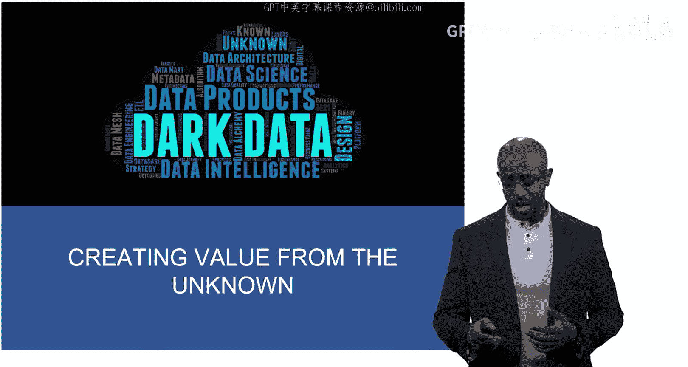
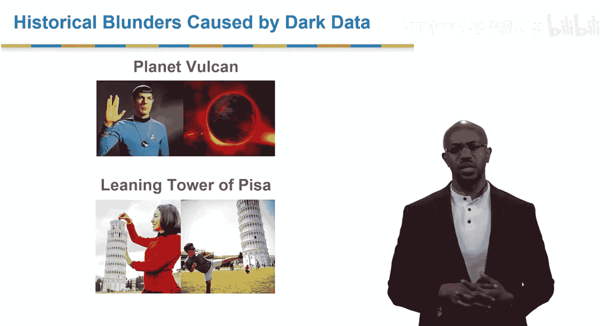

# 亚利桑那州立大学《黑暗数据迁移与架构｜Dark Data Migration and Architecture》中英字幕 p04 3_暗数据定义.zh_en [BV1TkurzMEmm_p4]

Welcome， in this course， we're going to focus on creating value from the unknown by diving deep into dark data。

Now， in this lesson， we're going to first take a look at the generally accepted definition of dark data and then move into figuring out how we want to redefine it for the purpose of value creation。

An anecdote initially。Most of you have seen this picture before floating on the internet。

 you've seen it as a meme， you've seen it out in the public space， you have six scientists。

With blindfolds on touching the same thing， neither of them is able to see the full object to which they're touching。

 One calls it a fan， a spear， a wall， a rope， a tree， a snake。And nobody's listening to the other。

They are all exhibiting what happens when we don't explore the dark data that's around us。

Although this is more of a funny picture。It's one of the things that you can see happening in real life and a lot of the interactions between people。

 between companies， misunderstandings happening， and a lot of times it's from the unknown。

 the data that's in and around us that we have access to most of the time and that we're not using and not digesting and for this course we're focused on taking that information and using it for value creation。

Now first we'll start with this generally accepted definition of dark data， this is from Gartner。

 and with this definition， they're focusing primarily on the data in organizations。

And identifying that data as very low value and it's more expensive and more risky to try to get value from that data however。

 some of the larger companies in greater organizations in the world who have found ways to tap into the unknown that just around us prevalently every day we see things like moneyball and other companies and even in sports where they're able to tap into the unknown。

 the data that's just there and around them， make better decisions and have more ideal outcomes。

 grow faster and achieve the results that they're looking for now for us that's where we want to go with our definition。

 we want to focus more on that value attainment。Now we're also going to define data products。

 so this is a generally accepted definition of data products。

 application or tool that uses data to help businesses improve their decisions and processes General straightforward。

 it's a very good and solid definition， we're going actually going to use this as a basis for our definition because our definition is going to focus on using data products as a conduit for dark data to create value and impact。

So our definition and go。As we reframe dark data， we want to look at how you can productize it。

 find it， change it， enrich it， enhance it。Bring it to the forefront， use it in our daily decision。

 decision support， decision making， find deterministic decisions and stochastic decisions。

 so when we're talking about dark data and creating impact。

 part of it is that productization of the data through data products。Now to provide。

Value and be more impactful One of the things we need to focus on is impact center design right So that means anything that we design as an end tool from a data product using dark data and the data that we do know。

 we want to focus on driving impact through cultural position， societal。

 financial empowerment and many other type of ways that you can gain value from knowing more and understanding things in this complex environment in this complex world。

So this is going to be our value focused definition that we'll use throughout this course。

Data in any form that has or has not been attained and are needed but are not creating or providing value or impact resultant from poor positioning。

 ability， literacy， obliviousness， or any other impacting factor that is unintentional。嗯。

These key words that are highlighted in blue are important for us to understand that data in any form。

 it's typically easier to work with the data that's in our systems and our databases。

 whether even we're talking about structure to unstructured data， JSON objects or standard SQL。😡。

But it's also good to understand the data that's floating around us that hasn't been captured or the data that's in our system that needs some human intellect to be made more full and more whole these are things that will discuss further and discuss more in this course but when we're talking about the result of the value and the impact where it says resulting from poor positioning。

 these are things that you'll want to think about right because when when your company or yourself is in a poor position to attain that value from the data you can it can be one of those things where illiteracy stops you obliviousness。

 not understanding that is there and readily available for you and furthermore。

There are other impacting factors that can stop you， such as。

Competitors intentionally putting out false data or false information。

 One of the things you want to think about as we move forward。 in the last piece。

 when we talk about the unintenenttionality of the situation。Sometimes things are dark， intentional。

 and those things you want to leave dark， such as when you're doing blind testing。

 sampling and you don't want to know the individuals。

 that dark data is okay and that dark data you want to leave dark because you're not looking for value from it。

 actually the absence of the data is what enhances the value that you get from it。

Now looking at the data products， right， so again， the data products are the conduit to which we will attain value from the dark data。

So this is identified as a tool or asset right that the end user that the end user utility will be creating or providing actualable impact or value。

 primarily based on the application of it constantly changing and evolving data and transform into a more useful information that companies can do something with that they can make new decisions with that they can adjust on the fly and faster and in real time and it has to either do something for the end user or enable the end user to do something better and the few examples automated decision making decision support。

 derive data and information and algorithms these are just four of the things that you can use in expressing data products and will go deeper into that and further lessons right so now。

One piece of key vocabulary that I wanted to make sure that we discuss in this first lesson is data productization。

 so this is the process of actually productionizing data products through this various processes。

 data transformation， ETL， just sending the data through APIs， enriching data。

 these are all different ways to gain value from the data and then getting it into a scenario where it can then be visualized by the end user。

And again， the idea is to provide impact and value for the organization。

 so just the sample of those three graphs at the bottom。

 they' just generic graphs that just sort of show this is just information right here。

This isn't intelligence that you would derive from a data product or from the productionization of enriched data variations and derivations。

 so this is one of the things you want to think about as we go further we'll show some sample dashboards and see where there's a difference between information。

 the difference between insights and the difference between intelligence。

 and actionable intelligence that you can gain from dark data and data productization。

A few more key vocabulary terms I'm not going to read the whole list。

 but these are terms that you'll want to make sure you understand you have a good idea of there's a lot that goes into the process of gaining value from the dark data and to bring it back to that initial slide with the gardener definition if we left the definition as it is you'd be looking at a lot of rot data and system and log data in a system which may or may not provide value but with our expanded definition with it being value focused you're looking at ways to capture the data at the data capture points。

 you're looking at ways to transform and use the information around you to gain value from that data to grow that data enable predictive modeling statistics like you see here classification of things data cleansing and data enrichment。

 all these different things we can use to help us and the last piece I definitely want to touch on is data quality is that's a big that's a big part of the equation here if your quality is it's sort of off。

In your data sets and in the transformation of your data。

 it can lead to poor analysis and bad decision making。And lastly。

 just want to leave you guys with a little spoiler for the next lesson。

 the next lesson we're going to focus on some examples of dark data and we're going to use the planet Vulcan and the leaning tower of Pisa for those examples。

 so catch you the next lesson and thank you for your time。

