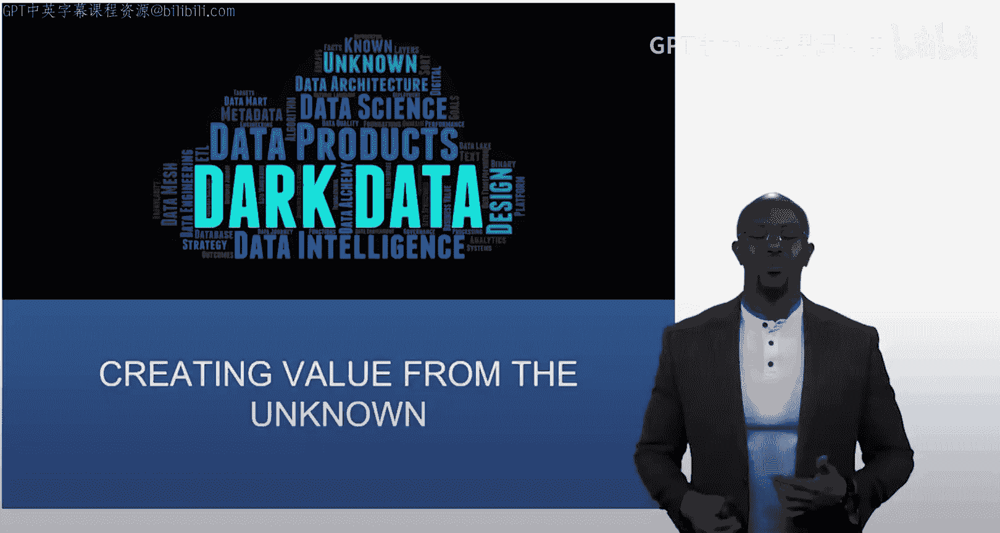
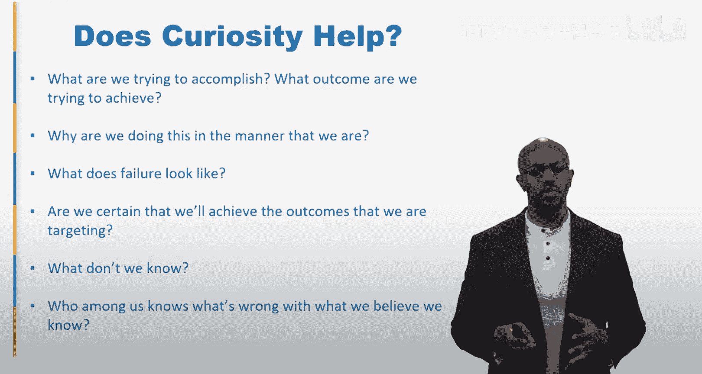

# 亚利桑那州立大学《黑暗数据迁移与架构｜Dark Data Migration and Architecture》中英字幕 p05 4_暗数据的高层实例.zh_en [BV1TkurzMEmm_p5]

Welcome， let's explore some high level examples of dark data。

Now， in the late 1800s and early 1900s， there are a number of scientists who found the planet Vulcan in our solar system。

 and as most of you know， Spock from the hit TV series。

 Star Trek was a Vulcan and that's where he claimed his identity。Now。

 this planet existed between mercury and the sun。And the French scientist， Ur John Joseph Lavieier。

 believed that Vulcan was indeed the planet that caused the variation between the mercury's orbit around the sun that pretty much every scientist at the time could observe。

 So once he put out the the statement that he found this planet。

 he was convinced that he found it between Merrcury and the sun。

 a number of other scientists came forward as they were searching for the planet and said they saw it too。

 So you had this whole array of individuals who saw this planet between Mercury and the sun。

Now he based the finding on him visually observing it。

 plus it being the reason that Mercuryies orbit。Set outside of Newton's laws of gravity。Now。

 this was held true largely amongst most of the scientific community until Einstein came up with his theory of relativity in 1915。

 which ended this search for the planet Vulcan。The theory of relativity suggests that gravity itself is a relative thing that permeates through space and time。

 and gravity affects time as well。 So that explain Mercury's non-stand orbit。

 given its position to the sun and Venus and all the other gravitational forces around it。😊。

This is a good example of people who believe that they know things that are actually unknown to them and is one of the best examples of dark data。

 as well as the next one that we're going to talk about。

 but one of the things that I think a lot of big business ventures fail in。

 a lot of people fail in is stepping forward without the right data without observing the unknown。

 understanding what they know and what they don't in planning for what they know and what they don't。

And then moving forward and having that failure， because things are actually unknown to them they believe that they know。

Now， moving into the leading Tower of Pia， this is an example of we believe we know what we know。

And we believe we know what we don't know。So most of you are familiar with this iconic tower in the city of Pisa。

 which is north of Rome。And most of you may have seen memes of people sort of pushing up and supporting the tower or like this guy on the right kicking the tower。

 but the tower at many different stages of its life cycle has had more lean or less lean and continues to move to this day。

So just a few quick facts on this， it's a freestanding building。

 it took 199 years to build over three phases。The tower itself was built on soggy ground。

It's 183 feet tall， and its lean is currently 3。9 degrees。At times， it's been more at the peak。

 it's been around 5。5 degrees， the total tower weighs upwards of 14，000 metric tons。

 and it has 296 steps。Now。There was a restoration effort that occurred recently throughout the decade of the 90s and going into the early 2000s that stabilized the tower because the tower was at a point where it was close to falling。

 there's been a lot of stress issues on the tower， the actual integrity of the hall， etc cetera。

One of the things that I find very interesting is that the base of the tower is relatively shallow。

 so it's a very tall building with about a six foot base built on soggy and sandy ground。

Not necessarily a great idea。So let's learn what happened with this case study and understand where the gaps are in the dark data so the foundational design of the tower was typically for your standard building so it's one thing building a very wide building on Soggy ground that's okay you can figure out a way to make that work more better but if you're building a tall tower you have to have a strong base you have to dig deeper than six feet。

And typically， you don't want to do it on soggy ground。

The depth and width of the foundation is just to was not going to ever support the scale of the tower。

 and then the upper floors were built in a curved manner over those three phases。

To sort of compensate for the leaning of the tower over those 199 years。Between those three phases。

 wars were fought， there are different leaders involved in getting it built。

 so as they tried to build it， they curve the building and hoped that that would solve the problem。

Now things that they didn't know， obviously back then they didn't have much many experts who were focused on geotechnical engineering in 1272。

 the bearing capacity for the ground， sheer strength of soil。

 and then when you talk about the cohesion of the soil， when you think about actual soil。

Little particles of clay are what actually makes soil coheve together。

 so it's one of those things you want to really think about that back then they just didn't have the expertise to make an adjustment and understand what they were doing and why it was wrong。

So that's the first point of failure and those are four big gaps of dark data that they missed。

Now when we talk about the 1990s。In the 90s， they initially caused a tower to actually lean forward more as the first big attempt was to dig holes in the leaning side。

Freeze the ground by using liquid nitrogen and then pour in metal into the ground to reinforce the base。

This obviously wasn't going to work， given that most ground has some level of water in it。

 so once you freeze the ground， the ground is going to actually expand and then once it defrosts。

It would then sink the building more so it actually the first attempt in the 90s actually causes the tower to lean further and further than the expectation of where it would possibly fall most experts said that if the tower got to about4 and a half to 5 degrees the tower would just fall but it actually went to about 5。

5 degrees and it just didn't fall in part possibly because the building was built in curved manner。

However， recently， the geotechnical engineers were very successful in the early 2000s by digging on the opposite side of the tower。

Slowly in removing ground underneath the building on that high side。 right。

 And what that caused is it allowed gravity to do its work。

 and the building slowly started shifting back the other way。😊。

And now the building is more stable and the engineers have decreed that it should be stable for another 200 plus years。

 so we'll see if that prediction comes into fruition。

One of the things we might want to ask is does curiosity help， right？

From my perspective I think it 100% does right so asking yourself what are we trying to accomplish。

 what outcomes are we trying to achieve， even if they seem to be obvious。

 what does failure look like and are we certain that willll achieve the outcomes that we are targeting based on what we do or do not know and at based what do we not know right？

And lastly， one of the things you want to focus on in curiosity is。As you're building a building。

 especially when you look at something like the leaning tower of Pi， such as a tower。

You'll want to think about some of the base things that are there， the quality of the building。

 the structural integrity， we don't want the building to fall， things like that。

 and then that lets you back into what are the preparatory steps that you need to take to ensure the success of your endeavor。

Thank you for your time。

