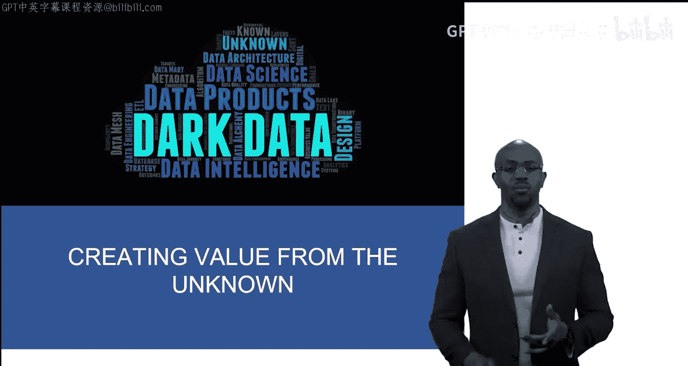
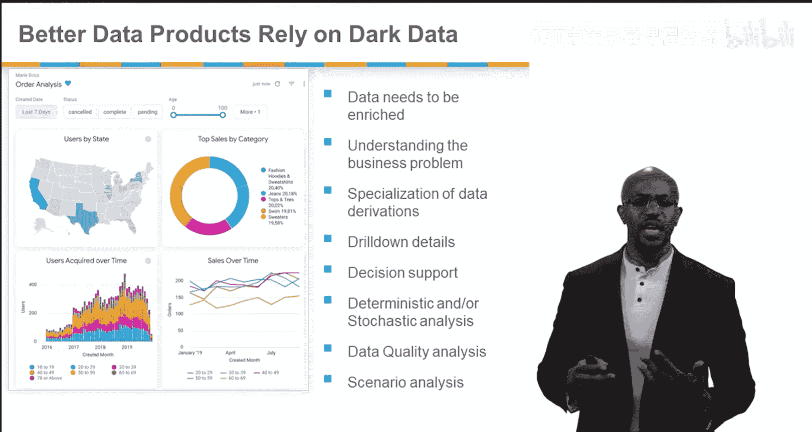

# 亚利桑那州立大学《黑暗数据迁移与架构｜Dark Data Migration and Architecture》中英字幕 p06 5_数据产品化价值第一部分.zh_en [BV1TkurzMEmm_p6]

Welcome back。 And we're going to talk about deriving value from data productization。

Just a brief reminder here on our value focused definition of data products。

 remember that we're looking for tools or assets that can help us derive impact and value。

 enable users to do something or enable users to do something better from the data that we've evolved transformed or changed in some manner。

So I want to go with this example of a dashboard， this is just a generic dashboard and I want to go into this and talk about how we're zero why are we zeroing in on data products so most intelligence center applications。

Rely on some form of visualization for us to consume the information insights and intelligence within right so data products are conduitent for decision making theyre a conduit to allow these visualizations to work better and allow them to provide us the insights from a deterministic or stochastic manner and allow us to move forward they also provide the ability for us to find opportunities and one of the things that you'll notice as you look at dashboards throughout different companies and throughout the business world itself is that most dark data navigate gets product ties and that most dashboards just sort of give you status indicators of where things are it's rare when people can dive into that dark data and start making those stochastic or deterministic actions based on the information。

Right。I want to use this as an opportunity for us to together look at this dashboard。

 identify where data might be missing， where dark data might be missing。

 where there's opportunities to transform and elevate dark data to the visualization to enable us to do better intelligence。

 so I want you guys to pause the video， look at the dashboard。

 identify what you think may be missing， and then we'll come back together。All right。

Welcome back so I'll just ask a few questions。 Did you guys look at the first quadrant with the United States？

This is your standard heat map type of a thing where you can see the number of orders by state。

If you look looks like California and Texas are pretty big right and if you look at then the top right quadrant when you see top sales by categories。

 you see the different categories in which ones take up more volume and if you hover over these you didn't be able to see like the totals。

 the numbers， all that stuff so that's sort of inherent but what's missing from that piece as well and then looking at the lower quadrant my next questions are when you look at that users acquired over time。

What's missing there？You see year by year and each of the individual pillars are each month。

Over time things are growing depending on the age of the person。

 then when you look at sales over time in general。You can see the change in volume based on those trending lines as well。

 So what do you think is missing？We'll point that out a little bit more now right so the data needs to be enriched a little bit more to provide more value for some of these views there needs to be more drill downs we need to understand the business problem that they're trying to solve do they just need a status and update。

Or are they actually trying to get more sales and more users and more customers？

Typically more businesses are trying to do that right do they understand the the specializations needed within the derivations that are possible So。

 for example， if you look at the United States picture there。

 California looks like it has the most orders followed by Texas。But the question is is。

Is it more orders relative to the population relative to the major metropolitan areas。

 are certain areas more successful than not？And then in the states where there aren't many sales。

The question is， have we not tapped the market with the same type of marketing right。

 or do we need different marketing， have we penetrated those markets and what's the sales in relation to the population？

So the sales actually， you want to see the totals， but you actually also need to see what's the ratio of sales to a purchasechasable population。

Because even when you think about the age range， you can't take the population of people who are under a certain age because they may not be available you for them to buy your product for them to make an order so you need to think about those pieces as well and then once you find out is what states are the biggest and why you need to conduct understanding from that dark data to then say okay now what segments are are actually more productive。

 provide more value to the company who are repeat sellers what are the identity of those people in those groups so that's something that I would do a deep dive into the United States on now typically when you do that type of analysis。

 you have to pull the data， do a bunch of scrubby analysis takes weeks。

 sometimes months to come to a good conclusion， however， if your data is product ties correctly。

 you've enriched it correctly youve used the right dark data you should be able to have that level of analysis in your dashboards in the。

Visualizations so you can quickly come to those deterministic and stochastic。

Answers and actionable steps to take next once you see and understand that data and then in more mature organizations。

 things that are more deterministic， you can automate the response to sales。

 So the idea is when you see a certain segment lagging in a certain state and whether you have a categorized by neighborhood or city if you see something lagging you could automatically similar to how you would use a cloud with low balancing。

 you could automatically adjust your marketing in those areas based on what you see。

Which then allows you to respond faster and in more near real time versus waiting months to come up with a new marketing plan and then adjust。

 So these are things that you'll want to think about。

 And then as you look at the the graph I'll just take a little bit of time and go to the bottom left with the。

With that age chart looking at the change over time， now you see the growth in consumers in general。

 you see some groups not growing as much as other groups。

 the light blue group seems to be growing the most and the light blue group is 20 to 29 are you marketing different to them or do they just like your product more？

Same with the pink group which is 30 to 39 right but when you think 10 to 19 it's a smaller subset it's growing a little bit but not much those people are a little younger they're at a different stage in their life so you want to also have data in your system just about the demographics irregard of the actual sales so if your system is storing data that is referential in nature。

In the RDBMS， you can simply take that data merge it。

 create new values enrich values and understand which category of people are doing and what they're doing and why they're doing it also what are the different trends in different states。

 how can you identify that information consume that data and make it more enriched right so these are all different types of things that you can do to help your decision support and drill down the details and come up with different scenarios for better analysis。

