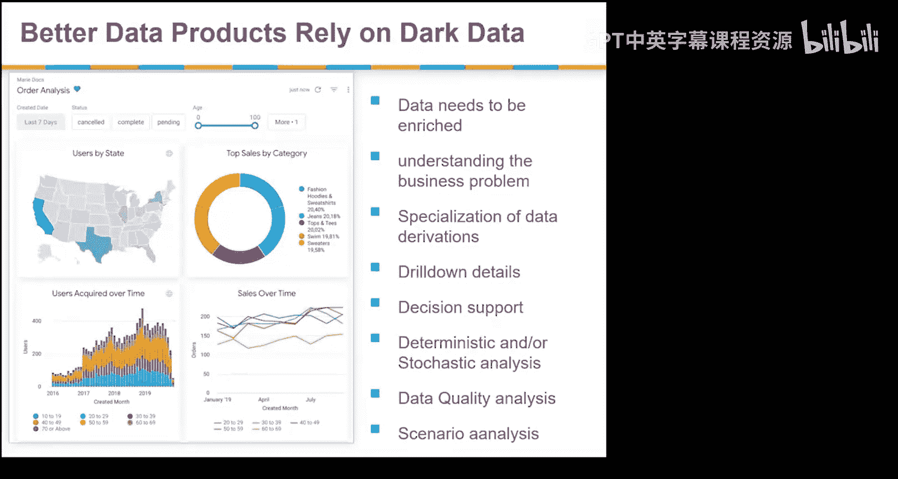
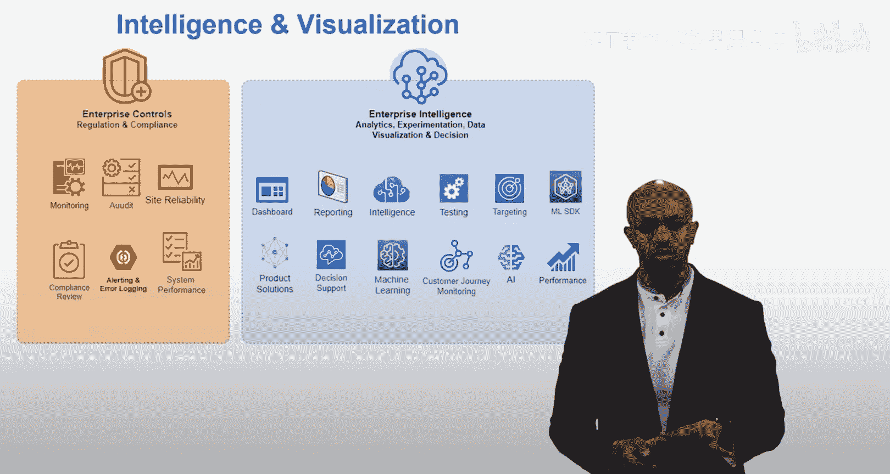

# 亚利桑那州立大学《黑暗数据迁移与架构｜Dark Data Migration and Architecture》中英字幕 p07 6_数据产品化价值第二部分.zh_en [BV1TkurzMEmm_p7]

Now， how can we get more from our data products， right， How do we get more value。

' going to go over a little bit of system design here。So。

This is a conceptual enterprise diagram and it speaks to how most Fortune 500 companies are set up。

 especially the top Fortune 100s， it's not actually identified by any specific company。

 but it's how they are typically set up in the more modern environment right and there's always slices and dices in different ways in different segments of how to do things but this is the general flow at a high level I tried to focus more specifically on the data side on the analytics side so some of the things when you look at the data capture points may not be quite as robust as as as they could be。

But our focus is on that transformation， the ingestion， and then getting to visualization。

 although the data capture points are critical because that's where the first line of mistakes are so you want to think about that piece as well。

So going over this at the wider sort of column there is your operational side of the house。

 and then the narrower side， that entire column to my right is the analytical side。All right。

 so as we go through this example。I want to just point out the general areas so the top。

The top part with the green section that's your data capture points that whole black area is internal operations for the purpose of generating sales for the purpose of conducting business in real time you have your engineering that builds the application monitor adjust in you know fix faults and systems that go down as well as build new systems and new capabilities for business to perform better and they pretty much touch everything across this ecosystem as well as the other side of the analytical side you have to management administration。

 these are the systems built for companies to organize and flow better。

 your HR systems your ERRP systems your acquisition systems， your member engagement systems。

 things like that and those data capture points that to the cloud。

 you're looking at hybrid hybrid cloud up there and then that green bar in between the data capture points and right here this green bar this is what's called an enterprise cash。

This cacheching mechanism is for system performance reliability and availability。

 ensuring that you're up nearly 100% of the time and ensuring that your systems are performing to the expectations of customers which is pages loading if possible less than one second and then down at the bottom the bottom black part is your data capture process this is where we're finalizing that capture of all the data into our internal systems although you'll capture things in the cache and from that cache you can either move the analytical side are down deeper into the official data capture side。

 but these are your internal databases， your system databases and some systems you have old mainframe systems that still pump out large transactions。

 a lot of financial institutions have a lot of steel cobal mainframe systems because they're good at handling wide scale。

Transaction volume and then you're from there we're going starting at the green coming down through the black。

 going into the red。 you're looking at data transformation and data storage。

 This is where you're getting into big data right so now we're looking at data lakes and data warehouses typically companies have either or a lake or a warehouse some have a hybrid partially structured semistructured fully structured all in one place where you have like a lake sort of a warehouse type of a thing and some just have both in completely separate it's mixtures so you can have one or the other you can have and both you can have a mixture of them and they're supported by all the different types of storing data MysQL Postgres on the structure side when you're looking at。

onstructure side， you're looking at JSON， legacy looking at XML。

 and you're also thinking about all the different NosQL databases， MongoDB， Cassandra， etcter。

And those are really good especially when you're talking about pulling stuff in from event listening at that data capture point。

 so in some cases where you need to have a real-time dashboard。

 you can use Kafka and send that information to a cache and that cache can go straight to your visualization。

 and then in some cases， it can go both for the visualization down into the data capture process as well as to the storage process if needed。

 depending on things。And then。Coming up again from the red into the blue here。

 looking at data enrichment and productization。This is where you start looking at having your data stores。

 where you have multiple data mars and or data layers。

As well as specialized data layers for data productization now that's something key。

 not many companies have that specialized data layer and it could be multiple specialized data layers。

 some have a very wide one and some have a bunch of small ones that they can rapidly deploy。

Dending on the use case that's needed for either this control and compliance up here in the orange or in this blue box up here at to the top right where we have the analytics。

 intelligence， decision support， customer journey and data visualization。Right。

 so this is sort of the flow in general of how you get to that endpoint where you're doing data visualization and in the center where you see that purple box with data governance。

 data governance touches everything， like that's a centrally controlled mechanism that you want to have everywhere so you ensure that your transactional systems are operating in the appropriate manner。

 as well as your analytical side of the house， especially when you're talking about having your data and storing it in a regulatory and compliant way。

 and garnering intelligence from it。All right。Over the next few slides what we're gonna do is we're going to break out the sections and go into detail。

 I just gave you a little overview the I blacked out that section where we were talking about the management administration because we're not going to focus on that for right now。

 we're going to focus on the data capture points including the cash。

 the enterprise data cache as well as this the big data instance instances as well as this whole。

Data productization process and then end the result compliance and visualization。

 both of those things， which are definitely critical for a companies' or a business success， right。

I'm start with the intelligence visualization so we're going to start with what you see the end result and sort of work backwards okay。

On the the orange side and on the blue side start with the orange and then we'll go into the blue。

 So enterprise controls， regulation and compliance。

 This is what you use to ensure your company is operating correctly， you're within the law。

 you're within controls。 you're able to ensure that customers are getting service correctly。

 you're ensuring that your systems are performing。 You got your compliance review， etc ce。

 and you're doing constant monitoring on the system， especially things like site reliability。

 which isn't compliance， but it is what you use to ensure that compliance。

 things are remain compliant right so mean you ensure your system is up and appropriate to the standards that you have now in terms of the value you add。

So the orange is more about。Maintaining the value that you have。

Ensuring that you don't fail and the blue is about the value addition as well as understanding the market more so we have things like dashboarding。

 reporting actionable intelligence that's derived from it。

 testing you have test and learn you have pre and post testing premarket launch pre acquisitionquis。

 testing and ensuring that you are targeting the right things。

 the actual targets for the organization your OKrs， your outcomes or objectives。

 the overall expectation of when you do something， how much are you going to get back from it。

 software development kits for machine learning， ensuring that your email engineers and your data scientists are operating in the machine learning environment and you're deriving that AI that you see there as well as looking at performance performance indicators。

 how are your systems performing as well as how are your marketing campaigns and your products performing out the market customer journey monitoring。

 so one of the things you also want to think about right so as we're thinking about how dark data impacts these。

Things that's really huge in the customer journey process right。

 are you monitoring the customer journey， are you seeing what's going on。

 Are you capturing the data from those data points and storing them and using them and then going to decision support and product solutions so。

In this view。This is where you see the result of using dark data correctly for some organizations like you saw for most organizations like you saw in that dashboard in the beginning of this presentation。

 they just have your standard dashboards， their sort of status indicators and they just have some data on the view with some insights you can see what's going on currently you can see the status of things for the more advanced organizations you'll see things categorized better。

 you'll see where dark data has been used and applied and enhance the data that you've captured and allows companies to quickly change。

 pivot， make decisions and automate some of the decisions so that's something key that this is where you actualize that information that you get from dark data。

