# 亚利桑那州立大学《黑暗数据迁移与架构｜Dark Data Migration and Architecture》中英字幕 p08 7_数据产品化价值第三部分.zh_en [BV1TkurzMEmm_p8]

Now the productization process， so you want to enrich the data， you want to transform the data。

 this isn't the classical sense of engineering transformation。

 this is transforming data and transpoing it into something new when needed， right。

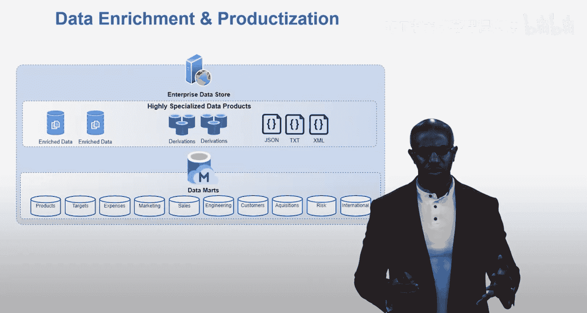

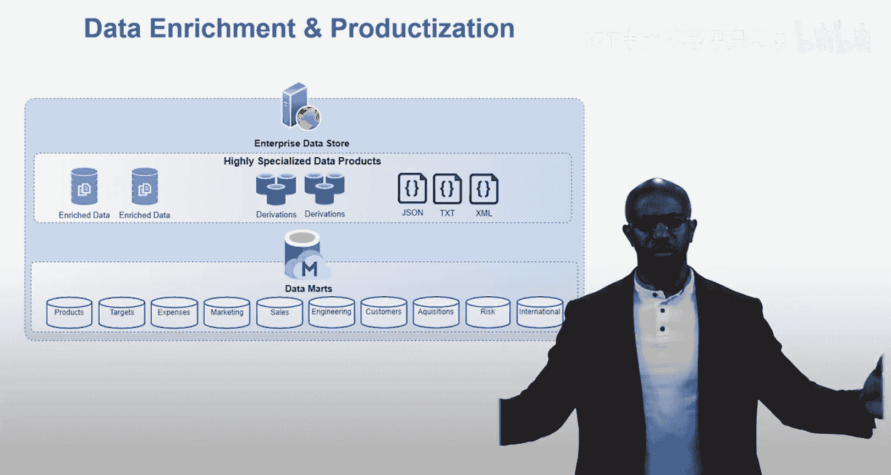

Starting at that top there， these are highly specialized data products and data layers。

 specialized for specific use cases， targets and things that are specifically for business monitoring business。

 planning and business expectations these can be JsonN objects， text files， XMl。

 they can be your standard SQL right they can be Postgre MySQL， all that stuff。

 it's how you want to store it right you want that enrich data quickly available in near source。

 So those dashboards are performing in time you want to always think of that human element and the derivations that you create。

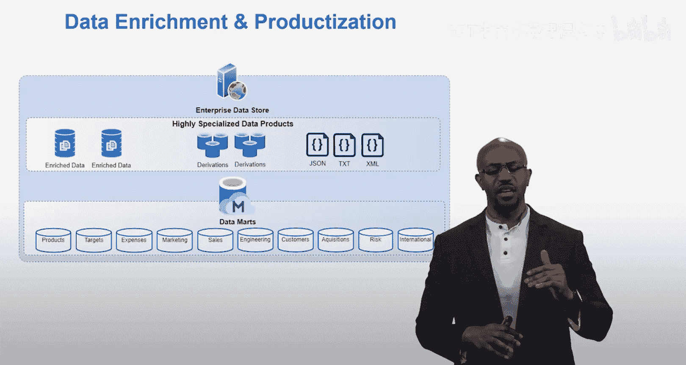

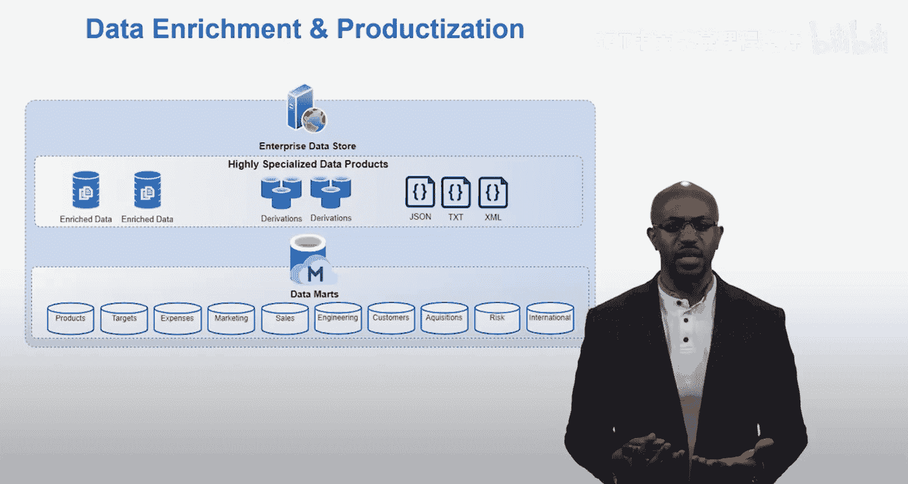

Are really critical。Because that's what's going to allow you to really understand and get value from that dark data now under that is your data marks that sit inside this data store right so this is a number of data mars that are derived as we're going backwards into big data that could be created on specific topics so you want to keep data in here as granular as possible。

Um and to the specific category， because then you send it up to that specialized data mark and create that information。

So you have things like your products ODL， which would be your data layer inside the Mart right。

 your products， targets， expenses， marketing sales。

 and these are just examples so then moving in backwards like we said into the data storage place now we're looking at big data。

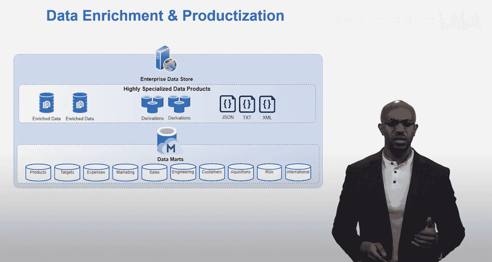

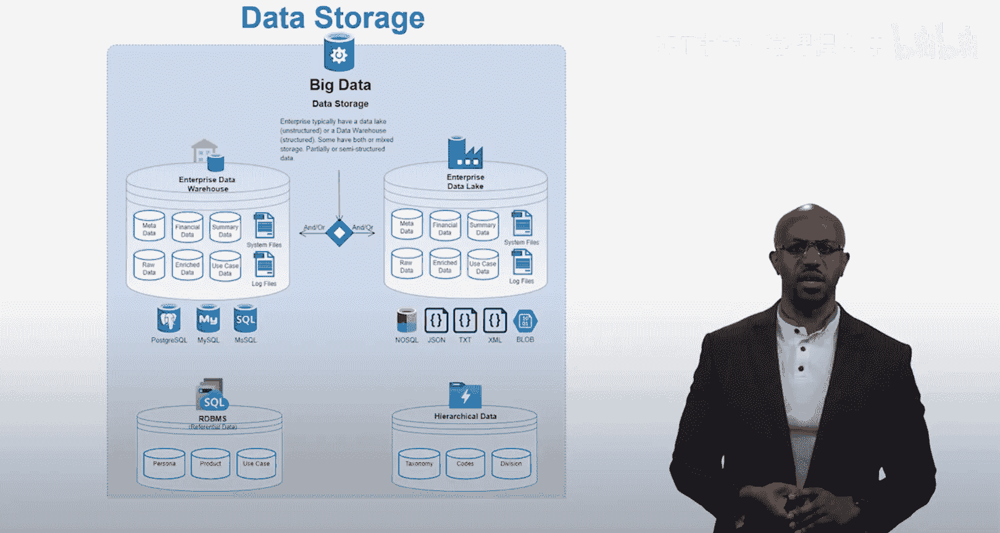

You have a lake and a warehouse typically where you pull your information from just remember at that productization layer that we were just on。

 you can also receive event listening information。

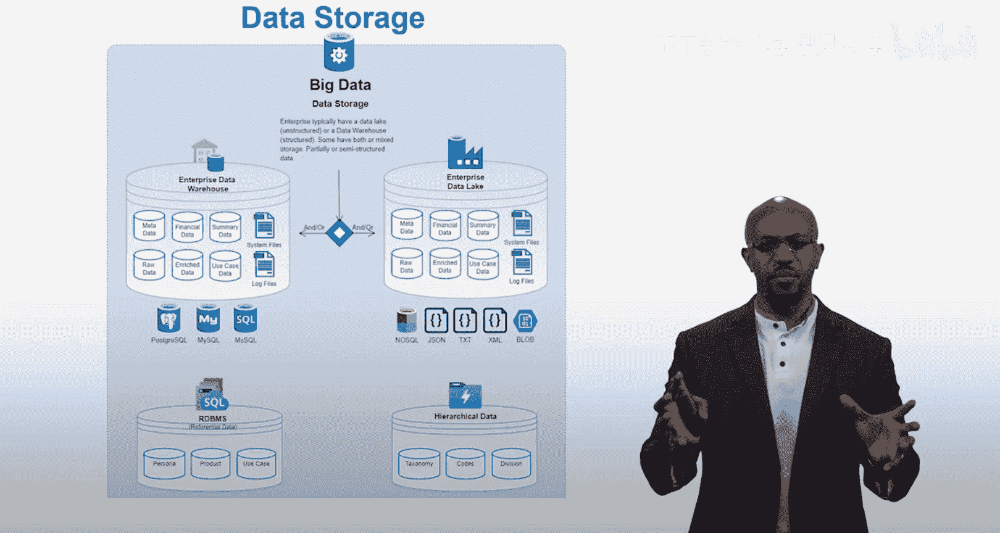

To focus on real time things like Kafka， seeing what's going on in the market at the moment and pulling that information and combining with this。

Sort of classical data that's stored so looking at these data mars。

 I'm sorry these data lakes in the data warehouse， the lake is primarily focused on unstructured data。

 No SQL， JSON， text files， Xl， etc ceter， and then your data warehouse is focused on structure data we're looking at MySQL。

 MSSQL， Postgres， things like that。

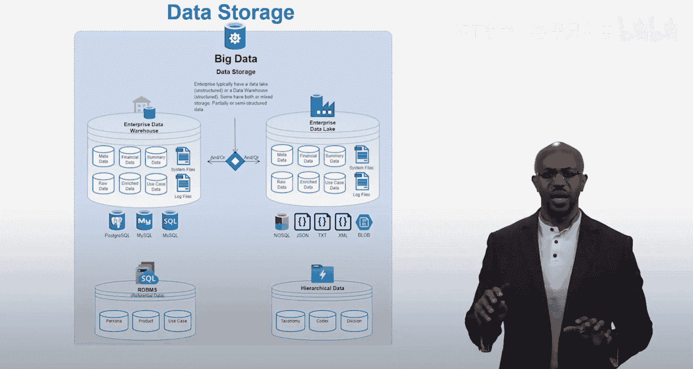

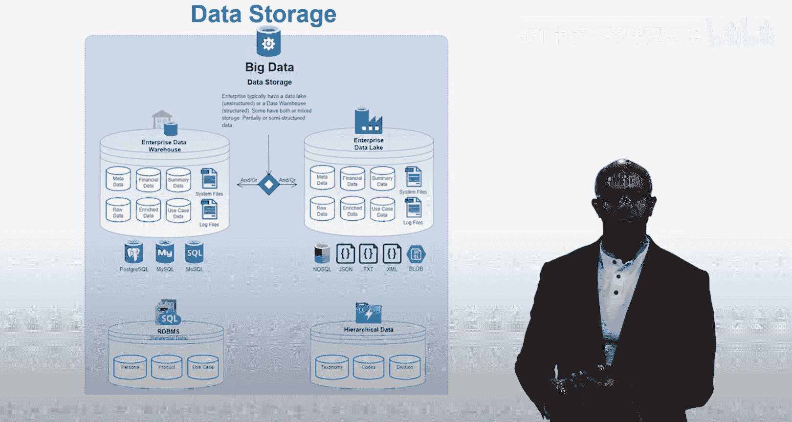

And under that， you have your RDBMS and your hierarchical data。

 your RDBMS allows you to use referential information。store the data from our administrative sources。

 those managed sources， as well as it also allows you to transform the data to at the next level so RDBMS is really critical I think that's where most organizations have the opportunity to really improve one at the capture point and two in the relational data that they have pulling in information outside of the company that isn't directly related to products and using it for creating more data。

And understand their products and the behavior of consumers better and hierarchical data。

 those taxonomies and things like that， how are things structured， making things sequential。

 similar to computational thinking。One step， one step。

 one step one step right like those types of things so understanding how things should be structured in that hierarchical format so when you're looking at the big data picture。

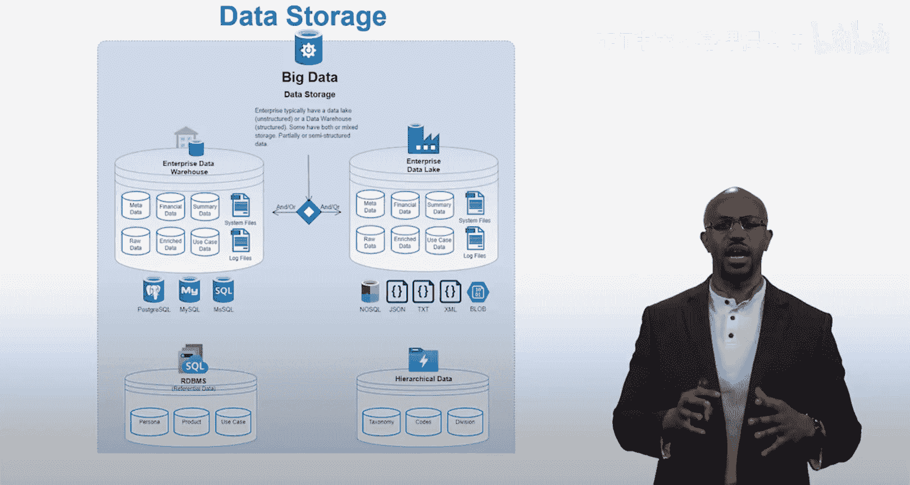

This is what you see and this is where it's stored and obviously you have the database management system。

 the DBMS that allows you to manage this service for the company。

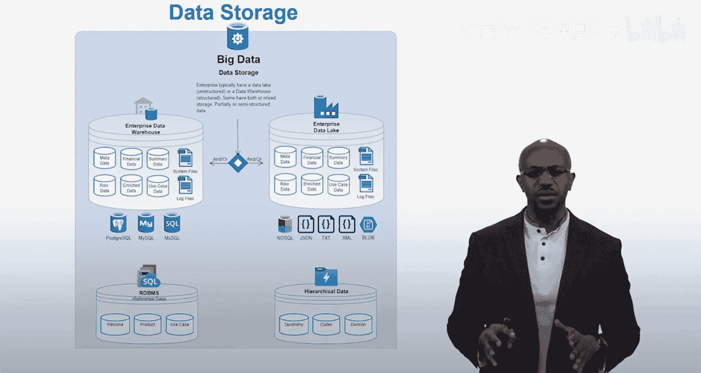

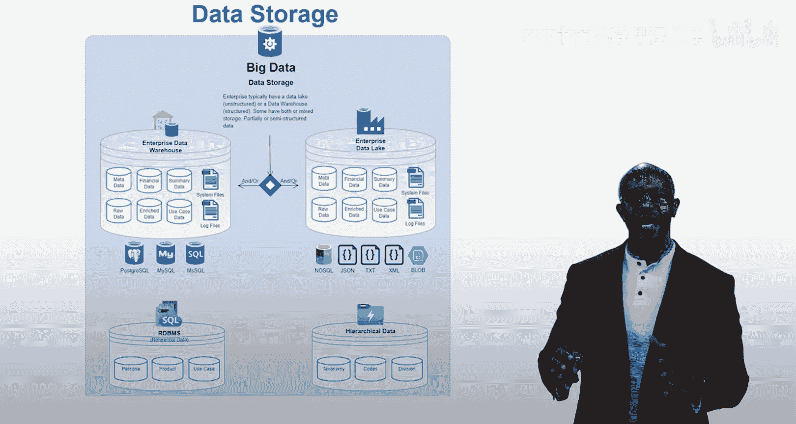

Now going into the data catchpointt。This is a view of a hybrid cloud。

 Most companies are going to a hybrid cloud。 It seems is typically the the more productive way of。

Managing services that may be offsite on onsite in parallel right in the middle you see that elastic load balancer and you see all the functionality there。

 you got your network balancer， you got your application balancer and things like that and then on both clouds sometimes depending on things you have your redundancy internal external you have certain applications on the cloud and one thing to point out here is some of the systems are sort of stacked some systems are also horizontally so although this view is focused more on things that are more web application or mobile application things like that。

 especially with your web server and your app server。

Some of your internal systems can be in the cloud depending depending on how you want to structure your environment。

 as you pull data from your data points， you can store your data in that cloud SQL right you can have an EC2 instance and other type of dev environments in the cloud。

 which allows your apps to perform faster for your consumer and also this data cache layer This allows the company to be more nimble it allows the company to send data to different places faster without slowing down the transaction operational speed of those internal systems。

So the enterprise datac is critical because it allows you to use that as a controller to send data where it needs to go fast。

 it allows you to have a place where you know you can send realtime data and send it consequently to the next channel faster if needed depending on how you want to do things and also allows you to reach into big data and pull things to near source so that your web your web or your mobile apps。

 whatever it is in the front can operate faster now the thing that you'll want to think about from a dark data perspective is this is where a lot of that outside data to an organization is failed and capture。

So now that we understand what we're looking at and what it's for， let's talk about。

Capture points right so looking at capture points you have things like your mobile device your web device a lot of most companies have their pages tagged。

 they have the events tagged they're looking at what you're doing when you click on the screen they can go to each session and see based on the cookies in your browser if you delete your cookies obviously they can't really see until they reload new cookies in there but they'll use that session to then understand how you're using the page and that's critical。

It allows them to make better decisions， it also lets them see you through the entire funnel right that did you go to the first page。

 the second page， the third page， did you hit submit what happened when you submitted。

 did the page load slower， fast， all those types of things。So。

Those are key data points that most companies capture。

 but when some can't capture is when you don't fill out the whole form。

 they know when you stop and they can ideate as to why based on the data but they really need to get a better understanding of what is hindering you to finish that form or what is hindering you to finish the operations that you're doing even when you look at social media as people use social media。

 there's a lot of data that those companies are capturing and typically those companies do a really good job of capturing dark data they analyze everything and they make adjustments based on that and they have a lot of deterministic actions after those things happen but a lot of the other more classical companies are starting to catch up in that space and working towards making those adjustments So one thing that you want to look at as we're looking at this is the app server of the web server you have event listening。

 we have virtual private networks。And when you think about SAS。

 you're looking at a platform as a service， software as a service。

 and you're distributing data to where it needs to go。Throughout the company， but the key is。

How are you capturing the data that's unknown from your consumer right you want to shrink the form as much as possible and you want to keep getting them to give you more information that's typically how these things work so you have to be really strategic on how you set up that capture point。

Lastly， just want to show to show this picture we get。

This is a data product lifecycl just a general one monitoring， using the data。

 how are you going to test and deploying the environment and model logic。

 how are you putting the models together and what does that look like now this is about the modeling for intelligence but one thing is missing is data modeling and then how are you going to actualize the intelligence in the lifecycl so these are a few things to think about and everything is predicated on the business goals。

 outcomes and expectations if you don't understand those you can't model appropriate。

 you can't test appropriately you can't create new data products appropriately and use the dark data to provide that value。

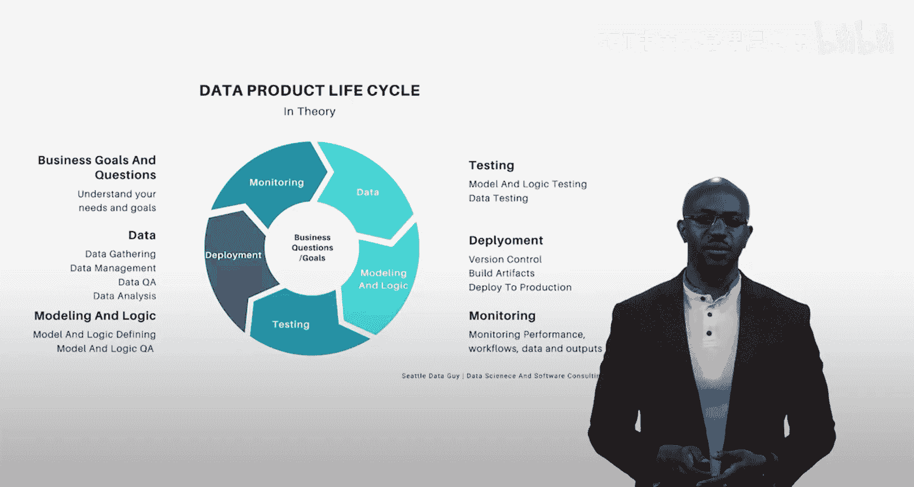

Thank you for your time。