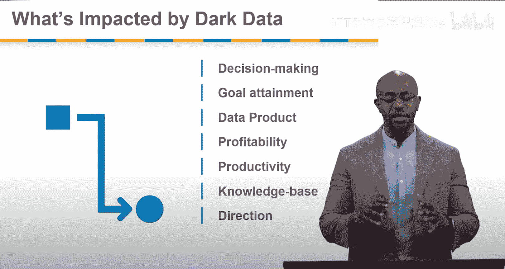
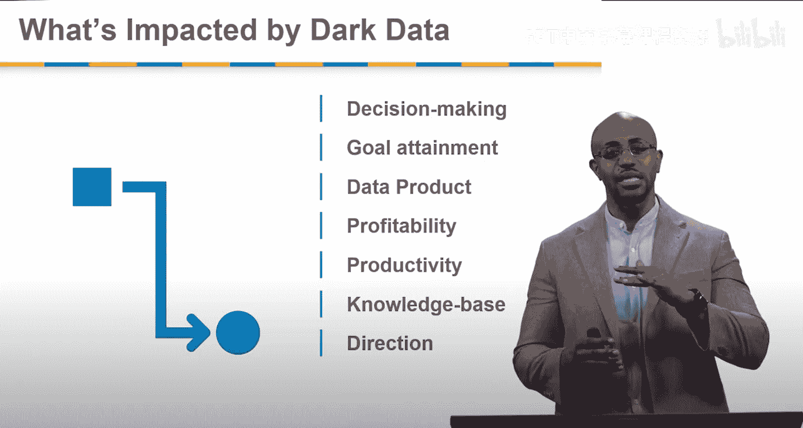
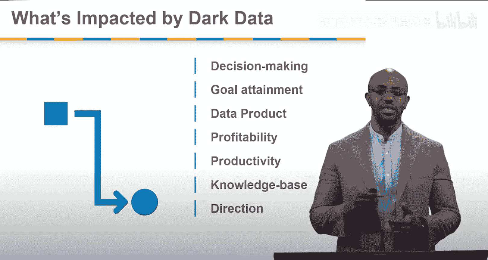
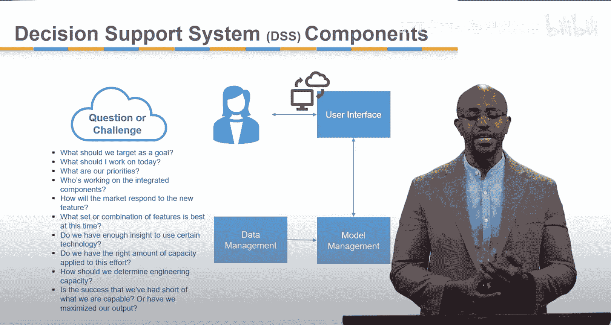
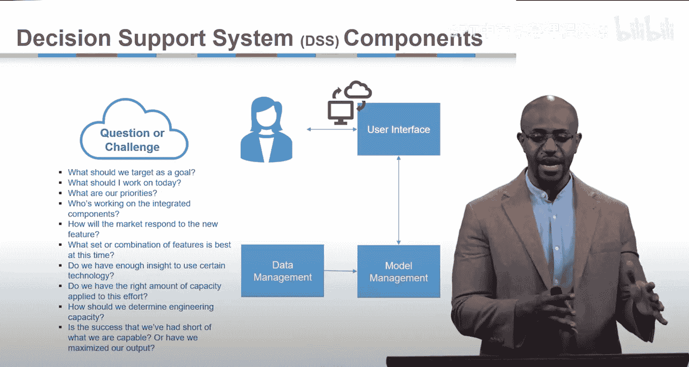
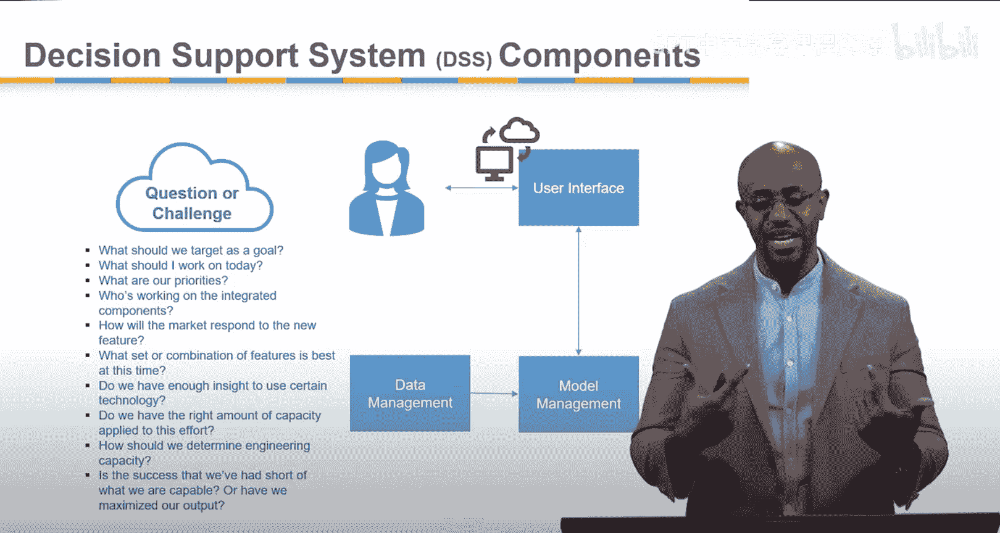
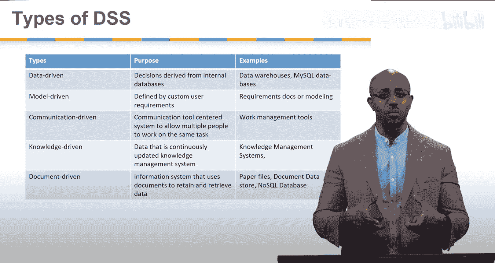
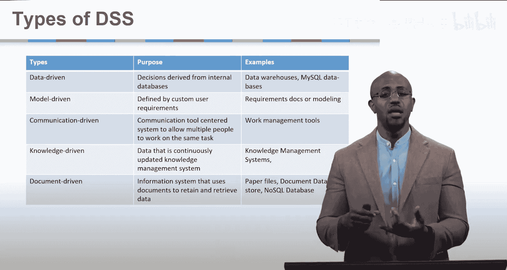
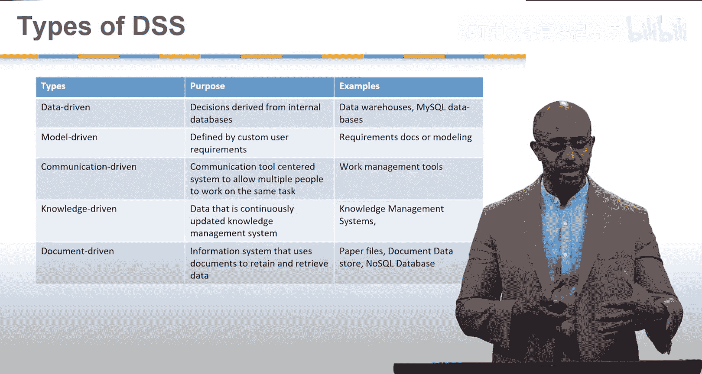
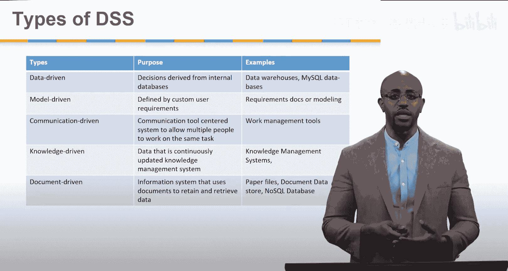

# 亚利桑那州立大学《黑暗数据迁移与架构｜Dark Data Migration and Architecture》中英字幕 p09 8_受暗数据影响的领域.zh_en [BV1TkurzMEmm_p9]

Welcome。Today we're going to focus on what's impacted by dark data and dive deeply into the impacts that are caused by dark data in our environments and the projects that we're doing so looking at this list here。

 looking at decision making goal attainment data products。

 profitability productivity and knowledge base these are many things that you'll go through in the business environment in the environment in terms of delivering projects towards in goals that have impacts around dark data when we think about decision making a lot of times we can have flawed data sets so we can have flawed insights and flawed information as well as views that are completely true but contextually irrelevant。

 allowing us to then make decisions that could be shortsighted or cause us to fall short of our end goals and true targets right you think about profitability and the overall data product that serves to enhance our ability to gain profits or productivity。

Long run， thinking about market research and all the different components that allow us to make informed and intelligent decisions。

 they're all based on that process of going from data to information to insights and then into actionable intelligence that allow us to make the appropriate decisions and move forward in the right direction。

So what underlines and underpins what we're doing in terms of putting together productized data that creates intelligence are the decision support systems and the components we' within there's always three main components the user interface where the human works on you know typically some type of monitor with data and graphs and charts already readily visible with filters and allowing us to dive deeper into the information to gain the insights needed there's typically some type of model management no matter what system you're in and then that data management that's that where the data productization comes in and a lot of times the model management piece could be RDBMS any type of structure to allow relational tables even if we're looking at non-obvious or I'm sorry but no SQL and unstructured data right if we're looking at unstructured data。

 there's typically still going to be some type of relational pull to add context to the data now what you see on the left side when you're looking at。

Questions or challenges there these are some of the questions。

 just sample questions or challenges you can have when you're trying to use a decision support system to allow you to make better decisions and move forward faster with your product and your projects。

So things like what are our priorities， how are we going about that。

 how are we storing the information and allowing the changes to adjust as well as who's working on which integrated components within a project and other things as you're looking at the end goal of any type of a program or a project you want to look at the success metrics year to date and in the past past so are our targets and goals being reached and are they the ones that we need and are they being meaningful are we seeing the growth that is correlated to what we're doing these are the different components in different type of challenges that you would use for a decision support system。

All right， and then going through that hierarchy one last time。

 looking at data as that foundational block， one challenge that I've seen a lot of times with with insights that some analysts or a data scientists may provide they typically sort of stop at the information level sometimes right so you have your data you send it over in information。

 you have some graphs and you can make some pretty basic assessments and decisions but it doesn't allow anything for you to take action immediately allow you to understand what's going on if it's going correctly or incorrectly if we're attain our goals are out of cheating so we have to figure out how we productize the data in the manner where we can use that model controller on a decision support system to allow us to gain the knowledge and wisdom and insights that will create the intelligence needed for the decisions to be made so you see how apply context。

 apply meaning， insights and then last speaking to the purpose of what we're trying to do。

So just a few different types of decision support systems， we have data driven， model driven。

 communication driven， knowledge driven， and document driven。

So in most cases we're going to be using systems that are based on data some have specific models and some are for the purpose of communicating better and communicating information better more seamlessly in a self-service manner。

 things like systems that are for workforce management or work management or agile management tools right then we have knowledge systems there are a lot of these that integrate into these work or agile management tools and allow you to both use communication- drivenn and knowledge drivenrive insights and information to do your jobs and deliver better and lastly with the document driven how do we store information objects and other things such as like digital asset management systems and things of that nature so these are a lot of the systems and components that are the underlying foundation to support the impact that dark data has and when we're thinking about dark data in these systems are we classifying metadata correctly are we applying it correctly。

Are the relational tables in the models that we're creating accurate and contextual and relevant to what we're trying to do in our purpose？

So thank you for your time。