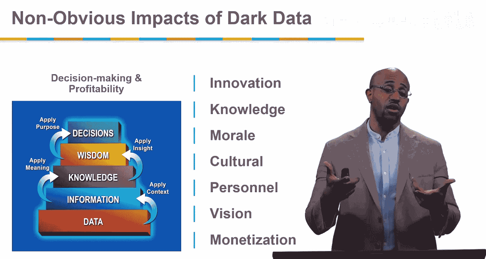
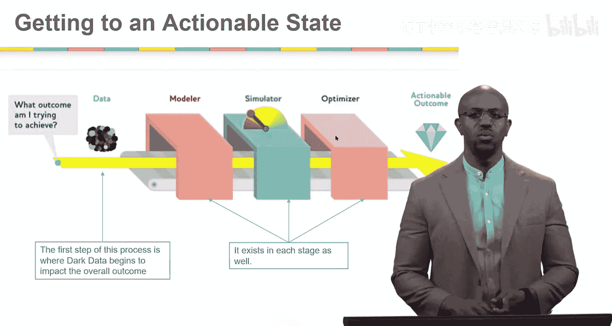
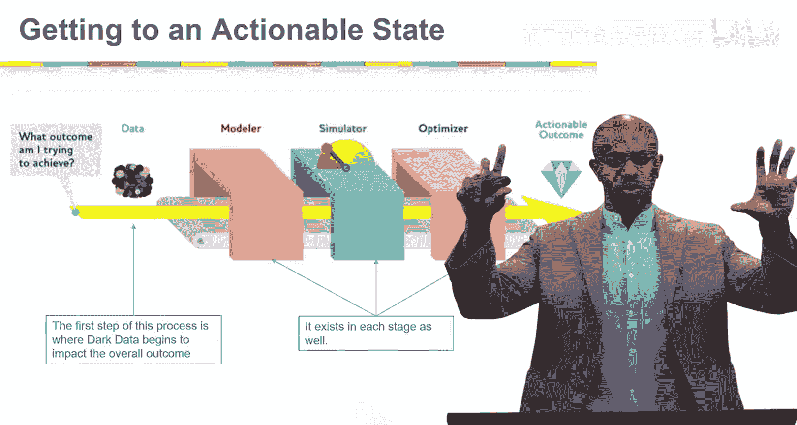
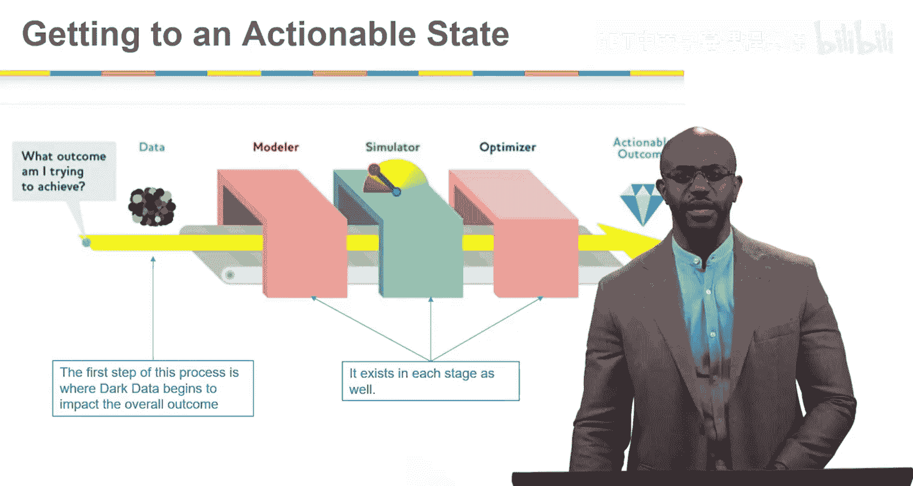
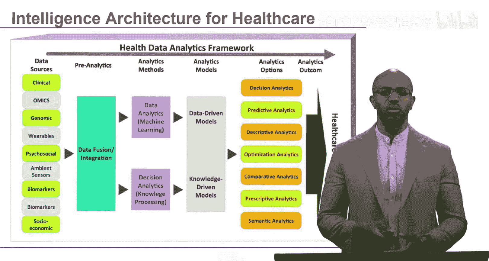
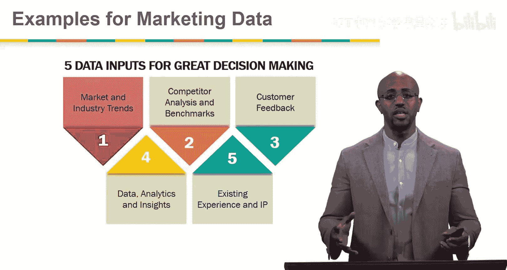
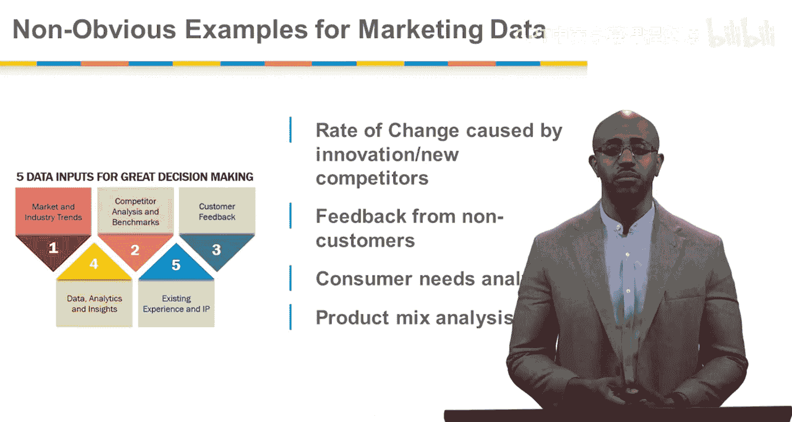

# 亚利桑那州立大学《黑暗数据迁移与架构｜Dark Data Migration and Architecture》中英字幕 p10 9_暗数据的隐性影响.zh_en [BV1TkurzMEmm_p10]

Welcome back we're going to talk about non obvious impacts for dark data。

So going back to this same pyramid here， showing data information， knowledge， wisdom。

 decisions as it relates to generating intelligence。

 some of the non obvious impacts that you'll run into are around innovation。Knowledge。

 creation and knowledge management， morale， culture， personnel， vision monetization。

 and also the process in which you create the data。

 sometimes you will run into some impacts where data has been lost or is unknown that it has been changed in certain manners。

 which then allows for。Challenges or incorrect views when it comes to creating that intelligence at the top end。

So taking a look back at this architecture diagram。On this left side。

 looking through this left lane here， this is all the transactional or operational systems of a company。

 and on the right side we're looking at the analytical systems。Now that transition， as you see。

 this orange box where you're talking about data governance and managing the flow and the process and the controls around how you move data down into this bottom part where you're moving the data from that transactional aspect into your warehouse into your lake and upwards into the systems where you start doing the analysis and creating the intelligence。

There's many places here where the process can break down in very non obvious and non intentional ways that then cause。

ssues with data and where you thought that you knew what was going on and that you understood your data you really don't right so for example。

 if you look here at this last on this box right here at the bottom of this blue one you'll see you have ETL processes and you'll see this API gateway that then sends data over to your data warehouse and you have your referential tables right in your RDBMS so what happens here is data can come out of a system。

 maybe a rules decisioning engine like Pega or other systems that may be off the shelf are customized they come into your data warehouse and where you're using reference tables or other data sets to then generate new pieces of data。

You can find yourself in a place where sometimes you default values or create values from the information in certain times that it comes in and if anything is incorrect there。

 you can then end up in a place where the data is incorrect or you can lose data。

 depending on how it's ingested into the system， which then in result if that data is flawed as it moves up through the value stream。

 it will pass the quality checks because the data itself came in cleanly and the data moving up through the system has already been scanned and vetted。

 so you would end up in this staging layer where you're starting to create your data mark and your data productization efforts in the new data products。

Those will then push into your visuals at the top where you're doing your analysis and then your in quality checks here in this orange box。

And you wouldn't even know that the data is flawed or the data is missing or the data has issues and I've seen this happen many times in in the various organizations that I've worked in so it's something to think about it's not only what you're missing it's how you're going about deriving the information because a lot of times you can be missing key components as it comes to creating that data in the end state one more。

Slide on the process This one's a little more high level I dove deep in the last one。

 This is a very very basic view。 So if you look at this section here。

 this data right here so this is like identifying data and this is where dark data first becomes becomes a impactful piece of the puzzle right so when you're looking at your overall outcome first is the initial data set is it complete does it have everything you need all of those questions and then as you go into the modeler are you modeling it correctly are you creating the right default values and derivations in a manner that allows you to structure the data so that it can so that you can create the correct data products to allow you to。

Then create the resulting insights in intelligence and then you have optional things like simulators。

 forecasting mechanisms and other things that you can use to create more value from data and then optimizing things so you can take the data and start with summaries and high level pictures and views and then drop down into the detail those are all the different things that you would do to create that actionable outcome from the intelligence right。

Here's a sample of very high level sample of architecture for healthcare system。

 so if you look at the data sources section on the left side。

 these are a few of traditional data sources that you'll see in a healthcare operation and as you move into the right you'll see it comes from those operational systems on the left。

Right here these neon green and light blue boxes and it moves into data fusion and integration this is where we're integrating into the analytics space and then from there you're doing your analytics your datadriven models etc what this doesn't show you is your warehouse in your lake but we're trying to keep it high level on this piece so then last is the options for analytics so these are the different types of use cases and views and dashboards that you would create or derive from the models that you get from the knowledge framework and a data drivenven approach and then you have your intelligence based on healthcare。

And just like in the example with that detailed business architecture。

 each of those stage gates in the process allow for those non obviousvious impacts to data and the loss of information or loss of intelligence。

Now a few just quick high level examples for marketing data。

So these are just five inputs that can be used to create better decision making。

This is definitely something to think about and use when if you're working on any marketing projects and these five factors are pretty good。

 you get marketing market industry trends， competitor analysis benchmarks， customer feedback。

 data and analytics insights， exiting an parent experience and IP right intellectual property right so these are all things that you could use to make better decisions。

 however， these aren't a full conclusive set furthermore。

 there are still opportunities where within these that dark data itself then presides right？

And here's a few non- obviousvious examples using the same visual from the last slide with those five inputs。

 these are some a few verticals or a few things that you want to think about so as you're thinking about competitor analysis and innovation rate of change caused by innovation and rate of change to innovation are both things you'll want to think about and how you can categorize those and show those in your views and use that to create intelligence to make better decision so that you can better predict things down the line as well as how do new entrants and competitors if you're thinking about like a SWAT analysis type of thing new competitors play a part because when new innovation comes people are always branching off to create a startup to explore that new innovation and move forward with new projects and new companies feedback from non- customerstomers。

 this is a real critical one so it's easy to get the feedback from your customers with surveys even within there you have dark data because not all of your customers are giving you feedback and people typically give feedback more so and are more encouraged to give feedback。

When they've had a negative experience versus a positive experience。

 also there's a segment of the market that are not your customers and how are you getting feedback from those folks？

That's a big question and how do you get an understanding of why they're not your customers。

 how they could become your customers and all the different slices in between is there data out there for you to attain and assess and how can you get those views or how can you create an analysis of those views the needs analysis what are as you look at your current customers。

 how can you better fulfill their needs and encourage them to become advocates as well as the product mix analysis sometimes you can have certain products that customers are well aware of and using and sometimes they may not be aware and they could use them and get value out of them so how do you get data around all these topics and more to allow you to make better decisions and create better information from the unknown。

Thank you for your time。