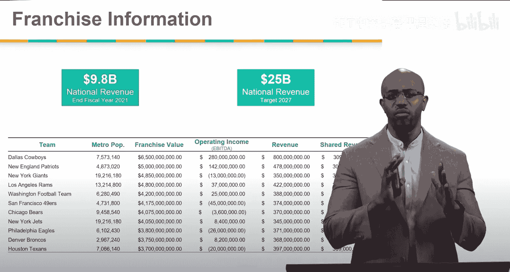
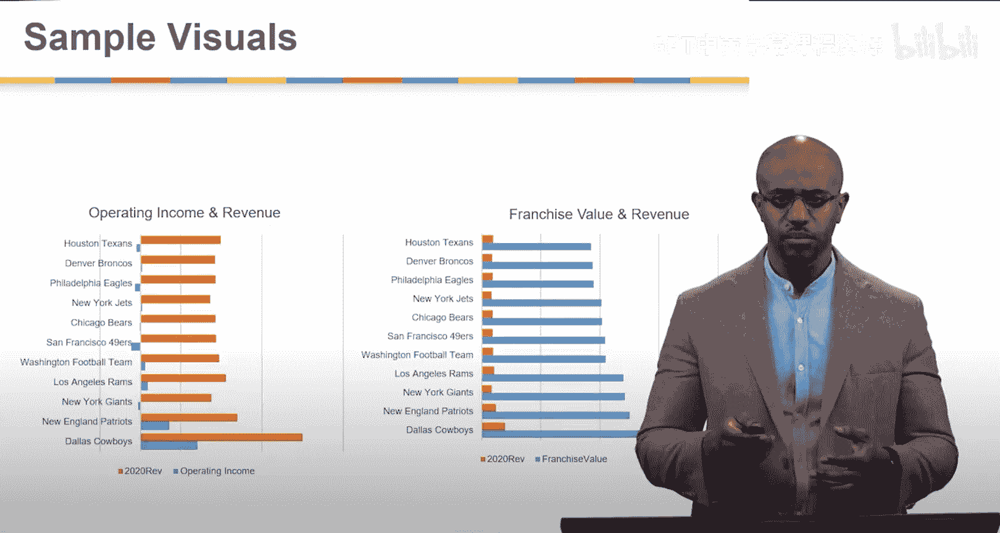
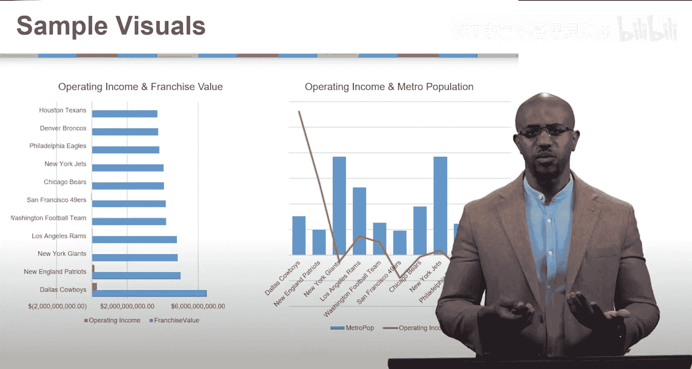
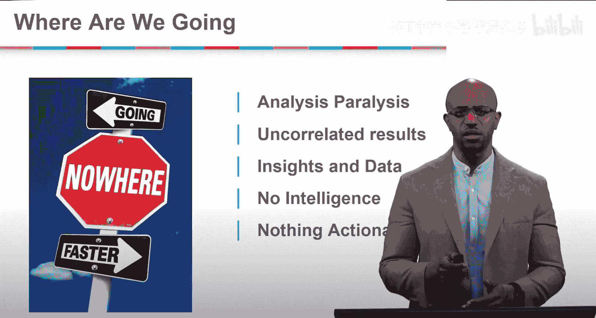
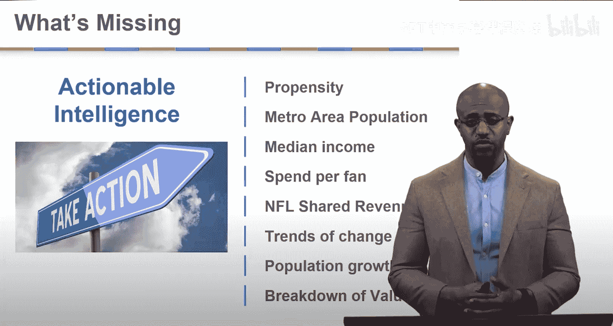

# 亚利桑那州立大学《黑暗数据迁移与架构｜Dark Data Migration and Architecture》中英字幕 p11 10_暗数据应用案例解析.zh_en [BV1TkurzMEmm_p11]

Welcome back。 We're going to have a bit of fun today and do an example on how to identify dark data by using National Football League NFL teams。

😊，So as most of you are aware， the National Football League is one of the biggest sports leagues in the world。

 although it is primarily in the United States and the consumer bases primarily in the United States as well。

 the US is the only country substantially that plays this type of football and everybody knows soccer is known as football in other countries。

 so they play a different type of football。Now what we're going to focus on are the top 12 franchises in the NFL。

And we're going to do a deep dive into investing and how we would look at investing or where we would find the dark data if we were to go through information and try to invest in any one of these NFL teams。

So。Starting with some high level numbers， these are the top 12 NFL franchises。

Cowboys Patriots Giants Rams， the Washington football team， nineners， bears， Jets， Eagleagles。

 Broncos and the Texans。😊，Now， the cowboys。Have been a team that has traditionally held that top spot in terms of the franchise value when you're looking at these values there in the billions and currently the Dallas Cowboys are worth $6。

5 billion。When you look at the operating income， they sort of blow the water out of the rest of the competitors now when you look at the overall national revenue for the NFL versus the national revenue target for the NFL for 2027。

 it's nearly double。So you get 9。5 billion for 2021 and 25 billion for 2027。

Then as you compare that to operational revenue versus franchise value。

 you can then sort of see that the franchise value is based on more than the dollars it's also based on the stadium。

 it's based on the brand， it's based on the local market and advertising that it has plus the shared revenue across right so we have franchise value。

 the operating income revenue and shared revenue， the revenue in the before you get to share revenue is the team revenue itself and the shared revenue is the revenue that is shared out from the NFL with all the media partners etc cea you sponsors。

 commercials all of it that money is distributed across all the teams equally。Now。

 one thing you'll want to look at specifically is that in that revenue column is the cowboys are looking at 800 million versus all the way down to the bottom of the Texans with 397 million。

You look at the population base of the city and you start coming to many conclusions on how you can start analyzing this information。

One last key call out before we go into the first visual will be that operating income。

 this is before e right so before taxes amortization debt， etc cetera。

Some teams are actually operating in the red right those teams with the parentheses around the number。

 those teams are losing money in their operating income and the operating income includes all the expenses such as the player salary。

 flights， jets， food， all of that stuff right so。From an eyeball perspective。

 if you just put your eyeballs on this， one of the biggest things that keeps these teams going is that shared revenue that's huge and then if you were to see past these first 12 teams there are some teams where their market the revenue they get from their market comes close to not even providing enough for them to operate so that shared revenue is really key。

Now， if we were to look at operating income and shared revenue or operating income and revenue within franchise value and revenue。

 right， you could look at this and say， man， know the Cowboys look like the best thing to invest in。

 that could be true。Given the franchise value， given the dollars that it makes and the dollars that it generates from the actual local market plus the operating income。

 it looks like a healthy and stable bet， however typically since costs since it's valued higher。

 it's going to cost more to get a percentage of that pie and then as you look upwards at the top of that chart at the Houston Texans。

The operating income is negative， but their revenue is still strong。

That may be something when you go to a negotiation table， you could you know。

 sort of figure out some wiggle room to get in there and make a you know。

 make a better offer because it's still about how are you going to get the best bang for your buck now if you look at the franchise value and revenue。

 you can come to highly the same conclusion except for the fact that after the Patriots， the Cboys。

Most teams are pretty much equal when it comes to that good old revenue piece。

 but then when it comes to that franchise value。You still have the Los Angeles Rams。

 the Washington football team， New York Giants， these bigger market teams that have a higher valuation。

So then the question becomes， do you look at the bigger cities or the bigger markets。

 the bigger metropolitan areas？

Two more charts， operating income and franchise value right so as you look at operating income you can see that it's very low compared to that franchise value again。

 and then if you look at the operating income versus metropolitan area。

 this is where we're looking at a slice of how does the metropolitan area play a factor in the operating income？

And when you take a look at this。The Cboys still stand out as that best and safest option。

 given how high that operating income is and how low the population is。

 it feels like no matter what size that population is they're going to be pretty healthy as well as the rest of looking at some of these other groups when you look at the operating income being very low for the niners and the metropolitan area is still being strong but not as high。

That could also be a safe bet because that organization obviously finds ways to spend less as opposed to the cowowboys。

 but the cowowboys have the cap to do more Now there's all types of other ways we can analyze this。

 we could also look at the revenue in the metropolitan area， the shared revenue。Versus the revenue。

 what's the split in the difference， how we can look at the difference between the operating income and the metropolitan area。

And if we went that that deep into some of this， we can get into what we call analysis paralysis and we'd be going nowhere fast right we'd be sitting here thinking about all the different possibilities and sort of taking these shots in the dark coming up with uncorrelated results。

 insights and data， no intelligence and nothing actionable one of the things to think about is there's always some level of discovery where you are sort of you know finding your way through the dark that makes sense。

 but you want to be careful as you go into the different views that you're finding the correct correlations and you're backing into the problem with the understanding of your goal and the direction that you're going。

So what's missing？Some of the things that we hadn't talked about that we missed doing this analysis is propensity。

 what is the propensity for a team to continue growing or what is the propensity of people to spend money on the team。

 what's to spend per fan， how would we analyze that， there's data out there related to spin per fan。

 but how do we know that we can trust that data， what's the median income for the population。

 how much are they paying the players。How much what's the win ratio to the amount of players that they have or to the salary that they're paying the players these are many things that you'll want to think about and some teams are sort of topsy turby one year they're doing really good another year they're down another year they're good and they're down so how do you find that balance and how much does the wins correlate to the escalation and value of the team？

And then last lastly， the breakdown of the valuation and the breakdown of the expenses。

 you want to really think through that piece right because those pieces play a big part in other income uses of the stadium and other things like that also the population growth of the city in town some cities grow less in some cities grow more and is there any correlation between those two so there's going to be some level of figuring your away in the dark but where do we know that we'll have bigger impact typically propensity is something big that you want to think about benchmarking is something big that you want to think about how can we define our benchmarks how can we define our propensities for certain and outcomes to happen is there a relation with the metropolitan area furthermore。

As we look at the different metropolitan areas of the United States。

 before we just say we're going to invest into an NFL team。

 what's the probability that there's going to be another team coming online at some point and will there be an opportunity to invest in those teams and what metropolitan areas will they be in？

So these are all questions that we want to think about towards actionable intelligence as we move forward in further lessons we'll explore this use case a little bit more and we'll dive into the data and we'll look at more teams in just the first top 12 just wanted to get this intro out so thank you for your time。

