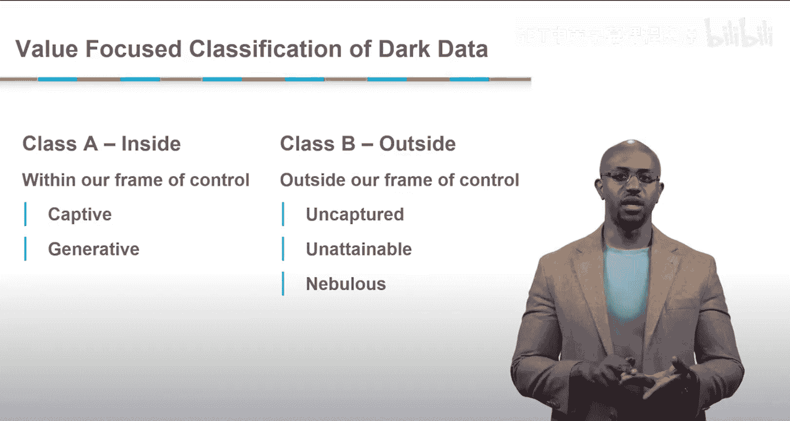
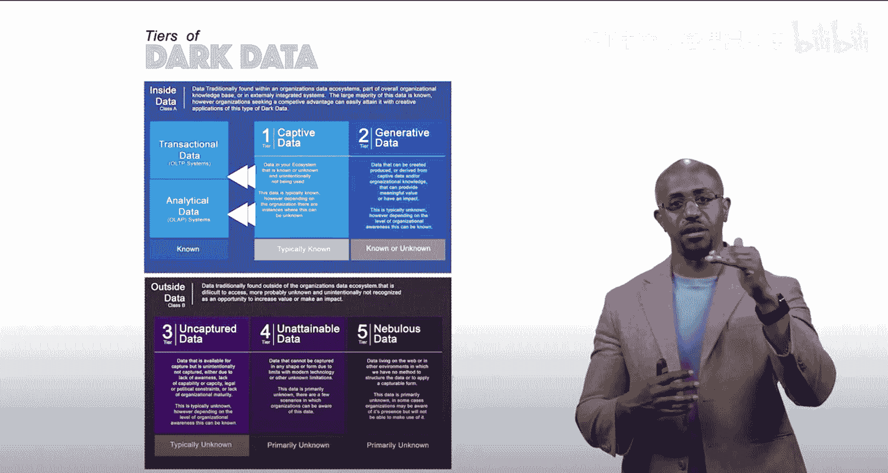

# 亚利桑那州立大学《黑暗数据迁移与架构｜Dark Data Migration and Architecture》中英字幕 p12 11_内外暗数据分类概览.zh_en [BV1TkurzMEmm_p12]

Welcome， we're going to focus on the classifications of dark data。Now kept it simple。

 starting with inside and outside inside， simply just saying it's inside the sphere of influence of whatever enterprise organization you're in。

 outside being anything that's outside of the organization that you have to go and get is not captured by the systems in the organization now within those two classifications we have just in total five different tiers。

 captive， generative， uncaptured， unattainable and nebulous。

At a high level to start with the inside stuff captive data is going to primarily be in your transactional systems and or your analytical systems along with generative data captive means you're using it。

 it's typically there， it's data that flows through your systems and they provide the transactional or operational value quite possibly also providing analytical value depending on how they're used the dark data within captive value can be many different things。

 captive data can be many different things however typically the majority of that is already being used generative data falls in line with things that are sort of like data enrichment。

 data derivations， creation of new value， things like that where you're using either referential data。

 the knowledge that you have or just simply other data elements to create something new and before it was created was unknown right？

Now going through outside data。We're looking at uncaptured， unattainable， nebulous。

And as we talk about uncaptureed data， these are things like if you have a web form and you are taking in new customers。

 you haven't captured data about your other customers。

 you may have captured captured a little bit of information about clicks。

 but you don't have anything intimate about those customers that never joined so where you can do analysis and understand what's going on with your current customers that have come through your funnel。

 you have no understanding or idea of the folks who hadn't。Unattainable。

 these are things that are at the moment you cannot attain so with that last example about people who weren't captured in your systems。

 what would be unattainable is after they've。Bouund off your website。

 you're going back a month or two you're trying to assess and grab those people's information or those potential customers。

 those prospects of information and that data has been lost in the ethos nebulous data this is the last one this is basically any piece of data that is completely unknown and you're unaware of so when in the other two you just didn't capture it。

 the other one is you can' obtain it， the other one this nebulous piece this one is any data that is just sort of out there in ethos and you're not even aware that it exists you're not aware of how to get it you're not aware of what to do to obtain it。

And there's ways to get nebulous data and there's ways to derive it going through the process of starting with captive data generative and all the way down the path and we'll get to that in later chapters or later classes。

So going deeper into inside data and how it works with transactional and analytical systems so on the transactional side we saw that architecture diagram this data is just sort of flowing through your systems you've captured people's names。

 IDs， etc ce， some of the things that may be dark inside of that could be people's intentions。

 the possibility of those folks and things like that however some of that can be derived using other values and other data that you have maybe patterns of customers。

 some of that can be speculated， but all of that type of work is done on that analytical side of the house as we went through our architecture diagram and then generative data again。

One of the things where you create so that relationship between captive and generative data is typically tied in very well together because they both support each other and then that outside view as we're going deeper into it with uncaptured。

 being typically unknown， unattainable being primarily unknown and nebulous is always primarily unknown because at the time you would not have understood the value of that data so these are the categories of dark data how I see them and put them together it kept it very simple saying outside and inside as it relates to the enterprise of the person and then。

With the five different tiers， we focused on that first top tier on the inside being captive and generative and now we're on uncaptureuring untainable neullaous data Thank you for your time。

