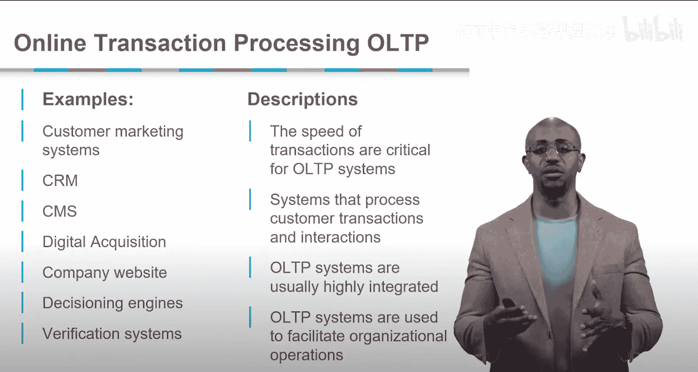
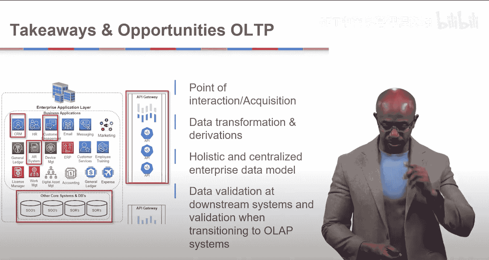
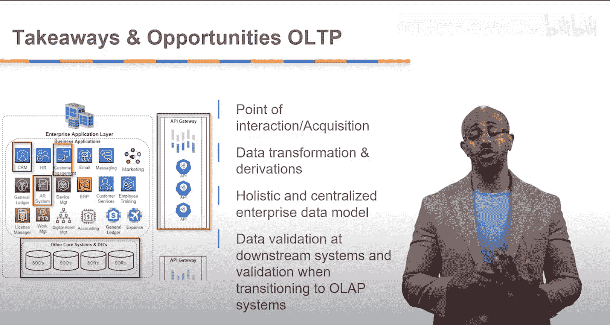
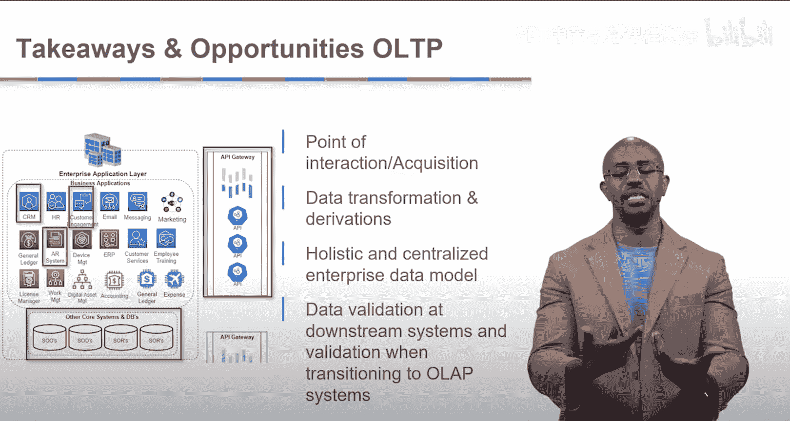
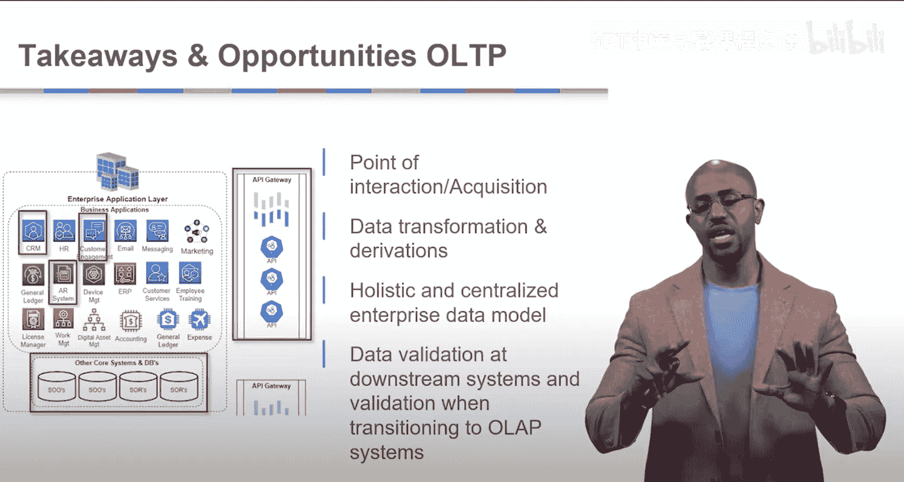
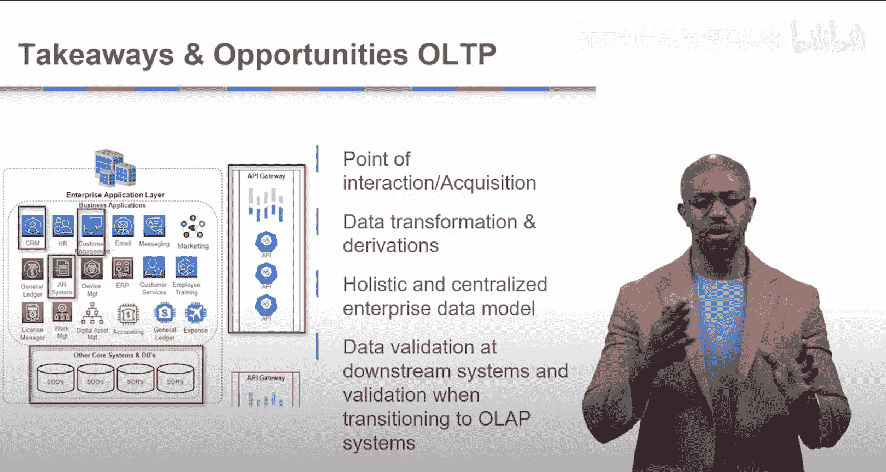
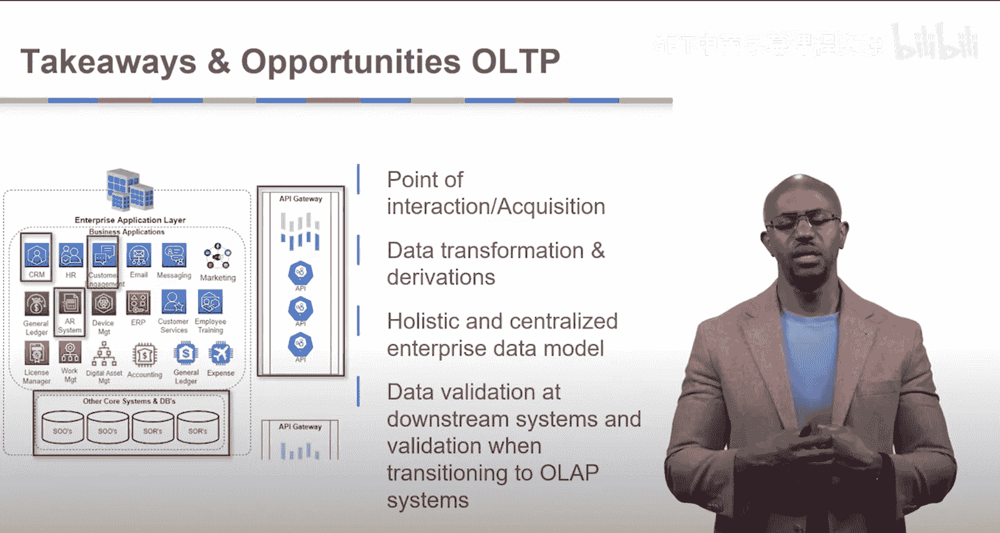

# 亚利桑那州立大学《黑暗数据迁移与架构｜Dark Data Migration and Architecture》中英字幕 p13 12_联机事务处理系统.zh_en [BV1TkurzMEmm_p13]

Welcome in this lesson we're going to dive deep into captive data so I'm want to start with those OLTP systems online transaction and processing systems some examples of those are customer marketing systems。

 CRM， CMSs， digital acquisition systems， as many of those decisioning systems， decisioning engines。

 verification systems， company websites， all these are systems that are used to transact business or transact processes and deal with relationships with other entities are other people。

Now the thing about the thing that we want to make sure we pay attention to when we're looking at dark data and these systems。

 the combination of how they work together， we want to think about speed of transactions and how they're critical to the OLTP systems which is why we typically separate them from the OLAP systems so systems that process customer transactions and interactions that have to be fast websites customer facing UIs and customer facing systems have to have certain SLAs dealing with five nines are they always up。

 are they always on are they always available and are they acting in the responsive manner now also as we're looking at the highly integrated systems。

 the integrations have to have the same level of performance they also have to be tied together in a way where we don't lose data through systems or we don't change data invertently there's been tons of times I've worked in companies where the data going from one system to another may have been defaulted or adjusted in a way accidentally over time。

The engineers may have forgotten or the people who created may have forgotten how the derivations or the default values were created and then from there you have basically chaos and issues pursue right so taking a look at the architecture diagram bringing it back one more time the two red squares I want to focus in on for this lesson I'm really focusing on that hybrid cloud both the public and private are mirrored and then the business application layer so looking at that business application layer what are those internal systems and then also how are they interacting on the cloud and then where the dark data and the captive data where the issues happen so looking at these systems poorly defined web forms may cause loss of data at acquisition I think we talked about in the last lesson basically are if you have web forms and maybe you don't capture the right amount of information or if they're too long and you lose customers you're losing data you are getting data that could be possibly misrepresented you are losing the ability to assess。

Your customers' true interest in your products that data caching tier right so if we focus on that a flawed enterprise data model can cause tons of issues。

 primarily dealing with like things like first name last name social etc I've seen places where one system calls first name F name another system calls it fN。

 another system calls it first in and then as they're trying to sync this data up。

 it becomes a very big myriad of reference tables to make all of the data to talk together because it was an a essential data model where every system called first name。

 the same thing first name， last name social phone， all of these types of things sync together。

 one of the biggest challenges as well as customers deal with their data model and we're thinking about the dark data within captive is addresses especially when you're dealing with international addresses because addresses can have two lines。

 three lines they have apartments when you look at something that says like West team or。

something they say West， something they sayW and that causes issues when people then have their memberships because。

When you then store the central information and the central data。

 you sometimes end up with two copies of the same person because there are different values so thinking about that captive data this is where the dark data is and in this last example dealing with the data model。

 this dark data is something that you want to be weary of it's more of reducing risk and adding value from that perspective and the other way when we're looking at that web form is capturing more data so that it is captive and then in turn then creating more value and better view or creation of what you guys have in store now dropping down a little bit further to the API gateway section。

 the three boxes that are touching at the corners and that last box at the bottom looking at the SOs and SORs。

 that's a generic view of SOs and SORs because it's most folks know when you're dealing with large enterprises there's a ton of different systems of record and tons of different systems of origin。

Between the two there can be a lot of mixing and confusing， so looking at a CRM。

 a customer engagement data source or AR system， a accounts receivable system。

As these systems talk to each other that data model comes into play， that's really critical。

 the data that you pulled from your web forms and the data that you fail to capture all contributes to the dark data in the captive systems and allows you to then start if you handle correctly。

 it allows you to gain more value and reduce risk， if not your risk increases and you reduce value。

fewew takeaways and opportunities。

When you think about a point of interaction， if you think about data transformation and derivations。

 holistic centralized enterprise systems and data models。

 you'll want to start thinking about how do we ensure that our data model has been developed correctly and it's flexible and it's easily understood do we have the appropriate data dictionaries and as we're capturing information in web forms have we optimize those web forms to one collect as much information on the user environment as possible second collects as much information and make it as easy for folks to then interact and submit their information there's tons of companies that do this really well and there's tons of companies that don't but when you think about it how easy can someone submit their information how easy can someone buy something from your website how available are you when someone submits even if your system goes down have you worked on your business services tier so that you reduce the。

bility for folks to see an error message and you can still capture the information in later when your systems come back up。

 tons of things like that， thinking about graceful degradation， resiliency。

 all of that plays a part in data， dark data， the data products that you have。

 and how you're gonna deliver value。 So thank you for your time。😊。

