# 亚利桑那州立大学《黑暗数据迁移与架构｜Dark Data Migration and Architecture》中英字幕 p14 13_联机分析处理系统.zh_en [BV1TkurzMEmm_p14]

Welcome， we're going to dive into OLAP systems and take a second to understand the analytical processes that go on in enterprises So a few examples of OLAP systems are warehouses data lakes。

 operational data layers， data storage data mars visualization applications and things of that nature we're going to add in governance to this just to show the relationship。

 although governance typically is more of a business process or data management process some of the things about these systems when we're talking about data warehouses and data lakes is that the complexity these systems em body sometimes can either escape us or in most cases we fail to achieve the value or adhere to the risk that is inherently inside of them right so looking at the primary purpose of the OLAP systems and we're thinking about data data mining analytics intelligence and machine learning these types of things also they help us inadvertently and sometimes directionally with regulatory audit compliance needs to make sure that we're right on track。

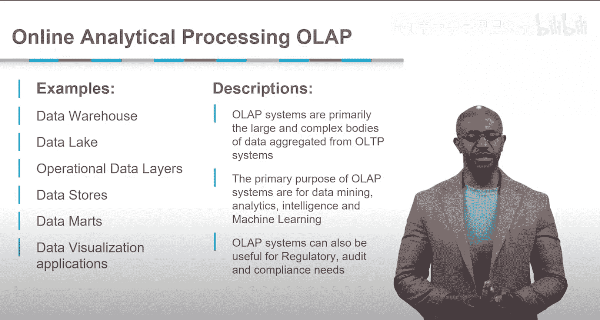

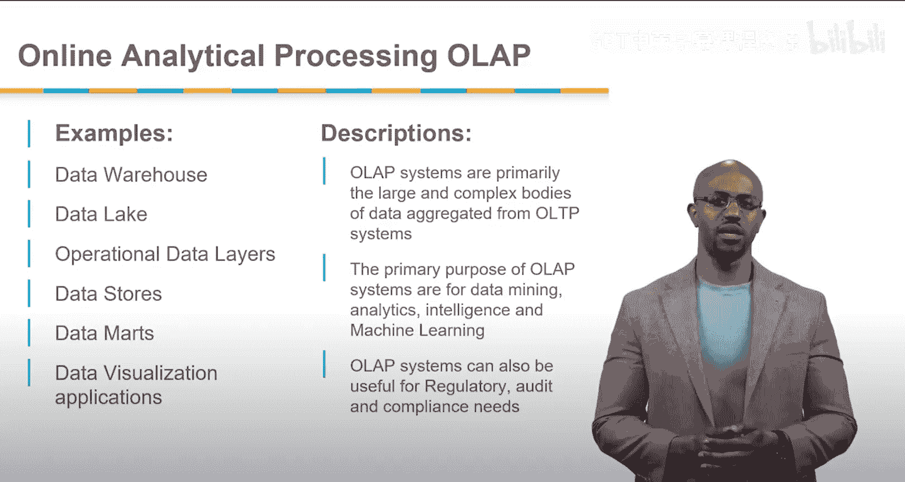

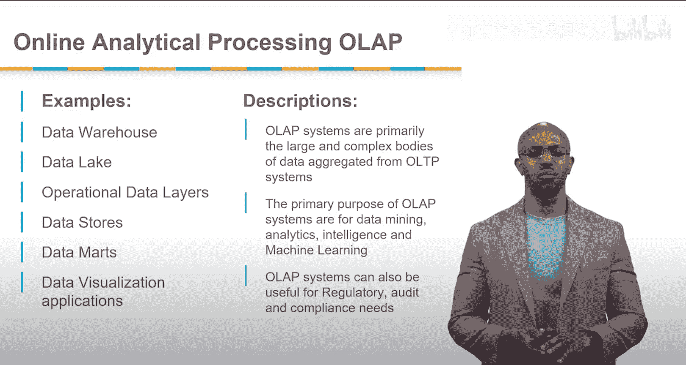

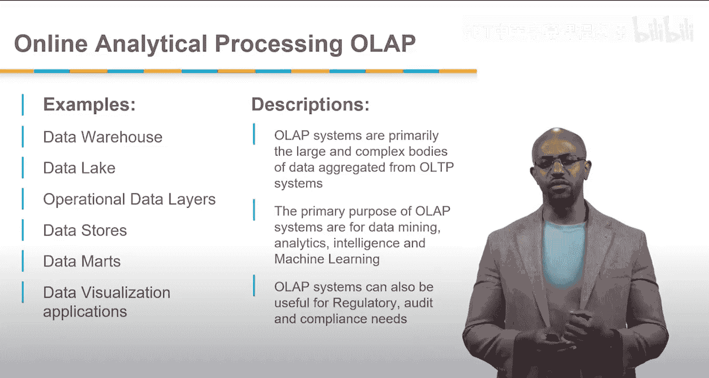

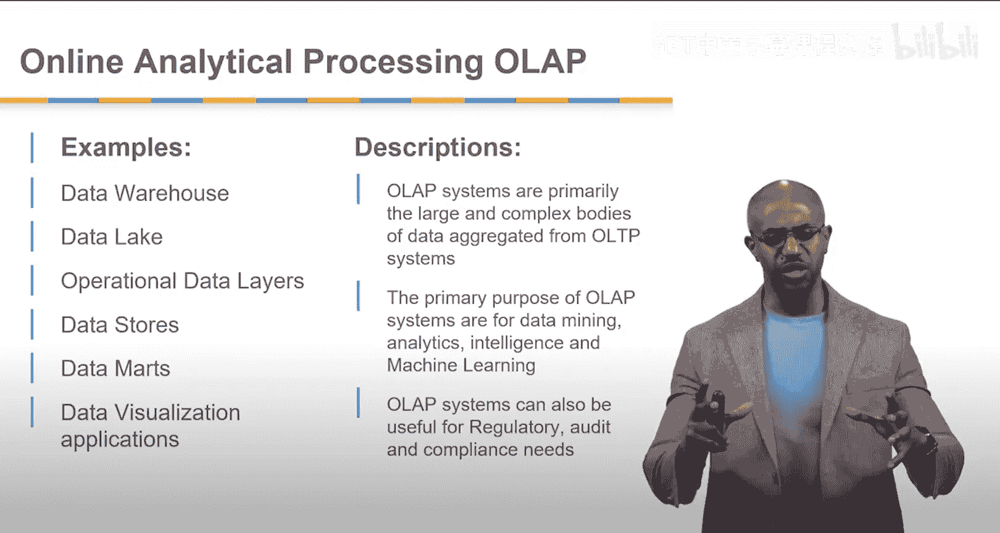

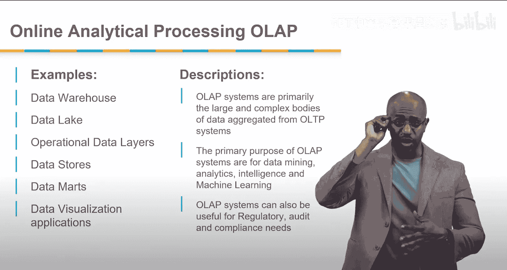

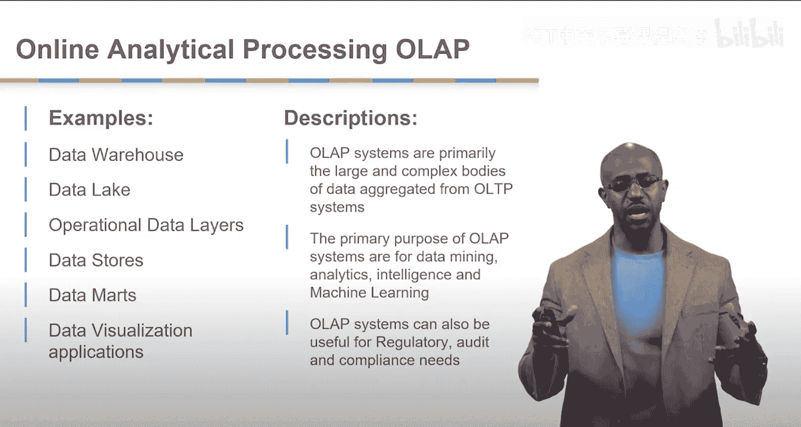

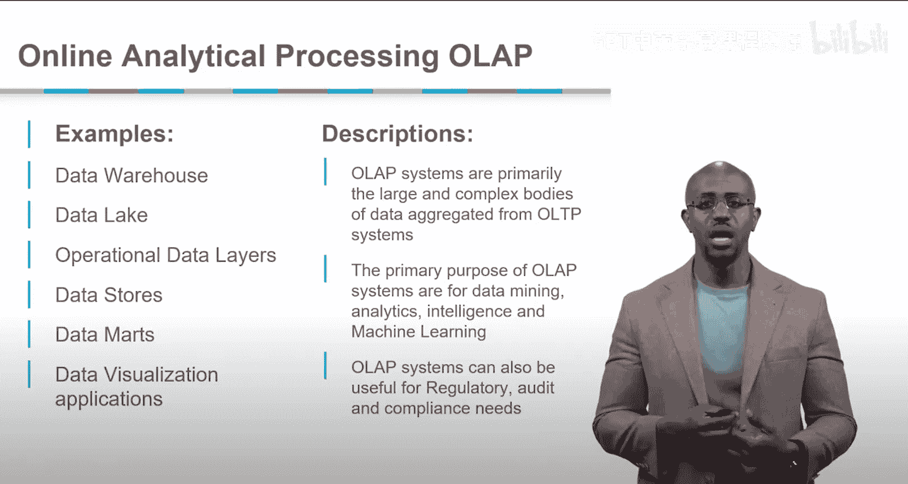

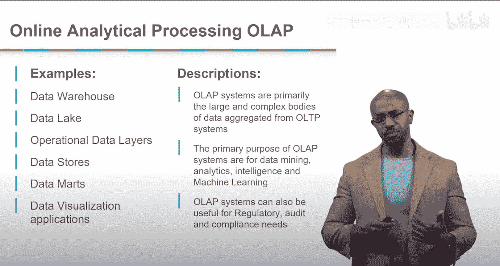

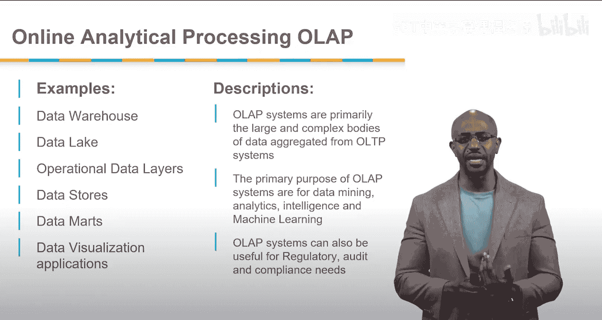

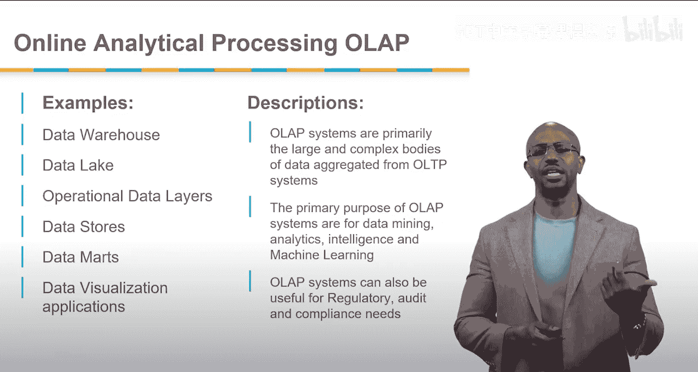

Like。So I wanted to focus on the architecture diagram again。

 looking at the top at the top we already spoke about this is the visualization so we're going to focus on that top left or top right box and that's where the visualization of our data occurs then we have those intermediate layers under that where we create new values。

 we derive new values， we enrich the data， we then also create data from the unknown。

Speaking about dark data and figuring out how we can build more value and create more intelligence at that layer and below that is where we store data typically in that big data cluster can be structured or unstructured。

 a warehouse or a lake， and then you things can be structured in JSN and other unstructured formats for like MongoDB。

 Cassandra， et cetera， and your standard structured things like Postgresh MySQL， MSSQL。

So going into the top portion of the diagram， a little deep dive as we're looking at the visualization and we're trying to gain the value from it or gain intelligence。

 some things to pay attention to is our analysis giving us false positives is the analysis itself directionally true。

 does it present a message that could be misleading a lot of that could be due to poor data model data quality hygiene issues and the only thing I want to point out different between quality and the hygiene because hygiene is somewhat of a subset of quality is just when things are non-sensical so it's just a slight cut from when you're looking at quality in those six dimensions but hygiene is more about is what we've done in using dark data。

 creating new data products creating enriched intelligence in all those other facets is is it sensible and we'll dive into that a little bit later in other lessons。

Poor governance also is a problem when we're think about CDEs， are critical data elements。

 things that are critical to the enterprise function and critical to our data model。

 poor governance can also cause challenges here as we're looking at the analytical systems when we think about captive andgenrative data and then as we're going down into what we see there with the data layers data layers。

 derivations in rich data all in the data store and those data mars。

 so you can sort of look at things as we have our Mars we have our stores。

 sometimes you only need one of the layers and then depending on the complexity of how you automate your analysis you may need both but this is where you really refine and develop those data products from the dark data that we'll talk about in the next slide。

 but this is where that value generation occurs and then it's expressed in that UI layer。

Now going down into big data so this is where all the data is stored coming off of those transactional systems in some cases you'll have a few derivations here primarily the majority of them will be at the next level that we already discussed but this is where those JS and objects live text files。

 other documents and things like that just that could be stored in the lake in an unstructured manner with keyvalue pairs and things like that going over to the left side looking at SQL again we're focusing on how are we missing data that came from the OLATP systems and are we storing them correctly so our data model is it causing conflicts and the naming so when the data comes into this foundational piece before it goes into those layers that we backed into is the data model correct are the nam is the naming convention is it uniform all the way throughout these are things that you'll want to think about then as we're looking at the hierarchical hierarchical data structure and the category categorically。

How is it accurate， is it inaccurate， is it misleading that lends itself up the stack to that visualization and can cause those issues that we talked about before。

So lastly， thinking about ML capabilities， a lot of times derivations or enrichment can come off of reference tables。

 but in some cases those reference tables themselves have derivations and adjustments and enrichments。

 so when we start talking about machine learning and training machine learning models and creating new ways of adding to data sets and new ways of pulling the unknown into the fray。

 machine learning gives us a boost and at this layer that's where a lot of that data can be added using ML tactics and training data。

 neural networks， etc。All right， a few takeaways and opportunities looking down that stack again。

 we got that visualization layer， we have the data store。

 the data mars all in that data products layer， and then at the bottom we have the big data right so a few takeaways we want to focus on ensure granularity at the data mar level a lot of times it's easy to just roll those values up and start combining things immediately although we do have to combine on key on key fields we still want to make sure we ensure that granularity so when things need to be changed and added at the end of sequences we can do that right ensure that a thorough use case a thorough understanding of the use cases from the business perspective that will allow you to create that data product layer and create it in a way where we can scale where you can pull the value out of and all other stuff test your assumptions ensure that the data model is being followed I can and I can't express that enough the data model is critical the CDEs are critical the metadata is critical。

Because all of that is gonna to build up and allow you to really get the value from the dark data。

 It's gonna allow you to identify where the gaps are and pull that information in and make the data products that you can use to gain that value and reduce risk。

 Thank you for your time。