# 亚利桑那州立大学《黑暗数据迁移与架构｜Dark Data Migration and Architecture》中英字幕 p19 18_生成式数据概述.zh_en [BV1TkurzMEmm_p19]

Welcome， in this lesson we're going to do an overview of generative data。

So this is class A tier 2 generative data and typically you use captive data and partially captive data along with some insights。

 some intelligence， some understanding， maybe even some tribal knowledge to get to the point where using that internal data。

 expanding it using reference data and creating new pieces of data and data products to enhance your company's ability or your enterprise's ability and this data obviously before it was created was previously unknown now most of you will have done things like this with things with you know methods like data blending as you see here data derivations。

 data enrichment data modification， expansions and insight but the core core key to this is to expand responsibly it's easy to get into scope creep。

 it's easy to get into just really wide data sets with everything by nature when you enrich data。

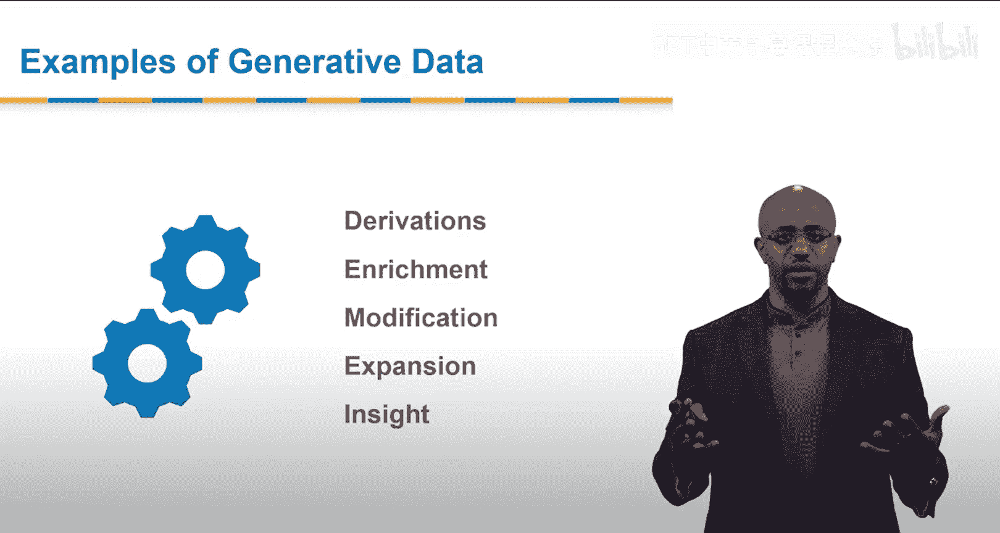

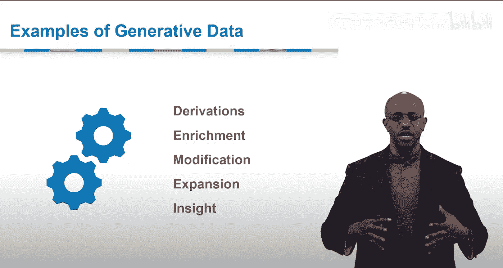

Especially if you're enriching data and creating data products is going to get somewhat wider。

 your data sets are going to get somewhat wider， but you want to make sure you take a strategic approach to architecting appropriately so that you get wide responsibly and like we said a lot of captive data。

 a lot of those things and a lot of those elements that you use are for the purpose of creating this value that you typically see in generative data now we're going to focus only on data that has come from inside the company on this because we're going to just focus on captive data later will get into how we expand even wider but in this piece derivations which typically are subsets of enrichment。

 blending all these other factors same with modification and then insights and expansion a lot of the times that comes from understanding how to build referential data around the data that you have or around metadata or using metadata itself。

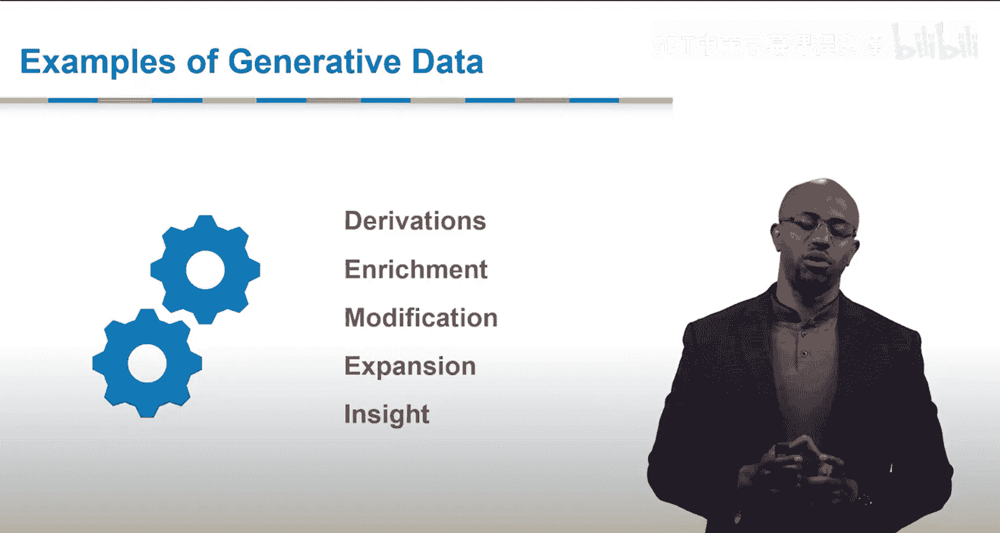

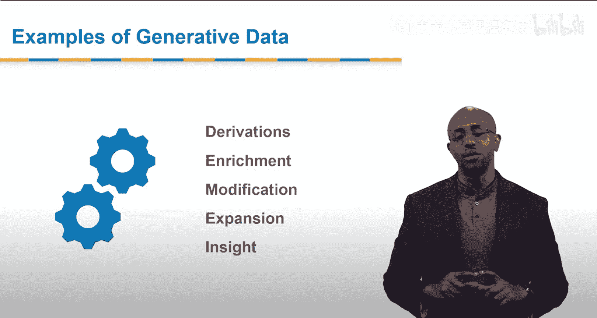

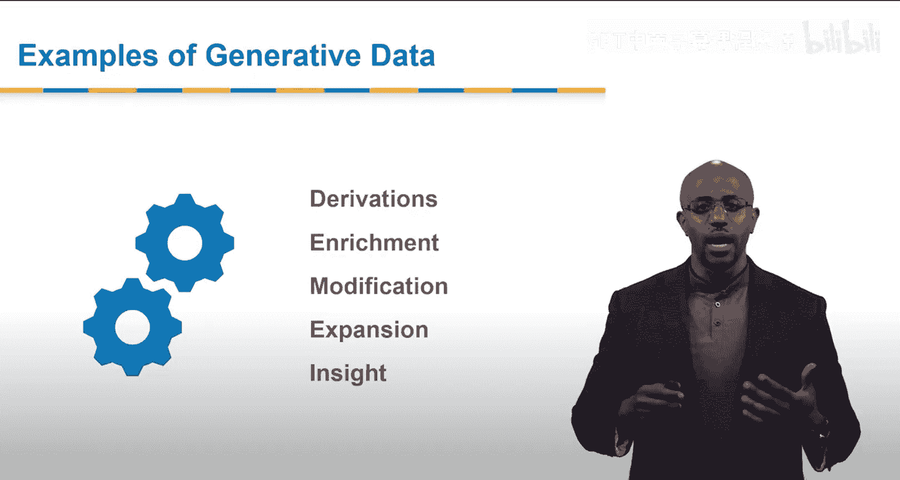

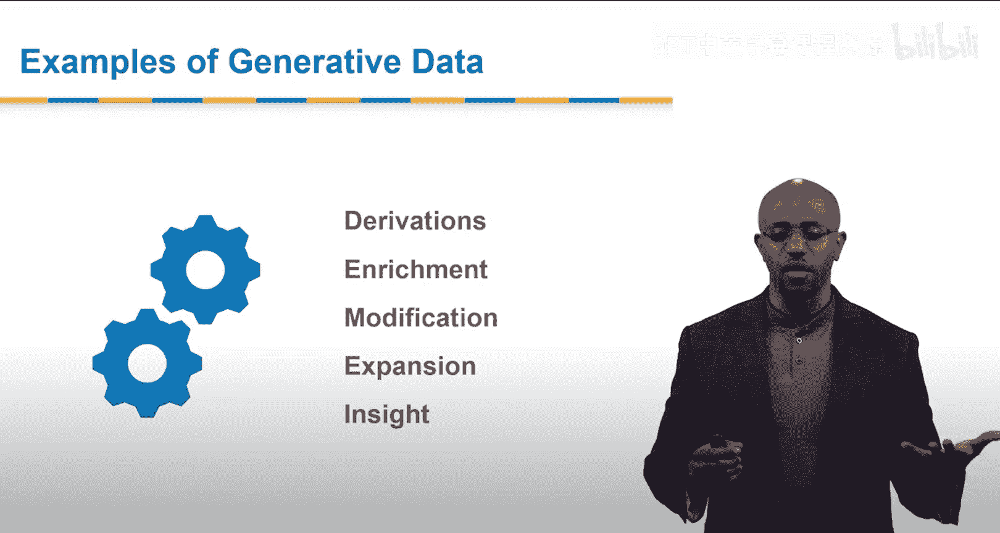

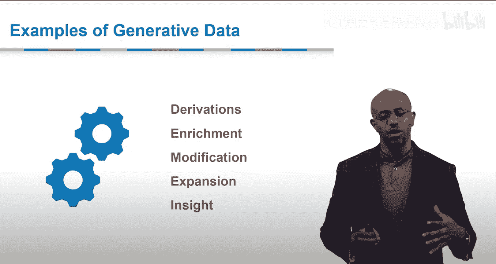

And then the last piece on this overview is the importance of enrichment I want to make sure I hit on these three core competencies。

 obtain more data and information from your own data specifically here but also from outside data which we'll get into later and then increase accuracy completeness of the information that you have right so sometimes。

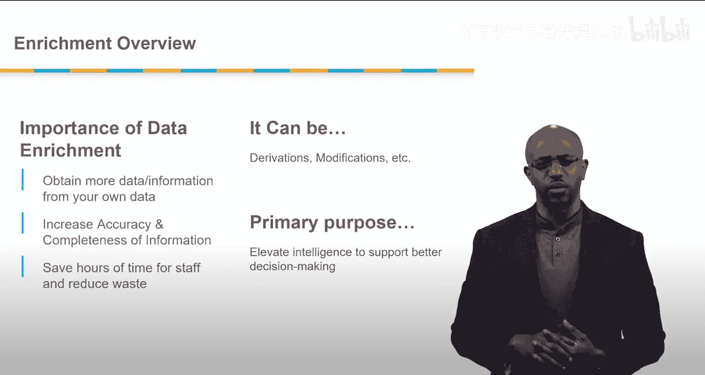

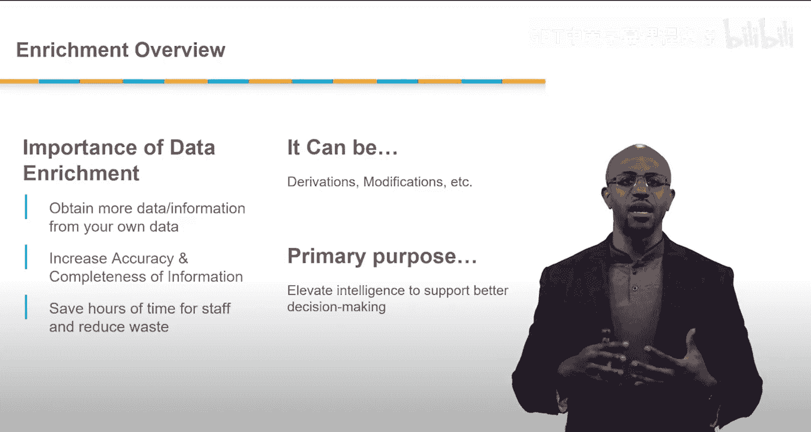

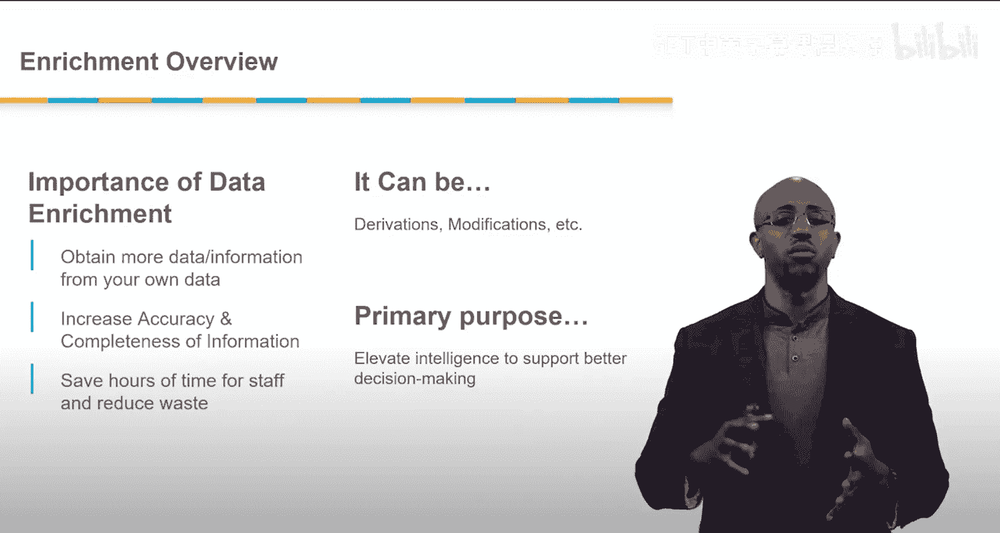

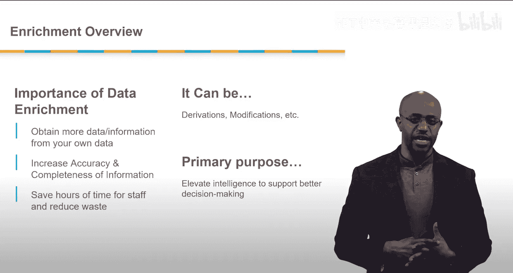

Where you may have missed the opportunity to capture data depending on elements that you have。

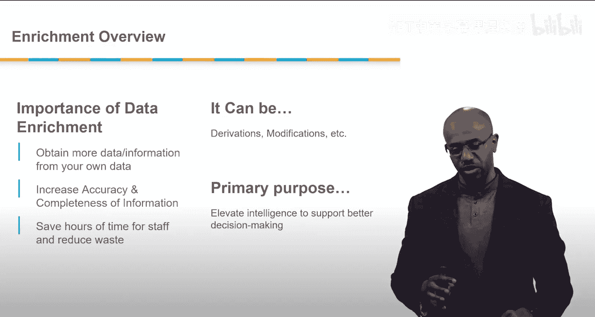

You can derive those values so that's really critical and that's something that you'll want to consider and that's really that's one of those things that are really helpful about data enrichment and then saving hours in time of staff and reducing waste people creating redundant things or redundant artifacts or redundant spreadsheets even redundant views that are partially automated and things like that data enrichment allows you to auto analysis if you know how to do it right automate a lot of manual tasks it also allows you to expand the horizon of what you're doing and then like we said it can be derivations it can be modifications but the purpose primary purposes is to elevate the intelligence to support better decision making so thank you for your time。

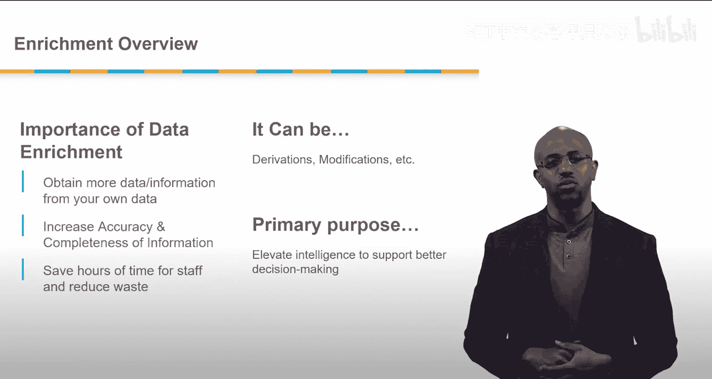

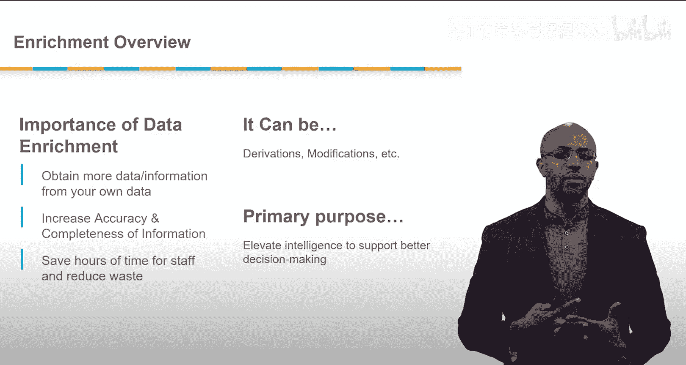

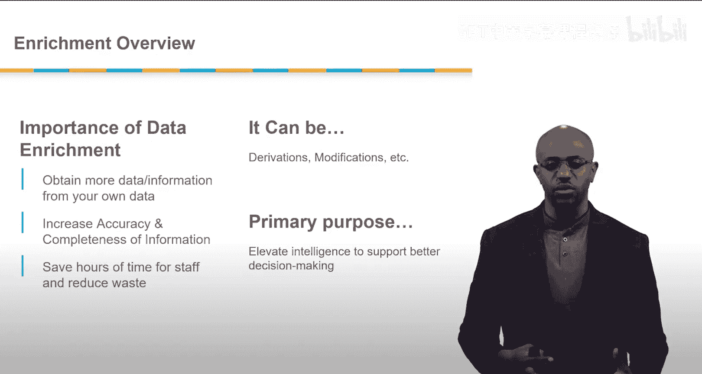

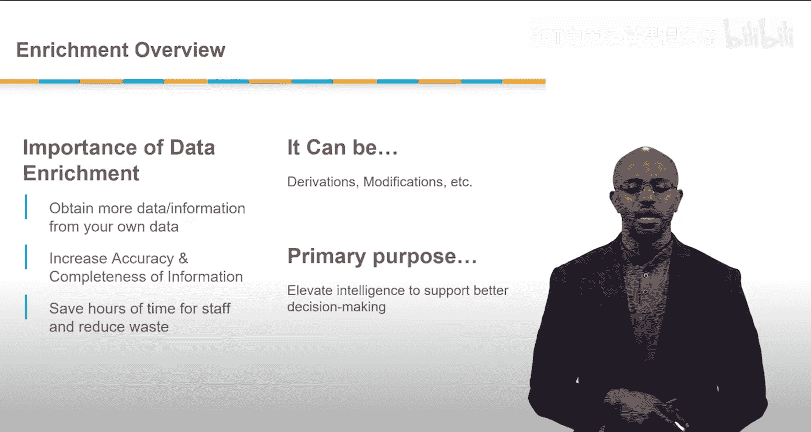

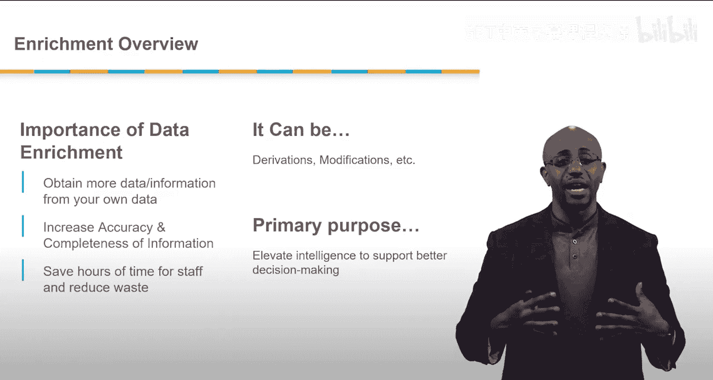

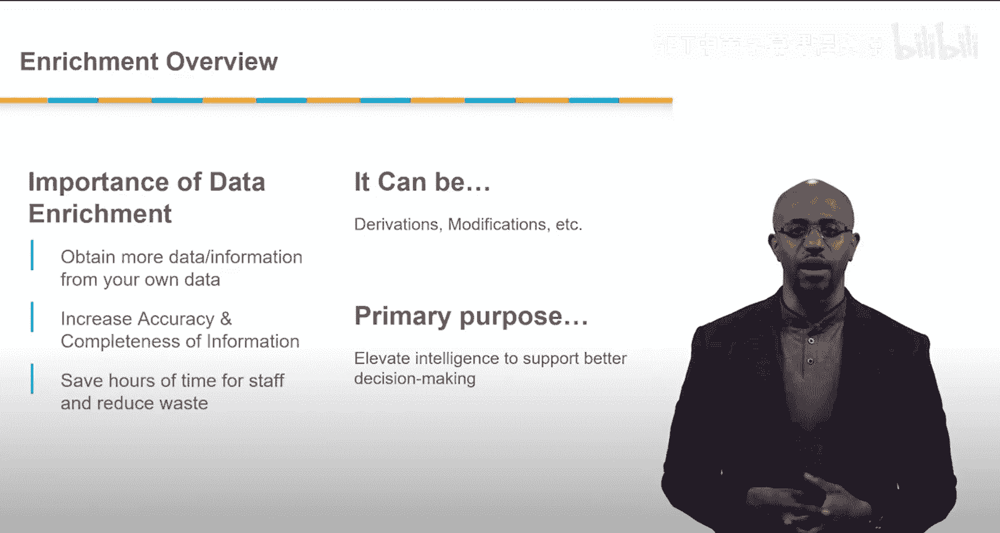

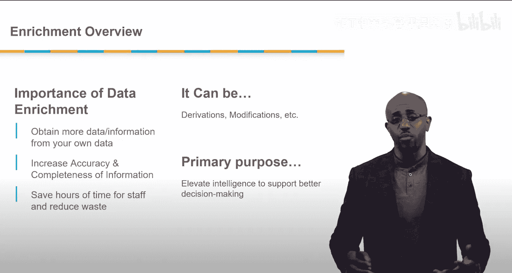