# 亚利桑那州立大学《黑暗数据迁移与架构｜Dark Data Migration and Architecture》中英字幕 p23 22_暗数据认知差距弥合策略.zh_en [BV1TkurzMEmm_p23]

Welcome in this lesson， we're going to focus on value stream mapping and customer journey mapping for the purpose of understanding what we need to look for when we want to go capture。

Uncaptured data。So。When we look at value stream mapping and journey mapping。

 they're really critical because。Value stream mapping identifies how the company creates value for the customer and journey mapping identifies how the customer receives that value and how the customer goes through the journey of obtaining value from the company。

Now this is extremely critical to understand that for this example and for these examples I'm about to go through。

 we aren't necessarily trying to dive deep into both of these and we're not trying to necessarily understand how we want to create these things in this lesson and this lesson we're focused on making sure we understand them better。

 making sure we can understand how a journey map should be created at a high level and what it's about and then understand。

What we need to do to search for that uncaptured data to better provide value for our customers。

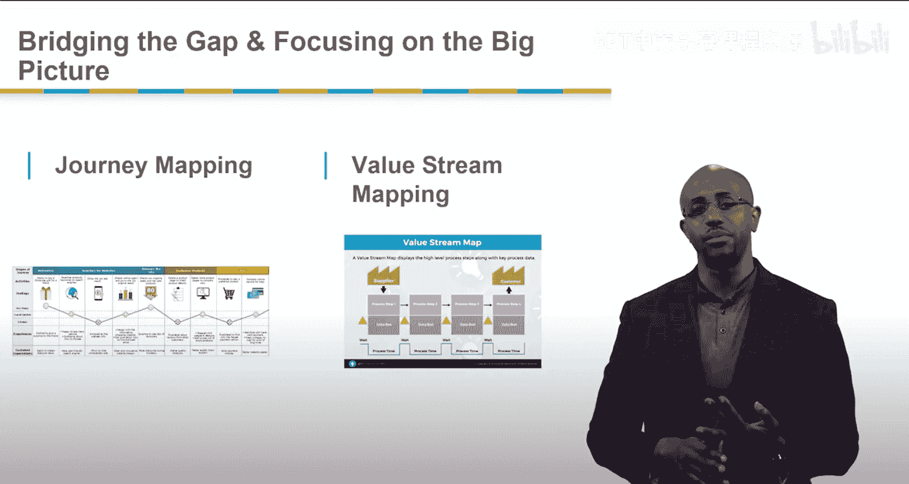

So。How to create a journey map， right。Focusing on the journey map first。First。

 we need to create buyer personas。 We've talked about that a bit。 Select the target customer。

 Same thing。 We'll need some data products to help us target the customers。

 But initially when you start， you're starting with less data。

 So your targeting will be most probably not as strong initially， but over time， you should grow it。

 Lets customer touch points， identify customer actions。

 Under who you're dealing with and how they operate with you。

 and how they want to be serviced or provided value to Under the available resources。

This is super critical because your resources are your resources。

 especially your human resources are your most valuable。

 they're the ones that ignite and do things So understanding your resources and how they can interact with your customers are critical analyze the customer journey and take business action right so take business action where you need to and these are things you' want to consider when you're creating this journey map then the other piece as we're going through this journey map。

 we're going to walk through the motivation， these different steps， the motivations。

 the searching the browsing to the site， the education of the customer。

 how it evaluates the products， then how do they pay right so if you go from left to right。

 you see is the person starts， they're looking at what is the motivating factor they may want to buy a gift the general shopping journey。

 they're go on a website or a mobile device either or they'll start looking at the different products。

 they'll browse the site， they'll figure out can they either save money can they buy a better product all these different things so as the human is going through the website。

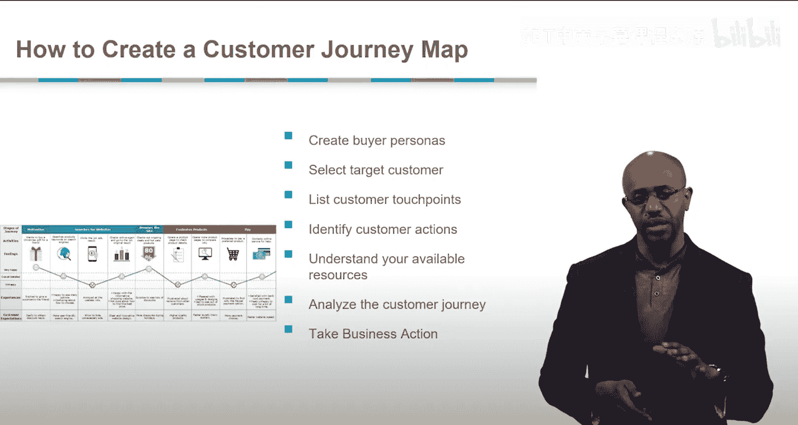

Or through whatever channels you have for them， they're collecting information themselves and saying。

 where should they spend their money， where should they give their value to you or someone else？

And having a deeper understanding of this。Allows us to say， okay。

 what data do we need to collect from them and how do we improve these processes over time so when you see like searches for a web and it says clicks the first add result right？

The first thing we need to understand is how high are we on these search rankings。

 Are we in a position Again， our positioning， Are we in a position to be seen by the customer to be heard by the customer for the customer to deal with us。

 have we collect enough data so that we're doing the right things so that we're selecting the right keywords。

 What is our search engine management。 Are we narrow to a niche are we going wide。

 These are types of things that we need to understand as we build out our customer journey map and understand the gaps within how our customers are dealing with us。

 So going into evaluating product， we have opens a product page checks the product detail。

 opens more product pages to compare info， Are we allowing customers to compare info fast and easily right And then when they making action。

 are we using tags and other things to grab that data。

 and then understand how customers are using the page so we can improve on the page。

 whether it's a web page or a mobile device。And then how are we using that data to also then say we need to start creating an understanding of data products that deliver value based on customer usage so now one of the questions where we had a question before about how is our products performing one of the questions would be how is our web products performing how is our web products and web platforms performing for customer usage and how are customers consuming and using those mediums and then we'd have to create a data product around that so that we can then better use that and that would also help us apply。

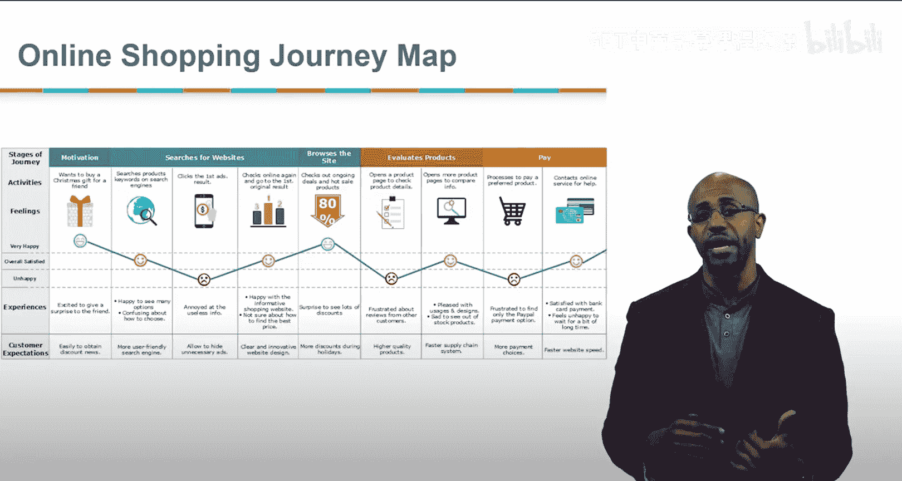

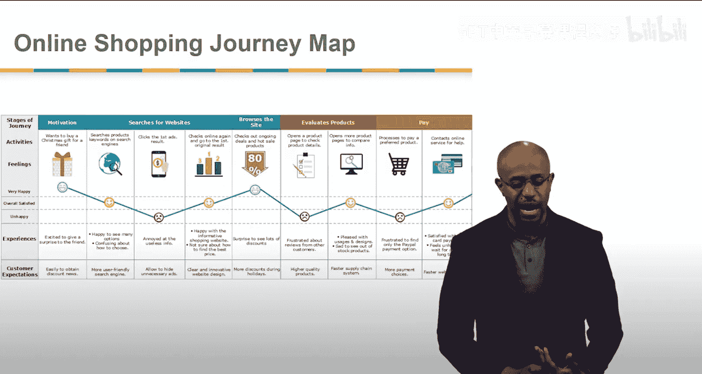

Value down line and downstream Now when we look at paying right， So processes to pay。

 prefer product contacts online service for support。 ideally。

 the best way is the person comes through， they go by the product and they're done。

 they don't even have to contact you。 That is the ideal world。

 but sometimes they have to talk to you。 Sometimes they may have questions on the product。

 Sometimes they may have to use that chat that little chat box down at the bottom。

 So we have to make sure we're collecting data from that as well。

 And then if they do talk to our customer service reps or the customer service reps collecting the right data。

 Are they trained well enough to do that and attain the right data。

 one of the things we want to consider is if we don't have the tags on that page where we're identifying how people are using the page where they're clicking how they're absorbing our information and we can't apply it back to the accounts。

 that can be an issue。We aren't collecting the intelligence that allows us to perform better。

 same with the shopping cart if someone's filling up their shopping cart then bouncing off and never buying。

 that's an issue if they're bouncing off and maybe coming back and reducing the cart。

 how many people are doing that why they doing that sometimes people fill up the cart because they can't compare really easily on a page understanding these behaviors。

 right？And then going back upstream one more as we're looking at the first ad。

 if we are selecting wrong keywords， we'll never even get in front of the customer。

 they'll never even see us and I've had this conversation a number of times with in corporaterate America where we're dealing with either ads or something where we're touching the customer it could be acquisitions。

 etc。And the thought comes up。 well we believe we're doing it right based on X。

 but the results aren't indicating it and the search results are showing that we are on the wrong keywords we're spending money on the wrong keywords and we're not getting the foot traffic that we need to so these are things you want to think about as you dive through uncap data Now I just wanted to show this one a little bit because this is a different type of a customer journey map and I got it from brightright vessel is really complex and as you look at this at the top level it starts it walks you back in there a little bit easier right it says awareness。

 consideration acquisition services and loyalty when you think about this and you think about how companies companies or enterprises are set up awareness is the beginning then you have consideration So awareness that's sort of where your marketing your ads go out consideration how are you managing the interest of the customer right offers them calling in whatever that might be then the acquisitions process right once they start going through checkout once they start。

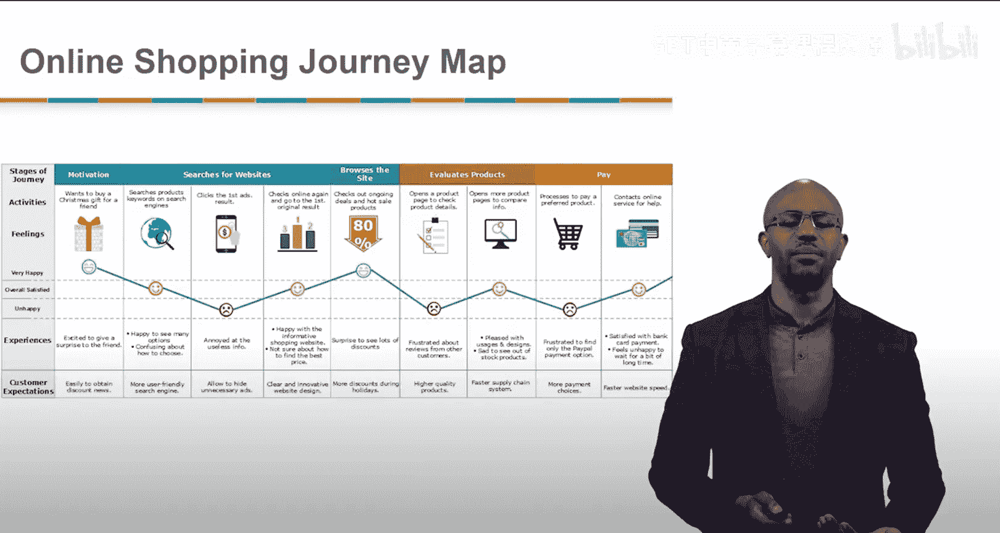

Going through these different pieces right filling out forms and all that other stuff e shop。

 you have the upper funnel and the lower funnel， the upper funnel being more marketing。

 the lower funnel that process of acquisition we got you in the systems。

 you're becoming a member and now we want to get you into service and loyalty like how are we servicing you and then further how are we creating that loyalty loop So now you're in we want to continue deepening our relationship with you we want to give you other products we want you to use our products we want you to get value from what we're doing。

So these things are all integrated integrated well and this sort of displays very well how when you look at the journey map。

 the different departments touch people at different parts and this is sort of generic and at a high level but I thought this was a very good view from Bright vessel I wanted to make sure we could show it here in this class Now let's move over a bit one more to a different type of customer journey map This one is more about music sharing I wanted to use this because it's more sort of a non-traditional thing it's more about music sharing lesss about selling right so this one shows visit。

 listen， discover， share， discuss， receive and respond This is the value stream for music sharing。

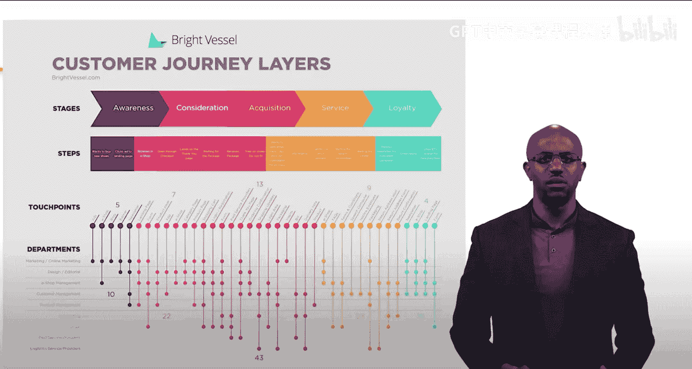

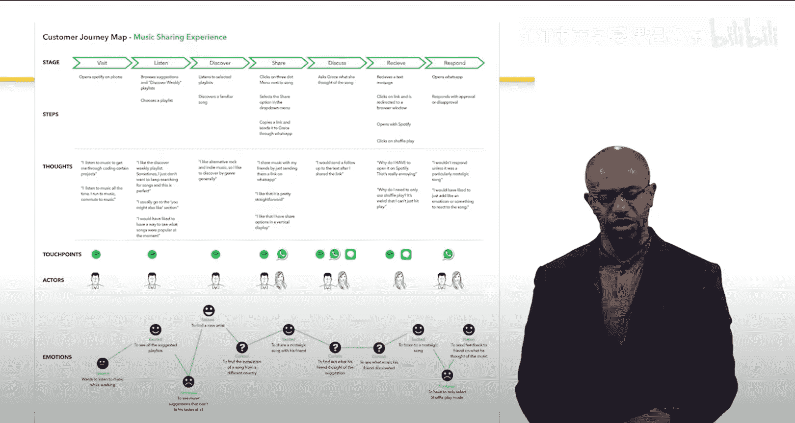

It's not about selling， it's not about a company making a profit。

 it's literally about maybe something like Spotify or Whatsapp or whoever whatever company is onena doing some sharing。

 maybe Pandora or something and how people interact with each other because they're giving value to their customers and the customers are also giving value to their friends and the people in their life so just at a high level looking at this when you go through those steps there and you look at the bottom。

 you see they're more focused on the customer emotion and how the customer feels and they want to make sure they try to get to the customer to that stoke level as much as possible and excited level as much as possible that's where they're looking at the value and then at the bottom。

 they don't want the customer to be annoyed if you see one of the things says one of the sad faces say to see music suggestions that don't fit his taste at all。

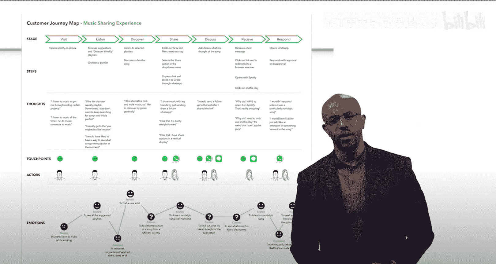

That's something that you want to consider I've used music appss before and sometimes a random song comes up and I'm thinking like how did that even get on my track because this has nothing to do with what I'm listening to or what I'm interested in so those are some of the things that can happen and you want to consider。

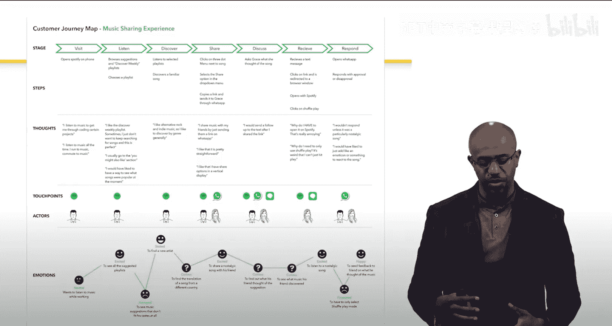

Now shifting gears to creating a value stream map and again going through the gaps of unattainable data here or unobtained data right so you have a supplier customer。

 that's where the value stream map starts。

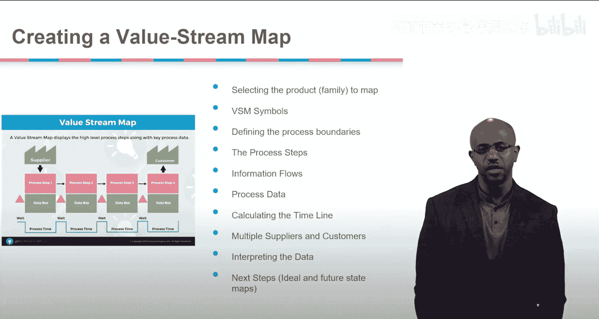

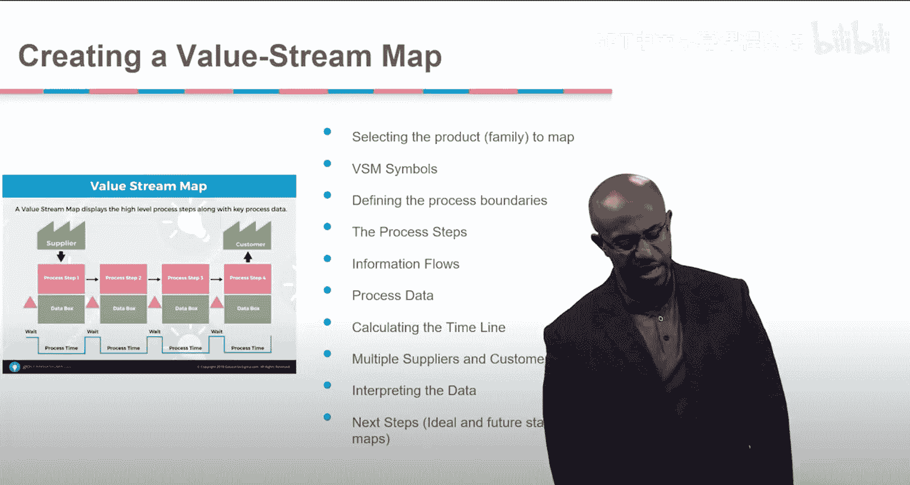

You and your enterprise have a supplier and then you have a customer this is a very high levelve one or high level view right it just says process steps1。

2，3， and four we get this from go learnar Six Sigma。

com right and looking at this on the right you see these are sort of the things that you want to look at for creating a value stream map selecting the product family selecting the product to map。

 the sort of the family， the valuestream symbols， making sure you understand what symbols to use where defining the process boundaries。

 the process steps， the information flows， process data。

 calculating the timeline you're gonna to have slack in things like that in the timeline。

 multiple suppliers， customers and interpreting the data。

last next steps is an ideal future state right so you also want to be able to say here's the value stream now and here's the value stream in the future。

 Sam with the customer journey mapping and then just to dive into this so we can talk a little bit about the dark data that's possible Well you see it at high level just wait and wait and wait right so you want to identify slack and something like this And then if you're in real time let's say if you're at a factory or even if you're at a company where there's a process and over in where are we losing value。

 Sometimes you need a quality checkpoint， but sometimes the quality checkpoint can be dug。

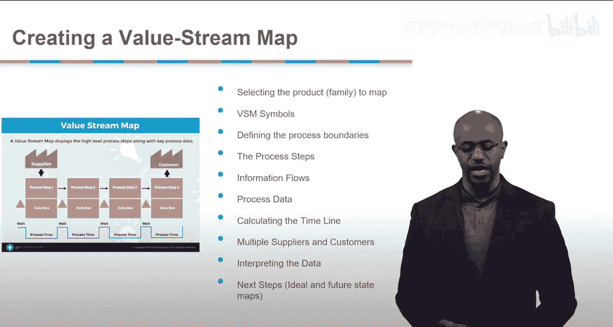

Later down the line and that's something that you'll want to think about where can we streamline things。

 where can we earn the right to reduce waste as if you went to a lean Six Sigma class。

 you'd really understand where you want to reduce waste in some of these processes sometimes technology can be uplift it to reduce processes in some cases to remove processes altogether so you know in old school days if you want to do customer relationship management you had file cabinets and people were mainly going through file cabinets to understand where they were we're dealing with certain customers now we have CRMs you know you just look it up in the system and you can see the whole history of the customer which reduces a lot of the manual processes that you would have to do and these are all data points that you want to capture to help your company produce better wherever you can automate automate automate automate but in a responsible way automation helps reduce some waste and also helps produce value and also captures data whereas if for in the exam。

If you were using a file cabinet， your data is what's on that paper and the processes and the human doing manual things in between nobody can capture that information so those are the things you want to focus on and that's literally why we wanted to focus on value stream mapping here so this is a critical thing that we want to focus on customer journey mapping。

 value stream mapping and understanding how we can get the data or streamline our processes for both of these things to focus on how we look at unattainable data so thank you for your time。

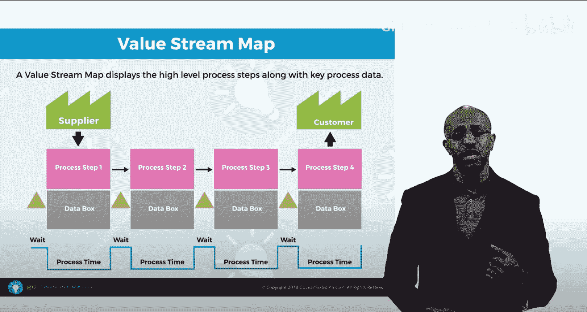