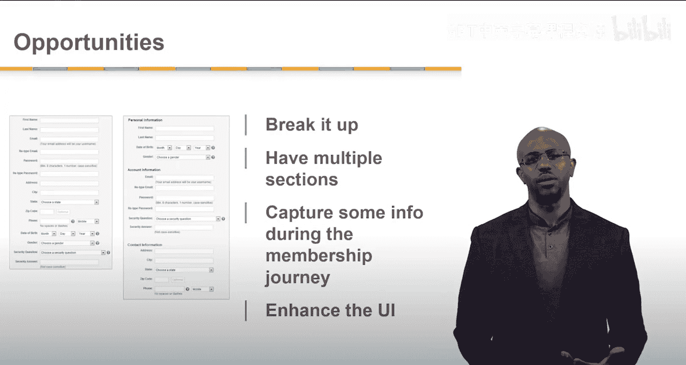
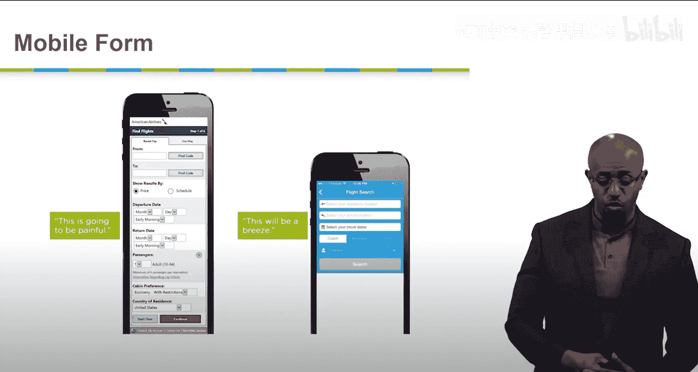
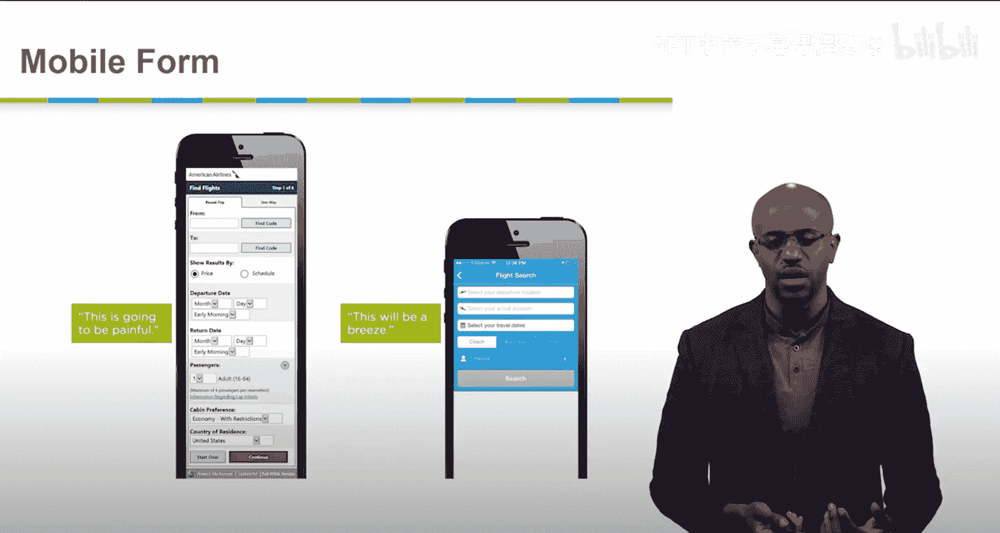
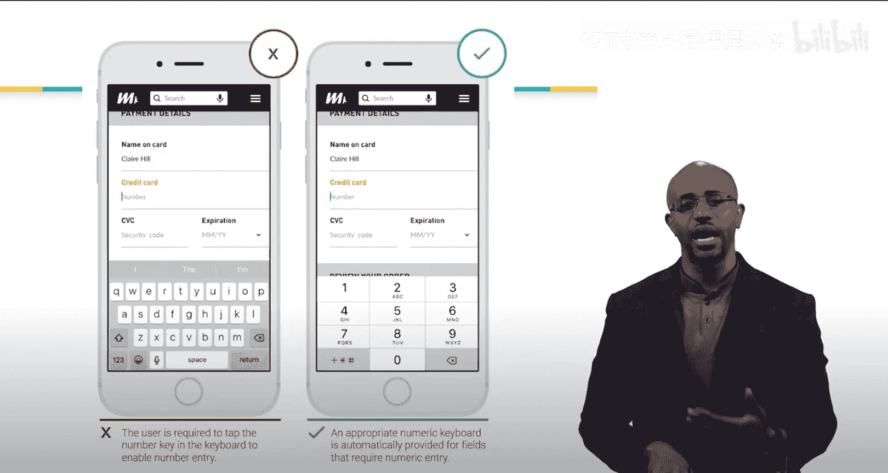
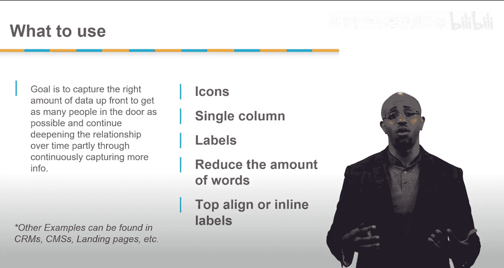

# 亚利桑那州立大学《黑暗数据迁移与架构｜Dark Data Migration and Architecture》中英字幕 p24 23_数据捕获示例.zh_en [BV1TkurzMEmm_p24]

Welcome， in this lesson， we're going to go through examples of data capture。

So I want to start it to your classic type of example。

 web form web form is primarily where folks go to fill out whatever they're trying to do。

 whether they're trying to travel， buy something， any other type of thing that you're trying to do。

 but this specific example is about how how do we want to design web forms to perform better now the examples that you're going to see in this in this lesson come from Smash magazine and。

TheThe author does a really good job of going through how to design better web forms so with this one you can see this is a very long web form they do a good job by categorizing things which sort of break it up。

 make you understand personal information account information contact information。

 all that stuff but in your more modern views what you'll have is this form is not only broken up into sections it's broken up over pages to reduce the burden for somebody to make decisions for what's on the page。

So here you see first name， last name， email。Retype email， all this stuff。Nowadays。

 when someone is sort of purchasing something or， you know， especially if you're buying like a plane。

 a flight， or if you're even purchasing something online。A lot of this information。

 when it's the first time someone's come to a website。

 you want to capture this after they've already invested or know what they're going to get so the person can spend time focusing on the checkout process。

 knowing what they're going to get and then giving you this information at the end。

Also the way this form is designed， you go straight down。

 then you go back up and then you come back down right it's sort of like a Z it's just not really ideal right。

 and it's all these dropdowns， etcter。As we go to this next one。

 the opportunities talking about breaking heat up， having multiple sections， enhance the UI。

 It is very archaic looking as well， right So this form has a lot of opportunities to improve a lot of opportunities where we can do something much better with this UI Now going into mobile phones。

 this is a mobile forms， this is a very a very good example。

 especially when you're on a mobile device， it's already a small small screen。

 you don't have much real estate there。 So if you're looking at on the left。

 typically no phone is going be this long。 So you're scrolling forever because you know this example。

 they just want to sort of make sure you can see the whole thing。 But when you look at that form。

 man， that's gonna to be painful to fill out your thumbs are going through you're sort of clicking and dropping down here and there and everywhere。

😊。

It's not really a user friendly opportunity there， not when you go to the right and you're looking for a flight。

 It's very simple， very good use of icons， very good use of inline labels right so full screen you see where you want to select your departure or arrival select your travel date。

 your destination and you're gonna to hit search and you're gonna immediately look for what's next they're not even they're not asking you for even some of the information that's on there do you want the cabin preference。

 all that stuff we're not gonna ask you that yet we'll get to that once you see something that you like and most when it comes to flights。

 most people buy based on cost the number of layovers reduction of layovers if we can find nonstop and then you know there's other features as well such as like are there extra baggage fees etc or their favorite airlines if they have member rewards points in those airlines right？

So looking at this equation here。Now， when we look at this piece， when we're talking about。

Not only the the way the form lays out， but also how do you interact with the form。 So on the left。

 if I hit credit card number， I see letters。 Now I have to spend time going to the number section。

 finding the numbers and then。Typically when you hit numbers it's gonna be at the top of the screen so you get these tiny numbers you're working on on the right where you have the green check。

 if you hit the credit card numbers， it literally pulls up the phone pad numbers are right there easy for you to hit makes it a lot easier people can go cruise through your website and at the end of the day it makes for a better user experience So so these are some of the things you' want to think about when we're thinking about data capture you can lose a lot of interest at the point of capture not only interest you can lose a lot of data you can lose a lot of data at the point of capture and this goes back into some of the lessons before where where with this piece you'll increase your bounce rate if you're not doing this right you'll reduce the retention rate people will get sick of filling out your forms and when someone else does it better they'll start using them。

嗯。And if you reduce your retention rate， your business is suffering。

 if you increase your balance rate， not only is your business suffering， your information。

 your data lake and your information repository is suffering and reduces the amount of data you have and reduces the completeness of your data it reduces your ability to create data products that can help you continuously improve so these are things to think about that the point of capture is critical and this isnt even this is way before we even hit the database so think about this stuff as we're looking at dark data this is where a lot of that dark data resides because we haven't even get to a place where we can capture the right information so to enhance some of the ability to capture data you want to think about what you want to use as well as how you want to lay it out things like icons single column especially in mobile devices labels they can be on top or in line in line is typically better depending on things sometimes they should be on top because if it goes wide if you're doing left to right sometimes now you have sort of like a two column feel。

Users going up down and sideways at the same time these are all small things when you think about other examples。

 CRM， CMss， landing pages， the goal is to capture the right amount of data up front。

That's what you really want to focus on as many and get as many people as you can its in your door and continuously improve the relationship and continuously capture more information if you ask for too much information up front you're going to lose people and if you don't ask for enough information up front you're not going to be able to service people So these are things you want to think about these are things that impact your data impact the data products that you can build and they all lead to either the increase or decrease of dark data Thank you for your time。

