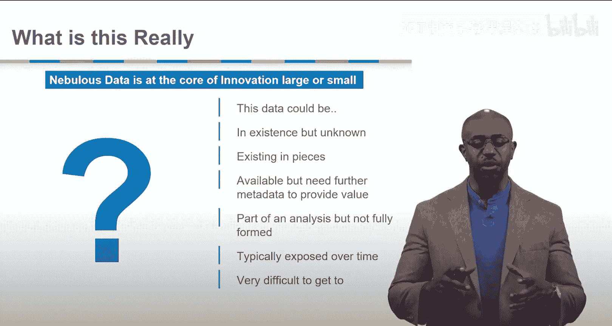
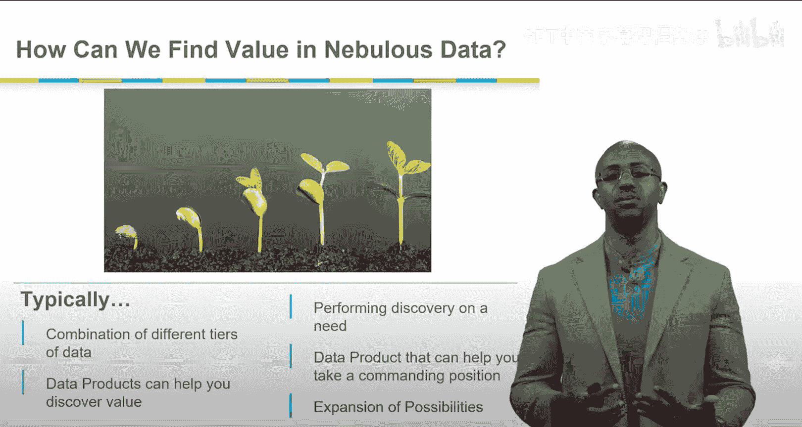

# 亚利桑那州立大学《黑暗数据迁移与架构｜Dark Data Migration and Architecture》中英字幕 p28 27_五级暗数据概览：模糊数据.zh_en [BV1TkurzMEmm_p28]

Welcome in this lesson， we're going to focus on nebulous data。 Now。

 this is the final the fifth tier in the outside data class。

 This data is largely living possiblyibly on the web， possibly not even in an electronic form。

 could be living in our minds and also could just be something that needs to be created or understood at a later time。

 once we get more technology or better understanding。

This is data that we are truly and absolutely unaware of。

 We are also unaware of the need of this data， so sometimes it takes a lot of curiosity。

 a lot of creativity， and a lot of imagination to get to the point where you can really dive into nebullaous data so this type of data typically comes after a lot of discovery after a lot of solution once a solution is created and we are now learning from what we've created and we start understanding and identifying where the nebulous data is and where we can use that to create value。

So what is it really this is data that could be mostly anything it could be in existence but unknown。

 it could be not in existence and need to be created， it could be pieces of existing data。

 it could be many different things such as like it could be something that's typically exposed over time and it could be part of an overall innovation part of analysis and things that are not truly and fully formed so it's a big question marking in reality but the thing about nebullaous data is it's typically at the core of innovation in the core of something new so how do we find value in nebulous data。

We need to first understand that you're gonna have to go through the process of using the captive data generative data。

 uncaptureed and unattainable stuff and once you finish using those data components。

 you'll start getting to the point where you can start reaching into the nebulous data where you can get those more gainful innovation and gainfully useful data products that can put you ahead of competitors and put you ahead of the curve so it's something you can use during performing of discovery if you're curious enough and curiosity is the core of being able to get to it and the data products that can help you take a commanding position in the market or in the environment right so these are a lot of different things and a lot of different ways that you can gain value from using nebulous data but it's it's nothing that you would want to try to attain upfront when you're first starting a project you want to plan for and just to bring it back to this slide that we discuss some of the earlier videos。

Looking at dark data and nebulous data， instead of looking at it as something hard。

 necessarily hard to get thats under the surface， look at it as that diamond mind and that since about 65% of the dark data is hidden inside of networks just understand there are components where you have to go out and get them or create them or understand that it may be something people are completely and flatly unaware of。

 so thank you for your time。