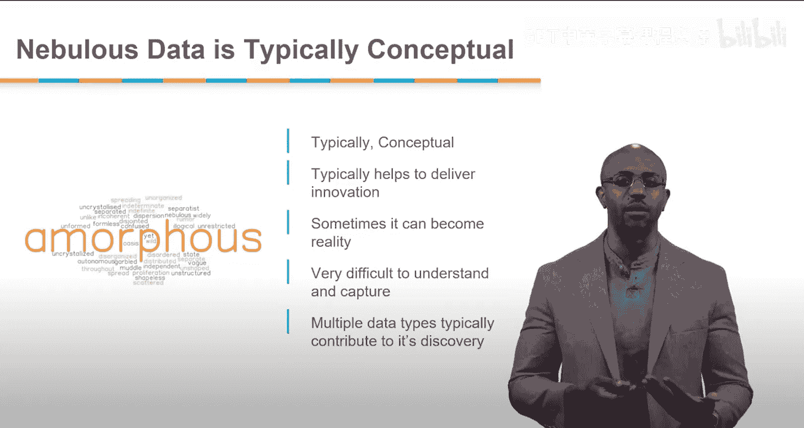
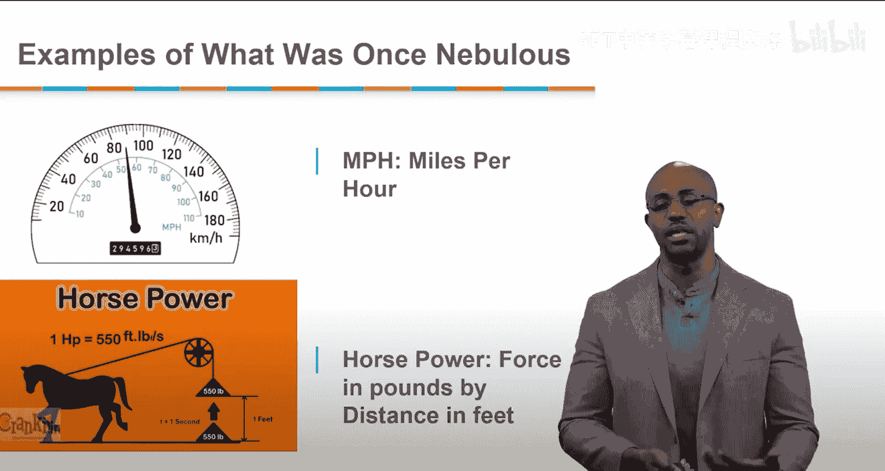
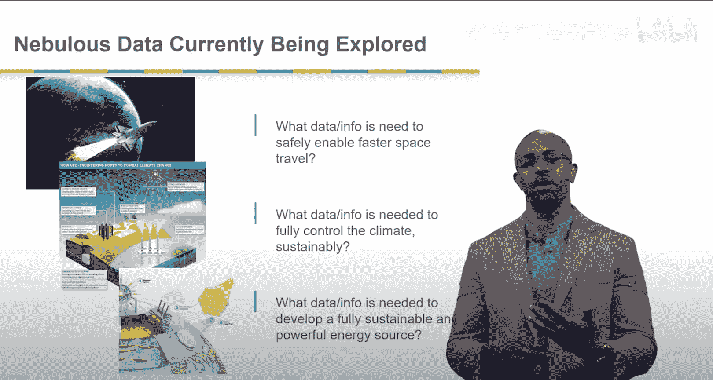

# 亚利桑那州立大学《黑暗数据迁移与架构｜Dark Data Migration and Architecture》中英字幕 p29 28_模糊暗数据示例.zh_en [BV1TkurzMEmm_p29]

Welcome in this lesson， we're going to go over examples of nebullaous data。

So nebulous data is typically amorphous， shapeless， formless。

 something that you really can't grasp until you've sort of dove deeper and exhibited that curiosity that it takes to get into the depths of either something that hasn't been there。

 something that isn't there and something that needs to be brought to light right so it's nebulous data is typically going be conceptual it typically helps to deliver on innovation and sometimes it can become the reality as you'll see in some of these examples and you'll also see in some of these examples where it was dark data that helped to create products that weren't there before and products that were definitely direly needed this day products that that that are part of our everyday lives and we don't really think about being something as innovative at this moment so at one point the concept even of miles per hour was a foreign。

When you think about cars and what came before cars with horse and buggy。

That is sort of what gave us the baseline of horsepower itself so if you look at horsepower miles per hour they measured the power of the torque that could come out of engine based on the number of horses that could equally drive as much power right so you'll hear a lot of people say oh we have so many X horses under the hood referring to horsepower these are all things built on data that at one point was nebulous at one point was completely dark。

A few things that talking about Nala' data that is currently being explored， faster space travel。

 there's things like warping space time， but nobody has been able to actually do it because they're working on getting more information to figure out how to make it happen。

 fully controlled climate change in a sustainable manner。That's one thing that。

We are definitely looking at how to do better and in most most places they're trying to do it in a more natural way。

 planting more trees， et cetera， those types of things。

 but that's sort of helping global warming not necessarily getting into climate control right that's one of the things that could be favorable to people depending on where they are on the globe And the last piece is fully sustainable power and powerful energy source。

 There are all types of natural energy sources using wind power solar power but the wind stops blowing。

You have power， you have a power degradation， right， the sun isnt shining is bright。

 You have power degradation。 There has been heliostatts which have been proven to be very successful。

 but again， it's dependent on something else。 It's not a fully sustainable。

 powerful energy source that is contained。😊，nuclearcle power is out there。

 but again you're still dependent on uranium and at some point uranium does run out。

 So these are many good examples of problems that are being currently explored and there's a bunch of nebulous data in the growth of trying to figure out how to solve these problems and lastly just a few a few oldies and in some new ones you know we already talked about flight we talked about the car obviously there was a ton of dark data in there。

 we also have the steam engine which preceded the car The steam engine was really huge。

 it allowed a big change in society factories became more productive we were able to get locomotives and other things and also when you look at the integration of steel based off of iron and other minerals steel into buildings allowed us to start creating skyscrapers and very robust and large building structures right so you have the Lidae which is in China which is。

building with a waterfall coming off the side of it it's the largest building with a water man-made waterfall coming coming on the side of the building and then the B califa in Dubai。

 which is an engineering marvell in itself one of the tallest buildings on the planet and it's a very huge structure So these are a few options and a few things that you can look at and say okay there was a ton of nebulous data at some point but with people trying to figure figure out new ways to do things。

 ways to do things better and bigger they would have the curiosity to dive into the nebulous data after they went through those first pieces of captive generative etc so thank you for your time。

