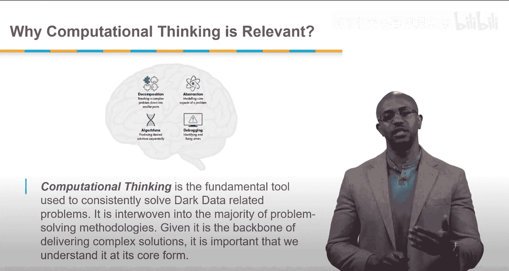
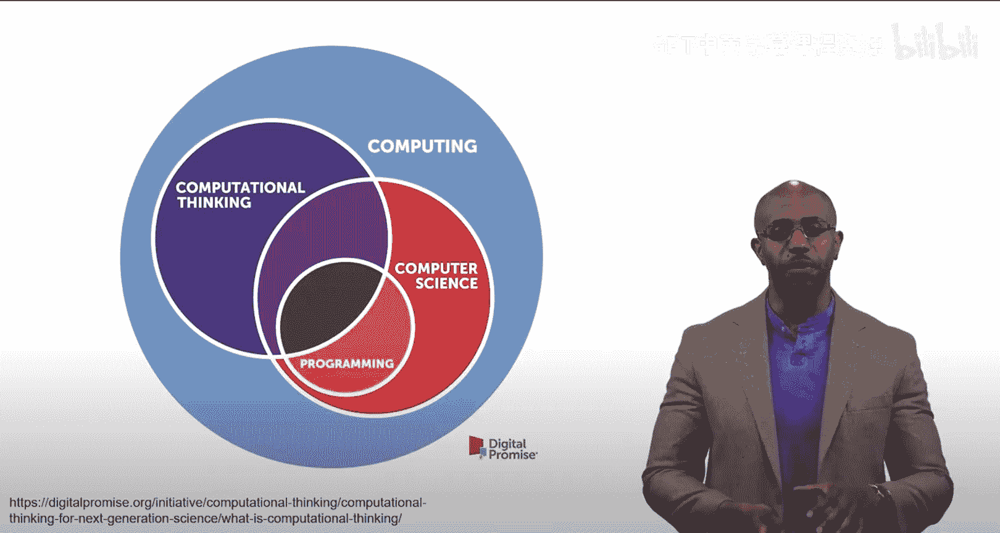

# 亚利桑那州立大学《黑暗数据迁移与架构｜Dark Data Migration and Architecture》中英字幕 p30 29_计算思维综述.zh_en [BV1TkurzMEmm_p30]

Welcome in this lesson， we're going to focus on computational thinking and I'll give you a brief overview of what it is。

 so at a high level computational thinking is a problem solving tool that can be used almost anywhere for the purpose of getting something done in an efficient and effective manner。

Computational thinking has been around for a long time。

 but this article from Carnegie Mellon by Jeanette Wing was something that sort of kicked it off and gave it new life back in 2006 it's going to be part of the reading that we'll go through with this course。

 however computational thinking itself is critical to pretty much every single problem solving project management methodology。

 data science， computer science， all of these different types of STEM disciplines and even management disciplines。

 it is the foundational route that is inside of all of them。

So when we think about computational thinking and we think about dark data。

 how does that relate when we think about those classes and those tiers that we just talked about all five of them。

 all five of them are going to require computational thinking for you to derive value out of any single one of them it is not necessarily just algorithms and formulas and code。

 you have to be able to think through the problem and apply it in a manner that can help you derive value so thinking about computational thinking being the fundamental tool if we're going to exploit dark data we have to be able to understand how we're going to solve these things in a step by step process and move forward。

At the high level I mentioned this a little bit earlier。

 computational thinking sits inside of computing in general and computing is just the process of getting to the next step of solving something or doing something right so when we look at computational thinking it has a part of computer science a part of programming it is inside of computing。

 you could put data science on here， you could put biology on here you can put building a building on here you can put anything in there it all involves computational thinking。

Now。Moving into the space where we're looking at how are we going to deliver something strategically。

 computational thinking also fits well within within agile and lean right inside the agile manifesto as well as six sigmaic aremaic recognize。

 define， measure analyze， prove and control all of these different things and it has these four four pillars right so these four elements decomposition。

 pattern recognition， abstraction and algorithms and we'll discuss those a little bit of the next lesson so thank you for your time。

