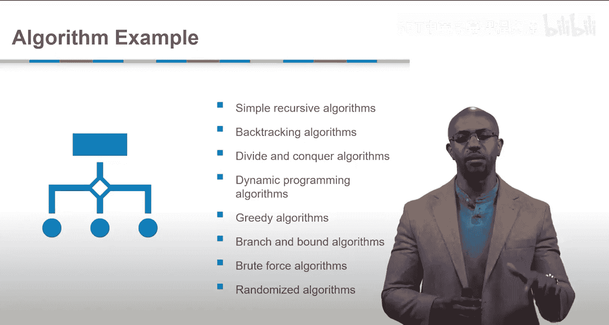
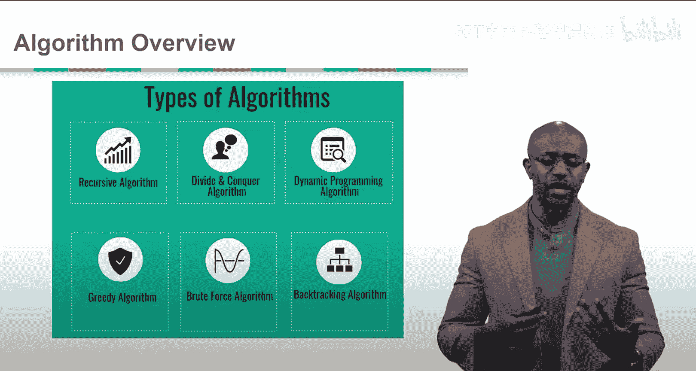

# 亚利桑那州立大学《黑暗数据迁移与架构｜Dark Data Migration and Architecture》中英字幕 p32 31_计算思维应用实例.zh_en [BV1TkurzMEmm_p32]

Welcome， in this lesson， we're going to focus on some examples of the four elements of computational thinking。

So I'll start with decomposition Some examples are iteration， delivering iteration。

 development iteration， iterative sprints and things like that sort of an agile proof of concept working and delivering a proof proof of concept before you start delivering the full product or before you start the full build  for a product minimum viable product right so this is one of those things you're building the airplane and flying it at the same time right so in most cases that's the example they give。

 but in reality you're sort of building a smaller airplane that can be scaled up。

And then that leads us to build that scale right so the right and responsible way to do MVP is you're building for scale。

 but the first product is actually usable。Pattern recognition。

Tings like sorting classification of data symmetry of observations， comparable dates。

 elements and sets and categories and grouping these are all examples of way to ways to look at pattern recognition just through observation and gathering data and that moves us into abstraction right so data analysis looking at large sample sets testing out trends data visualization involve taking data and transforming it into visual form so that we can use it better evaluation being able to do the assessment evaluation and then stepping back and saying what is the way to go extractionion is abstraction is always one of those pillars that are always going to be a part of something because you have to say what are we doing and which way are we going evaluation analysis etc cetera。

 all of that stuff and then lastly algorithms coming back these are some of the core algorithms。

 obviously you know also bubble sort is an option but bubble sort is a subset of some of these so you have simple recursive backtracking。

Divide dynamic programming algorithms， greedy branch and bound you also have things like even Fibonacci numbers when you look at Fibonacci numbers they themselves serve as an algorithm as as they expand based on the number previous then lastly just to explore algorithms a little bit more because the algorithms are going to somewhat be that deliverable at the end when you get to the point where we are going to start making making a statement and moving forward So we'll dive into these six a little bit in the next lesson so thank you for your time stay tuned。

