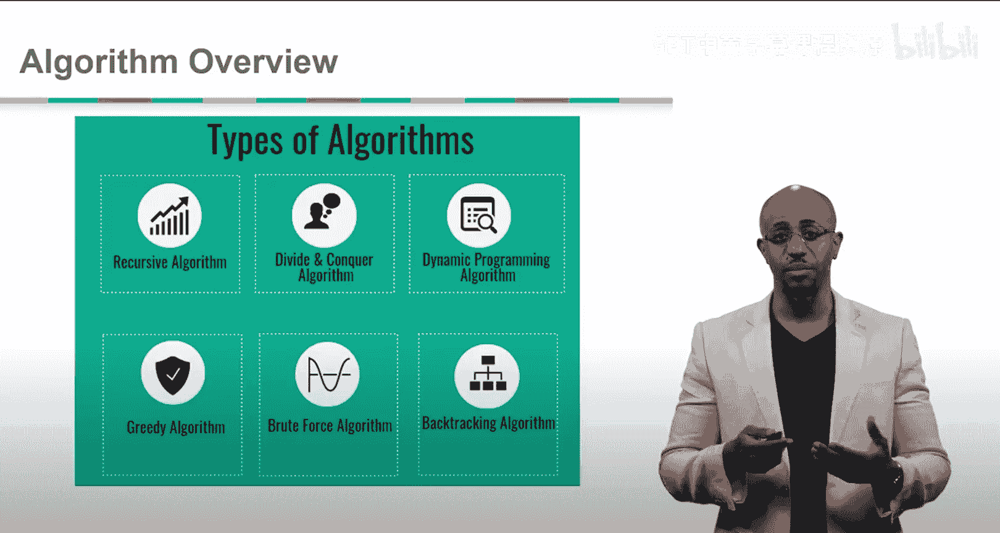
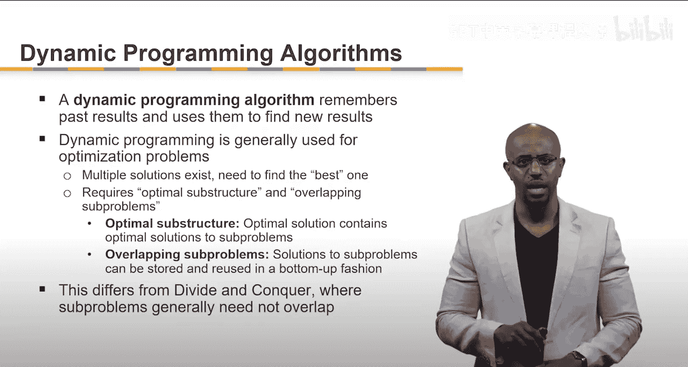
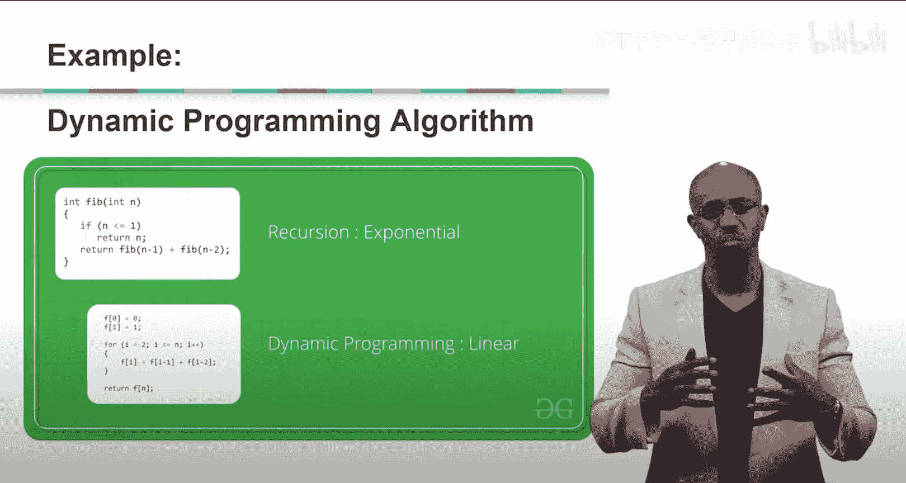
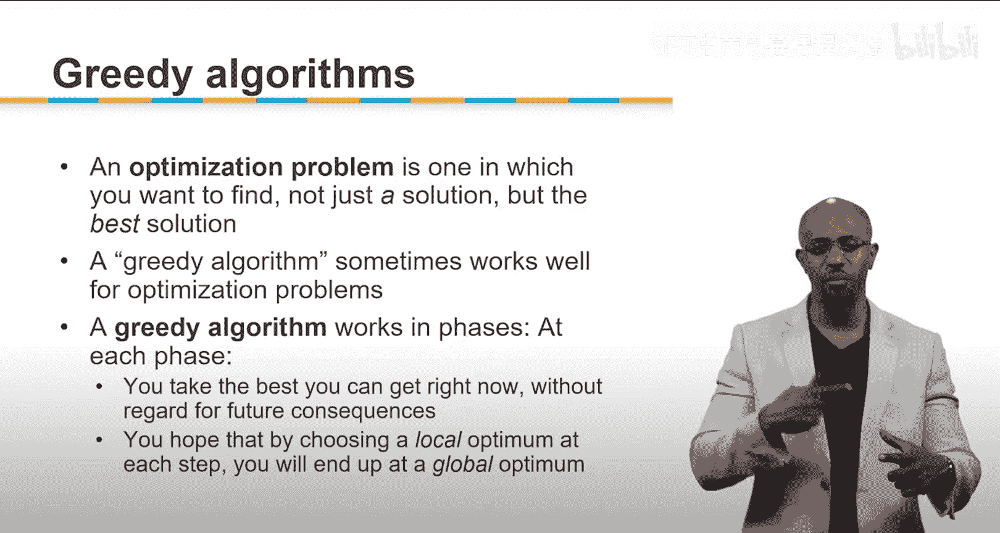
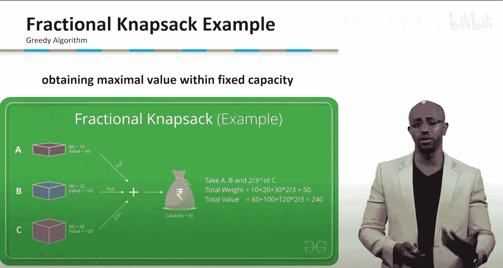
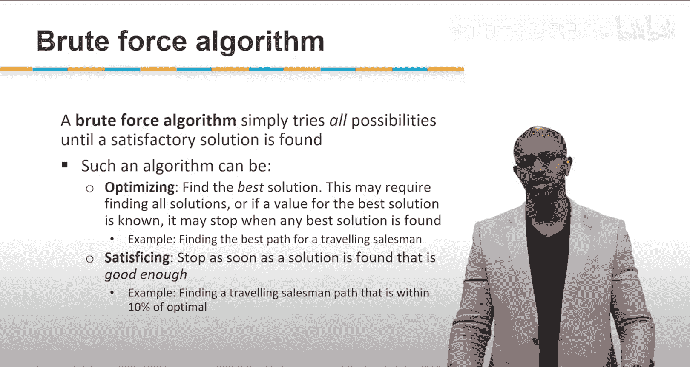
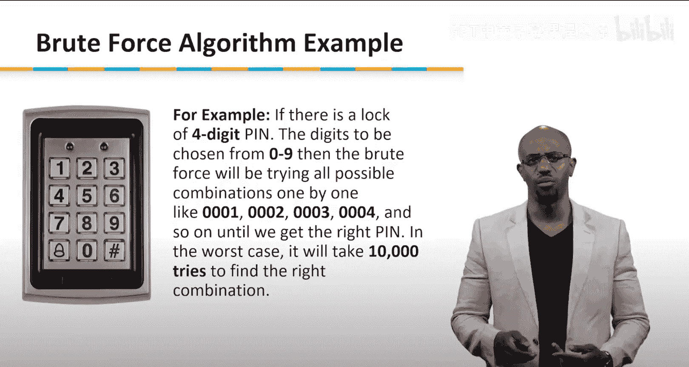
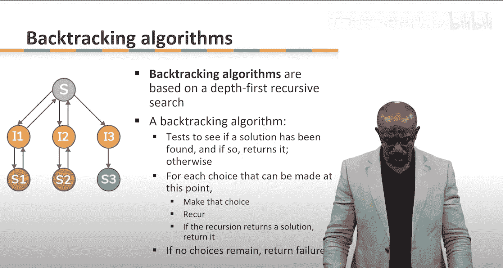

# 亚利桑那州立大学《黑暗数据迁移与架构｜Dark Data Migration and Architecture》中英字幕 p33 32_算法原理概览.zh_en [BV1TkurzMEmm_p33]

In this lesson， we're going to go over some examples of algorithmic thinking by looking at some of our standard algorithms。

 Now we're going to focus on six types of algorithms。

Now there are way more types in these six and in these six there are sub subtypes or categories of types within them sort of a hierarchy so we' going look at recursive algorithms divide divide and conquer algorithms。

 dynamic programming algorithms， greedy algorithms。

 brute force algorithms and backtracking algorithms and in some cases some of these have multiple segments under them as well right so our purpose for just going over these six is we want to focus on some of the algorithms that are more helpful to getting value from dark data more helpful for computational thinking exercises and more helpful for overall problem solving with technology dark data data products so starting with recursive algorithms this is one of our simple and most basic algorithms。

Not the most basic but one of the more simple ones。

 it just it simply requires a process to recursively execute until we get to a problem or a failure or whatever the output might be some of these do require extra work in terms of converting a solution into something simpler or a subpro but as we go into this example。

 the best example is basically your standard F statement and then trying to return that F statement for either checking a list of elements or testing if a value occurs in a list there are other opportunities to use recursive algorithm but this is one of the basic one so we look at like a case of n is less than or equal to one return one then you would basically you would use something like this if if something is coming in decimal points or zeros or negative numbers you just don't want those to populate and you want things to come in as a singular one you would use that but obviously if something was a negative number you may。

want to do a different algorithm to handle that situation。

 which you would expand upon this if it was a part of a set of algorithms to get us to a state where we're able to easily decipher negative numbers versus anything that's zero to one in all in between。

So if we're looking at like testing if a value occurs。

 we just want to see if a value that is equal or less than one occurred and we then deliver that one and we will recursively do it through a list or recursively do it through a program and that's why it's a recursive algorithm so now moving into divide and conquer this consists of two parts you need to divide it and then you need to figure out where your solution or where your solution has failed right so。

One of the things that you want to think about with these divide and conquer algorithms are like the sorting techniques right merge sort。

 quick sort， bubble sort， all those different types of algorithms right so when I think about quick sort I'm thinking about partitioning in the two arrays then going down each array and figuring out how do we need to sort this to get it down into an organized list as you see you have 10。

 8， 30， 90， 40， 50 and 70。If you want to rearrange it。

 you'd use Quick sort to do an ascending or descending merge sort different in the sense that you would cut the array in half and then you would merge each until you get it into ascending or descendending。

You use some of that thinking and computational thinking when you're solving the problem。

 if things need to be rearranged， and as you solve and recursive。

 if things need to be transformed into something different。

 taking like a decimal point and turning it into one or something like that。

Now dynamic programming algorithm， this is one that I use a lot just even in thinking before I even go into solving a problem。

 the reason why is because things in the real world are very gray and things in the real world sometimes have multiple meanings。

When we think about a dynamic programming algorithm these things can get really complex。

 they can get really big they can get really unwieldy so these dynamic programming algorithms。

 you call when you need to decipher a value， understand the value。

 go through a list or create new value store it come back to it later possibly reuse it。

 possibly use it as something that determines other values you can get really fancy with these dynamic programming algorithms and you can repeat these things recursively like similar similar to recursive algorithms and you can repeat and recur smaller segments of these algorithms right so recursive algorithms by nature can sort of fit inside of these dynamic programming algorithms as well you can fit brute force algorithms in here。

 you can combine brute force and recursions inside this one as well as well as other things like bubble sort etc so when you're doing sorting algorithms and you want to put things together in large packages so this is why I。

perersonally use a lot of dynamic programming algorithms and if there was such a thing as dynamic programming。

 algorithmic thinking， I would say I use that， but that's sort of how I go about problem solving。

 being able to store， use， adjust and manipulate values as needed or modify values as needed。

So when we're thinking about dynamic programming algorithms。

 you have optimal substructures and then you have overlapping substructures。

 this differs from divide and conquer because this is more of a thing where you're pulling things together and then dispositioning things as you need them or storing things as you need them to come back to them and it's just many different ways you can use these types of algorithms。

You'll read more in your reading so recursion exponentially then dynamic programming lineararily now this example I want to start or just talk about the second white box at the bottom if you see the Fi equals Fi minus1 plus Fi minus2 and then you're turning in this is you can take this type of a four loop and change it however you would like。

And you can come out with multiple different values and you can see where F0 equals0。

 f1 equals1 and you go in there and you're sort of doing this whole if I equals two and we can append more and more and more values at the end of it with the I plus plus so thinking about this linearly that's one way to look at it and then looking at the top box when you're thinking of it exponentially where linear was just adding one variable to the next one after the other one starting with0 and1。

 the top box。We're looking at if and the n is less than or equal to1。

 and then you're going into lower that lower line where it says return FIB n minus1 and then n minus2。

 you're simply putting things together and it's more exponential because if you repeat it it repeats the same process。

 so going into the greedy algorithms。

This is another one that's good And I use these sometimes as well。

 and you can use these inside of a dynamic programming algorithm as well。

 but greedy is definitely a good algorithm because it allows you to optimally identify value or optimally create value within constraints so when you're thinking about phases and getting things right for the moment and then improving over time。

 greedy algorithms are definitely good and they're definitely good for your algorithmic thinking when you're planning a project and figuring out how to pull data out of something where you don't know what's best and you can only see like for the next rolling wave。

 greedy algorithms are awesome because you can define the constraints。

 you can define what you can do and what your time frame is and how much value you can get out of it So it's good from a thinking perspective and it's good from a tactical engineering perspective。

 So this fractional Naps is a very good example when you're looking at this。

 this fractional Napsack example is saying， how are we gonna to obtain maximum value within a fixed capacity。

😊。

Fixed capacity being 50 and with this you can between A B and C。

 you can see the weight and the value。With the weight being that capacity delimitator。

 so when you look at the equation here， it says take A B and two thirds of C。

 which gives you 10 plus 20 plus 30。And divide that 30 by two thirds and that gives you 50 exactly so if you're trying to get the value out of this fractional knapsack you're going to do AB and two thirdds of C and that's going to get you the most optimal value and then later if you have to do a recursion or if you're plugging this greedy algorithm into a dynamic one you can then cycle this around and pull the rest of the value out of C you can do creative things like that so these two pieces greedy and dynamic algorithms definitely very valuable algorithms that I use a lot when I'm trying to create value。

 especially creating value from dark data。

Brute force algorithm。This is one of those algorithms that are very basic in nature It is literally try all possibilities until you have your solution or solutions found or you have failed right so optimizing satisfaction like how are you looking optimization and then how are you satisfying so finding the best solution and just iteratively going through the possibilities until you find one so find the best path for a traveling salesman the problem with brute force algorithm is they take a lot of time can they can really be a load on a system that can be nonop you can have slow processing and then even if you're working on something like we're saying in the planning or the strategizing the computational thinking process they're okay for some of the smaller things because you just want to get something up and running fast but when you start dealing with really complex data sets。

 they can be a challenge so you want to be careful with brute force algorithms so this example here is a lot as a four- digit pin and the digits are chosen between zero and9。

And basically you just go through all the combinations till you fix till you get to the solution。

 something like that will take 10000 tries right so it would definitely be good in this scenario if you like a relational data table that。

Expelld things that were non possible like we know it can't be all the same numbers so you get rid of those things。

 you know， stuff like that。But you have to figure out how to be creative。

 how to use context to reduce the load on brute force algorithms， backtracking algorithms。

Back trackingrack algorithms are based on depth first recursion search。So you got recursiveness。

 you got a little bit of dynamic programming in there honestly。

 but basically you're going directly down a specific line that's programmed。

You're going deep down there and then you're coming back out if you don't have the solution。

 so you're going down a path， you're coming back out without a solution。

 coming down a path until you come back without a solution until you find that right path where you see that S1 is red。

 S2 is red and then S3 is green so if there was S4 or5 you would stop there and just keep and not necessarily have to test S5 unless you have programally identified the fact that there might need more than one solution。

So basically you're doing all these till no choices remain。 Now example of back tracking algorithm。

 something that's famous is night's tour。 If you look at it8 by8 chess board and you place a night on that chess board。

 the success for the night to have finished this algorithm is the night must visit all square。

 So knowing that night's move。😊，In in L shape where they go up to and over one。

 it will take a lot of moves for the night to visit every square and you have to go down each path until the night sort of hits the edge of the board then you got to go down a different path and a different path and a different path and this is a good example of the nights are the backtracking algorithm and a lot of times backtracking algorithms start with FL statements there can be other things they can you know have the。

Sort of the linear path and they can also have multiple types of arrays and different structures。

 but most of them are just your FLs， et cetera， and thank you for your time。

