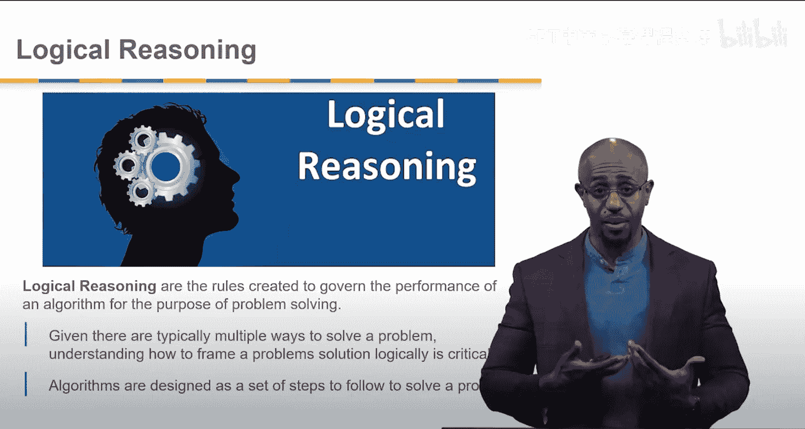
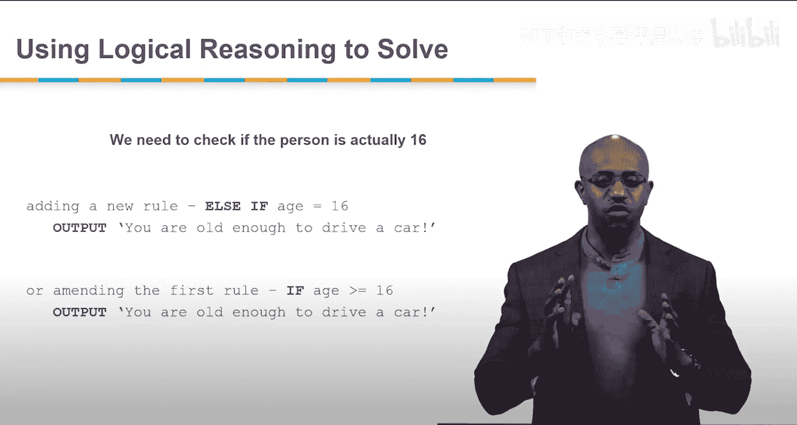

# 亚利桑那州立大学《黑暗数据迁移与架构｜Dark Data Migration and Architecture》中英字幕 p34 33_暗数据逻辑推理.zh_en [BV1TkurzMEmm_p34]

Welcome in this lesson we're going to go over a rudimentary example of logical reasoning and how it applies to algorithms now when we're thinking about logical reasoning it's seeing something that's pretty obvious but it is the set of rules that governs the performance of algorithms。

 algorithmic thinking， our computational thinking and how we're going to get from A to Z a lot of times there are many ways to solve a problem and there are many ways that we can go about creating different paths that have different outcomes as well as perform differently when we think about product design and product delivery。

So when we're thinking about algorithms and algorithms， algorithm and thinking。

 they're designed as a step by step process to get us to that end and logical reasoning is going to help us get there so the example that we're going to use is you know you're 16 and you're starting to drive a car so if we were to put this into an algorithm just to identify if you're old enough to drive a car you would go to a form and you put in your age and then we spit out a result just basically saying if you're old enough or if you're not so you initially store the user's input and then we say an if else right so if the age is greater than 16 then output you are old enough if age is less than 16 an output you are too young to drive a car now as you look at this algorithm there is one issue with this algorithm there's a problem I'd like for you to think about what is the problem with this algorithm and what is the possible failure of this algorithm what it's at。

we'll pause the video and we'll come back to it。All right， welcome back。

 so what did you come up with？First， we need to check if the person is actually 16 the algorithm that you saw on the last slide basically said if you're older than 16。

 if the value is greater than 16， then you are old enough。

 but if it's less then then you are too young or you're not old enough so we can do it one of two ways and here goes the logical reasoning。

 you can add a new rule saying else if at the end of it。Age 16。

 you are old enough to drive a car so adding that check for the exact age。

 or you can amend the first rule by simply adding a greater than or equal to age 16。

Now if I'm going to use my logical reasoning and I want to think about performance of the algorithm and this is a very rudimentary algorithm so either way is's typically going to be okay。

 but when you're thinking about very long or big algorithms that search across large sets of data。

 you're going to want to use the second you're going use the second the second option because that second option is checking for two things at once and you're not adding more length and more criteria to an algorithm that possibly has to deal with billions of configurations so。

When we're thinking of logical reasoning， this is what we want to do。

 we want to focus on how can we optimize algorithms， how can we take the best path forward。

 the most value added path forward and focus on the most optimal solution Thank you for your time。

