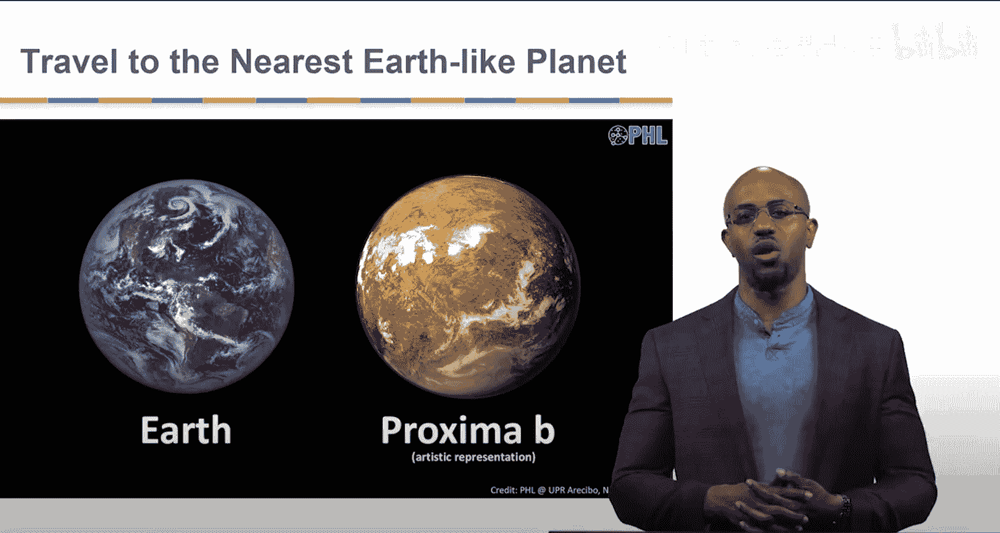
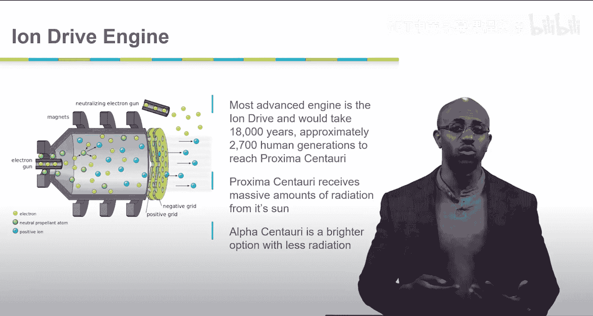

# 亚利桑那州立大学《黑暗数据迁移与架构｜Dark Data Migration and Architecture》中英字幕 p35 34_太空旅行技术难题.zh_en [BV1TkurzMEmm_p35]

Welcome in this lesson， we're going to dive into the problem statement of Proxima B space travel。

Now we have a unique opportunity here because we are tasked with the mission of going from Earth to proxima B。

 which is the closest earth like planet and we are now。

Employees or leaders inside of Latimemore Industries， a fictitious company that we've made up。

 and the company's goal or mission this year is to build a spacecraft that's capable of traveling near speed of light or faster if possible。

 and getting to proxima B within five years or less。Now， as we're looking at this problem statement。

 there's a ton of dark data， there's a ton of exploration。

 there's a ton of things that we need to go out， find out， understand and learn。

 there's a tons of information that we need to get， but at the core。

Atimore industries has five things that they want to make sure they accomplish when they get to proxima B。

Arrive safely， start a self sustaining settlement。The crew needs to be self-sustaining on the spacecraft on the journey there。

 they need to be able to communicate throughout the entire trip。

 they need to be able to transmit data and findings along the trip back to Earth。

 and then the spacecraft and crew need to be able to defend itself against threats one of the key things defending against threats and sustainability once they get there because once they're there。

 they may or may not be coming back， they may just start an entire civilization there。

 which is one of the questions that you may want to ask on this piece。I want to give a few examples。

 so the next few slides are going to be about。Things that you may want to understand or learn as you're doing the exploration and trying to come up with the design and or the step by step computational process of what you will need to do to create a spacecraft to allow us to do that。

Proxima B， proma in chry B orbits a red star， there's actually three stars in the galaxy and the dwarf red Star is the smallest one。

 it's in the habitable zone。the actual proxima surry that red star gives it's a flare star that has intense magnetic electromagnetic radiation。

 surface temperature is below zero consistently。But its distance from from the Earth is 4。

2 light years away， which is  four trillion kilometers these are some things that you'll want to think about when you're trying to discover the dark data and come up with your plan。

Another piece is how are we going to get there what's the engine that's going allow us to get there when we think about a propulsion。

 there's tons of ways you know we have these combustible engines。

 they have an ion drive that has currently been developed and has been deployed this is one of the one of the engines that is the most recent and most powerful and modern times now there are other things that are conceptual and there are other engines that can add to add to our travel right so a few other options for power sources or solar cells magnetic sales the M drive which is in development but has been in development for a while。

嗯。There's the near speed of light that can be achieved through magnetic reconnection。

 which was discovered with Einstein's theory relativity。Theoretically that can get to 99。

9% speed of light， wormhole do they exist， dark matter， dark rockets， theoretical in nature。

 but the use of dark matter should give us the power to get there。

 nuclear food fusion reaction reactors in terms of getting to prox sry。

The idea of a nuclear fusion reactor could get us there in 50 years that doesn't hit our target。

 but it is better than the engines that we have now。

 the engines that we have now will still take about 27，000 years。

 which obviously will put us out of range so when you think about what we need to do。

 how we need to build what needs to come together and even what are the steps that we need to accomplish。

 you have to look through the unknowns， understand the dark data， get a feel for what's out there。

There are a few things if you look up information online you have electromagnetic propulsion。

 you have these things like dark matter or black holes， worm holes， you have iron drives。

 nuclear fission， what are the best ways to do it a few things you'll want to also think about is you have to get off of the ground so our rockets necessary and if you have a rocket you' going put so much weight on its back there's been things floated around like space a spaceship factory on the moon so these are all these types of things you'll want to think about and that would give you a low low gravity environment so。

Take your time， go through the documents provided and we'll see what you come up with。

 thank you for your time。