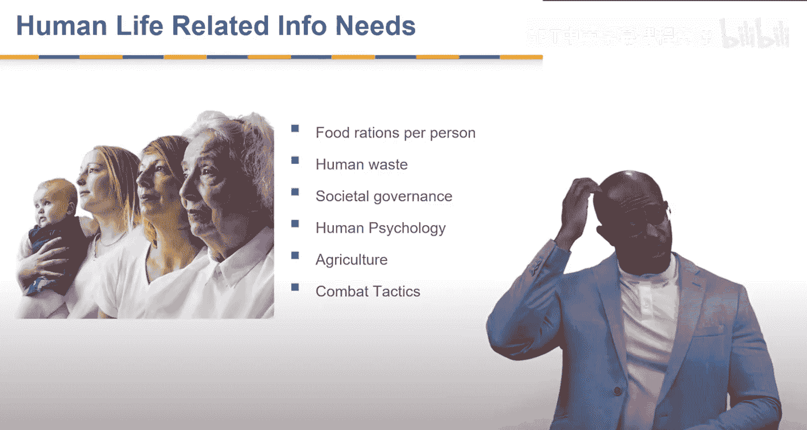
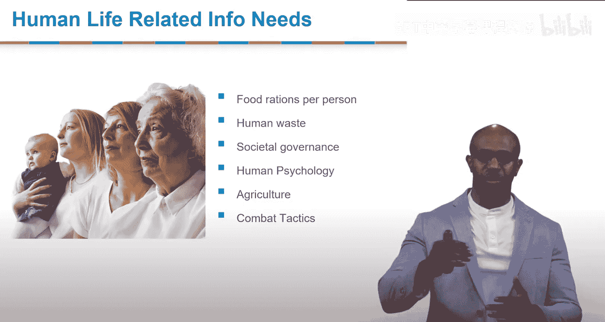
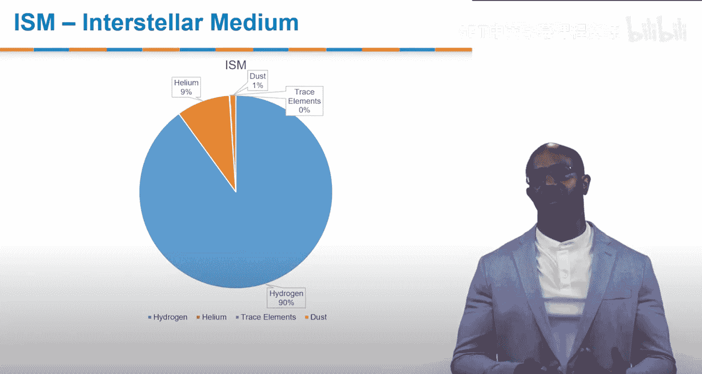

# 亚利桑那州立大学《黑暗数据迁移与架构｜Dark Data Migration and Architecture》中英字幕 p36 35_通用信息与实用技巧.zh_en [BV1TkurzMEmm_p36]

Welcome in this lesson we're going to go over just a few helpful tips and information that you can use to solve this problem Now what I want to do here。

 the purpose of this video is going to be focused on helping you capitalize on the information that's generally out there in the public the information that you can go find and derive and add to the data sets that we have so part of this is going to find the simple and known data adding it to our data and creating that those derivations which are sort of that first tier of dark data right so first we'll talk about human life related info needs now this isn't a comprehensive list this is just a list to allow you to sort of start opining on what you need to capture and apply in relation to the data that we're going to provide you so food rations per person this is something you can find out on survivalist websites or other places。

That tell you about the human biology and human needs， human waste。

 societal and governance this is gonna to be critical because when you think about the trip going across multiple years。

 the people will need to govern themselves in incongruence with help from ground control back here on earth so if you have 2。

000 people on the ship you are bound to have general conflict between people so what do you do if somebody does something untoward what if you do if somebody steals from someone else or worst case if there's some type of assault on the ship do how do you manage these types of situations and what's going to be the societal governance how we deal and treat with each other。

Human psychology right so also what is what do we need to know when we go on these trips so let's say if for example。

 if there was a trip that was if we were going to just use propulsion ships only it may take 80 or 90 years once you once you get to year 30 40 these people are going to start having space babies and those people didn't sign up for this trip so they'll need to know how to psychologically deal with new lives on the ship if it was that case。

Hopefully we get this thing done in to two years there， two years back。

 and in that case you still have psychological needs as it pertains to people dealing with space and delirium。

 etc cea。Agriculture for when you land， combat tactics for land for when you land。

 how do you deal with new and unknown animals that may be aggressive。

 we don't know what we're getting into when we get to these next planets， one thing is for searching。

 if it's possible for a planet to sustain life as it is on that planet。

It's more probable than not that there is some type of life on the planet。

Whether it's intelligent life， whether it's just bacteria， microbes。

 funguss and things like that we don't we wouldn't know but we'll know when we get there。

 so we need to have these types of concepts baked out fully in a good understanding of how we can computationally take the steps to plan and prepare for them and add it to our data set。

Next space and physics related so I want to do this as an example as well。

 there are things like quantum mechanics， the intersstate stellar medium I'm actually going to go into that a little bit that's very critical to the actual traveling。

Shield and deflection， wormhole， particle accelerators， electromagnetism， gravity gravity is huge。

 gravity itself impacts the path that we go if we get too close to a large gravitational body。

 we may get sucked in Also gravity on the human body if we go to a planet and the gravity force is too strong it could crush the human body gravity also has an impact on time dilation。

 So the rate of speed at which we move is impacted by time dilation as well as gravity so if we go to a source that is a planet that's very huge and gravitational force is huge time will move slower there so you can imagine that the generation's pass on earth much faster than it would on that planet and we have those types of issues So the speed and the of gravitational force also impact that time dilation impacts the time component of the trip when we think about the 4。

5 years because if it takes us a month or two months or a year to set up the colony。In totality。

If time on Earth took past in 20 or 30 years， we would then blow away the time span that we have identified and we lose our time call scope right。

 cosmic rays， EM Drive and Warp drive so some of these other opportunities we can use to travel space instead of going linearly。

 we warp space in front of us in behind us and that's information that's out there as well。

Don't want to go over that interstellar medium just at a high level。

 so this is just a high level view of interstellar medium and the reason why understanding this will be important and how you would add this to the data。

 hydrogen， when you think about the space between the celestial bodies， Earth stars。

 although it's primarily empty， it does have things and it's primarily composed of hydrogen。

 90% of it is hydrogen。Now you also have trace elements of other materials。

 1% is dust and 9% is helium， so when you think about dust are these trace elements that would be less than a micrometer and with if you're traveling at the speed of light and you're hit direct on with just something as minimal as something that's the size of a micrometer it could be catastrophe for your space vessel so you have to have the appropriate shielding and you also have the appropriate shielding not only against interstellar medium but against cosmic rays to reduce radiation so thank you for your time。

